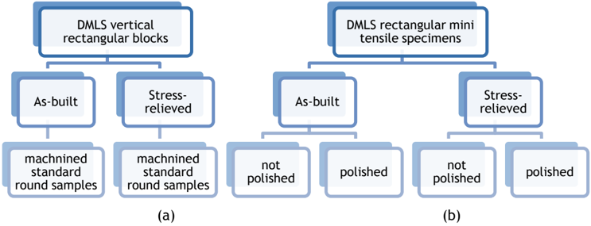
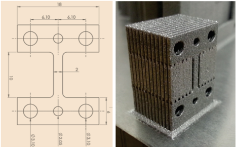
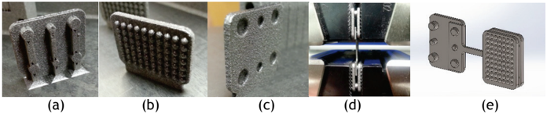
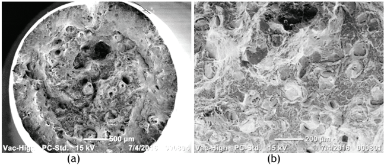
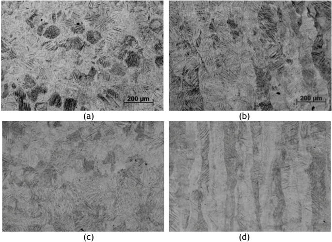
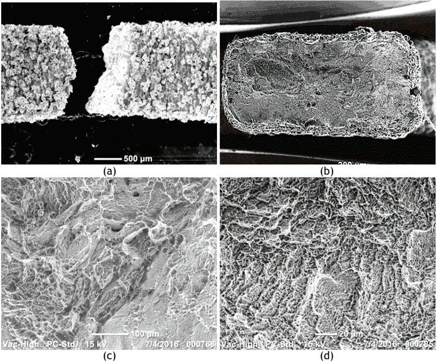
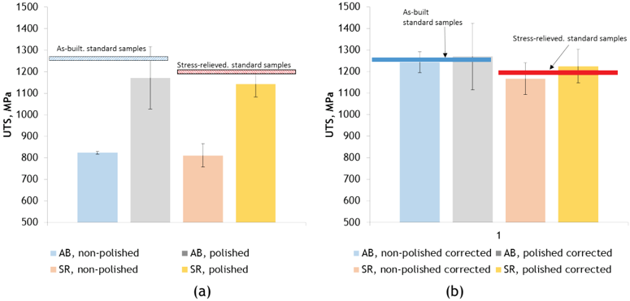
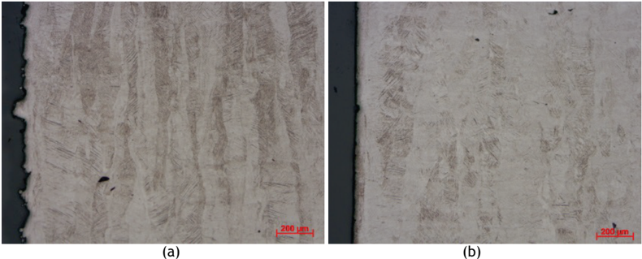

## VALIDATION OF MINIATURISED TENSILE TESTING ON DMLS TI6AL4V (ELI) SPECIMENS

I. van Zyl 1# , M. Moletsane 1 , P. Krakhmalev 2 , I. Yadroitsava 1*  &amp; I. Yadroitsev 1

## ARTICLE INFO

## Article details

Presented at the 17 th annual international conference of the Rapid Product Development Association of South Africa (RAPDASA), held from 2-4 November 2016 in Vanderbijlpark, South Africa

Available online

11 Nov 2016

## Contact details

* Corresponding author iyadroitsava@cut.ac.za

## Author affiliations

- 1 Department of Mechanical and Mechatronic Engineering, Central University of Technology, Bloemfontein, Free State, South Africa
- 2 Department of Engineering and Physics, Karlstad University, Sweden
- # The author was enrolled for an M Tech degree in the Department of Department of Mechanical and Mechatronic Engineering, University of Central University of Technology, Free State, South Africa.

## DOI

http://dx.doi.org/10.7166/27-3-1666

## 1 INTRODUCTION

Direct metal laser sintering (DMLS) is a powder bed fusion process used to make metal parts directly from metal powders. It is an automated process that provides a platform for the production of complex  three-dimensional  geometries.  Three-dimensional  scans  or  CAD  data  are  sliced  into multiple layers via software. Using this data, the machine parameters are calculated and/or chosen for the building process. First a thin layer of powder is deposited onto the building platform, after which it is scanned by the electronically-controlled laser, and the exposed area is melted by the laser  beam,  matching  the  contour  area  of  the  sliced  2D  data.  The  next  layer  is  deposited  and exposed, which fuses with the previous sintered area and, in so doing, a 3D part is built up.

During DMLS, a very small molten pool is formed that results in a large thermal gradient at high scan speeds.  The  microstructure  and  mechanical  properties  obtained  in  DMLS  are  unique,  and  are

## ABSTRACT

Direct metal laser sintering (DMLS) is a relatively new technology that  is  developing  rapidly.  Since  DMLS  material  is  created  by melting/solidifying tracks and layers from powder, even building geometry  can  influence  the  mechanical  properties.  To  certify  a material, the testing specimens must be designed and manufactured according to the appropriate standards. Miniaturised tensile  DMLS  samples  could  be  a  good  alternative  for  express quality control, and could reduce the cost of DMLS-specific testing. In this study, as-built and stress-relieved miniaturised tensile DMLS Ti6Al4V  (ELI)  specimens  with  different  surface  qualities  were investigated. The fracture surfaces and mechanical properties of the  mini-tensile  specimens  were  analysed  and  compared  with standard  full-sized  specimens  also  manufactured  by  DMLS.  The obtained data showed the applicability of mini-tensile tests for the express analysis of DMLS objects if a correction factor is applied for the calculation of the load-bearing cross-section of the specimen.

## OPSOMMING

Direkte lasermetaalsintering is ʼn nuwe vervaardigingstegniek wat vinnig ontwikkel. Aangesien onderdele met die tegniek vervaardig word deur poeier te smelt en dan weer te laat stol is dit belangrik dat  die  bougeometrie  eweredig  is,  om  sodoende  die  verlangde meganiese  eienskappe  te bewerkstellig.  Om  ʼn  materiaal  te sertifiseer moet toetsmonsters ontwerp en vervaardig word volgens toepaslike  standaarde.  Miniature  trekmonsters  wat  met  direkte lasermetaalsintering vervaardig is, kan ʼn goeie alter natief wees om gehaltebeheer te versnel. Hierdie studie gebruik onbehandelde- en spanningsverligte Ti6Al4V monsters met verskillende oppervlakafwerkings. Die kraakoppervlakke en meganiese eienskappe  van  die  miniatuurtoetsmonsters  is  geanaliseer  en vergelyk  met  standaard,  volgrootte  monsters  ook  met  direkte lasermetaalsintering vervaardig. Die data toon dat die toepassing van miniatuur trektoetse vir versnelde analise van direkte lasermetaalsintering  voorwerpe  geldig  is  wanneer  ʼn  korreksie faktor  toegepas  word  op  die  lasdraende  deursnee-oppervlak  van die monster.

influenced by different process parameters. Machine-based input parameters are also crucial to the stability  of  the  building  process,  such  as  the  laser  type  and  its  mode  and  spot  size,  protective atmosphere and its flows, delivering system, and even the substrate surface prior to exposure [1].

As-built DMLS samples can have anisotropy in mechanical properties, since DMLS is a layer-by-layer powder technology. Along with the defects inherent to non-optimal process parameters, there is a second important aspect that strongly influences the quality of the SLM material: internal stresses resulting from rapid solidification during the process. The mechanical properties of DMLS material depend on the specimen geometry, build orientation, and surface finish [2]. The DMLS surfaces are very rough, especially those that are not parallel to the building platform where powder attaches with sintered material.

Titanium alloys have two main benefits for biomedical applications: good corrosion resistance, and a high strength-to-weight ratio. Medical implants made of titanium alloys are strong, lightweight, corrosion-resistant, long-lasting, and non-ferromagnetic; and they accommodate the possibility of osseointegration. The development of biocompatible materials and new processes, such as DMLS, have resulted in significant progress in customised design and a reduction in the production time of implants and prostheses, without compromising functionality.

The capacity of DMLS to manufacture medical devices with complex shapes, in combination with the unique  properties  of  titanium  alloys,  holds  great  promise  for  the  medical  industry.  Ti6Al4V components,  produced  by  DMLS,  have  to  comply  with  international  standards  for  biomedical applications. Different process parameters, the orientation of the object, and its design features can influence the mechanical properties (Table 1). It is therefore of paramount importance that designers know the mechanical properties of every part produced in order to ensure a safe and appropriate application. Ti6Al4V, being a heat-treatable alloy, makes it attractive for the DMLS application  because  post-processing  can  produce  a  variety  of  different  properties  for  specific applications  [3-5].  D ue  to  very  fine  martensitic  α'  microstructure  with  the  texture  in  the  build direction, the DMLS object should also be heat-treated differently from wrought alloy parts.

Table 1: Mechanical properties of Ti6Al4V vertical samples produced by DMLS

|                                                                                         | Specimen labels   | YS, MPa   | Young's modulus, GPa   | UTS, MPa   | Elongation, %   |
|-----------------------------------------------------------------------------------------|-------------------|-----------|------------------------|------------|-----------------|
| [2]                                                                                     | As-built          | 1070 ± 50 | 110 ± 10               | 1200 ± 50  | 11 ± 2          |
| [2]                                                                                     | Annealed*         | 1000 ± 20 | 114 ± 10               | 1060 ± 20  | 15 ± 1          |
| [3]                                                                                     | As-built          | 1143 ± 30 |                        | 1219 ± 20  | 4.89 ± 0.6      |
| [6]                                                                                     | As-built          | 962 ± 47  | 102 ± 7                | 1166 ± 25  | 1.7 ± 0.3       |
| [7]                                                                                     | As-built          | 664-802   | 99-121.6               | 1040- 1062 | 11.3-12.7       |
| Standard specification for Ti6Al4V alloy castings for surgical implants - ASTM F1108-14 |                   | Min 758   |                        | Min 860    | Min 8           |

## 1.1 Tensile mechanical tests

## 1.1.1 Standard tensile specimens

Tension tests  provide  information  about  certain  material  properties  of  test  specimens:  ultimate tensile strength (UTS), the yield stress (YS), and elongation. With the use of an extensometer, it can also provide the Young's modulus and strain rate of the material being tested. For manufacturing, uniaxial tensile stresses can be used in alloy development, quality control, and design under certain circumstances. Standard  Test  Methods  for  Tension  Testing  of  Metallic  Materials  E8/E8M [8] describes the tension testing of metallic materials at room temperature; specifically, the methods of determination of YTS, UTS, elongation, and reduction of area. As indicated, ASTM E8 specimens smaller than 6 mm diameter can be used when tested material is too small or 'when all parties agree to their use for acceptance testing' [8].

## 1.1.2 Mini-specimens

The grips used were wedge-type grips in the case of the miniature samples. This can result in small inconsistencies in the stress measurement, although it has a more significant effect on the YS and an even greater effect on the Young's modulus [ 9]; as a result, the data provided UTS and elongation, as these remain relatively unaffected.

Roughness, notches, or any impurities in the samples can affect the results. Kashaev et al. [10] have shown that micro-fatigue specimens have a fatigue life similar to that of standard specimens if the cross-sections of the mini-specimens are corrected for roughness.

The  aim  of  the  present  study  is  to  determine  the  possibility  of  using  as-built  and  polished miniaturised samples for defining the basic properties of DMLS Ti6Al4V (ELI) alloy before and after stress relieving.

## 2 MATERIALS AND METHODS

The Ti6Al4V (ELI) powder used was pre-alloyed gas atomised powder. The chemical composition was as follows: Ti - balance, Al - 6.34%, V -3.94%, O - 0.058%, N - 0.006%, H - 0.001%, Fe - 0.25%, C 0.006%, and Y and Zn less than 0.001% (weight %). The equivalent diameters (weighted by volume) of the powder particles were d10 = 13 μm, d50 = 23 μm , and d90 = 37 μm.

Ti6Al4V samples were produced by the EOSINT M280 system (EOS GmbH). A back-and-forth scanning by strips (5 mm width) with the hatch distance of 100 μm was applied to manufacturing specimens with  30 µ m  layer  thickness.  The  substrate  and  powder  materials  were  similar  in  chemical composition. Argon was used as the protective atmosphere; the oxygen level in the chamber was 0.05-0.09 per cent.

Ten vertical standard round samples with threaded ends were machined from SLM rectangular bars with dimensions of 11 mm x 11 mm x 62 mm according to the recommendations of ASTM E8, with a gauge length four to five times the diameter; the specimen 's diameter was 4.3 - 4.5 mm. Surface roughness for the standard round machined samples was 4.8 ± 0.63 µ m (Rz), and Ra was 0.8 ± 0.13 µ m. Five bars were subjected to a stress-relieving procedure (Figure 1a). Tensile tests were performed with  an  Instron  1342  servo-hydraulic  testing  machine  with  circular  locked  grips  and  a  clip-on extensometer of 12.5 mm under a constant strain rate of 1.5 mm/min.

Figure 1: Design of the experiment

Sixteen  rectangular  pin-loaded  mini-samples  of  10  mm  gauge  length,  2  mm  width,  and  1  mm thickness were built directly at the same process-parameters by the EOSINT M280 system (Figure 2b). The dimensions of the tensile mini-samples are shown in Figures 2a and 2b. Tensile tests were performed with an MTS Criterion Model 43 electric testing machine with wedge grips and without extensometer under a constant strain rate of 0.25 mm/min. Clamping of the miniature samples for the purpose of tensile testing was done via customised inserts, as seen in Figures 3a-e.

Heat treatment for stress-relieving of all specimens was done in an Argon atmosphere at 650°C for 3 hours.

Figure 2: Dimensions sketch of mini-specimens (a) and as-built mini-specimens (b)

Figure 3: Insert with pins (a); grip surface (b); insert with cavity (c); mini-specimen setup with inserts and wedge grips tightened (d); and computer model of specimen and inserts (e)

## 3 RESULTS AND DISCUSSION

The mechanical properties of standard samples manufactured vertically show excellent mechanical properties (Table 2). For standard round specimens, the Young's modulus was defined as a chord between 200 MPa and 800 MPa, and tensile stress at Yield was defined at offset 0.2 per cent of the Young's modulus.  As  was  indicated  by  Frey et  al. [2],  round  machined  samples  give  relatively consistent and reliable data for DMLS specimens.

Table 2: Tensile properties of Ti6Al4V ELI of as-built DMLS parts at EOS-prescribed process parameters

| Specimen labels          | Specimen labels   | YS, MPa    | Young's modulus, GPa   | UTS, MPa   | Elongation, %   |
|--------------------------|-------------------|------------|------------------------|------------|-----------------|
| Standard round specimens | As-built          | 1105 ± 9.1 | 109 ± 1.5              | 1238 ± 8.9 | 10.74 ± 0.7     |
| Standard round specimens | Stress-relieved   | 1098 ± 8.1 | 115.8 ± 1              | 1171.6 ± 6 | 11.89 ± 1       |

The analysis of the fracture surfaces of standard machined vertical samples showed that a cup-andcone shape of the necking region was observed in the as-built and stress-relieved samples. The region of fibrous fracture was in the central area of the neck (Figure 4a). The fibrous zone was irregular, with dimple rupture fracture; quasi-cleavage facets were also visible with SEM (Figure 4b). The mechanism of ductile fracture and the formation of a cup-and-cone shape in the necking region are usually associated with pore coalescence.

According to the building strategy, all the specimens were built vertically, which meant that the columnar primary β grains also grew nearly parallel to the building direction [11]. With respect to the  specimen  geometry  and  test  arrangement,  the  columnar  primary  beta  grains  were  oriented parallel  to  the  load  application  direction.  Under  these  conditions,  a  crack  formed  due  to  pore coalescence propagates perpendicular to the columnar primary ß grains. In Figure 4b it is seen that when  the  crack  reaches  primary  ß  grain  boundaries  or  pores,  the  growth  direction  is  changed. Therefore, the interface acts as a crack deflector that prevents quick failure. This conclusion is in agreement with the results presented by Wen et al. [12].

Figure 4: Fracture surface of standard vertical samples: (a) cup-and-cone shape; and fracture surface at higher magnification (b)

An examination of the tensile fracture surfaces and a comparison of the polished cross-sections of the mini-specimens by SEM revealed the specific role of macro- and micro-structure caused by the nature of the layer-by-layer DMLS. For the mini-samples, primary ß grains were oriented along the building direction (Figure 5) and had a smaller size than in the standard samples produced from bars. Representative fractographs of the tensile fracture surfaces for the mini-samples are shown in Figure 6. On the whole, the rectangular mini-samples showed surface fractures similar to those in the standard specimens. The finer scale topography of the fracture surface and shallower dimples were observed in the fibre zones in comparison with the standard samples (Figures 4 and 6c &amp; 6d). A clearly observed quasi-cleavage fracture mode indicates a brittle component of fracture. Unlike in the standard specimens, a columnar microstructure is not obvious at the fracture surface. It could be associated with the finer microstructure of the mini-specimens. An estimation of the column width done by an intercept method showed that the standard specimen columns had 120 µm average width, while in the mini-specimens this value was about 100 µm.

Figure 5: Cross-section of the stress-relieved standard (a, b) and mini-samples (c, d) perpendicular to the building direction (a, c) and along the building direction (b, d)

Figure 6: Fracture of as-built mini-samples (a, c) and after stress-relieving heat treatment (b, d)

Figure 7: UTS for standard and mini-samples without application of the effective load-bearing cross-section (a) and corrected UTS (b)

To investigate the influence of surface finish on the tensile properties of the mini-samples, both asbuilt and stress-relieved specimens were tested, with non-polished and polished surfaces. The minisamples after polishing showed lower values for UTS than did the standard samples (Figure 7a). The UTS for the non-polished as-built specimens was 50 per cent lower than in the standard specimens. After stress-relieving, the UTS of the un-polished specimens was 45 per cent lower. After polishing, UTS increased (Table 3), but was still six per cent and three per cent lower (for the as-built and the stress-relieved specimens respectively) than for the standard samples.

For the mini-samples, high roughness could be a crucial factor in the load-bearing cross-section. Attached partially-melted powder particles were found at the surfaces of the non-polished samples, and formed an irregular surface layer. The thickness of this layer was about 100 µ m, and could be estimated in terms of the surface roughness characteristics as having a mean roughness depth Rz . As was shown by Kashaev et  al. [10],  it  is  possible  to  introduce  a  correction  factor  to  estimate  an effective load-bearing cross-section, Aeff ,:

$$A _ { e f f } = ( S - 2 R _ { z } ) \cdot ( W - 2 R _ { z } ) \\ ( i \cdot b h _ { e f f } ) ^ { 2 } + ( 1 - 6 \cdot b h _ { e f f } ) \cdot ( W - 2 R _ { z } )$$

where S is the thickness and W is the width of the mini-specimen.

Table 3: Tensile properties of Ti6Al4V ELI of as-built DMLS parts at EOS-prescribed process parameters

| labels                   | labels                  | Roughness   | Roughness    | UTS,       | Elongation,   |
|--------------------------|-------------------------|-------------|--------------|------------|---------------|
| Specimen                 | Specimen                | Ra, µm      | Rz, µm       | MPa        | %             |
| Standard round specimens | As-built                | 0.76 ± 0.13 | 4.8 ± 0.6    | 1238 ± 9   | 10.74 ± 0.7   |
| Standard round specimens | Stress-relieved         | 0.76 ± 0.13 | 4.8 ± 0.6    | 1172 ± 6   | 11.89 ± 1     |
| Non-polished samples     | As-built                | 21.7 ± 4.37 | 125.2+20.49  | 823 ± 8    | 6.6 ± 0.4     |
| Non-polished samples     | Cross-section corrected | 21.7 ± 4.37 | 125.2+20.49  | 1243 ± 49  | 6.6 ± 0.4     |
| Non-polished samples     | Stress-relieved         | 18.3 ± 3.79 | 109.2 ± 24.1 | 811 ± 54   | 6.4 ± 1.4     |
| Non-polished samples     | Cross-section corrected | 18.3 ± 3.79 | 109.2 ± 24.1 | 1167 ± 74  | 6.4 ± 1.4     |
| Polished                 | As-built                | 3.5 ± 1.11  | 21.9 ± 7.16  | 1172 ± 144 | 6 ± 0.9       |
| Polished                 | Cross-section corrected | 3.5 ± 1.11  | 21.9 ± 7.16  | 1270 ± 154 | 6 ± 0.9       |
| Polished                 | Stress-relieved         | 3.3 ± 0.91  | 19.2 ± 7.75  | 1143 ± 60  | 5.5 ± 0.4     |
| Polished                 | Cross-section corrected | 3.3 ± 0.91  | 19.2 ± 7.75  | 1230 ± 78  | 5.5 ± 0.4     |

Applying the effective load-bearing cross-section to the experimental data obtained for the minispecimens showed results closer to UTS values received for the standard round samples (Table 3). It is  also  seen  that  this  approach is effective for the polished specimens, as some residual surface roughness  remains  after  polishing  (Figure  8).  Differences  between  the  obtained  elongations  at breakpoint for the standard and mini-samples are attributed to the shape of the samples and size effects, and are not related to surface quality. It is seen that ductility characteristics are about the same for the polished and the non-polished specimens.

Figure 8: Cross-section of mini-samples (a) before and (b) after polishing along building direction

Besides surface roughness, a microstructural factor could also influence mechanical testing results. It has been shown by Antonysamy et al. [13] that the microstructure of Ti6Al4V in the regions near side surfaces differs from the regular bulk regions. In regions close to the side surface, the primary beta  phase  does  not  form  regular  vertical  grains.  Instead,  some  deviations  from  the  vertical crystallisation  direction  have  been  observed.  This  could  be  related  to  a  change  of  solidification conditions and the direction of the thermal gradient. In the present investigation, this effect was not  observed.  Probably  due  to  other  manufacturing  parameters,  primary β also  formed  almost vertical columnar structures in regions very close to the irregular side surfaces; in the near-surface region, however, the grains are finer.

Figure 8 shows that surface polishing did not remove the material deeply enough to eliminate the influences  of  the  side  microstructure.  Nevertheless,  according  to  the  experimentally-obtained mechanical properties, the differences in microstructure observed in this region apparently have a negligible  influence  on  the  mechanical  properties  of  the  mini-samples.  To  confirm  this,  a comparative analysis of mini-specimens with and without obvious differences in microstructure in the side surface region is necessary.

## 4 CONCLUSIONS

The  tests  done  show  that,  even  on  a  small  scale  (with  a  width  of  about  10  single  tracks),  the construction  of  DMLS  components  is  strong  and  reliable.  This  testifies  to  the  sound  process parameters.

The mini-samples are effective for the determination of the basic properties of DMLS material. The samples  were  found  to  be  relatively  consistent  with  all  the  failures  occurring  within  the  gauge length. Nevertheless, due to the attached partially-melted powder layer on the side surfaces of the vertically-built samples, a correction of data is required.

Surface  polishing  was  not  found  to  be  sufficient  for  improving  the  reliability  of  the  measured mechanical data (deviation from standard 15-20%) due to possible residual surface roughness. The results  corrected  with  respect  to  the  effective  load-bearing  cross-section Aeff were  found  to  be closest to the values obtained with reference standard tensile specimens (deviation from standard 5-7 per cent).

Further  microstructural  analysis  has  to  be  done  to  investigate  the  effect  of  the  orientation  of primary β grains and texture in the mini-samples from Ti6Al4V. This data will be helpful for micromanufacturing by DMLS.

## ACKNOWLEDGEMENTS

This work is based on research supported by the South African Research Chairs Initiative of the Department  of  Science  and  Technology  and  the  National  Research  Foundation  of  South  Africa (Grant №97994) and the Collaborative Program me in Additive Manufacturing (Contract №CSIR -NLCCPAM-15-MOA-CUT-01).  The  authors  express  their  gratitude  to  Chris  McDuling  at  the  CSIR  for mechanical testing and technical input.

## REFERENCES

- [1] Yadroitsev, I. 2009. Selective laser melting: Direct manufacturing of 3D-objects by selective laser melting of metal powders. Saarbrucken: LAP Lambert Academic Publishing AG &amp; Co. KG.
- [2] Frey, M., Shellabear, M. and Thorsson, L. 2009. Mechanical testing of DMLS parts. EOS whitepaper, EOS GmbH Electro Optical Systems, Munich.
- [3] Rafi, H., Karthik, N.V., Gong, H., Starr, T.L. and Stucker, B.E. 2013. Microstructures and mechanical properties of Ti6Al4V parts fabricated by selective laser melting and electron beam melting. Journal of Materials Engineering and Performance , 22, pp. 3873-3883.
- [4] Vrancken, B., Thijs, L., Kruth, J.P. and Van Humbeeck, J. 2012. Heat treatment of Ti6Al4V produced by selective laser melting. Journal of Alloys and Compounds, 541, pp. 177-185.
- [5] Yadroitsev,  I.,  Krakhmalev,  P.  and  Yadroitsava,  I. 2014  Selective  laser  melting  of  Ti6Al4V  alloy  for biomedical applications: Temperature monitoring and microstructural evolution. Journal of Alloys and Compounds , 583, pp. 404-409.
- [6] Vilaro, T., Colin, C. and Bartout, J.D. 2011. As-fabricated and heat-treated microstructures of the Ti-6Al4V alloy processed by selective laser melting. Metallurgical and Materials Transactions A, 42, pp. 31903199.
- [7] Kasperovich,  G.  and  Hausmann,  J. 2015.  Improvement  of  fatigue  resistance  and  ductility  of  TiAl6V4 processed by selective laser melting. Journal of Materials Processing Technology, 220, pp. 202-214.
- [8] ASTM  E8  /  E8M-16a ,  2016, Standard  Test  Methods  for  Tension  Testing  of  Metallic  Materials ,  ASTM International, West Conshohocken, PA, www.astm.org
- [9] Jia,  N.  and  Kagan,  V.A. 1999.  Interpretations  of  tensile  properties  of  polyamide  6  and  PET  based thermoplastics using  ASTM  and  ISO  procedures.  In: Peraro,  J.S.  (ed.) Limitations  of  test  methods  for plastics , ASTM STP 1369. West Conshohocken, PA: American Society for Testing and Materials.

- [10] Kashaev, N., Horstmann, M., Ventzke, V. and Riekehr, S.H.N. 2013. Comparative study of mechanical properties using standard and micro-specimens of base materials Inconel 625, Inconel 718 and Ti-6Al-4V. Journal of Materials Research and Technology , 2(1), pp. 43-47.
- [11] Simonelli, M. 2014. Microstructure evolution and mechanical properties of selective laser melted Ti-6Al4V. PhD thesis, Loughborough University, UK.
- [12] Wen, S., Li, S., Wei, Q., Yan, C., Zhang, S. and Shi, Y. 2014. Effect of molten pool boundaries on the mechanical properties of selective laser melting parts . Journal of Materials Processing Technology , 214, pp. 2660-2667.
- [13] Antonysamy, A.A., Meyer, J. and Prangnell, P.B. 2013. Effect of build geometry on the grain structure and  texture  in  additve  manufacture  of  Ti6Al4V  by  selective  electron  beam  melting. Materials Characterization, 84, pp. 153-168.