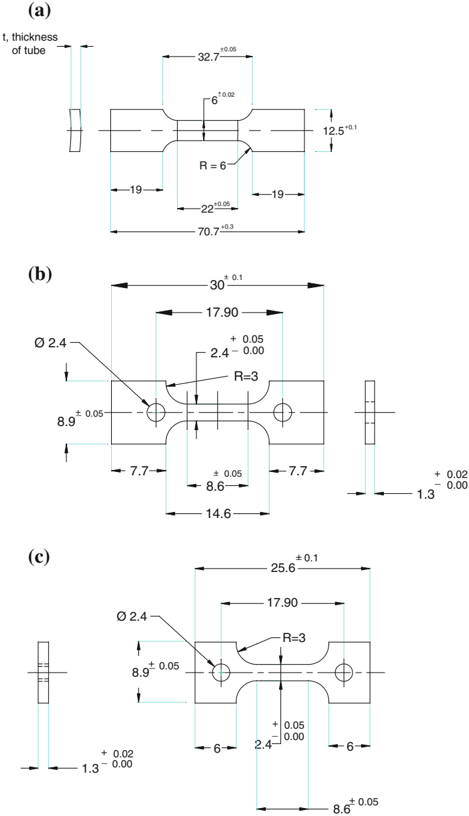
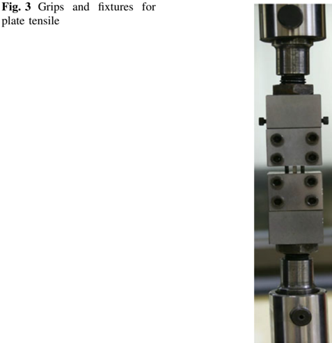
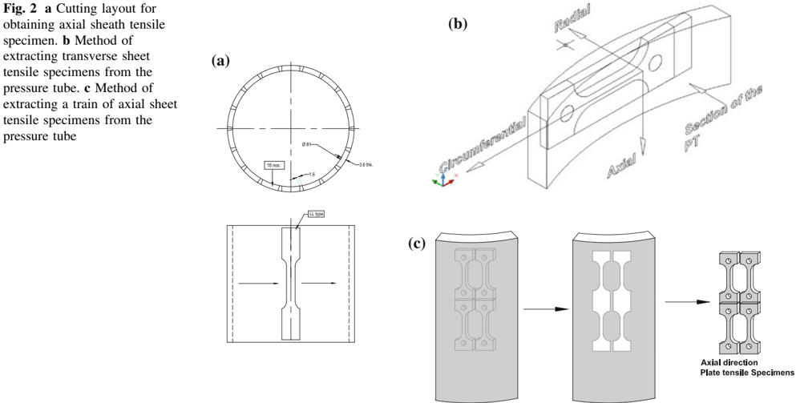
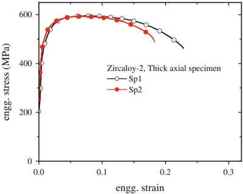
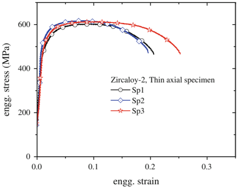
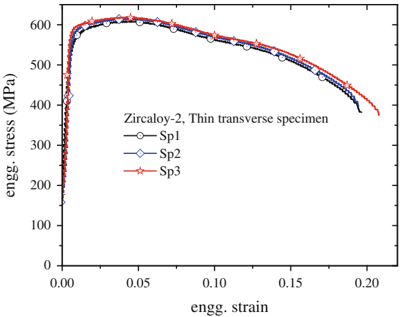
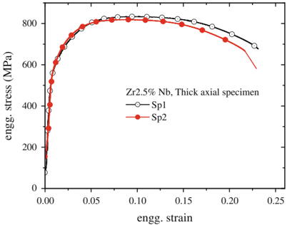
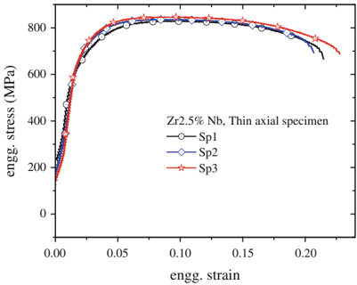
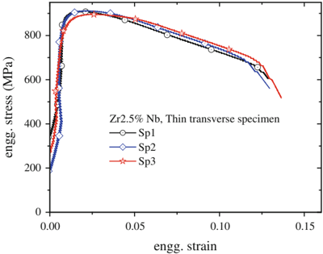

## TECHNICAL PAPER

TP 2735

## Suitability of Miniature Tensile Specimens for Estimating

## the Mechanical Property Data of Pressure Tubes: An Assessment

K. S. Balakrishnan · M. K. Samal · J. Parashar · G. P. Tiwari · S. Anatharaman

Received: 12 October 2012 / Accepted: 19 March 2013 / Published online: 29 August 2013 Ó Indian Institute of Metals 2013

Abstract The integrity assessment of nuclear reactor pressure tubes (PTs) used in pressurized heavy water reactors necessitates the determination of their tensile property data. This in turn will require the employment of appropriate specimens that can be fabricated from them. If this is to be done on the material in the irradiated condition it will be essential to resort to sub-size or miniature sized specimens which need to be designed and tested to prove its efficacy in providing the correct output. With this aim in view two different sheet type tensile specimens were designed for estimating the tensile property data of both axial and circumferential directions of the PT. As the raw material was in the form of tube, sheath type tensile specimens with 25 mm gauge length and having the full thickness of the tube were designed for axial direction of the PT as per the broad guidelines of ASTM Std. A370 and tested as per ASTM Std. E8. Thus the output generated from the axial sheath tensile specimens would serve the purpose of providing standard and reliable tensile property data of the material and that too at the component level. The data from the axial sheet tensile specimens were found to match very well when compared with those from the

K. S. Balakrishnan  G. P. Tiwari  S. Anatharaman Post Irradiation Examination Division, Bhabha Atomic Research Centre, Trombay, Mumbai 400085, India

M. K. Samal ( &amp; ) Reactor Safety Division, Bhabha Atomic Research Centre, Trombay, Mumbai 400085, India e-mail: mksamal@yahoo.com; mksamal@barc.gov.in

J. Parashar

Department of Physics, SATI, Vidisha, Bhopal, Madhya Pradesh 464001, India sheath specimens thus proving not only the veracity of the data but also the transferability of such data from miniature specimens to that at the component level. Hence, sheet tensile specimens prepared in the circumferential direction of the PT alone were utilized to obtain the transverse tensile property data of the PT. This approach was employed in the case of both Zr-2 and Zr-2.5 % Nb PTs in the unirradiated condition.

Keywords Mechanical properties  Zirconium alloy  Pressure tube material  Anisotropy in mechanical properties

## 1 Introduction

Pressurized heavy water reactors (PHWRs) are the mainstay of Indian nuclear power programme. Zirconium based alloys are widely used in these reactors as materials for ding for the fuel elements. These alloys have very low neutron absorption cross-section and excellent corrosion resistance besides the properties of good compatibility with the coolant and fuel along with adequate mechanical properties.

The PTs of Indian PHWRs are made up of zirconium alloys such as Zircaloy-2 (in older type of reactors) and Zr-2.5 % Nb (in newer type of reactors especially from Kakrapar Atomic Power Station (KAPS) onwards) [1]. These tubes carry fuel bundles which contain the natural uranium dioxide fuel inside the fuel pins/elements. These tubes are of 82 mm diameter (internal) and have a wall thickness of 4.3 mm approximately in the case of Zircaloy2 and 3.6 mm for Zr-2.5 % Nb type. The tubes are normally subjected to internal pressure of 10.3 MPa and temperature of 300 ° C approximately during the reactor operation in addition to the radiation and corrosive environment. It is essential to ensure the integrity of the PT so as to assure the safe operation of the reactor as it is a primary pressure boundary material in the PHWR system. Such an assessment becomes all the more important because the severe conditions of pressure, temperature, radiation and corrosive environment experienced by them during their prolonged service life in the reactor would considerably affect their operational efficiency thereby making them unable to carry out the intended function after a certain period [2-9]. The integrity assessment of the PT would make it necessary to estimate their mechanical properties (i.e. yield strength, ultimate tensile strength and ductility) periodically.

The estimation of mechanical property data would primarily call for suitable test specimens to be made available. Extraction of standard test specimens out of an irradiated PT would be a tall order in view of the radiation hazard associated with it. Under such scenario, the availability of miniature sized tensile specimens would be a welcome solution. However, the results obtainable from these specimens will require to be calibrated against standard conventional specimens. Further, zirconium and its alloys have a hexagonal close packed structure due to which their mechanical properties would differ in the longitudinal and transverse directions. The anisotropic effect is further enhanced by the processing the material is subjected to during the special fabrication route it goes through. The nuclear PTs and cladding tubes are fabricated in India by pilgering technology-a process in which high reduction in thickness and diameter can be simultaneously achieved so as to provide adequate mechanical properties to them with relative ease. All these aspects make it necessary to determine the mechanical behaviour of the zirconium alloy component in both the directions of loading, i.e. longitudinal and transverse.

In order to achieve the above cited objective it would be required to evolve suitable alternative methodologies that would provide reliable and correct mechanical properties of PTs especially in the irradiated condition. This will make it essential to establish the applicability of such methodologies initially in the unirradiated condition of the component under investigation so as to gain adequate confidence to make use of the same approach subsequently when the component is in irradiated condition also. The paper furnishes the outcome of an experimental approach that was adopted to tackle the problem. It also discusses the major considerations involved in designing the various types of tensile specimens utilized for the investigation.

## 2 Materials

Zircaloy-2 and Zr-2.5 % Nb alloys were used for the investigation. Their chemical compositions are shown in Tables 1 and 2.

## 3 Specimens

## 3.1 Types of Specimens for Axial Direction

## 3.1.1 Sheath Tensile Specimen

The straightforward method of estimating the mechanical property data of a tube (which does not have large thickness) is through the means of first fabricating standard tensile specimens in the axial direction as per the general guidelines of a standard testing agency like that of ASTM standard A 370 [10] and then testing them as per ASTM standard E8 [11] to derive the data. The standard tensile specimens can be in the form of plate or sheath type. The full thick sheath type tensile specimen would be ideal in the case of a tubular section from several standpoints:

- (1) The full thick sheath specimen would retain the shape/contour and size/thickness of the tube in such a way as to make it identical to that of the tube from which it is made,
- (2) Machining of full thick samples would be relatively easier in comparison with other types,
- (3) The testing of such sheath specimens especially the thicker ones (as is the case with that of the PT) can be accomplished by using the normally available standard 'Wedge Action' type of grips &amp; fixtures,
- (4) The data derived from the full thicksheath specimens can be considered as that obtained at the component level-testing itself in view of its close proximity to the shape and size of the component from which it is extracted. (As the PTs have more than 3 mm thickness, it is quite practical to assume that the test procedure will not bring in any extra deformation at the gauge length region or at the gripping location that might affect the test results.)

The details of the sheath tensile specimens which were specially designed for the estimation of tensile properly data of the PT are illustrated in Fig. 1a. The parallel length/ gauge length of the specimens for Zr-2 type of PT was kept as 25 mm while that for the Zr-2.5 Nb alloy PT was maintained as 22 mm in view of the increase in the thickness of the former in order to make the same ratio between the square root of area and the gauge length as stipulated in the ASTM standard.

## Table 1 Chemical composition of Zr-2 pressure tube material

| Element   | Sn      | Fe       | Cr        |   Ni | C (ppm)   | O (ppm)   | Zr ? permitted impurities   |
|-----------|---------|----------|-----------|------|-----------|-----------|-----------------------------|
| Wt%       | 1.2-1.7 | 0.13-0.2 | 0.07-0.13 | 0.05 | 150-400   | 900-1,200 | Balance                     |

Table 2 Chemical composition of Zr-2.5 % Nb pressure tube material

| Elements                      | Zr-2.5 % Nb   |
|-------------------------------|---------------|
| Nb (%)                        | 2.4-2.8       |
| Fe (%)                        | \ 0.6         |
| Carbon (ppm)                  | \ 40          |
| Oxygen (ppm)                  | 900-1,400     |
| Zr ? permitted impurities (%) | Balance       |

Fig. 1 a Detailed dimensions of axial sheath tensile specimen. b Detailed dimensions of plate tensile specimen from axial direction. c Detailed dimensions of plate tensile specimen from circumferential direction

## 3.1.2 Sheet Tensile Specimen

The miniature sized tensile specimen was designed such that all its dimensions can be met easily out of the maximum sized blanks that can be cut out of the tube. The dimensions of the tensile specimens were designed such that they would follow the broad guidelines of ASTM standard E8 with regard to the gauge length, thickness and width. The details of the axial plate tensile specimens which were specially designed for the estimation of tensile properly data of the PT in the longitudinal direction are illustrated in Fig. 1b.

The dimensional details of the specimen designed for determining the tensile property data in the circumferential direction of the tube are brought out in Fig. 1c. These were also arrived at as per the broad guidelines of ASTM standard E8 with regard to the gauge length, thickness and width as explained earlier.

## 3.2 Method of Fabricating Various Types of Tensile Specimens

## 3.2.1 Fabrication of Sheath Tensile Specimens

A bunch of 18 number of sheath type tensile specimens having the full thickness of the PT were extracted from the PT in the axial direction in such a way that the length of each specimen coincided with that of the axis of the tube. Figure 2a illustrates pictorially the approach adopted in the fabrication of the sheath specimens. The slitting of the specimens was accomplished by using electric discharge machining (EDM) technique so as to provide specimens of accurate dimensions which were free from burs, dimensional errors, rounded ends etc. The circumferential spacing of each specimen was designed/adjusted such that two diagonally opposite specimens would result from one single slitting along the length of the tube. Adopting this procedure would make it feasible to secure 18 numbers of sheath specimens (having a width of 12.5 mm) to be sliced out of a 75 mm long tubular piece belonging to PT.

## 3.2.2 Fabrication of Sheet Tensile Specimens

The miniature size tensile specimen was designed such that all its dimensions can be met easily out of the maximum sized blanks that can be cut out of the tube. The dimensions of the tensile specimens were designed such that they would follow the broad guidelines of ASTM standard E8

with regard to the gauge length, thickness, width and the gripping region. The major hindrance came from the insufficiency (i.e. 4 mm) in thickness due to the curvature. This problem occurred primarily in the case of fabricating the transverse tensile specimen wherein the thickness of the proposed plate sample was required to be obtained only from the available flat portion that could be sliced out of the curved section of a tubular piece. This information was successfully derived by applying engineering drawing which furnished the maximum length of the blank having the required thickness that could be extracted out of a given curved piece which had the same width as that of the specimen. By adopting this approach it was found feasible to obtain only a blank length of about 27 mm and having 1.5 mm thickness. Hence, the total length of the circumferential specimen was fixed at 26 mm. These blanks were subsequently converted into miniature tensile specimens as per the pre-decided dimensions by EDM technique again. This process furnished miniature plate tensile specimens having a total length of 25.6 mm as displayed in Fig. 3b.

In the case of fabrication of an axial plate tensile specimen, it was decided to design it in such a way that all its basic dimensions like the width and thickness at the gauge length region would be identical to those of the circumferential plate specimen except the total length. This was done due to four reasons: (1) There is not much difficulty in getting the required flat blanks of any length in the axial direction, (2) It is also possible to get a flat blank (which can be later converted into a tensile specimen) of any thickness like 2-3 mm in the axial direction, (3) If the total length alone was increased it would help in evolving straight comparison of the test results as the critical dimensions are unaltered, (4) Increasing the total length of the axial specimen would help in avoiding the likely mixup while fabricating a large number of specimens. Thus the total length of an axial plate tensile specimen was kept about 30 mm as displayed in Fig. 1b. The manner of extracting such specimens is brought out clearly in Fig. 2c. It is evident from this figure that many axial specimens can be sliced out of a given tubular piece.

## 4 Tension Testing

## 4.1 Grips and Fixtures

The reliability, accuracy and correctness of tension test data that can be generated would depend upon many factors like how well the specimens have been designed, the fabrication procedure followed, the uniformity in the dimensions of the test specimen especially its thickness, the type of grips &amp; fixtures employed, the compliance of the loading system, the firmness with which the specimen is held within the grips without spoiling it, the manner in which the specimen is aligned within the grips, how well the set consisting of the of the specimen, the grips &amp; fixtures are aligned with respect to the load line of the testing machine, the testing speed used and its consistency in the machine, the quality of the testing machine put to use, the accuracy in the calibration of the load cells etc. Out of the variety of factors listed above, the three most important points within our control are the consistency in the dimensions of the specimen, method of fabricating the sample, the type of grips &amp; fixtures employed for the experiment as all other factors are expected to be of standard quality. Of the three important criteria mentioned above, the first two have been already taken into consideration in the present work as described earlier. With regard to the third point concerning that of the grips &amp; fixtures utilized for the test, a new set was specially designed for carrying out the testing of the miniature tensile specimens fabricated as described earlier. Figure 3 shows a photograph of the grips &amp; fixtures designed and fabricated for carrying out tension test of plate type tensile specimens.

The grips are special in the sense that they have been designed specifically for conducting the tension test of miniature plate tensile specimen without damaging it either before testing or during the test. The set of grips &amp; fixtures is special also because of the fact that the test specimen can be easily engaged in them and tightened firmly with minimum effort and hence can be used for remote handling purposes when a need arises for testing radioactive specimens. Also the design of the grips &amp; fixtures is such that they can be easily attached to the cross heads of the testing machine and clamped with the help of loading pins which will faithfully transmit the load from the load cell to the specimen in a uni-axial manner which is the prime requisite of the tension test.

## 4.2 Test Procedure Adopted

The tests were carried out at room temperature using a screw-driven universal testing machine (UTM) at a crosshead speed of 0.25 mm/min for all the types of specimens fabricated. The sheath tensile specimens were tested by engaging them one at a time in the readily available standard Wedge Action type of Grips. Each one of the samples was pre-loaded to 4,000 N prior to testing in order to take off the slackness existing in the load line. The plate/sheet type of tensile specimens were tested by making use of the special set of grips &amp; fixtures designed and fabricated for the purpose. In this case a preload of 300 N was applied to the test sample.

The dimensions of thickness and width of the specimen at the parallel region were measured a few times before engaging it within the respective grips. Extreme care was exercised in properly aligning the entire assembly consisting of specimen &amp; grips with the adaptors which had been attached to the load line to complete the load train before starting the test. No extensometer was attached to any of the samples before testing. This was done with a view to simulating the method that would be followed during the testing of radioactive samples also as it would not be a feasible proposition. Moreover, the design of the sample did not take into account the need to provide additional length necessary for fixing an extensometer onto it in view of the same logic connected with remote handling difficulties.

## 5 Test Results

Table 3a and b shows the room temperature test results generated by making use of Zr-2 axial sheath tensile specimens belonging to PT and Zr-2 axial plate tensile specimens respectively from the same PT. The average values of 0.2 % YS obtained were 493 and 486 MPa respectively while those in the case of UTS were 595 and 618 MPa respectively. The uniform and total ductility values for the sheath type specimens were (6.8, 20.35 %) while those obtained from miniature plate tensile specimens were (7.67, 20.6 %). These test results are within the range of experimental error. Table 3c shows the room temperature test data for the circumferential tensile properties obtained from the plate tensile specimens machined from the circumferential direction of Zr-2 PT. The average values of 0.2 % YS and UTS obtained are 560.24 and 608.5 MPa respectively while the uniform and total ductility values are 3.9 and 19.25 % respectively.

Similarly, Table 4a and b shows the room temperature test results generated by making use of Zr-2.5 % Nb axial sheath tensile specimens and Zr-2.5 % Nb axial plate tensile specimens respectively. The average values of 0.2 % YS obtained were 631 and 635 MPa respectively while those in the case of UTS were 834 and 838 MPa respectively. The uniform and total ductility values for sheath type specimens were (7.03, 20.98 %) while those obtained from miniature plate tensile specimens were (6.83, 17.62 %). Table 4c shows the room temperature test data for the circumferential tensile properties obtained from the plate tensile specimens machined from the circumferential direction of Zr-2.5 % Nb PT. The average values of 0.2 % YS and UTS obtained are 763.23 and 916.74 MPa respectively while the uniform and total ductility values are 1.61 and 13.99 % respectively. It may be noted that both these zirconium alloys are highly anisotropic in nature and hence, the mechanical properties in axial and transverse directions are very different as can be seen from the presented values in Tables 3a and b versus c and 4a and b versus c.

Table 3 Room temperature test results on Zr-2

| Specimen no.                           | Type of specimen                       | 0.2 % YS (MPa)                         | UTS (MPa)                              | % Uniform ductility                    | % Total ductility                      |
|----------------------------------------|----------------------------------------|----------------------------------------|----------------------------------------|----------------------------------------|----------------------------------------|
| (a) Axial sheath tensile specimens     | (a) Axial sheath tensile specimens     | (a) Axial sheath tensile specimens     | (a) Axial sheath tensile specimens     | (a) Axial sheath tensile specimens     | (a) Axial sheath tensile specimens     |
| 1                                      | Sheath tensile                         | 486.00                                 | 593.00                                 | 6.7                                    | 22.5                                   |
| 2                                      | Sheath tensile                         | 499.63                                 | 596.00                                 | 6.9                                    | 18.2                                   |
| Average                                |                                        | 492.82                                 | 594.5                                  | 6.8                                    | 20.35                                  |
| (b) Axial plate tensile specimens      | (b) Axial plate tensile specimens      | (b) Axial plate tensile specimens      | (b) Axial plate tensile specimens      | (b) Axial plate tensile specimens      | (b) Axial plate tensile specimens      |
| 1                                      | Plate tensile                          | 477.00                                 | 592.00                                 | 8.3                                    | 20.00                                  |
| 2                                      | Plate tensile                          | 489.00                                 | 633.00                                 | 7.2                                    | 19.2                                   |
| 3                                      | Plate tensile                          | 491.00                                 | 629.00                                 | 7.5                                    | 22.6                                   |
| Average                                |                                        | 485.67                                 | 618.00                                 | 7.67                                   | 20.6                                   |
| (c) Transverse plate tensile specimens | (c) Transverse plate tensile specimens | (c) Transverse plate tensile specimens | (c) Transverse plate tensile specimens | (c) Transverse plate tensile specimens | (c) Transverse plate tensile specimens |
| 1                                      | Sheet tensile                          | 569.47                                 | 614.00                                 | 4.1                                    | 19.0                                   |
| 2                                      | Sheet tensile                          | 551.00                                 | 603.00                                 | 3.7                                    | 19.5                                   |
| Average                                |                                        | 560.24                                 | 608.50                                 | 3.9                                    | 19.25                                  |

Table 4 Room temperature test results on Zr-2.5 Nb

| Specimen no.                           | Type of specimen                       | 0.2 % YS (MPa)                         | UTS (MPa)                              | % Uniform ductility                    | % Total ductility                      |
|----------------------------------------|----------------------------------------|----------------------------------------|----------------------------------------|----------------------------------------|----------------------------------------|
| (a) Sheath tensile specimens           | (a) Sheath tensile specimens           | (a) Sheath tensile specimens           | (a) Sheath tensile specimens           | (a) Sheath tensile specimens           | (a) Sheath tensile specimens           |
| 1                                      | Sheath tensile                         | 637.42                                 | 836.55                                 | 6.7                                    | 20.6                                   |
| 2                                      | Sheath tensile                         | 647.1                                  | 828.37                                 | 6.1                                    | 20.9                                   |
| 3.                                     | Sheath tensile                         | 605.00                                 | 836.70                                 | 8.2                                    | 21.8                                   |
| 4                                      | Sheath tensile                         | 633.33                                 | 734.25                                 | 7.1                                    | 20.6                                   |
| Average                                |                                        | 630.71                                 | 833.97                                 | 7.03                                   | 20.98                                  |
| (b) Axial plate tensile specimen       | (b) Axial plate tensile specimen       | (b) Axial plate tensile specimen       | (b) Axial plate tensile specimen       | (b) Axial plate tensile specimen       | (b) Axial plate tensile specimen       |
| 1                                      | Plate tensile                          | 601.25                                 | 828.68                                 | 6.8                                    | 17.34                                  |
| 2                                      | Plate tensile                          | 647.97                                 | 838.00                                 | 7.3                                    | 16.63                                  |
| 3                                      | Plate tensile                          | 645.00                                 | 845.00                                 | 6.2                                    | 19.1                                   |
| 4                                      | Plate tensile                          | 633.33                                 | 842.00                                 | 7.0                                    | 17.4                                   |
| Average                                |                                        | 634.86                                 | 838.42                                 | 6.83                                   | 17.62                                  |
| (c) Transverse plate tensile specimens | (c) Transverse plate tensile specimens | (c) Transverse plate tensile specimens | (c) Transverse plate tensile specimens | (c) Transverse plate tensile specimens | (c) Transverse plate tensile specimens |
| 1                                      | Plate tensile                          | 768.00                                 | 913.51                                 | 1.7                                    | 14.94                                  |
| 2                                      | Plate tensile                          | 777.96                                 | 939.38                                 | 1.5                                    | 14.25                                  |
| 3                                      | Plate tensile                          | 768.84                                 | 915.37                                 | 1.4                                    | 12.43                                  |
| 4                                      | Plate tensile                          | 754.00                                 | 911.27                                 | 1.86                                   | 11.8                                   |
| 5                                      | Plate tensile                          | 757.80                                 | 883.23                                 | 1.81                                   | 11.49                                  |
| 6                                      | Plate tensile                          | 768.00                                 | 921.69                                 | 1.51                                   | 15.73                                  |
| 7                                      | Plate tensile                          | 748.00                                 | 932.74                                 | 1.51                                   | 16.94                                  |
| Average                                |                                        | 763.23                                 | 916.74                                 | 1.61                                   | 13.94                                  |

Figures 4 and 5 depict the stress-strain graphs corresponding to Zr-2 PT obtained by using the axial sheath type tensile specimens and axial thin plate type tensile specimens respectively and tested at room temperature. Similarly, Fig. 6 shows the engineering stress-strain curves obtained from a few typical plate type tensile specimens fabricated from the circumferential direction of the same PT.

Fig. 4 Engineering stress-strain graphs obtained from axial sheath type tensile specimens

Fig. 5 Engineering stress-strain graphs obtained from axial plate type tensile specimens of Zr-2

Fig. 6 Engineering stress-strain graphs obtained from circumferential plate type tensile specimens of Zr-2

Fig. 7 Engineering stress-strain graphs obtained from axial sheath type tensile specimens of Zr-2.5 Nb

Fig. 8 Engineering stress-strain graphs obtained from axial plate type tensile specimen of Zr-2.5 Nb

Fig. 9 Engineering stress-strain graphs from circumferential plate type tensile specimens of Zr-2.5 Nb

The test graphs generated from the specimens belonging to Zr-2.5 % Nb PT are brought in Figs. 7, 8 and 9 corresponding to axial sheath tensile specimens, axial plate tensile specimens and a few typical circumferential plate tensile specimens respectively.

## 6 Discussion

It is evident from Table 3a and b that in the case of Zr-2 PT the results of strength and ductility obtained by making use of miniature plate tensile specimens in the axial direction are reasonably close to those obtained from full thick sheath tensile specimens also belonging to the same PT. This proves that miniature plate tensile specimen is capable of providing reliable and accurate data of both strength and ductility of the PT in the axial direction of Zr-2 tube.

Similarly, it is evident from Table 4a and b that in the case of Zr-2.5 % Nb PT also the results of strength and ductility obtained by making use of miniature plate tensile specimens in the axial direction are very much close to those obtained from full thick sheath tensile specimens belonging to the same PT. This proves again that miniature plate tensile specimen is capable of providing reliable and accurate data of both strength and ductility of the PT in the axial direction of Zr-2.5 % Nb tube.

It maybenotedfromTables 3aandbandalsofrom4aandb that the values generated on a number of specimens are within a short range of variation thus proving the consistency in the results. This is a clear indication of the painstaking efforts gone into the correct choice of designing not only the specimens but also a proper set of grips &amp; fixtures for conducting the experiments, adopting accurate inspection procedures to ensure the uniformity in the dimensions in the fabricated samples, the manner of conducting the experiment etc.

A close look at the various test graphs for Zr-2 and Zr2.5 % Nb, especially those pertaining to the axial direction of each of them as indicated from the Figs. 4, 5, 7 and 8 reveal that they are respectively similar in shape. Thus not only the strength and ductility values as adjudged from Tables 3a, b, 4a and b but also the nature of hardening as seen from the test graphs attest to the reliability in the results generated by the type of miniature plate tensile specimens for both the materials studied.

The above discussion clearly brought out the reliability of miniature plate tensile specimens in furnishing tensile property data of two important materials used as PTs in India. It may further be noted that Tables 3c and 4c depict the room temperature transverse tensile property data of the same two tubes (i.e. Zr-2 and Zr-2.5 % Nb respectively) obtained by making use of similar miniature plate tensile specimens fabricated in the circumferential direction of the two types of PT. The corresponding stress-strain curves are illustrated in Figs. 6 and 9 respectively. The anisotropic effect can be clearly seen from the data given in Tables 3, 4 and Figs. 4, 5, 6, 7, 8 and 9 respectively.

The earlier discussion had clearly brought out the fact that it would be possible to get reliable and consistent tensile property data of Zr-2 and Zr-2.5 % Nb materials by making use of miniature plate tensile specimens as well as sheath tensile specimens for the axial direction of the respective tubes. Thus the one-to one correspondence between the two types of specimens clearly had got established primarily for the axial direction of both the tubes. In view of that reasoning it can be logically assumed that it would be equally appropriate to consider the use of only miniature plate tensile specimens fabricated from the circumferential direction of the same tubes for determining their transverse tensile property data. Hence, it can be argued with adequate conviction that it is possible to make use of miniature plate tensile specimens alone for the determination of tensile property data of the two important materials, namely Zr-2 and Zr-2.5 % Nb alloys available in the form of tubular geometry.

## 7 Conclusions

The tensile property evaluation study carried out on two types of zirconium alloy PTs, (namely Zr-2 and Zr-2.5 % Nb alloys) demonstrated the following:

1. In the case of Zr-2 PT the results of strength and ductility obtained by making use of miniature plate tensile specimens in the axial direction were found to be reasonably close to those obtained from full thick sheath tensile specimens belonging to the same PT.
2. In the case of Zr-2.5 % Nb PT also the results of strength and ductility obtained by making use of miniature plate tensile specimens in the axial direction were found to be very much close to those obtained from full thick sheath tensile specimens belonging to the same PT.
3. The test graphs of sheath tensile specimens and miniature plate tensile specimens fabricated from both the materials in the axial direction individually showed the identical patterns with regard to the hardening behaviour as observable from their shape.
4. The test results from both Zr-2 and Zr-2.5 % Nb types of PT showed that miniature plate tensile specimens were capable of providing reliable and accurate data of both strength and ductility of the PT in the axial direction of the tubes respectively.
5. Based on the above findings, it can be inferred that miniature plate tensile specimens fabricated from the circumferential direction of the tubes can be employed for determining the transverse tensile property data of the PTs. In view of this logic, only miniature plate tensile specimens were fabricated from the circumferential direction of both Zr-2 and Zr-2.5 % Nb PTs and

tested to obtain their respective room temperature transverse tensile property data.

## References

1. Bhaskara Rao C V, in Proceedings of the Symposium Zirconium2002, (ed) De P K, September 11-13, Mumbai, India, (2002) p. 278.
2. Northwood D O, and Carpenter G J C, Radiat Eff Defects in Solid 19 (1973) 189.
3. Northwood D O, and Gilbert R W, Radiat Eff Defects in Solids 22 (1974) 139.
4. Williams C D, and Gilbert R W, in Proceedings of Symposium on Radiation Damage in Reactor Materials. IAEA, Vienna, Vol. 1, (1969), p. 235.
5. Pickman D O, Nucl Eng Des 21 (1972) 212.
6. Howe L M, J Nucl Mater 2 (1960) 248.
7. Cupp C R, J Nucl Mater 6 (1962) 241.
8. Balakrishnan K S, Anantharaman S, Chatterjee S, and Sivaramakrishnan K S, in Proceedings of the Symposium on Radiation Effects in Solids, (ed) Tiwari G P, November 23-25, Mumbai, India, (1983) p. 383.
9. Balakrishnan K S, and Chatterjee S, in 16th International Symposium on the Effects of Radiation on Materials, ASTM special technical publication, STP-1175, (eds) Arvind S. Kumar, David S. Gelles, Randy K. Nanstad, and Edward A. Little, (1992) p. 1129.
10. ASTM standard A 370-Standard Test Methods and Definitions for Mechanical Testing of Steel Products, Annual Book of ASTM Standards, Philadelphia, USA.
11. ASTM Standard E8/E8 M Standard Test Methods for Tension Testing of Metallic Materials, American Society for Testing Materials, Annual Book of ASTM Standards, Philadelphia, USA.

