## ILL - DOCUMENT DELIVERY

## Copyright Warning

The copyright law of the United States (Title 17, United States Code) governs the making  of  photocopies  or  other  reproductions  of  copyrighted  material.  Under certain  conditions  specified  in  the  law,  libraries  and  archives  are  authorized  to furnish a photocopy or other reproduction. One of these specified conditions is that the photocopy or reproduction is not to be 'used for any purpose other than private study,  scholarship  or  research.'  If  a  user  makes  a  request  for,  or  later  uses,  a photocopy or reproduction for purposes in excess of 'fair use,' that user may be liable  for  copyright  infringement.  This  institution  reserves  the  right  to  refuse  to accept a copying order if, in its judgement, fulfillment of the order would involve violation of copyright law.

## I n t e r l i b r a r y   L o a n

915-747-5678

l i b r a r y i l l @ u t e p . e d u STP 1576, 2014 / available online at www.astm.org / doi: 10.1520/STP157620140013

Maxim N. Gussev, 1 Jeremy T. Busby, 1 Kevin G. Field, 1 Mikhail A. Sokolov, 1 and Sean E. Gray 2

## Role of Scale Factor During Tensile Testing of Small Specimens

## Reference

Gussev, Maxim N., Busby, Jeremy T., Field, Kevin G., Sokolov, Mikhail A., and Gray, Sean E., 'Role of Scale Factor During Tensile Testing of Small Specimens,' Small Specimen Test Techniques: 6th Volume , STP 1576, Mikhail A. Sokolov and Enrico Lucon, Eds., pp. 1-19, doi:10.1520/STP157620140013, ASTM International, West Conshohocken, PA 2014. 3

## ABSTRACT

The influence of scale factor (tensile specimen geometry and dimensions) on mechanical test results was investigated for different widely used types of small specimens (SS-1, SS-2, SS-3, and SS-J3) and a set of materials. It was found that the effect of scale factor on the accurate determination of yield stress, ultimate tensile stress, and uniform elongation values was weak; however, clear systematic differences were observed and should be accounted for during interpretation of results. In contrast, total elongation values were strongly sensitive to variations in specimen geometry. Modern experimental methods like digital image correlation allow the impact of scale factor to be reduced. Using these techniques, it was shown that true stress-true strain curves describing strain-hardening behavior were very close for different specimen types. The limits of miniaturization are discussed, and an ultra-miniature specimen concept was suggested and evaluated. This type of specimen, as expected, may be suitable for scanning electron microscopy and transmission electron microscopy in situ testing.

Manuscript received February 7, 2014; accepted for publication May 13, 2014; published online August 29, 2014.

1 Oak Ridge National Laboratory, Oak Ridge, TN, 39831, United States of America.

2 The Univ. of Michigan, Ann Arbor, MI, 48109, United States of America.

3 ASTMSixth International Symposium on Small Specimen Test Techniques on January 29-31, 2014, in Houston, TX.

## Keywords

miniature samples, scale factor, digital image correlation, SS-1, SS-2, SS-3, SS-J3, true curves.

## Introduction

Small specimens are widely used for investigation of mechanical properties and deformation-hardening behavior of irradiated metals and alloys [1,2], nanostructured materials, and different composites. A survey of the opened literature shows that a variety of different sizes and geometries are used in nuclear material science [1-3], and the choice of geometry depends on the availability of materials and peculiarities of test methods.

It is also well known that dimensions and geometry of the sample can influence test results [1,3]. In recent decades, numerous industrial standards have been developed to help obtain consistent results. However, it is not always possible to follow these standards, especially in the nuclear industry, where specimen miniaturization is important because of limited specimen volume and safety requirements post-irradiation.

As was observed in Ref 4, data scattering and a wide variety of specimen geometries may be an issue during literature data survey and data mining in analytical research. One of the goals of the present work is to compare mechanical properties and true stress-true strain curves obtained using commonly found tensile specimens types in nuclear materials literature. Analysis of the literature also revealed that researchers are moving toward the use of even smaller specimens; so, checking the limits of miniaturization was also of interest. In the present work, the concept of new small specimen type is introduced, and its advantages and disadvantages are analyzed.

## Experimental Procedures

Conventional well-known materials, as well as advanced steels, were studied in the present work; the goal was to examine materials with different structures (facecentered-cubic versus body-centered-cubic) and different deformation-hardening behaviors. Austenitic AISI 316L and ferritic A533B steels were selected as being representative of widely used materials. F82H steel is an example of modern ferritic material, and modified cast high-nitrogen stainless steel (designated as 213L) [5] represented newly developed austenitic materials (see Table 1 ).

316L stainless steel was supplied as an annealed flat bar with an average grain size of  50 l m. The bar was 20 % cold rolled and used for specimen machining. Part of the specimens was used in a cold-worked (CW) condition; other specimens were annealed at 1323 K for 30 min (cooling with furnace, the final average grain size: 34 l m) and at 1163 K (30 min, also cooling with furnace, the final average grain size: 24 l m) to provide different strength levels. Cold work and intermediate annealing at 1163 K were used to simulate a radiation-hardening effect. In the context of the presented work, possible negative effects caused by annealing at 1163 K, such as sensitization, were neglected.

TABLE 1 Element composition of the investigated materials.

|          |                | Composition (wt. %)   | Composition (wt. %)   | Composition (wt. %)   | Composition (wt. %)   | Composition (wt. %)   | Composition (wt. %)   | Composition (wt. %)   | Composition (wt. %)   | Composition (wt. %)   | Composition (wt. %)   | Composition (wt. %)   |
|----------|----------------|-----------------------|-----------------------|-----------------------|-----------------------|-----------------------|-----------------------|-----------------------|-----------------------|-----------------------|-----------------------|-----------------------|
| Material | Type           | C                     | Mn                    | Si                    | S                     | P                     | Cr                    | Ni                    | Cu                    | Mo                    | N                     | Others                |
| 316L     | Commercial     | 0.0180                | 1.740                 | 0.420                 | 0.260                 | 0.04                  | 16.9                  | 10.1                  | 0.34                  | 2.05                  | 0.08                  |                       |
| 213L     | Cast steel     | 0.01                  | 5.1                   | 0.45                  | 0.01                  | 0.03                  | 17.7                  | 12.6                  | 2.8                   | 2.0                   | 0.32                  | W:1 %.                |
| F82H     | Ferritic steel | 0.09                  | 0.21                  | 0.10                  | n/d                   | n/d                   | 7.46                  | -                     | -                     | -                     | 0.006                 | 1.96W                 |
| A533B    | RPV steel      | 0.21                  | 1.31                  | 0.24                  | 0.012                 | 0.009                 | 0.08                  | 0.65                  | 0.11                  | 0.54                  | 0.011                 |                       |

An advanced steel, designated in the present work as 213L, was developed as an improved cast material for the international thermonuclear experimental reactor (ITER) shield modules [5]. The steel contained high levels of Mn, N, and W, and, because of casting, had the largest grain size (1-2 mm) of any material investigated. Nitrogen is known as a powerful solid solution strengthener [6], and a high Mn content should increase the solubility of N and provide better phase stability [6]. As expected, W in combination with Mo promotes additional strength and may improve pitting corrosion resistance [5].

The purpose of F82H steel, developed by the Japan Atomic Energy Research Institute (JAERI) and the NKK Corporation [7], was to produce reduced activation ferritic-martensitic steel by substituting W and V for Mo and Nb. After standard heat treatment (austenization for 30 min at 1313 K followed by an air cold þ tempering for 1 h at 1013 K), this steel had a 100 % martensite structure [7].

Steel A533B is widely used for the construction of both nuclear and nonnuclear pressure vessels. The material used in the present work was normalized at 1186 K and then annealed at 871 K for 4 h followed by quenching in water. The material was then tempered at 936 K for 4 h (cooling in furnace). Stress-relief annealing was conducted at 894 K for 40 h followed by cooling in the furnace.

Figure 1 shows the geometry and dimensions of the specimen types used in the present work, as well as their dimensional tolerances. Prior to the tensile test, the thickness and width of each specimen were measured with an accuracy of 10 l m or better, so it was believed the dimension inaccuracy did not impact the strength data; gauge length variations ( 6 0.02 mm) were too small to influence plasticity results.

The SS-1 specimen type was developed in the 1980s for material science irradiation programs in the EBR-2 reactor [8]. Later, to reduce the volume occupied by an individual sample ( Table 2 ) and to decrease residual activity levels, the SS-2 specimen type was developed [9]; because it is a thin specimen, SS-2 is especially suitable for ion irradiation experiments, but it is also the most sensitive to occasional damage because of sample handling.

FIG. 1 Geometry and dimensions of tested miniature specimens and ASTM subsize sample. All dimensions are in mm; 'T'designates thickness. Dimensional tolerances for small specimens were as following: gauge length 6 0.02mm, gauge width 6 0.02mm, specimen thickness 6 0.01 mm, and other dimensions 6 0.04mm. For ASTM subsize specimen: 6 0.1 mm.

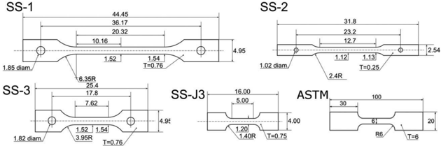

Later, in the middle of the 1980s for irradiation in the fast flux test facility, the SS-1 specimen design was changed, and SS-3 specimen with a much shorter gauge was offered [10]. In the 1990s, the SS-J3 specimen, smaller than SS-3, was offered by Japanese researchers. As was noted in the introduction, the increasing trend in the specimen geometry evolution has been to decrease length, volume, and weight.

Table 2 shows some important geometric parameters that could be relevant to the data analysis described below. These parameters are thickness-to-width ratio (T/W), length-to-width ratio (L/W), shoulder curvature (R), and shoulder curvature-to-width ratio (R/W). The T/W parameter affects neck geometry and the angle between the neck and load axis [11]; the latter two parameters influence stress concentration near the shoulders and can cause a change in the yield stress value obtained from the engineering curves. Shoulder curvature can also affect the geometry of the triangle-like 'dead zone,' which often forms near the grips [3]. As noted in Ref 3, such a zone can demonstrate decreased or even zero strain levels compared to the rest of the gauge. In simplest form, the specimen geometries can be classified based on their thickness and length. First, SS-2 is described as being a thin specimen compared to SS-1 and SS-3, which are considered to be thick ( Table 2 ), and specimens SS-1 and SS-2 are long (L/W &gt; 10) compared to SS-3 and SS-J3, which are described as being short.

TABLE 2 Dimensions and base geometry parameters of specimens.

| Type         |   Occupied Volume (mm 3 ) |   Gauge Length (mm) |   Cross- section, (mm 2 ) | T/W (thickness/ width ratio)   | L/W (length/ width ratio)   |   Shoulder Curvature R (mm) |   R/W Ratio |
|--------------|---------------------------|---------------------|---------------------------|--------------------------------|-----------------------------|-----------------------------|-------------|
| SS-1         |                       168 |               20.32 |                      1.16 | 0.5 (thick)                    | 13.5 (long)                 |                         6.4 |         4.2 |
| SS-2         |                        21 |               12.70 |                      0.25 | 0.2 (thin)                     | 12.7 (long)                 |                         2.4 |         2.4 |
| SS-3         |                        96 |                7.62 |                      1.16 | 0.5 (thick)                    | 5 (short)                   |                         4.0 |         2.7 |
| SS-J3        |                        48 |                5.00 |                      0.90 | 0.6 (thick)                    | 4.5 (short)                 |                         1.4 |         1.3 |
| ASTM subsize |                      6000 |                  28 |                        18 | 0.5                            | 4.7                         |                           6 |           1 |

According to ASTM E8/E8M-15, uniform elongation should include both plastic and elastic elongation; uniform elongation shall be determined using autographic methods with extensometers. However, if no extensometer was used during the tensile experiment and if strain was calculated from the beam-displacement value, then elastic elongation included not only the elastic deformation of the specimen but also the elastic contribution of the loading system (grips, beams, etc.). In this case, calculation of deformation values according to ASTM practice can lead to systematic error, which will depend on tensile machine stiffness, grips, and many other factors. Therefore, in the present work, the elastic portion of the total and uniform elongation values was excluded to eliminate this source of systematic inaccuracy. In other words, in the present work, plasticity values show only plastic deformation.

Specimens for mechanical testing were produced from bulk material using an electric discharge machine (EDM). Some of the specimens were also mechanically ground by a vendor to fit the dimensions. All specimens were produced by the same vendor. EDM cutting and subsequent grinding may lead to a damaged surface layer of up to 10-20 l m [12]. Therefore, electro-polishing was conducted prior to mechanical testing to eliminate the effect of different surface conditions. Chemistry solution compositions for different steels were obtained from the literature, and electro-polishing modes (voltage, duration) were adjusted as necessary to get deformation-free surfaces. The thickness of the layer removed by electro-polishing varied from 20 to 30 l m.

To conduct a comparative analysis, ASTM subsize specimens ( Fig. 1 ) were produced from F82H steel by EDM; no additional surface treatment was performed on this specimen. Similar subsize specimens with the same gauge dimensions were used in Ref 13.

Figure 2 shows the scheme and general view of grips used in the present work. The grips were configured to provide shoulder loading of the specimens during mechanical testing. This style of grips and the same loading scheme were used for all miniature specimens. Grips varied by shoulders curvature, and grips were used for different specimen types. ASTM subsize specimens were tested using pneumatic grips. Miniature specimens were tested on an MTS 'Insight 2-52' screw-driven machine with a force capacity of 2 kN. ASTM subsize specimens were tested on an MTS servo-hydraulic machine with a 407 controller. All tensile experiments were conducted at room temperature with strain rate 0.001 s  1 . Variations in strain rate for different specimen types did not exceed 2 %-3 %. For each data point, three identical specimens were tested.

All tensile experiments were conducted using optic non-contact measurements and digital image correlation (DIC) algorithms. Optic strain measurements are based on comparing images of an object (tensile specimen) before and after deformation. Details of the optic extensometry method and DIC are discussed elsewhere [14-16]. An Allied Vision Technology GX3500 digital camera was used to obtain images during tensile experiments; the resolution was 10-15 l m per pixel, depending on specimen type. To calculate strain fields and true stress-strain curves, VIC2D commercial software and in-house-developed software were used. For all tested specimens, true stress-true strain curves were calculated for the middle third part of the gauge. These experimental true curves were compared with true curves calculated from engineering diagrams. Such calculations [17] are a commonly used method to extract additional data from tensile tests.

FIG. 2 Scheme and image of grips with loaded specimen. Note that shoulder curvature of the grips varies for different specimen types.

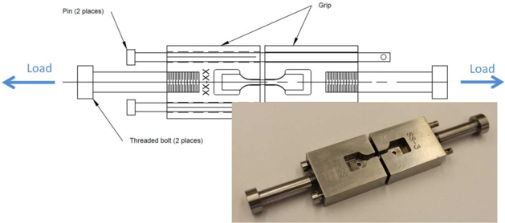

## Experimental Results and Discussion

## ENGINEERING DIAGRAMS OF TESTED MATERIALS

Figure 3 shows typical engineering tensile curves obtained for the different specimen geometries and alloys investigated. One can see that scattering is relatively small for specimens of the same type, and that the engineering curves are located close to each other. At the same time, different specimen types demonstrate clear systematic differences in elongation value and strength level. In particular, the SS-2 specimen type shows the lowest total elongation value for all materials except cast 213 steel ( Fig. 3 ).

It is interesting that the SS-2 specimen type did not show Lu ¨ders deformation and yield plateau for ferritic A533B steel, which were visible on the other specimen types for A533B steel. This unexpected behavior could have been caused by a relatively small T/W ratio for the SS-2 specimen.

FIG. 3 Engineering tensile curves 'engineering strain-retain engineering strain:' 1-SS-1, 2-SS-2, 3-SS-3, 4-SS-J3. For two materials (213 and 316L annealed at 1323 K), three curves are shown; for the other materials, the one most typical curve per specimen type is presented.

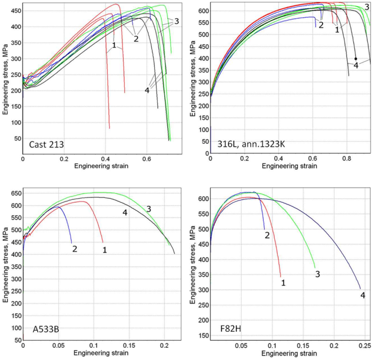

## INFLUENCE OF SPECIMEN TYPE ON MECHANICAL PROPERTIES

Figure 4 shows standard mechanical properties-yield stress (YS), ultimate tensile strength (UTS) stress, uniform elongation (UE), and total elongation (TE). The data in Fig. 4 were sorted by increasing T/W ratio (SS-2, SS-1, SS-3, SS-J3); this ordering also allowed the long (SS-1, SS-2) and the short (SS-3, SS-J3) specimens to be compared.

Based on Fig. 4 , the YS values for F82H and cast 213 steels can be considered as almost geometry-insensitive values (except data for the ASTM subsize specimen with a different gripping scheme). Error bars for these materials were close each to other. For other materials, YS tended to increase with an increase in T/W ratio (see data for SS-2, SS-1, and SS-3 specimens), but the SS-J3 specimen, in many cases, especially for austenitic steels, showed a lower YS value than that of SS-3.

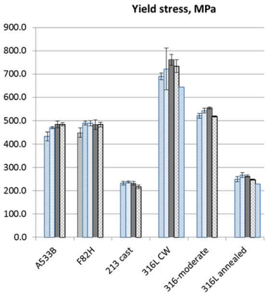

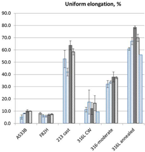

FIG. 4 Yield and ultimate stress and uniform and total elongation for the investigated materials. Error bars show one standard deviation value. Specimen types are sorted by T/W ratio, from the smallest to the largest (except SS-mini).

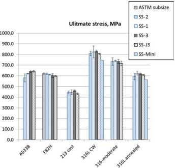

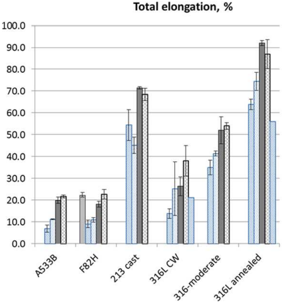

UTS, in general, demonstrated the same patterns as YS. For A533B steel, UTS tended to increase with increasing T/W ratio, but this was not a general tendency. For non-irradiated and irradiated JPCA (modified 316) and JFMS (modified 9Cr ferritic) steels, it was previously shown [18] that YS and UTS values increased with increasing T/W ratio; if the T/W value exceeds  0.18, YS and UTS values saturate. A similar result was obtained in Ref 19.

Uniform elongation values increased with an increase in the T/W parameter. The exceptions were cast 213 steel with a high grain size and cold-worked 316L steel; the latter demonstrates unexpectedly high scattering of data and large error bars. The SS-J3 specimen demonstrated a smaller UE value than SS-3 if UE

exceeded  20 %. There was no pronounced difference between SS-3 and SS-J3 types for the low-ductile materials (e.g., F82H). Note that the SS-J3 and SS-3 specimens are similar enough from a geometry point of view; the only significant difference is the shoulder curvature R ( Table 2 ). In the most cases (except CW 316L), the short specimens (SS-3, SS-J3) show higher UE than the long specimens (SS-1, SS-2).

ASTM subsize specimen ( Fig. 4 , data for F82H steel) demonstrated lower YS compared to miniature specimens and higher UTS; plasticity parameters were very close to SS-3 and SS-J3 samples.

In general, YS, UTS, and UE were relatively insensitive to the specimen geometry for all investigated materials, except cast steel. F82H steel was relatively insensitive to specimen geometry, whereas cast 213 and annealed 316L steels were relatively sensitive. The difference between specimen geometry types did not exceed  15 %.

## TOTAL ELONGATION VALUE

Total elongation value ( Fig. 4 ) was found to be strongly sensitive to specimen type and geometry. For the TE value, the data demonstrated a pronounced trend: TE increased as the L/W value decreased; in other words, the shorter the specimen, the larger the TE. It is possible that the reason for such behavior is more geometrical than physical. Elongation parameters (both UE and TE) are relative values; one uses initial gauge length (L) of the sample to calculate UE and TE. If L decreases but the neck geometry and the duration of neck development ( D ) change insignificantly, then the relative contribution of necking ( D /L) to the TE increases greatly. Clearly, in this case, during the discussion of TE data, the results do not show a pure scale factor effect but some artifact caused by the calculation method.

## LOCALIZED ELONGATION AND NECKING

During irradiation, because of radiation-induced embrittlement, UE may disappear after some damage dose [17]. In this case, material will demonstrate necking immediately after yield stress. Hence, it was interesting to analyze the effect of scale factor on the development of localized deformation and necking.

Figure 5 shows the value of localized elongation for different specimen types. In the framework of the present research, localized elongation ( D ) can be defined as a time interval (or mobile beam displacement value) that corresponds to the development of the local neck. To compare different specimen geometries, localized elongation was measured in millimeters (physical displacement of the mobile beam of the tensile frame), not in %, which allowed the difference in gauge length to be eliminated.

As shown in Fig. 5 , localized elongation, as a rule, increased with increasing gauge length. The reason for this phenomenon could be complex. It is probable that some stress concentration exists in the short specimens, and an increase in the gauge length decreases it, allowing the neck to develop longer. It is also possible the effect might be caused by the relative shoulder curvature (R/W); the row SS-J3-SS3-SS-1 also corresponds to an increase in R/W parameter ( Table 2 ).

FIG. 5 Average localized elongation (difference between uniform elongation and total elongation, see detail in text). Specimen types are in order of increasing gauge length L.

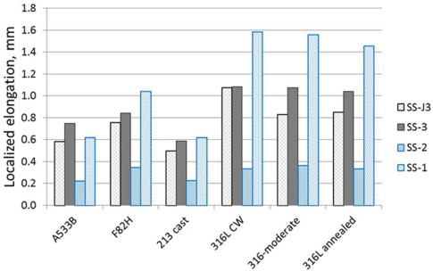

A trend was exhibited for thick specimens with a T/W ratio of 0.5 or more ( Table 2 ), but the thin SS-2 sample failed to follow this rule and showed smaller localized elongation. As described in Ref 11, total elongation and localized elongation decrease as the T/W ratio decreases; this effect is associated with the difference in neck stress states for thin and thick specimens.

## IMPACT OF SCALE FACTOR ON TRUE CURVES OBTAINED BY OPTIC EXTENSOMETRY

Figure 6 shows true stress-true strain curves obtained by optic extensometry for tested materials. Comparing true curves obtained for different specimen types, one can see that there are no significant systematic differences between different specimen geometries. The results agree well except for cast steel, which will be discussed below; the deviation between the curves for the different specimens, in general, remains the same (3 %-5 % of stress value) as strain increases and can be explained by an inaccuracy in cross-section measurement and the natural inhomogeneity of specimens.

Analytical examination of true curves was beyond the scope of the present research. Nevertheless, it should be noted that true curves for steel 316L in all structure states demonstrated parabolic hardening ( Fig. 6 ). In general, these curves can be described by a Swift equation with two free parameters ( r ¼ k ( e -r 0 2 / k 2 ) 0.5 ). This equation was discussed in detail in Ref 17. True curves for ferritic steels show more complex behavior. The whole curves, as a rule, cannot be fitted by a simple parabolic equation. Some aspects of true curves examination for ferritic steels are analyzed in Refs 20 and 21.

FIG. 6 Typical true strain-true stress curves obtained with DIC. The curves were obtained for the middle third part of the specimen gauge. 1-SS-1, 2-SS-2, 3-SS-3, 4-SS-J3.

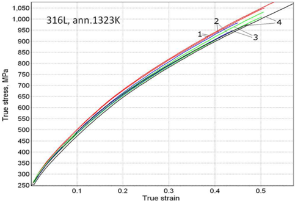

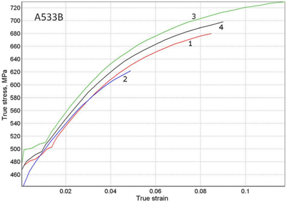

For the tested materials (except cast steel), a notable difference between data for different specimens exists only for SS-2 specimens of A533B steel ( Fig. 6 ). For this specimen geometry, the true curves, also as engineering diagrams, do not demonstrate the Lu ¨ders deformation in the area of small strains.

True curves for cast 213L stainless steel demonstrated very high scattering ( Fig. 7 ); in many cases, scattering of the stress values at the same strain level reached 25 %-30 %. This fact can be explained by large grain size. The gauge of the cast steel tensile specimen in most cases consists of a few grains, and the specimen, in terms of Ref 22, can be considered multior quasi-single crystalline. During a tensile experiment, such objects demonstrate formation of strong deformation relief, bending, etc. The terms 'true strain' and 'true stress' should be applied to this class of objects very carefully. Detailed investigation of their plastic behavior is an interesting and important task (see, for example, Ref 23), but it is out of scope of the present work.

FIG. 7 True strain-true stress curves for cast 213 stainless steel. 1-SS-1, 2-SS-2, 3-SS-3, 4-SS-J3. 'E' indicates easy slip stage; 'L' shows stage of 'linear hardening.'

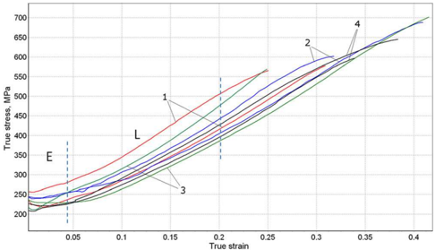

Some of the true curves for cast steel are similar to those for single-crystal metal materials [24]. By analogy with single-crystal samples of similar stainless steel, it is possible to allocate the stage of 'easy slip' and stage of 'linear hardening' ( Fig. 7 ). For a single-crystal sample, the stress and strain at this stage demonstrate a linear relationship [24], but for the case of cast steel, this stage is not purely linear. Because only a few grains are present in the gauge, the acting stress increases according to a more complex law, which could be fitted by an empiric equation with an extra parabolic term: r  k 1 e þ k 2 e 2 . Also, for a single-crystal sample, the parabolic hardening stage ( r  e 0.5 ) should follow the linear hardening stage; for the case of cast steel, parabolic hardening does not occur for the whole gauge, but, as optic measurements show, parabolic hardening takes place only in the neck if the local strain value exceeds  0.30-0.35.

## COMPARISON OF CALCULATED AND EXPERIMENTAL TRUE CURVES

As was noted above, in most cases, tensile tests of small irradiated specimens reported in the literature are being conducted without the use of an extensometer of any kind; deformation value is being recorded as displacement of mobile beam. This is not an issue as provided tensile diagrams and engineering mechanical properties are the only objective of the research.

However, engineering diagrams are often used to calculate 'true stress r -true strain e ' curves [17,25], which are more informative [17] and can be useful in finite-element analysis [26]. In this case, the difference between calculated and measured true curves should be analyzed in detail.

Usually, the calculation of ' r -e ' curves are being performed using 'constant volume criteria' [27]. When doing this calculation, it is important to check how the scale factor and specimen geometry influence such calculated curves. Also, it is necessary to estimate the difference between the calculated and experimental true curves.

Figure 8 shows experimental and calculated true curves for the investigated materials. The calculation works only before the ultimate stress point [17]; therefore, the calculated curves were limited by the uniform elongation part of the tensile curve. One can see a clear difference between the calculated and experimental true curves, and this difference changes with material strength level and strain degree. For instance, soft, coarse-grain cast 213L steel with a low deformation-hardening rate (especially in the area of small strains) demonstrates very high divergence between calculated and experimental true curves (up to 25 %, Fig. 8 ). For soft, annealed 316 steel, the difference reaches a maximum (  10 %) at e  0.25.

FIG. 8 Comparison of experimental true curves obtained using DIC (thin lines with markers) and true curves calculated from engineering diagrams (solid lines). 1-cast 213 SS; 2-annealed 316L; 3-316L annealed at 1163 K; 4-CW 316L; 5-F82H; 6-A533B.

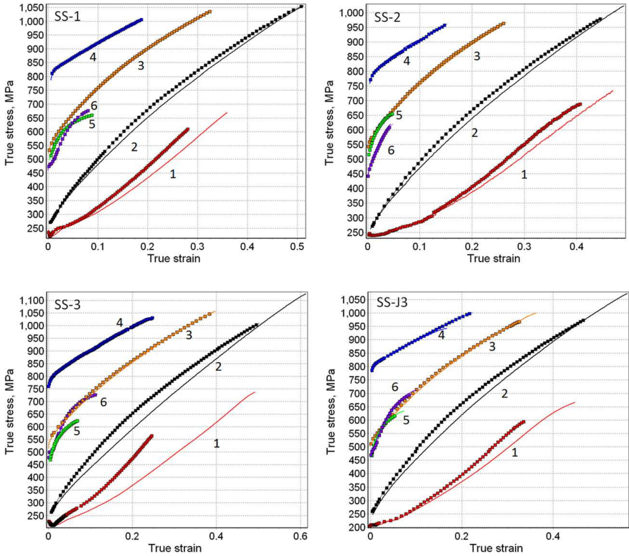

The most pronounced difference exists for SS-3 and SS-J3 specimens; for the same material, SS-1 and SS-2 specimens show a much smaller divergence. This result can be explained by larger gauge length value in the SS-1 and SS-2 samples. Larger gauge length decreases the relative input of heads in the strain value measured from engineering diagrams.

Also, it is possible to see that the difference between calculated and experimental true curves decreased as material yield stress increased. For 316L steel with a moderate strength level (annealed at 1163 K), the difference was less than that for fully austenized 316L steel, and the difference did not exceed 2 %-3 % for CW 316L steel.

These results allow one to conclude that calculated true curves for annealed, soft materials may include significant inaccuracy. However, if yield stress exceeds  450 MPa and the material still has some uniform elongation, calculated curves should be accurate enough.

## The Concept of an Ultra-Miniature Specimen

In some cases, the amount of available material may be not enough to produce even a SS-J3 specimen, or the activity level may require volumes less than that of SS-3 geometry. In such cases, researchers use smaller non-standard specimens produced by various methods such as EDM, machining, or punching. For instance, Fukuya et al. [28] used specimens with a 4-mm gauge punched out using a specific die.

Also, ultra-miniature specimen geometries that can facilitate in situ test methods using analytical electron microscopy equipment such as scanning electron microscopy (SEM) and transmission electron microscopy (TEM) have been developed and are widely used by many researchers. Such methods allow one to observe dislocation movement and dislocation-defect or dislocation-grain boundary interaction directly, which provides further insights into the behavior of materials under a stress environment [29].

The behavior of many polycrystalline materials is strongly influenced by grain orientation and grain boundary character distribution [30,31]. One area of interest is the development of deformation localization caused by grain-to-grain interaction under straining [31]. Analysis of stress and strain localization based on grain orientation and material properties requires the development special specimen geometries capable of being utilized in analytical electron microscopy equipment. Several considerations must be investigated in developing new specimen geometries including electron equipment load capacity and factors such as electron beam shadowing as a result of specimen morphology.

FIG. 9 General view and dimensions of SS-mini specimen type used in the present work. All dimensions are in mm. Dimensional tolerances for this geometry: gauge length 6 0.02mm, gauge width 6 0.02mm, and gauge thickness 6 0.01 mm.

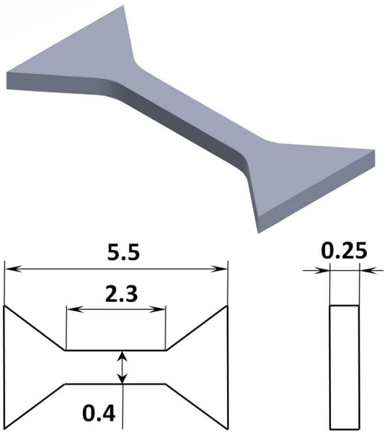

Based on these considerations, a modified ultra-miniature specimen (SS-mini) geometry was developed and a preliminary analysis was conducted ( Fig. 9 ). This specimen may be easily produced from the heads of SS-1 or SS-3 specimens using EDM or by machining. The geometry significantly reduces any material limitation issues. The reduced volume also has a marked benefit of reducing the residual sample activity level by nearly two orders of magnitude. At the same time, the gauge contains enough grains to accumulate statistics and to study sensitivity-to-grain orientation, e.g., twinning [30] or phase transformations [6].

Figure 10 shows the specimen loaded in a copper carrier coupon, which is then loaded in a Gatan Model 671.DH single title liquid-nitrogen-cooled straining holder. The copper carrier coupon serves as the straining holder grips by providing shoulder loading and interfacing to the straining holder. The spring-like shape allows for full extension of the holder without failure, limiting the possibility of specimen loss during straining.

Configurations such as those shown in Fig. 10 allow for unique experimentation such as pre-straining and post-straining grain orientation analysis using electron backscattering diffraction (EBSD) or focused ion beam (FIB) TEM specimen preparation techniques on a special grain configuration (e.g., high Schmid factor or grain boundary inclined 90  to the load direction). A screen capture showing slip line and dislocation pile-up using the in situ TEM configuration is shown in Fig. 10( b ) . The specimen was prepared using an EBSD-assisted FIB sample preparation. The image shown in Fig. 10( b ) is an example of the type of information that can be obtained; the nature of the channeling dynamics will not be discussed here. Such techniques can provide valuable insights into the deformation mechanics of specimens. The geometry also lends itself to larger scale in situ observations such as the use of a scanning electron microscope.

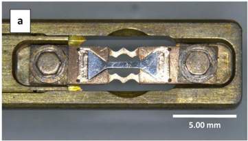

FIG. 10 ( a ) Optical micrograph showing the ultra-miniature specimen loaded in a Gatan Model 671.DH holder; and ( b ) screen capture of a slip line interacting with a grain boundary utilizing the in situ test configuration on an annealed 316SS.

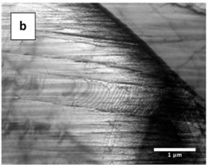

Limited mechanical properties data obtained using the proposed SS-mini-specimen type are shown in Fig. 4 . One can see that the SS-mini-type provides smaller yield and ultimate stress data than SS-3 (at  10 %) and demonstrates significantly smaller ductility. In general, the results are close to the SS-2 specimen-type data. One may expect that plasticity values may be improved by some increase in specimen thickness.

## Conclusions

In the present work, the influence of scale factor (tensile specimen dimensions and geometry) on mechanical test results was investigated for different widely used types of the small specimens (SS-1, SS-2, SS-3, and SS-J3) and a set of materials (annealed and cold-worked 316L, F82H, A533B, etc.). The effect of scale factor on yield and ultimate stress and uniform elongation value was found to be relatively weak. However, a clear systematic difference existed and should be considered. Total elongation value and localized deformation were strongly sensitive to the scale factor.

Modern experimental methods like digital image correlation and optic extensometry allow the effect of scale factor to be reduced by eliminating the contribution of the out-of-gauge deformation into the elongation value. True stress-true strain curves describing strain-hardening behavior were shown to be very close for different specimen types.

## ACKNOWLEDGMENTS

This research is supported by the U.S. Department of Energy, Office of Nuclear Energy, for the Light Water Reactor Sustainability Research and Development Effort, and through a user project supported by ORNL's Center for Nanophase Materials Sciences (CNMS), which is sponsored by the Scientific User Facilities Division, Office of Basic Energy Sciences, U.S. Department of Energy. The writers would like to thank Dr. Wang Yanli (ORNL) for help with tensile test of ASTM samples and D.P. Stevens (ORNL) for valuable help with manuscript preparation. This manuscript was authored at the Oak Ridge National Laboratory, and managed by UT-Battelle LLC under Contract No. DE-AC05-00OR22725 with the U.S. Department of Energy. The publisher, by accepting the article for publication, acknowledges that the U.S. Government retains a nonexclusive, paid-up, irrevocable, worldwide license to publish or reproduce the published form of this manuscript, or allow others to do so, for U.S. Government purposes.

## References

- [1] Klueh, R. L., 'Miniature Tensile Test Specimens for Fusion Reactor Irradiation Studies,' Nucl. Eng. Des. Fusion , Vol. 2, 1985, pp. 407-416.
- [2] Wakai, E., Nogami, S., Kasada, R., Kimura, A., Kurishita, H., Saito, M., Ito, Y., Takada, F., Nakamura, K., Molla, J., and Garin, P., 'Small Specimen Test Technology and Methodology of IFMIF/EVEDA and the Further Subjects,' J. Nucl. Mater. , Vol. 417, Nos. 1-3, 2011, pp. 1325-1330.
- [3] Pierron, O. N., Koss, D. A., and Motta, A. T., 'Tensile Specimen Geometry and the Constitutive Behavior of Zircaloy-4,' J. Nucl. Mater. , Vol. 312, Nos. 2-3, 2003, pp. 257-261.
- [4] Busby, J. T., Hash, M. C., and Was, G. S., 'The Relationship Between Hardness and Yield Stress in Irradiated Austenitic and Ferritic Steels,' J. Nucl. Mater. , Vol. 336, Nos. 2-3, 2005, pp. 267-278.
- [5] Busby, J. T., Maziasz, P. J., Rowcliffe, A. F., Santella, M., and Sokolov, M., 'Development of High Performance Cast Stainless Steels for ITER Shield Module Applications,' J. Nucl. Mater ., Vol. 417, Nos. 1-3, 2011, pp. 866-869.
- [6] Lee, T.-H., Oh, C.-S., Kim, S.-J., and Takaki, S., 'Deformation Twinning in High-Nitrogen Austenitic Stainless Steel,' Acta Mater. , Vol. 55, No. 11, 2007, pp. 3649-3662.
- [7] Jitsukawa, S., Tamura, M., van der Schaaf, B., Klueh, R. L., Alamo, A., Petersen, C., Schirra, M., Spaetig, P., Odette, G. R., Tavassoli, A. A., Shiba, K., Kohyama, A., and Kimura, A., 'Development of an Extensive Database of Mechanical and Physical Properties for ReducedActivation Martensitic Steel F82H,' J. Nucl. Mater. , Vols. 307-311, 2002, pp. 179-186.
- [8] Bajaj, R., Shogan, R. P., Deflitch, C., Fish, R. L., Paxton, M. M., and Bleiberg, M. L., 'Tensile Properties of Neutron-Irradiated Nimonic PE16,' Effects of Radiation on Materials Tenth

Conference , ASTM STP 725 , D. Kramer, H. R. Brager, and J. S. Perrin, Eds., ASTM International, West Conshohocken, PA, 1981, pp. 326-351.

- [9] Tanaka, M. P., Bloom, E. E., and Horak, J. A., 'Tensile Properties and Microstructure of Helium Injected and Reactor Irradiated V-20Ti,' J. Nucl. Mater. , Vols. 103-104, 1981, pp. 895-900.
- [10] Bauer, R. E. and Truitt, R. W., 'Materials, Open Test Assembly (MOTA) Irradiation in FFTF,' Effects of Radiation on Materials: 12th Conference , ASTM STP 870 , F. A. Garner and J. S. Perrin, Eds., ASTM International, West Conshohocken, PA, 1985.
- [11] Byun, T. S., Kim, J. H., Chi, S. H., and Hong, J. H., 'Effect of Specimen Thickness on the Tensile Deformation Properties of SA508 Cl.3 Reactor Pressure Vessel Steel,' ASTM STP 1329 , 1998, pp. 575-587.
- [12] Bleys, P., Kruth, J.-P., Lauwers, B., Schacht, B., Balasubramanian, V., Froyen, L., and Humbeeck, J. V., 'Surface and Sub-Surface Quality of Steel After EDM,' Adv. Eng. Mater. , Vol. 8, Nos. 1-2, 2006, pp. 15-25.
- [13] Garware, M., Kridli, G. T., and Mallick, P. L., 'Tensile and Fatigue Behavior of Friction-Stir Welded Tailor-Welded Blank of Aluminum Alloy 5754,' J. Mater. Eng. Perform. , Vol. 19, No. 8, 2012, pp. 1161-1171.
- [14] Suzuki, K., Jitsukawa, S., Okubo, N., and Takada, F., 'Intensely Irradiated Steel Components: Plastic and Fracture Properties, and a New Concept of Structural Design Criteria for Assuring the Structural Integrity,' J. Nucl. Eng. Des. , Vol. 240, No. 6, 2010, pp. 1290-1305.
- [15] Schalk, P., Fauster, E., and O'Leary, P., 'High-Temperature Video-Extensometry for Material Testing of Refractories,' Proceedings of SPIE-IS&amp;T Electronic Imaging , Vol. 5679, SPIE, Bellingham, WA, 2005, pp. 129-139.
- [16] Pan, B., Qian, K., Xie, H., and Asundi, A., 'Two-Dimensional Digital Image Correlation for In-Plane Displacement and Strain Measurement: A Review,' Measure. Sci. Technol. , Vol. 20, No. 6, 2009, 062001.
- [17] Gussev, M. N., Byun, T. S., and Busby, J. T., 'The Relationship Between Hardness and Yield Stress in Irradiated Austenitic and Ferritic Steels,' J. Nucl. Mater. , Vol. 427, Nos. 1-3, 2012, pp. 62-68.
- [18] Kohno, Y., Kohyama, A., Hamilton, M. L., Hirose, T., Katoh, Y., and Garner, F. A., 'Specimen Size Effects on the Tensile Properties of JPCA and JFMS,' J. Nucl. Mater. , Vols. 283-287, 2000, pp. 1014-1017.
- [19] Kohyama, A., Hamada, K., and Matsui, H., 'Specimen Size Effects on Tensile Properties of Neutronirradiated Steels,' J. Nucl. Mater. , Vols. 179-181, 1991, pp. 417-420.
- [20] Vanaja, J., Laha, K., Sam, S., Nandagopal, M., Panneer Selvi, S., Mathew, M. D., Jayakumar, T., and Rajendra Kumar, E., 'Influence of Strain Rate and Temperature on Tensile Properties and Flow Behavior of a Reduced Activation Ferritic-Martensitic Steel,' J. Nucl. Mater. , Vol. 424, Nos. 1-3, 2012, pp. 116-122.
- [21] Spa ¨tig, P., Baluc, N., and Victoria, M., 'On the Constitutive Behavior of the F82H Ferritic/ Martensitic Steel,' Mater. Sci. Eng. A , Vols. 309-310, 2001, pp. 425-429.

- [22] Keller, C., Hug, E., and Feaugas, X., 'Microstructural Size Effects on Mechanical Properties of High Purity Nickel,' Int. J. Plastic. , Vol. 27, No. 4, 2011, pp. 635-654.
- [23] Kim, K.-H., Kim, H.-K., and Oh, S.-I., 'Deformation Behavior of Pure Aluminum Specimen Composed of a Few Grains During Simple Compression,' J. Mater. Proc. Technol. , Vol. 171, No. 2, 2006, pp. 205-213.
- [24] Karaman, I., Sehitoglu, H., Maier, H. J., and Chumlyakov, Y. I., 'Competing Mechanisms and Modeling of Deformation in Austenitic Stainless Steel Single Crystals With and Without Nitrogen,' Acta Mater. , Vol. 49, No. 19, 2001, pp. 3913-3933.
- [25] Fabritsiev, S. A. and Pokrovsky, A. S., 'The Effects of Grain Size and Helium Accumulation on Radiation Hardening and Loss of Ductility of Pure Copper for ITER Application,' Fusion Eng. Des. , Vol. 65, No. 4, 2003, pp. 545-559.
- [26] Kim, J. W. and Byun, T. S., 'Analysis of Tensile Deformation and Failure in Austenitic Stainless Steels: Part II-Irradiation Dose Dependence,' J. Nucl. Mater. , Vol. 396, No. 1, 2010, pp. 10-19.
- [27] Gussev, M. N., Maksimkin, O. P., Osipov, I. S., and Garner, F. A., 'Application of Digital Marker Extensometry to Determine the True Stress-Strain Behavior of Irradiated Metals and Alloys,' J. ASTM Int. , Vol. 5, No. 4, 2008, JAI101073.
- [28] Fukuya, K., Nishioka, H., Fujii, K., Miura, T., and Kitsunai, Y., 'Local Strain Distribution Near Grain Boundaries Under Tensile Stresses in Highly Irradiated SUS316 Stainless Steel,' J. Nucl. Mater. , Vol. 432, Nos. 1-3, 2013, pp. 67-71.
- [29] Kacher, J. and Robertson, I. M., 'Quasi-Four-Dimensional Analysis of Dislocation Interactions with Grain Boundaries in 304 Stainless Steel,' Acta Mater. , Vol. 60, No. 19, 2012, pp. 6657-6672.
- [30] Gussev, M. N., Byun, T. S., Busby, J. T., and Parish, C. M., 'Twinning and Martensitic Transformations in Nickel-Enriched 304 Austenitic Steel During Tensile and Indentation Deformations,' Mater. Sci. Eng. A , Vol. 588, 2013, pp. 299-307.
- [31] McMurtrey, M. D., Was, G. S., Patrick, L., and Farkas, D., 'Relationship Between Localized Strain and Irradiation Assisted Stress Corrosion Cracking in an Austenitic Alloy,' Mater. Sci. Eng. A, Vol. 528, Nos. 10-11, 2011, pp. 3730-3740.