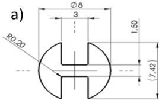
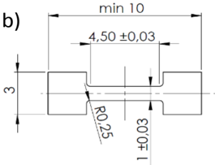
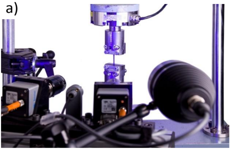
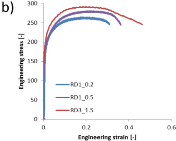
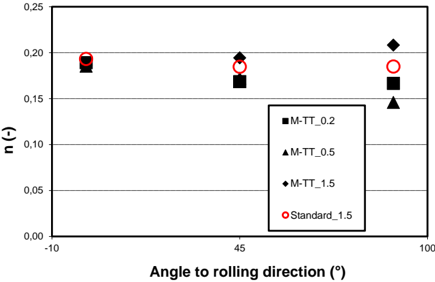
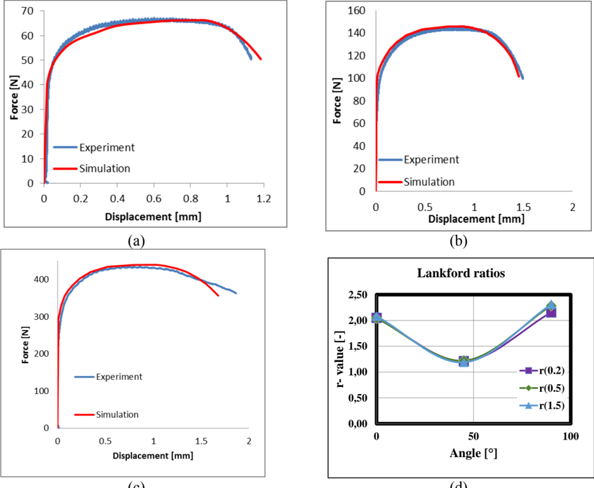

## PAPER · OPEN ACCESS

## Applicability of miniature tensile test in the automotive sector

To cite this article: P Konopík et al 2018 IOP Conf. Ser.: Mater. Sci. Eng. 461 012043

View the article online for updates and enhancements.

## You may also like

- Advanced procedures for design of bolted connections František Wald, Jaromír Kabelá, Marta -

Kuíková et al.

- [The assessment of electrospun scaffolds fabricated from polycaprolactone with the -](https://iopscience.iop.org/article/10.1088/2057-1976/ab756f)
- addition of L-arginine Jana Horakova, Zuzana Oulehlova, Vit Novotny et al.
- [Effect of revolutions number on mechanical properties of HPT processed -](https://iopscience.iop.org/article/10.1088/1757-899X/723/1/012019)
- [copper](https://iopscience.iop.org/article/10.1088/1757-899X/723/1/012019)

D Melzer, I Smirnov, A Evstifeev et al.

## Applicability of miniature tensile test in the automotive sector

## P Konopík 1 , P Farahnak 1 , M Rund 1 J Džugan 1 , and S Rzepa 2

1 COMTES FHT a.s., Dobřany, Czech Republic, EU 2

AGH University of Science and Technology, Kraków, Poland, EU

E-mail: pavel.konopik@comtesfht.cz

Abstract . The aim of this paper is to show the applicability of miniature tensile test (M-TT) for local properties determination on steel sheets for drawing and forming which are mostly used in  automotive  industry.  Knowledge  of  local  mechanical  properties  is  a  key  factor  for  parts quality assurance. A comparison of the tensile test results from standard sized and miniature sized geometry has been done to assess the M-TT reliability. Various mechanical properties, such as the ultimate tensile and yield strengths the elongation, and reductions in area will be obtained. Moreover, thanks to advanced measurement techniques like digital image correlation with high resolution, strain hardening parameters and plastic strain ratio can be evaluated as well. Finally, flow stress curves are calibrated by inverse analysis in Abaqus FEM software.

.

## 1 Introduction

The tensile properties of materials, such as the ultimate tensile strength, yield strength, elongation and cross-sectional area, are very important factors for engineering design. In automotive industry, a group of  cold-rolled  steels  for  drawing  and  cold  forming  (DC01  -  DC06)  is  widely  used  [1]. These  steel grades have excellent formability, which facilitates cold forming operations, and are ideal for deep drawing.  They  are  used  for  bending  and  deep  drawing  forming  processes  for  applications  where strength, rigidity and ductility are required.

There  are  guaranteed  mechanical  properties  of  delivered  sheet  which  can  be  easily  determined using  standard  tensile  test.  However,  for  the  quality  and  reliability  assessment  of  the  final manufactured  part,  local  properties  can  be  crucial.  The  most  critical  are  often  sharp  bending locations with small radiuses where residual formability and elongation can be near to the material limit.

On the other hand, due to lower friction than  expected  during  cold  forming,  some  areas can  be deformed less than expected and thus, these locations could have lower strength.  In comparison with  [2],  the  recently-developed  miniature  tensile  test  (M-TT)  is  an  excellent  tool  for  local properties determination [3] or, in all cases, where only a limited amount of material is available [4-5].

The  aim  of  this  paper  is  to  show  the  applicability  of  miniature  tensile  test  for  local  properties determination on steel sheets for drawing and forming. For this purpose, standard and miniature tensile  tests  (M-TT)  were performed  in  3  orientations:  0°,  45°  and  90°.  Moreover,  for thickness influence evaluation, miniaturized specimens were machined with several different thicknesses and material model using Abaqus FEM software will be created.

## 2 Testing method, M-TT

For  local  properties  determination,  miniature  test  pieces  had  to  be  used.  The  recently-developed miniature-tensile  test  (M-TT)  technique  was  chosen  for  this  purpose.  The  shape  of  the  M-TT  test pieces was initially derived from the small punch test (SPT). Small punch test specimens are discs 8 mm in diameter and 0.5 mm in thickness. SPT is used for determining the mechanical properties of inservice components because it only requires a very small amount of material. However, its drawback comes when interpreting the test readings, which must be converted by means of empirically-derived correlations to ordinary mechanical properties, such as yield and ultimate strength [6].

On the contrary, M-TT stress-strain curves are identical to standard ones [7], provided that several conditions  are  met.  M-TT  only  requires  small  amounts  of  experimental  material,  and  therefore enables  local  mechanical  properties  to  be  measured.  To  obtain  consistent  data,  the  test  piece thickness must be ≥ 10× grain size [8]. When standard conditions [7] are met, such as accuracy of the  measurement of force and extension and the required strain rate, M-TT data are identical to standard test data within a broad range of metals and their strength levels [9][10].

The initial test piece design (Figure 1a) was modified (Figure 1b) for current investigated material DC01. A modified M-TT specimen has a thickness of 0.5 mm and parallel length of 4.5 mm.

M-TT is carried out using a special test device with high load cell sensitivity. Its linear motor runs smoothly  at  very  slow  speeds  to  fulfill  all  criteria  given  by  the  standard  [7].  The  test  piece  is clamped in special flat grips which have been developed for this purpose. The axial extension is captured with a high-speed CCD camera integrated into the systems Mercury RT or ARAMIS™ that  relies  on  digital  image  correlation  (DIC).  As  the  force  and  extension  data  are  captured accurately, the record need not be specially processed and the evaluation can follow the standard procedure [7].

Figure 1. Geometry of an M-TT test piece; (a) initial design, (b) modified geometry for testing ductile steel sheets

## 3 Experiment

The uniaxial tensile tests are performed on the specimen geometries with different thicknesses 0.2, 0.5 and 1.5 mm to investigate material behavior.  Specimens were taken from DC01steel sheet in three directions: longitudinal direction 0°, diagonal direction 45° and transverse direction 90°, related to the rolling direction.

Electro-mechanical  testing  system  Mayes  is  used  to  conduct  the  uniaxial  tests  and  Aramis™ system with 12 megapixel is utilized to monitor 2D strain fields with high resolution. Figure 2a illustrates  the  experimental  setup  and  data  acquisition  rate  is  set  at  100 Hz  in  testing  system  for clear  visualizing  the  tensile  behavior.  It  is  noticeable  that  for  all  experiments  initial  lengths  of extensometers are chosen 4 mm. Figure 2b represents engineering stress- strain curves of tensile tests for all considered specimens geometries in rolling direction (RD).

Figure 2. (a) Experimental setup, (b) engineering stress- strain curves for different thicknesses

## 4 Tensile test results

Tensile tests were evaluated based on the standard [7]. The measurement for the plastic strain ratio determination  was  performed  with  the  use  of  continuous  strain  measurement  by  DIC  system ARAMIS. Subsequently, r-values (i.e. plastic strain ratio) for the plastic strain range of 2-10 % were evaluated according to the standard [11].

Results of averaged values from three tests per conditions are shown in Table. 1, where YS is Yield strength,  UTS  is  Ultimate  tensile  strength,  A g is  plastic  extension  at  maximum  force,  A  is  plastic elongation of the gauge length after fracture (GL for standard geometry was 50 mm and for M-TT 4 mm),  Z  is  maximum  change  in  cross-sectional  area  and  r 2-10 is  plastic  strain  ratio  evaluated  in  the range of 2-10 % plastic deformation.

Table 1. Summary of tensile tests results

| Specimen         |   YS MPa |   UTS MPa |   A g % |   A % |   Z % |   r 2-10 ----- |
|------------------|----------|-----------|---------|-------|-------|----------------|
| M-TT_0°_0,2      |      154 |       241 |    15.8 |  34.5 |  57.2 |           2.05 |
| M-TT_0°_0,5      |      185 |       295 |    18.8 |  53.2 |  83.7 |           2.04 |
| M-TT_0°_1,5      |      186 |       295 |    20.9 |    56 |    80 |           2.08 |
| Standard_0°_1,5  |      195 |       309 |    25.4 |  44.6 |  70.3 |           2.11 |
| M-TT_45°_0,2     |      176 |       272 |    16.8 |  31.7 |  50.8 |           1.21 |
| M-TT_45°_0,5     |      184 |       315 |    22.3 |  44.4 |  77.7 |           1.22 |
| M-TT_45°_1,5     |      196 |       307 |    21.7 |  57.6 |  83.9 |           1.19 |
| Standard_45°_1,5 |      206 |       323 |    24.4 |  44.8 |  44.7 |           1.21 |
| M-TT_90°_0,2     |      150 |       231 |    17.9 |    36 |  53.7 |           2.16 |
| M-TT_90°_0,5     |      166 |       298 |    23.9 |    54 |  87.2 |           2.28 |
| M-TT_90°_1,5     |      170 |       287 |      26 |  59.8 |  84.2 |           2.31 |
| Standard_90°_1,5 |      196 |       304 |    24.2 |  48.1 |  71.4 |           2.45 |

The evaluation of strain hardening parameters was carried out based on Hollomons equation (1):

IOP Conf. Series: Materials Science and Engineering 461 (2019) 012043 doi:10.1088/1757-899X/461/1/012043

$$( 1 )$$

where σ is the stress, K is the strength index or strength coefficient, ε is the plastic strain and n is the strain  hardening  exponent.  In  equation  (1),  the  power  law  relationship  between  the  stress  and  the amount of plastic  strain  is  used.  The  fitting  range  considered  for  the  Hollomons  law  parameters  is between 2-10% of the plastic strain. Results are summarized in Figure 3.

Figure 3. (a) Strain hardening exponent, (b) Strength coefficient

## 5 Abaqus FEM simulation

Abaqus FEM software is utilized for numerical simulation with conventional plasticity [12] based on von  Mises  material  model.  Flow  curves  are  calibrated  through  inverse  analysis  by  comparing experimental and numerical force-displacement curves and are depicted in Figure 4.

For all simulations, 3D elements are used (C3D8R according to Abaqus element library) and mesh size  is  chosen between  the  extensometer  points  and  0.15  mm  for  surrounding  area. Moreover, 5 elements are assigned along the thickness. As it can be seen in Figure 4a, 4b and 4c, numerical simulations are in close agreement with experimental data measured in rolling direction. For measuring Lankford ratios, Gauge sections are defined in transversal direction as well as axial direction.  Three  experiments  are  performed  on  specimens  in  rolling,  diagonal  and  transverse directions.  GOM  Aramis™  captures  2D  displacement  fields  during  deformation,  e.g.,  axial  and transversal  extensometers,  provides  engineering  surface  strains  which  are  then  transformed  into true  values.  Finally,  thickness  strain is  measured  based on incompressibility condition. Lankford ratio (plastic strain ratio) can be calculated from average slope of the true plastic width and thickness strain based on equation (2) for the specific range of equivalent plastic strain and are indicated in figure 4d.

$$r = \frac { d \varepsilon _ { w } ^ { p } } { d \varepsilon _ { t h } ^ { p } } \quad \text {while } 0 . 1 \leq \bar { \varepsilon } _ { p } \leq 0 . 2 \\$$

600

500

400

300

200

100

0

C (MPa)

-10

M-TT\_0.2

M-TT\_0.5

M-TT\_1.5

Standard\_1.5

45

100

Angle to rolling direction (°)

(c)

(d)

Figure 4. Engineering stress- strain curves for different thicknesses (a). for thickness 0.2 mm, (b). for thickness 0.5 mm, (c). for thickness 1.5 mm, (d). Lankford ratios

## 6 Results discussion

Overall,  the  agreement  ranged  from  acceptable  results  to  excellent  results.  The  biggest  differences were  seen  in  the  stress-strain  curves  obtained  from  M-TT  0.2  mm  in  thickness  for  all  rolling directions, where the most significant deviation was measured in respect of UTS and corresponding C values. This can have several causes. Firstly, machining and handling of a specimen 0.2 mm thick is challenging and surface finish could possibly have a big influence. Furthermore, the specimens were taken  from  the  middle  part  of  the  sheet  where  the  material  can  be  softer  than  material  near  to  the surface.

However,  this  study  indicated  that  values  of  plastic  strain  ratio  are  not  dependent  on  specimen thickness. Trends obtained here for this parameter are in agreement with those published in [13-15].

## 7 Conclusions

The  paper  presented  here  successfully  shows  the  possibility  of  metal  sheet  characterization  for forming  processes  with  the  use  of  miniaturized  tensile  specimens.  Generally,  very  good  agreement was found for all considered parameters and conditions between the results attained with the use of standard and M-TT specimens. FEM simulation in Abaqus software demonstrated that data obtained from M-TT can be easily used as input data for all software requiring reliable stress - strain data and thus, local properties can be taken into count for part quality assurance.

## Acknowledgements

This paper was created by project No: TH02010544, financed by the TA ČR and project No.: LO1412 - Development of West-Bohemian Centre of Materials and Metallurgy, financed by the MEYES of the Czech Republic.

## References

- [1] ArcelorMittal, Extract from the product catalogue, 2018, [online] https://automotive.arcelormittal.com/saturnus/sheets/ArcelorMittal%20Automotive%20prod uct%20offer%20EN.pdf
- [2] Janoušek J and Balda M 2014 Strain gage measurements for accurate yield point determination, Applied Mechanics and Materials 486, pp. 123-128
- [3] Jirková J, Rubešová K, Konopík P and Opatová K 2018 Effect of the Parameters of Semi-Solid Processing on the Elimination of Sharp-Edged Primary Chromium Carbides from Tool Steel, Metals - Open Access Metallurgy Journal 8(9):713
- [4] Dzugan  J,  Prochazka  R  and  Konopik  P  2017  Low  cycle  fatigue  tests  with  the  use  of miniaturized  test  specimens,  ASME  Pressure  Vessels  and  Piping  Conference,  Location: Waikoloa, HI, Date: JUL 16-20, 2017, Article Number: UNSP V01AT01A072
- [5] Dzugan J, Prochazka R and Konopik P 2015 Micro-Tensile Test Technique Development and Application to Mechanical Property Determination, 6th ASTM International Symposium on Small  Specimen  Test  Techniques  Location:  Houston,  Date:  JAN  29-31,  2014,  Volume: 1576, Pages: 12-30
- [6] Dobes F and Dymacek P 2016 Fracture-based correlation of uniaxial and small punch creep data Theoretical and Applied Fracture Mechanics , Part: A, 86, 34-38, DOI: 10.1016/j.tafmec.2016.08.020
- [7] ISO  6892-1:2016:  Metallic  materials  --  Tensile  testing  --  Part  1:  Method  of  test  at  room temperature, 2016
- [8] Kumar K, Madhusoodanan K and Rupani, B. B. 2006 Miniature Specimen Technique as an NDT Tool for Estimation of Service Life of Operating Pressure Equipment., International Conference &amp; Exhibition on Pressure Vessel and Piping, Chennai, India, 7-9 February 2006; 92-102
- [9] Rund M, Procházka R, Konopík P, Džugan J and Folgar H 2015 Investigation of Sample-size Influence on Tensile Test Results at Different Strain Rate. Procedia Engineering , 114, 410415, https://doi.org/10.1016/j.proeng.2015.08.086
- [10] Prochazka R, Dzugan J, Konopik P and Rund M 2018 Investigation of high-strength stainless steel using small specimen test techniques - tensile and fatigue properties, 7th International Conference on Mechanics and Materials in Design (M2D), Albufeira, Portugal, 11-15 June 2017; Eds. Gomes, J.F.S.; Meguid, S.A.; INEGI/FEUP: 2017; Paper ref. 6841, 343-354
- [11] ISO 10113:2006: Metallic materials Sheet and strip determination of plastic strain ratio
- [12] Farahnak P, Azinpour E, Belinha J and Cesar de Sa J 2016 The numerical non-linear analysis of elasto-plastic  materials  using  the  radial  point  interpolation  method International  book  of Material Modelling: Applications, Challenges and Research ISBN: 978-1-53612-161-2.
- [13] Gavrus A and Francillette H 2011 An Anisotropic Behaviour Analysis of AA2024 Aluminium Alloy Undergoing Large Plastic Deformations Aluminium Alloys, Theory and Applications , ISBN 978-953-307-244-9.
- [14] Ramos G, Stout M, Bolmaro R E, Signorelli J W and Turner P 2010 Study of a drawing-quality sheet steel. I: Stress/strain  behaviors and  Lankford  coefficients  by  experiments  and micromechanical  simulations, International  Journal  of  Solids  and  Structures Volume  47, Issue 17, 15 Pages 2285-2293.
- [15] Huh  J,  Huh  H,  Lee  C  S  2013  Effect  of  strain  rate  on  plastic  anisotropy  of  advanced  high strength steel sheets, International Journal of Plasticity ,  Volume: 44,  Pages: 23-46, 2013, DOI: 10.1016/j.ijplas.2012.11.012