## Size-Dependent  Stochastic  Tensile  Properties  in  Additively  Manufactured  316L Stainless  Steel

Ashley  M. Roacha,  Benjamin  C  Whitea,  Anthony  Garlanda,  Bradley  H. Jareda,  Jay  D. Carrolla,  Brad  L.  Boyce*

'Materials,  Physical,  and  Chemical  Sciences  Center,  Sandia  National  Laboratories,  Albuquerque,  NM  87185-0889 *Corrosponding  Author:  blboyce@sandia.gov

## ABSTRACT

Recent  work  in metal  additive manufacturing  (AIvI)  suggests  that mechanical  properties may  vary  with  feature size;  however, these  studies  do  not  provide  a  statistically  robust  description  of this  phenomenon, nor  do  they  provide a  clear  causal  mechanism.  Because  of the  huge  design  freedom  afforded  by  3D  printing,  AM parts  typically  contain  a range  of feature  sizes,  with  particular  interest  in  smaller  features,  so  the  size  effect  must be  well  understood  in  order to make  informed  design decisions.  This  work  investigates  the effect of feature size on  the  stochastic mechanical performance  of  laser powder  bed  fusion tensile specimens.  A high-throughput  tensile testing method was  used  to characterize  the  effect  of specimen  size  on  strength,  elastic  modulus  and  elongation  in  a  statistically  meaningful  way. The  effective  yield  strength,  ultimate  tensile  strength  and  modulus  decreased  strongly  with  decreasing  specimen  size: all  three  properties  were  reduced  by nearly  a  factor  of two  as  feature  dimensions  were  scaled  down  from  6.25  mm to 0.4  mm. Hardness  and  microstructural observations indicate that this size dependence was  not  due  to an  intrinsic change  in material  properties,  but  instead  the  effects  of surface  roughness  on  the  geometry  of the  specimens.  Finite element  analysis  using  explicit  representations  of surface  topography  shows  the  critical  role  surface  features  play  in creating  stress  concentrations  that  trigger  deformation  and  subsequent  fracture.  The  experimental  and  fmite  element results  provide  the  tools  needed  to  make corrections  in  the  design  process  to  more  accurately  predict  the  performance of  AM components.

Key  Words:  Additive manufacturing;  Laser  powder  bed  fusion;  Surface  roughness;  Feature size; Strength;  Elastic modulus;  Ductility;  Crystallographic  texture,  316L  stainless  steel

## 1.  INTRODUCTION

Recently  there has  been  considerable advancement  in  the  field of  metal  additive manufacturing  (AIvI),  both  in terms of  the technologies used,  and the diversity and volume of  applications for AM  parts. Once  used almost exclusively for prototypes and small  non-load bearing one-off  structures, metal AIVI is beginning to be used in mainstream  mass  production  [1-3].  Alongside  this  advancement,  and  increasing  use,  have  been  numerous  efforts  to qualify  structural  parts,  which  has  proven  to  be  a tremendous  challenge  [4,  5].

While  many  metal  AM processes  have  similar  capabilities  and  challenges,  the  current  study  is  interested  in  laser powder  bed  fusion  (LPBF), also  known  as  selective  laser  melting  (SLM) [6].  In  this  process  a  laser  is  scanned  over  a bed  of stationary  powder,  melting  the  powder  in  the  laser  path  to  form  a  solid  cross  section  of the  part.  A new  layer of  powder  is  then  spread  over  the  part,  and  the  3D part  is  built  one  layer  at  a  time.  The  mechanical  properties  of the final  part  are  dependent  on  many factors  including:  powder  characteristics  [7],  laser  power, velocity  and  scan  strategy [1,  8-10],  build orientation and  location  [11-13],  post  processing  [11,  12],  and  surface  roughness  [14-17].  Within complex geometries,  the dynamic conditions for melting,  solidification and  reheating can vary  from location to location,  making  it  difficult  to  obtain  uniform  properties  with  fixed  printing  parameters.

The  large  number  of parameters,  some  of which  are  difficult  to  control,  creates  well-documented  challenges  with consistency  in  mechanical  properties  [1, 4,  5, 7,  11-13,  18-20].  AM components  can  exhibit  variations  in  mechanical properties between  different  machines  using  the  same  nominal  conditions,  and  even  among  samples  printed  in  the same  batch  on  the  same  machine [11,  19].  In  a  round  robin  study  by  Ahuja  [11], the  ultimate  strength  of  specimens was  found  to vary  by  as  much  as  50% between  vendors,  and  by  30%  within  some  vendors,  with  ductility showing considerably  more  drastic  differences.  This  variation  makes  it  necessary  to  adopt  a  statistically  rigorous  approach  to component  qualification. To  accommodate  large numbers  of  samples,  streamlined high-throughput  testing can be implemented  to  improve  efficiency.  By using  a  drop-in  grip  configuration  and  non-contact  digital  image  correlation (DIC) extensometers,  large  data  sets  of up  to  1000 samples  can  be  obtained  in  a  matter  of hours  [18, 21]. Such  studies can  provide  the  statistical  basis  that  is  needed  for  the  design  of critical  components  and  can  provide  insight  into  rare worst-case  defects  that  occur  in  only  a few  percent  of samples  [21].

Processing  parameters,  particularly  input  energy,  determine  part  microstructure  [10, 22,  23].  Just  as  important  as the  energy  put  into  the  part,  however, is  the  conduction  of this  heat  through  and  away from  the  part.  Much theoretical and  computational  work  has  explored  the  heat  flow  through  AM parts,  which  is primarily  influenced by  the cross section  and  the  height  from  the  build  plate  of the  feature  [24-27].  In  particular,  Mukherjee  has shown  computationally that  cooling  rates  and  melt  pool  volumes  are  effected  not  only  by heat  input  and  height  of the  build,  but  by  the  number of  parallel  laser  scans  [27].  This  suggests  that  the  width  of features  could  be  expected  to  change  the  thermal  history of  the  feature,  and  therefore  its microstructure.

The  freedom  to  design  complex  structures  afforded  by  AM results  in  components  that  can  contain  a  wide  range  of feature sizes.  LPBF  can  produce  features  as  small  as  100  um [28],  and  many  components  such  as  lattice materials [29],  biological  implants  [30],  and  heat  exchangers  [31],  benefit  from  such  features.  Features  on  this  scale  are  often made  by  a  single  pass  of the  laser,  so  input  energy  has  a direct  effect  on  the  thickness  of the  feature.  However, altering the  input  energy  may create  key-hole, lack  of fusion  or  porosity  defects  [32, 33].  In  many cases  processing  parameters cannot  be  changed  during  the  build,  so  parameters  that  may be  ideal  for  small  features  may not  work  as  well  for  bulk structures  and  vice  versa,  making  it  necessary  to  investigate  the  effect  of size  on  the  performance  of the  component. Brown  et  al.  have  shown  a  trend  of decreasing  mechanical  performance  with  decreasing  wall  thickness  in  both  LPBF produced  304L, and  Electron  Beam  Melting  Ti6A14V  [34].  While  Brown  et  al.  indicate  there  is  a  likely  a  strong  size effect,  more  work  is  needed  to  understand  root  causes, and  to  address  statistical  variations  as  a  function  of feature  size.

It  is  unknown  whether  the  large  variation  in  mechanical  properties  inherent  in  AM components  becomes  more  or less  pronounced  when  the  test  specimen  size  decreases.  To address  this  concern,  the  current  study  employed  a  highthroughput  testing  strategy  to  investigate  the  mechanical  properties  of LPBF  printed  316L  stainless  steel  spanning  the typical  range  of component  feature  sizes. Additionally,  finite  element  analyses  (FEA) were  performed  to  demonstrate the  role  of surface  topography  in  stress  concentrations  that  lead  to  sample  deformation  and  subsequent  failure.

## 2.  METHODS

Tensile  specimens  of varying  gauge  volumes  were  manufactured  by  laser  powder  bed  fusion  and  tested  to  failure using  a  high  throughput  tensile testing process.  Five  sizes of  tensile specimens  with  gauge  volumes  ranging  from 0.256  mm3 to  977  mm3 were  manufactured,  with  at  least  19 samples  per  size,  and  153 specimens  tested  in  total.  These sizes were  chosen  to  replicate  the  printable  range  of failure-critical  features  often  found  in  additively  manufactured geometries.  The  sample  geometries  shown  in  Figure 1 conform  in  the  gauge  section  and  transition  radius  to  ASTM E8  guidelines  for  dimension  ratios,  with  pin  or  clamp  grip  sections  replaced  by a  45°  angle  drop  in  grip  configuration. This  sample  geometry  was  linearly  scaled  to  produce  the  five  different  sample  sizes  dimensioned  in  Table 1.  Table 1:Nominal  Sample  DimensionsSince  no  overhangs  exceed  45°  this geometry  is readily printable in all sizes,  and orientations without  supports,  reducing  post  build sample  preparation  time.  Furthermore  tensile  tests using  drop  in grips  are  much  quicker  to  set  up  and  allow  for  automated  high-throughput  testing,  which  is  critical  when  the  number of  samples  being  tested  reaches  into  the  hundreds  [18, 21].  These  studies,  show  this  sample  geometry  to  be  suitable for  high  throughput  testing,  quickly  producing  results  consistent  with  manufacture  specifications  for  wrought  material [18]  and  very  few  grip  failures.

Figure  1: (a)  Tensile  specimen  build  orientation  and  layout,  and (b)  tensile  specimen  geometry

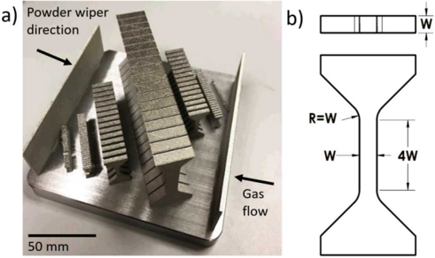

Two  identical  build  cycles,  each  with  all  sizes  printed  on  a  build  plate,  were  fabricated  from  316L stainless  steel, also  known  as  UNS S31603  or  WNR 1.4404,  using  a  ProX  DMP 200 (3D  Systems) laser  powder  bed  fusion  printer. While  the  part  spacing  in  Figure 1  is  quite  close,  the  microstructure  was  found  to  be  consistent  within  each  sample, and  between  sample  sizes,  indicating  little effect  of part  spacing.  The  powder  layers  were  nominally  30 gm  thick,  and the  average  powder  diameter (D50)  was  16.7  gm, with  a  10% powder  size  distribution  (D10) of  8.2  gm, and  a  90% particle size distribution  (D90) of  27.6  gm. The  nominal  laser power  was  programmed  for 103  W, with  a  100  gm beam  diameter  and  a  scan  velocity  of  1.4  m/s.  The  laser  used  a  3D  systems  hexagon  raster  scan  pattern with  50  gm hatch  spacing.  The  chamber  was  filled with  argon  cover  gas  and  contained  approximately  1000  ppm  oxygen.  These parameters are baseline values  recommended  by  the manufacturer and  had proven  to work well over  a  range of previous builds. Walls were built around  the smaller  tensile samples  shown  in Figure 1 to protect  them  from  the powder  recoater.  All  the  samples  were  tested  in  the  as-built  condition  without  any  post  processing,  surface  finishing or  thermal  treatment.

Table  1:Nominal  Sample  Dimensions

| Sample Size   |   Width, [W] (mm) |   Thickness [W] (mm) |   Length, [4W] (mm) |
|---------------|-------------------|----------------------|---------------------|
| W=0.4         |              0.40 |                 0.40 |                 1.6 |
| W=0.6         |               0.6 |                  0.6 |                 2.4 |
| W=1.0         |               1.0 |                  1.0 |                   4 |
| W=2.5         |               2.5 |                  2.5 |                  10 |
| W=6.25        |              6.25 |                 6.25 |                  25 |

After printing, tensile  samples were cut from the  build  plates  by wire electrical  discharge  machining. Metallography was  conducted on  the  longitudinal  cross section of  a  single sample  from  each  specimen  size using standard  grinding  and  polishing  procedures. Porosity  was  calculated  from  the  area  fraction  of pores  optically  measured on  the  metallography  cross  sections.  Grain  size  and  crystallographic  texture  were  quantified  with  electron  backscatter diffraction  (EBSD).  An  Oxford  EBSD  system  was  used  with  a  step size of 2  gm  for  the  smallest  size  (W=0.4  mm), and  3 gm  for  the  other  sample  sizes.  Standard  functions  available  in  the  Matlab  toolbox  MTEX were  used  to  calculate the  texture  index  and  average  grain sizes  of each  specimen  size.  The  same  metallography  cross  sections were  then used  for  Vickers  microhardness  testing,  using  a  load  of 100  g, and  a  15  sec  dwell.  Six  hardness  measurements  were taken  along  the  gauge  length  of a  specimen  from  each  size.

A  representative tensile specimen  from  each specimen size was  characterized by  micro-computed  tomography (CT)  using  a  Zeiss  Xradia  520  Versa  system.  Because  the  largest  sample  was  approximately  4000 times  the  volume of the  smallest  sample, the  voxel  size  was  varied  from  0.89  gm to 1.73  gm, in  order  to  maintain  practical  scan  times. While  the  CT data  is  used  primarily  to  qualitatively  asses  the  sample  shape, these  voxel  sizes  should  still  reveal  any significant  internal  porosity  and  provide  a  detailed  3D  maps  of the  sample  surface  topography.  A voltage  of  160  kV was  used  to  image  the  larger  samples,  which  was  reduced  to 140  kV for  the  smallest (W=0.4)  sample.  The  surface roughness  of the  specimens  was  characterized  from  a  longitudinal  CT cross  section  at  the  mid  plane  of the  specimen. The  edge  was  extracted  from  the  2D image,  and  an  average  surface  roughness  calculated  from  the  digitized  profile.

The  width  and  thickness  of every  specimen  was  measured  using  a Keyence  IM-6000  optical  measuring  microscope, also  screening  out  excessively  warped  specimens.  Monotonic  tensile  tests  were  performed  on  an  MTS load  frame,  at a  strain  rate of  1.25x10-2/s. The  samples  were  loaded  to  2% strain,  unloaded  to  zero  load  to  measure  the  unloading modulus,  and  then  re-loaded  to  failure.  Commercial  2D  Digital  Image  Correlation  (DIC) software,  VIC-Gauge,  by Correlated  Solutions  Inc.,  was used  to  measure  virtual  extensometer  strain  without  contacting  the  samples,  providing a  consistent  method  of strain  measurement  across  all  five  sample  sizes. The  virtual  gauge  length  was selected  to  be the entire gauge  length of  the sample  (4W) from fillet to fillet.  DIC  images were acquired with a  Point Grey Grasshopper  camera  (model  GS3-UR-41C5M-C) with  Edmund  Optics  lenses  scaled  such  that  the  gauge  lengths  filled &gt;50%  of  the  field of view.  The  two-point  virtual  extensometer  with  this  set  up  had  a  root  mean  square  strain  noise floor  of  -0.0002  mm/mm.

Finite  element  analysis (FEA)  was  used  to  corroborate  and  interpret  the  experimental  observations.  The  effect  of sample  surface  roughness  was  explicitly  modeled  by  extracting  the  surface  features  from  a  CT slice  at  the  mid-plane of  the  specimen.  This  surface  was then  used  to  create  an  extruded  2.5D  model that  could  be  analyzed  using  Sandia's computational  mechanics  suite,  Sierra  [35].  A multilinear  elastic-plastic  hardening  model  with  failure  that  has  been used  extensively  in  other  studies  [36-38]was  used  to  simulate  the  tension  test  to  complete  failure  of the  part.

## 3.  RESULTS

## 3.1  Microstructure  Characterization

HIR-EBSD  grain orientation maps  containing  a  total of  18.5 million points  are  presented  in  Figure  2.  While  not shown,  metallography  did  not  reveal  any  significant  difference  in  precipitates,  or  grain  boundary  segregations.  All sample sizes have a  [001]  texture in the build direction,  similar to  316L  microstructures from LPBF  reported in previous  work [39-41].  An inverse  pole  figure  quantifying  this  texture  is  given  for  the  W=6.25 specimen  in  Figure  2b and  is  representative  of the  other  specimen  sizes.  Feature  size  and  processing  parameters  can  produce  complex  thermal gradients  that  lead  to  gradient  grain  structures  [25].  However, for  the  processing  conditions  used  in  this  study  there  is little, if  any,  detectible gradient  in grain size,  orientation,  or  aspect  ratio between  the center and  the edge  of  the specimens.  The  grain structure at  the  immediate  surface of  the samples  shows  a  thin  (&lt;100  gm) region of  refined grains  likely  caused  by  grain  nucleation  from  partially melted  particles.  Subsequent  analysis  however  suggests  that the  mechanical  response  in  this  region  is  dominated  by the  geometric  contributions  of surface  topography.

Figure  2:  a) EBSD  maps  of the  crystallographic  grain  structure  of each  sample  size,  at  a common  scale,  b) Inverse  pole figure for  the W=6.25 sample  with  respect  to  the  build  direction

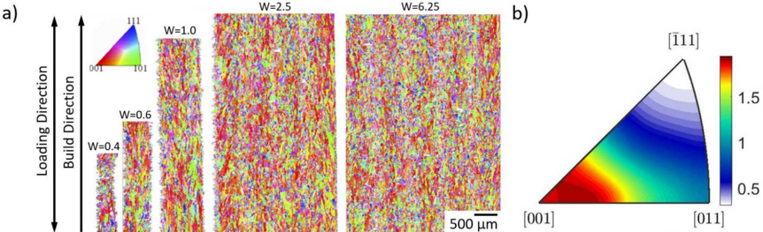

Figure  3 summarizes  the  microstructural  parameters  as  well  as  microhardness  between  the  different  specimen  sizes. The  grain  aspect  ratio  is  calculated  as  the  ratio  of major  to  minor  axes  of an  ellipse  that  has  been  fit  to  each  grain  and then  averaged  over  all  grains  in  the  specimen.  The texture  index  quantifies  the  degree  of anisotropy,  with  an  index  of 1 representing a  fully  isotropic grain structure,  and  an  index  of infinity  a  single crystal  [42].  The  texture  index  is calculated  from  the  square  of the  orientation  distribution  function  integrated  over  orientation  space (Eq.  1).

$$J = \Phi ( f ( g ) ) ^ { 2 } \, d g$$

The  properties  shown  in  Figure  3 are  relatively  consistent  between  the  specimen  sizes,  and  very  consistent  within each  specimen  as  a  function  of height.  The  grain  size,  texture  index,  and  surface  roughness  may increase  marginally as  specimen  size  increases,  before  dropping  back  down, though  this  trend  is  relatively  slight  and  could  be  influenced by  the  smaller  number  of grains  measured  in  the  W=0.4  and  W=0.6  samples.  The  microhardness  however  is  nearly the  same  for  all  samples  suggesting  that  what  minor  differences  in  microstructure  are  present  do  not  appreciably  affect the  mechanical  properties.

Figure  3:  Texture  index,  grain  size,  grain  aspect  ratio,  and  microhardness  of the five  sample  sizes  normalized  by  the W=6.25 specimen.  The  values fbr  the W=6.25 specimen  are  given  in  the  legend.

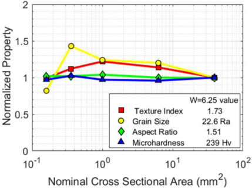

## 3.2  Mechanical  Response

High  throughput  tensile tests were  performed  to probe  the mechanical  response,  and statistical variations as  a function  of specimen  size.  No statistically significant  variation  in  tensile properties  between  builds  of the  same  size specimen  were  observed,  so  the  data  from  both  builds  has  been  combined  into  one  data  set.  The  number  of specimens tested  and  the  property  statistics  are  included  in  Table  1  of the  Appendix.  While  the  microhardness (Figure  3) is  quite consistent  for  all  sample  sizes,  the  stress  strain  plots  given  in  Figure  4  show  significant  differences  in  strength  between the  sample  sizes.  Also  apparent  is  the  wide  spread  in  elongation  to  failure  for  all  sample  sizes,  which  is  characteristic of  AM material.  The  largest  sample  sizes,  W=2.5  and  W=6.25  generally  agree  with  yield,  UTS and  elongation  values for machined specimens found from the literature, though as previously noted the literature shows significant variations  in  properties  between  sources  [12,  13,  15].

Figure  4: Stress-strain  plots fbr  all  tensile  samples  of all  sizes

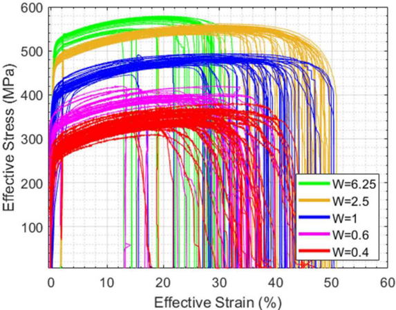

The  yield  strength,  ultimate  strength  (UTS),  and  elastic  modulus, plotted  in  Figure  5a-c,  all  decrease  significantly with  decreasing  sample  size.  The  smallest  samples,  W=0.4, exhibit  effective  strengths  and  stiffnesses  of  only  -50% of  the bulk samples  (W=6.25).  In  absolute terms,  the variability in strength increases slightly as  the sample size decreases,  however  in  relative  terms  this  increase  in  variation  is  significant.  The elongation  to  failure  of the  samples (Figure  5d) show  little differentiation  between  sample  sizes,  instead  showing  substantial  sample-to-sample  variation within  each  size,  as  has  been  observed  elsewhere  [18, 21].  Since  elongation  to  failure  is  a  dimensionless  quantity,  it is  not  affected  by errors  in  area  measurements  like  strength  and  stiffness,  parameters  dimensioned  in  N/mm2 .

Statistical Tukey analysis, presented in the Appendix,  indicated that only the W=6.25  specimen size had a statistically distinct elongation distribution. Subsequent  fractographic analysis was  not  able  to determine  a  clearly distinct  failure  mechanism  for  the  W=6.25  mm sample  population. However, unlike  the  other  specimen  sizes,  most of  these  largest  samples  failed  at  nearly  the  same  location  in  the  gauge  section. This  suggests  that,  for  both  builds, there  was  a  particular  build  layer  that  produced  ductility-limiting  flaws.  These  defects  however  occurred  at  different heights  for  each  build  plate,  and  could  not  be  correlated  with  any  features  found  in  metallography  of EBSD.  This  type of  defect  behavior  (though  not  necessarily  this specific cause)  is  related  to  sample  size,  as  larger  samples  are  more statistically likely to sample the entire distribution of  flaws,  including the less common  larger flaws. Smaller specimens  on  the  other  hand  sample  only  a  fraction  of the  flaw  population,  resulting  in  some  samples  with  virtually no  flaws,  and  some  samples  with  large  flaws  relative  to  the  sample  size,  increasing  the  variability  between  specimen.

Figure  5:  Tensile  properties  as  a function  of sample  size.  a) yield  strength,  b) ultimate  strength,  c) elastic  modulus,  d) elongation to failure.

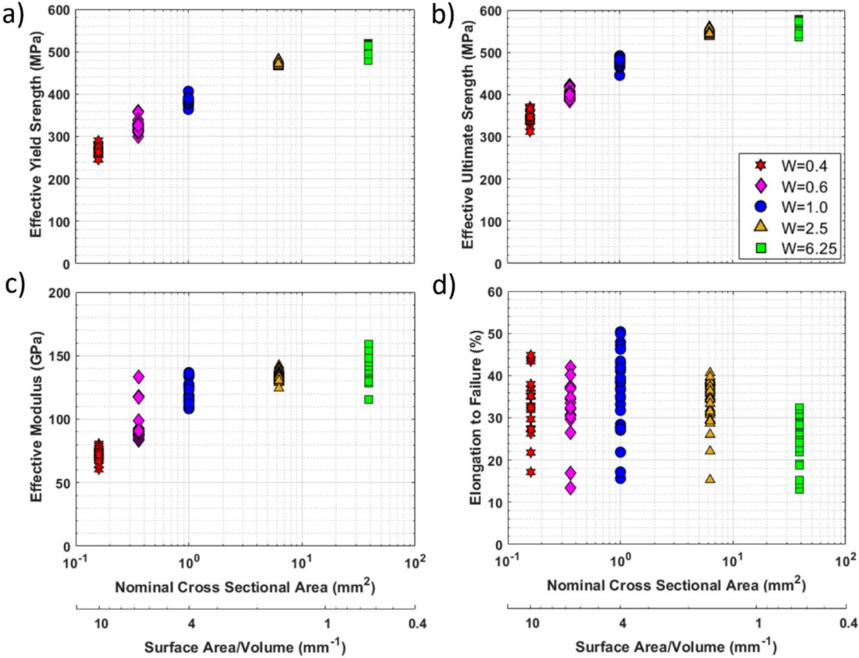

The  maximum  likelihood  estimates  of Weibull  three-  parameter  cumulative  probability  distributions  for  ultimate tensile strength are shown  for all five specimen sizes in Figure  6 as determined using Minitab statistical analysis software.  Among  15  common  distributions,  the 3-parameter Weibull  provided a  best  fit as determined using an Anderson-Darling goodness  of  fit.  This  distribution had  also proven  effective in previous statistical datasets  [21]. This graphical representation emphasizes the systematic trend in ultimate strength distribution as a  function of specimen  size.  The  kink  in  the W=6.25  mm dataset suggests  a  subtly bimodal  response,  which  may  indicate  two distinct  flaw  populations.  This  is  likely  related  to  whatever  build  flaws  caused  the  consistent  failure  location  observed in  the  W=6.25  samples.  Setting  aside  the  bimodality  of W=6.25,  there  is  a  trend  of increasing  distribution  breadth  for smaller  specimen  sizes.

Figure  6:  Cumulative  probability  of UTS  at failure for  each  specimen  size.

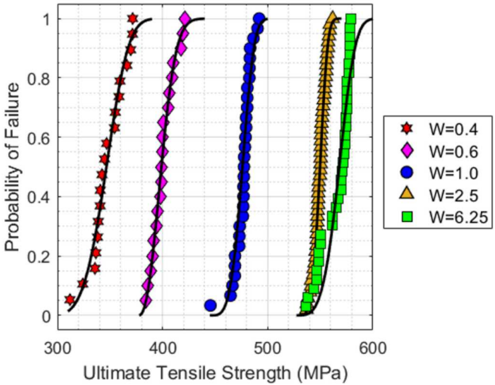

Since  the  intrinsic microstructure  and  microhardness  show  little variation  between  specimen  sizes,  the  observed trend  of decreasing  strength  and  modulus  with  specimen  size  suggests  an  extrinsic  source.  A likely  explanation  is  that the  surface  roughness  obfuscates  the  precise  determination  of the  true  load-bearing  area.  A surface  effect  explanation is  consistent  with  the  strength  and  elastic  modulus  asymptotically  approaching  a  constant  value  at  larger  sample  sizes, as  the  surface  area  to  volume  ratio  decreases (Figure  5a-c).  Such  an  issue  has  been  described  previously  [43],  and  is analyzed  in  more  detail  in  the  discussion.

However even the largest specimens, where surface effects are minimal, exhibit modulus values that are substantially  lower  than  the  accepted  Young's  modulus  of -193  GPa  for  wrought  316L. This  can  be  attributed  to  the [001]  texture  in  the  loading  direction  of all  the  samples,  which  is  the  most compliant  orientation.  For  austenitic  (FCC) stainless  steel  the [001]  direction  has  a  modulus  of  101  GPa, approximately  half  of the  isotropic  polycrystalline  value [44].  Prior  work  has  shown  that  the [001]  direction  is  a  preferred  growth  orientation  for  LPBF, particularly  with  high energy  input [39-41].  A study  by Niendorf  et  al.  characterizing  the  same alloy  and  manufacturing  process  as  the  current paper,  showed  that  very  strong  [001] textures  could  be  produced  with  high  energy  input,  resulting  in  elastic  modulus values  half that  of the  samples  with  more  isotropic  grain  structure  [39].

The  effective  elastic  modulus  produced  by crystallographic  texture  can  be roughly  estimated  from  the  single  crystal elastic  constants  [45],  and  the  crystal  orientation  distribution  obtained  from  EBSD [46].  While  there  is  no  uniformly agreed  upon  method  for this homogenization,  the Voight (Eq.  2, [47])  and  Reuss  approximations  (Eq.  3, [48])  are useful  because  they  give  upper  and  lower  bounds  for  the  polycrystalline  modulus respectively.  The  Hill  approximation (Eq.  4, [49])  meanwhile  is  a  commonly used  simple  average  of the  two.  The  Voigt  and  Reuss  equations  are  given  in Eq.  2-3,  in  forms  compatible  with  EBSD data  [50].  The  subscript  SX refer  to  the  single  crystal  stiffness/compliance matrices,  andf(g) is  the  orientation  distribution  function  obtained  from  EBSD, all  integrated  over  the  orientation  space.

$$\overline { [ C ] } _ { v o i g t } & = \oint [ C ] _ { S x } \cdot f ( g ) \cdot d g & \text {Eq.} \, 2 \\ \overline { [ S ] } _ { R e u s s } & = \oint [ S ] _ { S x } \cdot f ( g ) \cdot d g & \text {Eq.} \, 3 \\ \overline { [ C ] } _ { H i l l } & = 1 / 2 \left ( [ C ] _ { v o i g t } + [ C ] _ { R e u s s } \right ) & \text {Eq.} \, 4$$

$$[ C ] _ { H i i l } = \gamma _ { 2 } \left ( | C | _ { V o i g t } + [ C ] _ { R e u s s } \right )$$

These  approximations  give  upper  and  lower  bounds  for  the  microstructures  in  Figure  2 of  159  GPa  and  134  GPa. The  Hill  average  of 146  GPa  is  remarkably  close  to  the  average  value  of 143  GPa  observed  in  the  largest  (W=6.25) samples.  While  these  approximations  must  be  taken  with  some  caution,  they  clearly  demonstrate  the  important  role  of texture in  the elastic moduli  observed  experimentally.  In  addition  to  the microstructural  texture component,  small values  of porosity  have  also  been  shown  to  have  an  outsized  effect  on  the  elastic modulus  of LPBF  316L  [41],  and may  be  a  secondary  contributing  factor  in  this  case  as  well.

## 3.3  Micro-computed  tomography

Micro-computed  tomography  (CT) scans  of representative  examples  for  sizes  W=0.4, W=0.6  and  W=2.5  sizes  are presented  in Figure  7.  The  W=2.5  size sample  shows  larger  pores,  with  the  largest  &gt;100  ium,  however  the  smaller samples  contain  similar  levels  of total  porosity  (Figure  8) with  more  smaller  pores.  The  decreasing  max pore  size  with decreasing  sample  size  could  be  due  to  a  sample  size  effect  that  is  commonly seen  in  smaller  samples,  or  it  could  be caused  by  the  thinner  geometry  itself.  A potential  example  of the  statistical  size  effect  phenomenon  is  that  some  small samples (400  ium  wide/thick)  may  have  contained  large  &gt;100  ium  pores,  but  the  flaw  to  sample  size  ratio may  have caused  them  to  fail  during  the  print.  About half  of the  smallest  samples  (W=0.4) failed  geometric  inspection,  and  some of  them  failed  entirely  during  printing,  while  only  a  few  of the  W=0.6  samples,  and  none  of the  larger  samples  failed geometric  inspection.  Some  print  failures were  observed  in  this  smallest  size  only,  but  no  direct  causation  could  be attributed,  and  many factors  play  a role  in  print  failures.  While  high  throughput  micro  CT is  not  yet  practical,  the  large number  of samples  mechanically  tested  allow  us  to  capture  this  statistical  variance.

Figure  7:  CT images for  the W=2.5,  W=0.6,  and  W=0.4 size  samples.  Left  column: 3D  Render,  middle  column:  longitudinal cross  section,  Right  column: loading  cross  section

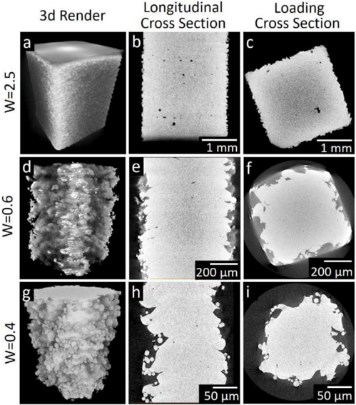

The  surface  roughness  and  porosity  for  each  sample is  given  in  Figure  8, and  are  relatively  constant  for  all  specimen sizes.  The  surface  roughness (Ra)  was  digitally  measured  from  the  edge  of the  CT longitudinal  cross  sections  shown in  Figure  7b, 7e,  and  7h. Because  the  surface  roughness  is  driven  by the  powder  size  and  laser  parameters,  which  were both  constant  for  all sample  sizes,  it  is  not  surprising  that  the  surface  roughness  is similarly  consistent  between  the specimen  sizes.  While  much  effort  has  been  spent  characterizing  and  reducing  the  porosity  of AM  components  in  the literature,  the  surface  roughness  clearly  becomes  a  more  substantial  issue  as  the  sample  size  decreases.  Additionally, it  is  worth  noting  that  from  fracture  mechanics  theory,  surface  flaws  are  known to  be  substantially  more  detrimental than  equivalent  internal  flaws.

Figure  8: Surface  roughness  and porosity for  each  specimen  size,  normalized  by  the W=6.25  value  given  in  the  legend.

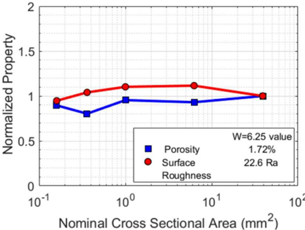

The  surface roughness  becomes  such  a  dominate  feature of  the smaller samples  that  it obscures our  ability to properly  dimension  these  small  features.  While  the  W=2.5  specimens (Figure  7a-c),  shows  a square  cross  section  with relatively  minor  surface  features,  the  W=0.4 sample  (Figure  7h-i),  is  so  dominated  by the  surface  roughness, that  it  is impossible  to  ascertain  the  nominally  square  cross-section.  This  type  of roughness  induced  geometric  error  has  also been  shown  in  CT  data  from  lattices  [51].  Clearly  a  mechanical  measurement,  which  measures  in 1D from  the  peak on  one  side  to  the  peak  on  the  other,  would  greatly  overestimate  the  true  thickness  of the  sample.  From  the  3D render however  it can  be  seen  that  even  a  two-dimensional  optical  measurement,  capable  of  extracting average,  min/max, etc,  would  still  not  be  able  to  capture  the  true  3D surface  topography.

## 3.4  Finite  Element  Modeling

To  better  understand  the  cause  of the  reduced  mechanical  performance  of the smaller  specimens,  fmite  element models were  generated based on  the CT  cross sections. The  longitudinal center cross sections  from  the CT  data, (Figure  7b,  7e,  and  7h) were  used  as  the  base  geometry.  A python  script  was  written  to  extract  the  surface  features from  the  CT cross  section  using  standard  image  analysis  edge  detection  algorithms.  The edge  geometry  was  then  used to  build  an  extruded  2.5D  model, as  outlined  schematically  in  Figure  9.  Some  surface  detail  is  lost  during  the  edge detection,  meshing  and  transfer  pipeline,  however  as  a  first  order  approximation  this  analysis  provides  useful  insights.

Figure  9: Process flow for  edge  extraction  and surface  modeling

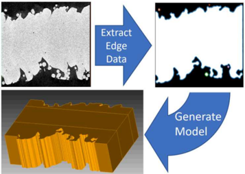

A  multilinear  elastic-plastic  hardening  model  with  failure,  used  extensively  in  other  studies  [36-38],  was  used  to simulate the tension test to complete failure of  the part. The  plastic hardening behavior was  based on  previous experimental  results  of LPBF  316L  [38].  As a  control,  a  W=6.25 reference  test  specimen (the  "bulk"  specimen)  with smooth  walls  was  also  evaluated  using  FEA. The  model  for  the  rough  0.4  mm width  specimen  is  shown  in  Figure  10. The  FEA  results  illustrates  that  the  surface  roughness  of the  test  specimen  produces  stress  concentrations  which  serve to  trigger  early  yielding,  reduce  ultimate  strength  and  drive  premature  fracture.

Figure  10: Evolution  of damage  initiating from  stress  concentration

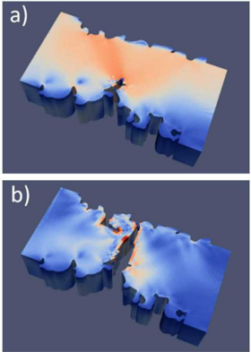

The  FEA  estimate  for  UTS is  compared  to  the  experimental  data  in  Figure  11  and  follows  the  same  trend  observed experimentally.  Since  the samples were  tested in the as printed state, it is possible that  residual stresses alter the effective  properties,  however  the  FEA was  conducted  without  any initial (residual)  stress,  and  shows  that  the  geometric contribution  from  surface  roughness  alone  is  able  to  capture  the  majority  of the  size  effect  behavior.  For  the  purposes of  the  present  study,  the  current  simplified  FEA is sufficient  to  illustrate the  semi-quantitative effects of the  stressconcentrating  surface  roughness  features.  Future  analysis  efforts  could  be  refined  by  modeling  3D surface  roughness, or by  parameterizing the surface roughness such that meaningful statistics can be generated from representative instantiations  of surface  roughness.

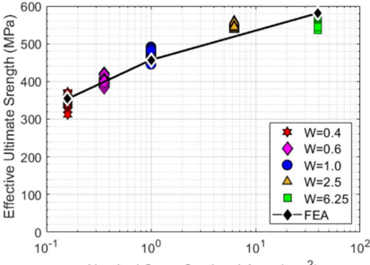

Nominal  Cross  Sectional  Area  (mm2 )

Figure  11:  Comparison  of experimental  data  with  FEA  results  explicitly  modeling  the  surface  roughness.

## 4.  Discussion

Traditionally,  materials  science  is  viewed  through  the  lens  of process-structure-property-performance relationships.  The  material  property  aspect  is viewed  to be  an  intensive  feature of the material,  and  does  not  itself depend  on  the  size,  or  shape  of the  material  present. However, in  the  case  of additive  manufacturing,  both  the  intensive material  properties  and  the  effective material  properties  (structural  properties)  are  intrinsically  coupled  to  the  shape and size of  the  features.  In  general,  AM components  may  have  internal microstructural variation that depends  on feature  geometry,  and  as  a result,  their  intensive  properties  can  vary  within  the  material  from  voxel  to  voxel  and  from one  geometry  to  another. A component  printed  at  one  scale  may have  different  microstructure/property  gradients  than the  same  component  printed  from  the  same  material  but  at  a  different  scale.  This  potentially  inextricable  link  between geometry  and  properties  poses  a  clear  dilemma  in  design  and  qualification. As the  concept  of an  intensive  material property  becomes  not  only  spatially  variable,  but  also  stochastic,  the  problem  becomes  even  more  complex. Given all  this  complexity, the  emphasis  in  qualification  should  focus  on  structural  performance  qualification. Feedstock  and material  qualification however  still play  supporting  roles  in  that  they  attempt  to maintain  overall  consistency  from batch  to  batch.

In the present study,  the AM 316L  alloy produced by  laser powder  bed  fusion had  a  reasonably homogenous microstructure across specimen sizes,  and  as a  result,  the hardness,  which  samples  the cumulative effect of  this intrinsic  microstructure,  was  constant  for  all  sizes.  Despite  this  uniformity  in  microstructure  and  intrinsic  strength,  a strong  trend  of decreasing  effective  strength  with  decreasing  sample  size  was  observed.  While  material  properties  are governed  by  the  microstructure,  the  structural  properties  of components  are  determined  by  both  the  intrinsic  material properties and  the geometry  of  the component.  Generally,  these contributions can be  separated through material testing,  FEA, and  component  level  testing,  and  the distinctions between  material  and  structure are  fairly obvious. However, as  the  feature  size  decreases, the  surface  roughness  becomes  large  enough  to  significantly  alter  the  geometry of  the  tensile specimens,  blurring  the  line between  material  sample  and  structural  component.  At  very  small  feature sizes  the  surface  roughness  begins  to  dominate, and  microstructural  differences,  or  even  the  original  design  geometry, can  become  secondary  factors.  While  it  is  tempting  to  cast  aside  the  geometry  contribution  as  a  problem  for design engineers,  this may  not  be  possible as  the geometry  can  be  linked  to  the  same  processing parameters  that  control microstructure.  Powder  size  and  heat  input  can  influence  feature  size  and  surface  roughness  as  well  as  microstructure, so  changing  processing  to  optimize  microstructure  and  material  properties  will  also  affect  the  geometry [28,  32,  33]. Small  feature AM therefore needs  to consider geometry  as a  fourth component  to the classical materials science paradigm.

## 4.1  Geometric  accuracy

The  effect  of surface  roughness  can  be  subdivided  into  two  parts:  a  reduction  in  load  bearing  area,  and  a  stress concentration  effect.  While  the  reduction  in  load  bearing  area  will  affect  all  materials  equally,  the  stress  concentration effect will be  more  significant  in brittle systems  such  as  the  Al 1  OMgSi  alloy,  or  certain loading  scenarios  such  as fatigue  loading.  The  load-bearing  area  problem  can  be  characterized  by  simple  roughness  parameters  or  corrections to  the  nominal  dimensions,  as  has  been  attempted  in  past  work [18].  In  this  study  the  surface  roughness  was found  to subtract  from  the  load  bearing  area,  however  other  sources  of geometric  error  can  be  both  positive  or  negative  [52, 53].  To  mitigate  this,  the  printer  or  part  model  can  be  uniformly  adjusted,  or  more  complex  corrections  can  be  made by  adjusting  the  printing  parameters  dynamically [34,  51].

The  actual  geometry  of  an  AM feature  at  any  one  location  is a  function  of many  factors  including:  the  nominal geometry,  the  dimensional  tolerance  of the  machine, warpage  from  residual  stress,  and  the  roughness  of the  part.  Some of  these factors like warpage may  scale with part size,  however  in absolute terms  the magnitude of  the surface roughness  was  found  to  be  constant.  This  means that  as  the  nominal  feature  size  becomes  smaller, the  feature  geometry will become  dominated  by  surface roughness.  At  the extreme  end,  as  the  feature size approaches  the scale of  the surface  roughness,  a  roughness  valley  may cut  all  the  way through  the  part,  or  far  enough  through  that  the  part  cannot stand  up  to  the  powder  wiper, and  the  part  fails  to  print.  In  reality  print  failures  are  coupled  events  that  depend  on  the process,  the  machine  and  the  feature.

Since  gross  geometric  effects  are  seen  in  both  the  strength  and  the  elastic  modulus, it  is  interesting  to  divide  the two  to produce a  normalized,  non-dimensional  yield strength shown  in Figure 12.  The  yield strength,  and  elastic modulus  measured  for each sample were  used  in this normalization.  Like elongation to failure,  this parameter  is dimensionless,  so  it should  not  depend  on  flawed measurements  of  cross-sectional  area,  i.e. a  constant  bias would cancel  out.  As expected,  there  is  no  discernable  trend  in  this  parameter  as  a  function  of specimen  size.  Furthermore, if  the  scatter  in  modulus  and  yield  strength  are  assumed  to  be  due  to  the  error  in  cross-sectional  area  measurements, then  the  scatter  in  the  normalized  yield  strength  should  approach  zero.  However, because  this  is  not  the  case, it  appears that  area  reduction  is  not  the  whole  story,  and  that  other  factors,  notably  stress-concentration  contributions  from  the surface  roughness  are  affecting  the  specimen  response.

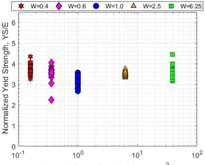

Nominal  Cross  Sectional  Area  (mm2 )

Figure  12: Effective  yield  strength  normalized  by  effective  elastic  modulus.

The  problem  of surface  topography  specific  stress  concentrations  is  more  difficult  to  understand  because  it  requires much  more  detailed information  on  the  exact  contour  of the surface.  Measuring  the  surface profile of  AM parts  is challenging because  they  contain  overhangs  and  crack  like  features  that  are difficult or  impossible  to  capture with physical  profilometry,  or  line  of sight  optical  surface  measurement  techniques.  Fortunately,  CT data  does  not  suffer from these problems,  and is only limited by  the resolution of  the instrument. More  detail on  metrology of  AM components  can  be  found  in  the  literature  [52, 54-56].  Once  the  surface  profile  of the  features  has  been  obtained,  FEA can  be  used  to  estimate  stress  concentrations  quite  accurately.  This  process  however  is  cumbersome, and  since  stress concentrations  tend  to  be  a  weakest  link  problem, potentially  subject  to  large  statistical  variance.

While  the  stress  concentration  problem  can  be  quite  significant  for  some surface  topographies  and  brittle materials, for  ductile  materials,  and  closely  spaced  uniform  surface  features  the  stress  concentration  effect  will  not  be  as  severe. Rather  than  the  surface  features  disrupting  the  flow  of stress  through  the  sample, if  they  are  spaced  frequently  enough, there  will  be  little stress  carried  near  the  surface  at  all.  Instead  the  surface  stress  concentrations  will  act  as  a  reduction in  effective  load  bearing  area.  Stress  concentration  solutions  for  an  infinite  row  of semicircular  edge  notches  compiled by Peterson show that the stress concentration decreases both as the notch spacing decreases, and somewhat counterintuitively  also  as  the  notches  become  larger  compared  to  the  plate  width [57].  This  line  of reasoning  indicates that  while  originally  assumed  to  be  distinct,  the  load  bearing  area  reduction  and  stress  concentration  effect  may in  fact be  linked,  though  not  the  same. Because  stress  concentrations  may  be  reducing  the  effective  load  bearing  area  below the surface it may  be  impossible to measure  the true load bearing area directly,  irrespective of  the measurement technique.

## 4.2  Design  Implications

Though  surface  roughness  has  been  well  documented  as  a  problem  in  AIvI  since  its  inception,  the  full  implications of  the  problem  have  not  been  fully  realized.  While  a  simple  knock  down factor  due  to  surface  roughness  on the  strength (yield,  ultimate,  or  fatigue) is  easy  to  accommodate  by  simply  designing  under  this  threshold,  the  effect  of roughness on  the  stiffness  of printed  parts  is  perhaps  more important  because  it affects  the  design  at  any level  of loading.  Some applications,  such  as  vibration  isolation or  damping, are  not  limited  by  strength  but  rather  derive  their  performance solely  from  the  stiffness  of the  part.  In  this  study  the  effective  stiffness  of the  0.4  mm samples  was  found  to  be  half that  of the  bulk  samples,  because  of a  surface  roughness  induced  reduction  in  load  bearing  area.  The  stiffness  will  be further  reduced  in  bending  loading  since  the  flexural  rigidity goes  with  the  dimension  to  the  third or  fourth  powers instead of  length squared as in the tensile stiffness. If  the smallest sample  in this study were  loaded in bending (I=1/12W4 ) its  flexural  stiffness  would  be  only  one  quarter  that  of the  bulk  samples.  On top  of the  surface  roughness reduction,  the  microstructural  texture  from  the  AIVI  process  may add  as  much  as  another  factor  of two  reduction  to  the stiffness.  Taken  together  it is possible  to  have  an  effective  tensile stiffness  on  the  order  of a  quarter  of the  accepted book  value,  or  one  eighth  of the  expected  flexural  rigidity.

Because  the  dimension  reduction  affects  tensile  and  bending  loading  differently  it carmot  be  fully  accounted  for by  simply  using  an  effective elastic modulus, though  modulus  adjustments  are  simple  to  implement  and  have  been shown  to  greatly  increase  the  accuracy  of FEA  predictions  [29].  Subtracting  a  surface  layer  from  the  nominal  design dimension  to  give  an  effective  thickness  is  proposed  to  be  a  more  accurate  correction.  The  microstructural  component of  the  stiffness  reduction  however  must  still be  accounted  for by  using  a  reduced  elastic modulus,  or  preferably  an anisotropic elastic model.  Both  corrections  are  necessary  to accurately  predict  structural  responses  in parts  that are subjected  to  complex  loading.

## 5.  SUMMARY  AND  CONCLUSIONS

The  effective  strength  and  stiffness  of as  printed  LPBF 316L  specimens  was  found  to  decrease  dramatically  as  the specimen  size  decreased.  Through  analysis  of microstructure,  the  mechanical  response  of statistically  relevant  sample sizes,  and  the  use  of finite  element  modeling, this  performance  reduction  can  be  attributed  to  surface  roughness  effects. The  most  significant  conclusions  are  listed  below:

1.  The  surface  roughness  was found  to  reduce  mechanical  performance  via  two  mechanisms·  decreasing  the  effective load bearing area and  creating stress concentrations.  FE  models  created from  CT  data were  able to accurately predict  the  strength  of the  different  sized  specimens.  While  this  study  was  carried  out  using  the  highly  ductile  alloy 316L  stainless steel,  the size effect  due  to stress concentrations  from  surface roughness  is expected  to become much  more  significant  in  more  brittle  alloys  such  as  All 0MgSi,  or  in  other  loading  schemes  such  as  fatigue  loading.
2.  The  stochastic  variation  in  mechanical  properties  increases  as  the  sample  size  decreases, though  this  trend  was  not as  clear  as  the  trend  in mean  values.  Even  larger data sets are  necessary  to  fully understand  the  distribution of properties.
3.  In  addition  to  the  geometric  size  effect  from  surface  roughness,  the  strong  crystallographic  texture  from  the  AM process  caused  a  significant  reduction  in  the  elastic  modulus  for  all  sample  sizes.  With  the  combined  contributions from  the  surface  roughness  and  microstructure, the  actual  tensile  stiffness  for  the  smallest  specimens  was found  to be  only  -1/3  that  of the  accepted  value  and  would  be  expected  to  decrease  even  further  in  bending  loading.
4. The  microstructure  and  intrinsic  material  strength  as  measured  by  microhardness  did  not  change  appreciably  as  a function  of specimen  size  for  the  316L  alloy  used  in  this  study.
5.  The  strength  reduction,  but  especially  the  lower  stiffness  of smaller  features,  can  cause  large  discrepancies  between the  predicted  and  actual  component  performance.  Designers  using  AM components  must  be  aware  of this  and  take corrective  measures  by using  an  effective  feature  thickness  and  anisotropic  elastic  material  model. It  is  not  enough to extract  true material properties and  transfer  them  to  the design procedure.  AIVI process engineers must  also include  surface  roughness  as  an  equal  partner  with  material  properties  when  optimizing  processing  parameters.

## 6.  ACKNOWLEDGMENTS

The  authors were  supported  by  a  Laboratory  Directed  Research  and  Development (LDRD)  program.  Laboratory facilities  were  provided  in  part  by the  Center  for  Integrated  Nanotechnologies.  The  authors  thank  Todd  Huber,  James Griego,  Philip Noell  and  Zachary  Casias  for  laboratory  support,  and  David  Siaz  for  printing all  the  test  specimens. Sandia National Laboratories is a multi-mission laboratory managed and operated by  National Technology and Engineering Solutions of  Sandia LLC,  a wholly owned subsidiary of  Honeywell  International Inc.,  for the U.S. Department of  Energy's National Nuclear Security Administration under contract DE-NA0003525.  The views expressed  in  the  article  do  not  necessarily  represent  the  views  of the  U.S.  Department  of Energy  or  the  United  States Government.

## 7.  REFERENCES

- [1]  Gibson,  Rosen,  D. Stucker,  B.,  Additive  Manufacturing  Technologies, second  ed.,  Springer,  New  York, (2014).
- [2]  T.  Kellner,  An epiphany  of  disruption:  GE additive chief  explains  how  3D  printing will  upend  manufacturing,  G.E.  Reports (2017).
- [3]  S.A.  Tofail,  E.P.  Koumoulos, A.  Bandyopadhyay,  S.  Bose,  L.  O'Donoghue, C.  Charitidis,  Additive  manufacturing:  scientific and  technological  challenges,  market  uptake  and  opportunities,  Mater.  Today  21(1) (2018) 22-37.
- [4]  Energetics Incorporated,  Measurement Science Roadmap  for Metal-Based Additive Manufacturing,  National Institute of Standards  and  Technology  (2013).
- [5]  R. Russell,  D. Wells,  J.  Waller, B.  Poorganji,  E. Ott,  T.  Nakagawa, . . .  M. Seifi,  Qualification  and  certification  of metal  additive manufactured  hardware  for  aerospace  applications,  Addit.  Manuf. Aero.  Ind., (2019),  33-66.
- [6]  C.Y. Yap,  C.K.  Chua, Z.L.  Dong, Z.H.  Liu,  D.Q.  Zhang, L.E.  Loh, S.L.  Sing,  Review  of selective  laser  melting:  Materials  and applications,  Applied  Phys.  Reviews  2(4) (2015).
- [7]  M.J.  Heiden,  L.A.  Deibler,  J.M.  Rodelas,  J.R.  Koepke,  D.J.  Tung,  D.J.  Saiz,  B.H.  Jared,  Evolution of  316L  stainless steel feedstock  due  to  laser  powder  bed  fusion  process,  Addit.  Manuf. 25  (2019) 84-103.
- [8]  D. Buchbinder,  H. Schleifenbaum,  S.  Heidrich,  W. Meiners,  J.J.P.P.  Billtmann,  High  power  selective  laser  melting  (HP  SLM) of  aluminum  parts,  Phys.  Procedia,  12 (2011) 271-278.

[9]  L.N.  Carter,  C. Martin,  P.J.  Withers,  M.M. Attallah,  The  influence  of the  laser  scan  strategy  on  grain  structure  and  cracking behaviour  in  SLM powder-bed  fabricated  nickel  superalloy,  J.  Alloys  and  Compd. 615  (2014) 338-347.

- [10]  F.  Geiger,  K. Kunze,  T.  Etter,  Tailoring the texture of  1N738LC  processed by  selective laser melting  (SLM) by  specific scanning  strategies,  Mater.  Sci.  Eng. A.  661  (2016) 240-246.
- [11]  B.  Ahuja,  A.  Schaub,  D. Junker,  M. Karg,  F.  Tenner,  R. Plettke,  . .  .  M.  Schmidt,  A Round  Robin  Study  for  Laser  Beam Melting  in  Metal  Powder  Bed, S.  Afr.  J.  of Ind.  Eng.  27(2) (2016).
- [12]  J.J.  Lewandowski, M.  Seifi,  Metal  Additive  Manufacturing:  A Review  of  Mechanical  Properties,  Ann.  Rev.  of  Mater.  Res. 46(1) (2016)  151-186.
- [13]  L. Hitzler,  J.  Hirsch,  B.  Heine,  M. Merkel,  W. Hall,  A. Ochsner,  On the  anisotropic  mechanical  properties  of selective  lasermelted  stainless  steel,  Mater.  10(10) (2017)  1136
- [14] P.  Edwards,  M. Ramulu,  Fatigue  performance  evaluation  of selective  laser  melted  Ti-6A1-4V, Mater.  Sci.  Eng. A.  598 (2014) 327-337.
- [15]  R.  Shrestha,  J. Simsiriwong,  N. Shamsaei,  Fatigue  behavior  of  additive manufactured  316L  stainless steel  parts: Effects of layer  orientation  and  surface  roughness,  Addit.  Manuf.  28 (2019) 23-38.
- [16]  P.  Karlsson,  L.  Pejryd,  C.  Oikonomou, Factors  Influencing  Mechanical  Properties  of  Additive  Manufactured  Thin-Walled Parts,  Euro  PM2017  Congress  &amp; Exhibition,  Milan, Italy,  (2017).
- [17]  Y.C.  Wu, C.N.  Kuo,  Y.C.  Chung,  C.H.  Ng, J.C.  Huang,  Effects of  Electropolishing on  Mechanical  Properties and  BioCorrosion  of Ti6A14V  Fabricated  by  Electron  Beam  Melting  Additive  Manufacturing,  Materials.  12(9) (2019).
- [18]  B.C.  Salzbrenner,  J.M.  Rodelas,  J.D.  Madison, B.H.  Jared,  L.P.  Swiler,  Y.-L.  Shen, B.L.  Boyce, High-throughput  stochastic tensile  performance  of additively  manufactured  stainless  steel,  J.  Mater.  Proc.  Tech.  241  (2017) 1-12.
- [19]  R. Dehoff,  C. Duty,  W. Peter,  Y. Yamamoto,  W. Chen,  C. Blue, C.  Tallman,  Case  study:  additive  manufacturing  of aerospace brackets, Adv.  Mater.  &amp; Proc. (2013)  19.
- [20]  M. Seifi,  A. Salem,  J.  Beuth, O.  Harrysson,  J.J.  Lewandowski, Overview  of materials  qualification  needs  for  metal  additive manufacturing,  JOM, 68(3) (2016)  747-764.
- [21]  B.L.  Boyce,  B.C.  Salzbrenner,  J.M.  Rodelas,  L.P.  Swiler,  J.D.  Madison,  B.H.  Jared,  Y.L.  Shen,  Extreme El  Value  Statistics Reveal  Rare  Failure  El  Critical  Defects  in  Additive  Manufacturing,  Adv.  Eng.  Mater,19(8) (2017).
- [22]  I.  Yadroitsev,  P.  Krakhmalev, I.  Yadroitsava,  S.  Johansson,  I.  Smurov, Energy  input  effect  on  morphology  and  microstructure of  selective  laser  melting  single  track  from  metallic  powder, J.  Mater. Proc.  Tech.  213(4) (2013) 606-613.
- [23]  D.K.  Do, P.  Li, The  effect  of laser  energy  input  on the  microstructure,  physical  and  mechanical  properties  of Ti-6A1-4V  alloys by  selective  laser  melting,  Virtual  and  Phys.  Prototyping  11(1) (2016) 41-47.
- [24]  V. Manvatkar,  A. De,  T. DebRoy,  Heat  transfer  and  material  flow  during  laser  assisted  multi-layer  additive  manufacturing, J. Appl.  Phys.  116(12) (2014).
- [25]  T.M.  Rodgers,  J.D.  Madison,  V.  Tikare,  Simulation of  metal  additive manufacturing microstructures using  kinetic Monte Carlo,  Comp. Mater.  Sci.  135  (2017) 78-89.
- [26]  Y. Li,  D.J.M.  Gu, Design,  Parametric  analysis  of thermal  behavior  during  selective  laser  melting  additive  manufacturing  of aluminum  alloy  powder,  Mater.  Design,  63 (2014) 856-867.
- [27]  T.  Mukherjee,  H. Wei,  A. De,  T. DebRoy,  Heat  and  fluid  flow  in  additive  manufacturing-Part  II:  powder bed  fusion  of stainless steel,  and  titanium,  nickel  and  aluminum  base  alloys,  Comp. Mater.  Sci.  150 (2018)  369-380.
- [28]  B. Ahuja,  A. Schaub,  M. Karg,  M. Lechner,  M. Merklein,  M. Schmidt,  Developing  LBM process  parameters  for  Ti-6A1-4V thin  wall  structures  and  determining  the  corresponding  mechanical  characteristics,  Phys.  Procedia,  56 (2014)  90-98.
- [29]  C.C.  Seepersad,  J.  Allison,  A.D. Dressler,  B.L.  boyce,  D. Kovar,  An Experimental  Approach  for  Enhancing  the  Predictability of  Mechanical  Properties  of Additively  Manufactured  Architected  Materials  with  Manufacturing-Induced  Variability,  Uncertainty Quantification  in  Multiscale  Materials  Modeling  (2019).
- [30]  J.  Parthasarathy,  B.  Starly,  S.  Raman, A  design  for  the  additive manufacture  of functionally graded porous  structures with tailored  mechanical  properties  for  biomedical  applications,  J.  Manuf. Proc.  13(2) (2011)  160-170.
- [31]  W.R. Schmidt,  Micro  heat  exchanger  with  thermally  conductive  porous  network,  U.S.  Patent  No.  7871578, (2011).
- [32]  H. Krauss,  M.F. Zaeh,  Investigations  on  manufacturability  and  process  reliability  of selective  laser  melting,  Phys.  Procedia, 41  (2013) 815-822.
- [33]  C. Song,  Y. Yang,  Y. Liu,  Z. Luo,  J.K.  Yu, Study  on  manufacturing  of W-Cu  alloy  thin  wall  parts  by  selective  laser  melting, Int.  J.  Adv. Manuf.  Tech.  78(5-8) (2015) 885-893.
- [34]  B.  Brown,  W. Everhart,  J.  Dinardo,  Characterization  of bulk  to  thin  wall  mechanical  response  transition  in  powder  bed  AM, Rapid  Prototyping  J.  22(5) (2016) 801-809.
- [35]  M.T.  Merewether,  J.A.  Plews, N.K.  Crane,  G.J.  de  Frias,  S.  Le, D.J.  Littlewood,  . .  .  T.  Shelton,  Sierra/SolidMechanics  4.50 Theory  Manual,  Sandia  National  Lab,  Albuquerque,  NM (United  States) (2018).
- [36] B.L.  Boyce,  S.L.  Kramer, H.E.  Fang, T.E.  Cordova, M.K.  Neilsen,  K. Dion, . ..  T.  Wierzbicki,  The  Sandia  Fracture  Challenge: blind  round  robin  predictions  of ductile  tearing,  Int.  J.  Fract.  186(1-2) (2014)  5-68.
- [37]  S.  Kramer,  T.  Ivanoff,  J. Madison,  A.  Lentfer,  Evolution of  damage  and  failure in an  additively manufactured 316L  SS structure:  experimental  reinvestigation  of the  third  Sandia  fracture  challenge, Int.  J.  Fract.  218(1-2) (2019) 63-84.
- [38]  S.L.  Kramer,  A. Jones,  A. Mostafa,  B. Ravaji,  T.  Tancogne-Dejean,  C.C.  Roth, .  . .  B.L.  Boyce,  The  third Sandia  Fracture Challenge:  predictions  of ductile  fracture  in  additively  manufactured  metal, Int.  J.  Fract.  218(1-2) (2019)  5-61.
- [39]  T. Niendorf,  S.  Leuders,  A. Riemer,  H.A. Richard,  T. Tröster,  D. Schwarze,  Highly  Anisotropic  Steel  Processed  by  Selective Laser  Melting,  Metall.  and  Mater.  Trans.  B. 44(4) (2013)  794-796.
- [40] T. Kurzynowski, K.  Gruber, W.  Stopyra, B.  Kuinicka, E.J.M.S. Chlebus, Correlation between process parameters, microstructure  and  properties  of 316  L stainless  steel  processed  by  selective  laser  melting,  Mater.  Sci.  Eng. A.  718 (2018) 64-73

[41]  E.  Garlea,  H. Choo,  C. Sluss,  M. Koehler,  R. Bridges,  X. Xiao,  . . .B.H.  Jared,  Variation  of elastic  mechanical  properties  with texture,  porosity,  and  defect  characteristics  in  laser  powder  bed  fusion  316L stainless  steel,  Mater.  Sci.  Eng.  A. (2019)  138032 [42]  H.J.  Bunge, Texture  Analysis  in  Materials  Science:  Mathematical  Methods, Buttersworth  Berlin  (1982).

[43]  A.D.  Dressler,  E.W.  Jost,  J.C. Miers,  D.G.  Moore,  C.C.  Seepersad,  B.L.  Boyce,  Heterogeneities dominate mechanical performance  of additively  manufactured  metal  lattice  struts,  Addit.  Manuf. 28  (2019) 692-703.

[44]  B. Hutchinson,  Critical  Assessment  16:  Anisotropy  in  metals,  Mater.  Sci.  and  Tech.  31(12) (2015)  1393-1401.

[45]  H. Ledbetter,  Predicted  single-crystal  elastic  constants  of stainless-steel  316, British  J.  Non-Destructive  Test.  23(6)  1981  227236.

[46]  U.F.  Kocks,  C.N.  Tomé,  H.-R.  Wenk,  Texture and anisotropy: preferred orientations in polycrystals and  their effect on materials  properties,  Cambridge  university  press,  Cambridge, (1998).

[47]  A. Reuss,  Berechnung  der  fließgrenze  von  mischkristallen  auf grund  der  plastizitätsbedingung  fur  einkristalle,  J.  App.  Math. and  Mech.  9(1) (1929) 49-58.

[48]  W. Voigt,  Lehrbuch  der  kristallphysik,  Teubner  Leipzig  (1928).

[49]  R. Hill,  The  elastic  behaviour  of a  crystalline  aggregate, Proc.  Phys.  Soc.  A.,  65(5) (1952) 349.

[50]  P.R.  Cantwell,  H. Kim,  M.M.  Schneider,  H.-H.  Hsu, D.  Peroulis,  E.A.  Stach,  A. Strachan,  Estimating  the  in-plane  Young's modulus  of polycrystalline  films  in  MEMS, J.  Microelectromecahanical  Syst.  21(4) (2012) 840-849.

[51]  Z.S.  Bagheri,  D.  Melancon,  L.  Liu,  R.B.  Johnston,  D.  Pasini,  Compensation strategy to reduce geometry and mechanics mismatches  in  porous  biomaterials  built  with  Selective  Laser  Melting,  J.  Mech. Behave.  of biomed.  Mater.  70 (2017)  17-27

[52]  R.K.  Leach,  D.  Bourell,  S.  Carmignato,  A.  Donmez,  N.  Senin,  W. Dewulf,  Geometrical metrology for metal additive manufacturing,  CIRP  Annals,  2 (2019) 677-700.

[53]  C. Yan,  L.  Hao,  A. Hussein,  P.  Young,  D.J.M.  Raymont, Advanced  lightweight  316L  stainless  steel  cellular  lattice  structures fabricated  via  selective  laser  melting,  Mater.  Design,  55 (2014)  533-541.

[54]  D.J.  McGregor,  S.  Tawfick,  W.P.  King,  Automated  metrology  and geometric analysis of  additively manufactured lattice structures,  Addit,  Manuf.  28 (2019)  535-545.

[55]  A.  Townsend,  N. Senin,  L.  Blunt,  R.K.  Leach,  J.S.  Taylor,  Surface  texture metrology  for  metal  additive manufacturing:  a review,  Precision  Eng.  46 (2016) 34-47.

[56]  G. Ameta,  R. Lipman,  S.  Moylan, P.  Witherell,  Investigating  the  role  of geometric  dimensioning  and  tolerancing  in  additive manufacturing,  J.  Mech. Design.  137(11) (2015).

[57]  W.D. Pilkey,  D.F. Pilkey,  Peterson's  Stress  Concentration  Factors,  John  Wiley  &amp; Sons,  New  York, (1997).

## 8.  APPENDIX

Table  1 provides  a  statistical  summary of  the  data.  An advantage  of the  high-throughput  testing  method  is  the  high sample  count  Nfor  each  sample  size  which  allows  statistically  robust  metrics  to  be  calculated  from the  results.  A naive expected  outcome  from  the  tests  is  that  all  the  sizes  should  have  the  same  properties  without  regard  to  size.  A oneway  ANOVA  test  can  be  used  to  test  the  null  hypothesis  that  all  the  sizes  result  in  the  same  mechanical  properties. The  results  are  in  Table  2 and  show  that  for  all  mechanical  properties  across  all  specimen  sizes  a statically  significant (p  &lt; 0.05)  difference  in  the  properties  exist.

To  explore  how  the  groups  differ  from  each  other,  a  Tukey pairwise  comparison  test  between  specimen  sizes  for each mechanical  property was  calculated. While  the ANOVA  test shows  if  a  particular specimen  size's properties come  from  a  group, the  Tukey  test  compares  specimen  size's mechanical  properties  directly against  each  other.  For all specimen sizes and all mechanical properties except elongation,  the Tukey  test resulted in rejecting the null hypothesis  that  different  specimen  sizes  mechanical  properties  come from  the  same  group.  Figures  1 and  2 show  the Tukey  test  results  from  UTS and  elongation  respectively.

Table  1.  Summary  of testing  results for  each  size.

| Statistic   | Ultimate Strength [MPa]   | Yield Strength [MPa]   | Elastic Modulus [GPa]   | Elongation to Failure [%]   | Microhardness [Hv]   |
|-------------|---------------------------|------------------------|-------------------------|-----------------------------|----------------------|
|             | W=0.4                     | W=0.4                  | W=0.4                   | W=0.4                       | W=0.4                |
| Count       | 19.0                      | 19.0                   | 19.0                    | 19.0                        | 6                    |
| Mean        | 347.7                     | 317.9                  | 71.4                    | 32.9                        | 232                  |
| Std         | 16.18                     | 13.49                  | 5.10                    | 7.26                        | 11.2                 |
| Min         | 312.0                     | 286.8                  | 60.5                    | 17.1                        | 220                  |
| 0.25        | 338.5                     | 308.3                  | 69.5                    | 28.6                        |                      |
| 0.50        | 344.9                     | 316.6                  | 72.0                    | 32.9                        |                      |
| 0.75        | 359.0                     | 325.6                  | 74.1                    | 36.9                        |                      |
| Max         | 371.6                     | 346.0                  | 80.6                    | 44.9                        | 251                  |
| W=0.6       |                           |                        |                         |                             |                      |
| Count       | 20.0                      | 20.0                   | 20.0                    | 20.0                        | 6                    |
| Mean        | 400.8                     | 375.5                  | 93.8                    | 30.8                        | 245                  |
| Std         | 10.69                     | 15.72                  | 13.19                   | 7.93                        | 13.6                 |
| Min         | 384.1                     | 350.8                  | 83.4                    | 13.3                        | 232                  |
| 0.25        | 393.5                     | 365.8                  | 87.0                    | 29.7                        |                      |
| 0.50        | 399.5                     | 373.5                  | 88.8                    | 32.4                        |                      |
| 0.75        | 407.0                     | 375.9                  | 92.2                    | 35.3                        |                      |
| Max         | 421.3                     | 417.0                  | 133.0                   | 41.9                        | 265                  |
|             | W=1                       | W=1                    | W=1                     | W=1                         | W=1                  |
| Count       | 30.0                      | 30.0                   | 30.0                    | 30.0                        | 6                    |
| Mean        | 476.7                     | 428.0                  | 121.0                   | 37.0                        | 232                  |
| Std         | 8.67                      | 7.37                   | 8.32                    | 9.27                        | 6                    |
| Min         | 445.5                     | 405.5                  | 108.2                   | 15.6                        | 224                  |
| 0.25        | 473.2                     | 426.1                  | 115.1                   | 32.1                        |                      |
| 0.50        | 477.5                     | 428.1                  | 118.2                   | 38.5                        |                      |
| 0.75        | 480.6                     | 431.4                  | 125.8                   | 42.7                        |                      |
| Max         | 491.8                     | 449.5                  | 136.6                   | 50.3                        | 241                  |
|             | W=2.5                     | W=2.5                  | W=2.5                   | W=2.5                       | W=2.5                |
| Count       | 51.00                     | 51.0                   | 51.00                   | 51.00                       | 6                    |
| Mean        | 549.7                     | 505.2                  | 135.41                  | 32.09                       | 229                  |
| Std         | 5.79                      | 6.84                   | 3.45                    | 4.67                        | 8.2                  |

| Min   |   536.9 | 494.0   |   124.37 |   14.34 |   216 |
|-------|---------|---------|----------|---------|-------|
| 0.25  |   546.7 | 500.1   |   133.19 |   29.36 |       |
| 0.50  |   550.3 | 503.8   |   135.83 |   32.94 |       |
| 0.75  |   554.1 | 508.1   |   137.49 |   35.80 |       |
| Max   |   561.7 | 51      |   142.39 |   38.10 |   237 |
|       |         | 5.9     |          |         |       |
|       |         | W=6.25  |          |         |       |
| Count |    33.0 | 33.0    |     33.0 |    33.0 |     6 |
| Mean  |   565.6 | 524.6   |    143.1 |    25.1 |   239 |
| Std   |   13.39 | 10.68   |     8.58 |    5.16 |   8.2 |
| Min   |   536.8 | 499.3   |    115.4 |    12.9 |   227 |
| 0.25  |   550.7 | 516.6   |    138.6 |    22.7 |       |
| 0.50  |   571.6 | 527.6   |    144.8 |    27.3 |       |
| 0.75  |   575.6 | 532.8   |    147.9 |    28.6 |       |
| Max   |   579.1 | 541.1   |    159.1 |    32.3 |   249 |

Table  2.  ANOVA  statistics

|         | UTS    | Yield   |   Modulus |   Elongation |
|---------|--------|---------|-----------|--------------|
| F score | 2059   | 1891    |       373 |         12.9 |
| P value | 1.34E- | 6.42E-  |  3.28E-76 |     4.38E-09 |
|         | 128    | 126     |           |              |

Figure  AI : Tukey  test  results for  UTS.  The solid  dot represents  the  mean.  The  bar  is  the  confidence  interval.  No confidence  intervals overlap  which  indicates  all  the  sizes  have  statistically  significantly  different  UTS values.

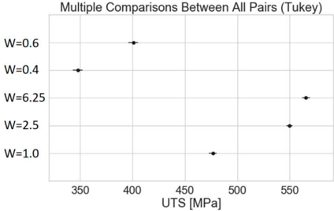

Figure  A2:  Tukey  test  results for  elongation  to failure.  The  solid  dot represents  the  mean.  The  bar  is  the  confidence  interval. Confidence  bars  overlap for  several  of the  sizes  which  means  the  properties  could  come from  the  same  distribution  and  are  not statistically  significantly  different.

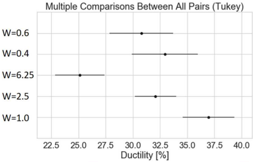