## Original Article

## Determination of true stress-strain curve of type 304 and 316 stainless steels using a typical tensile test and fi nite element analysis

Hyeong Do Kweon a, c , Jin Weon Kim b , Ohseop Song c , Dongho Oh c, *

- a Korea Hydro &amp; Nuclear Power Co, Ltd, 70, 1312-beongil, Yuseong-daero, Yuseong-gu, Daejeon, 34101, Republic of Korea
- b Department of Nuclear Engineering, Chosun University, 309 Pilmun-daero, Dong-gu, Gwangju, 61452, Republic of Korea
- c Department of Mechanical Engineering, Chungnam National University, 99 Daehak-ro, Yuseong-gu, Daejeon, 34134, Republic of Korea

## a r t i c l e i n f o

Article history: Received 29 April 2020 Received in revised form 9 July 2020 Accepted 12 July 2020 Available online 30 July 2020

Keywords: Necking Plastic behavior Stainless steel Tensile test

Finite element analysis

True stress-strain curve

## 1. Introduction

Nuclear power plant structures and components are designed so that the working stress under various operational loading conditions does not exceed the yield or ultimate tensile strength of materials in general. In the engineering evaluation to ensure the structural integrity of structures and components, therefore, an elastic analysis is performed assuming that stresses are linearly proportional to strains. This is an excessively conservative method that does not take into account strain hardening even though plastic deformation occurs signi fi cantly in actual materials under some large loading conditions.

The safety of nuclear power plants against large earthquakes exceeding design basis has been of paramount concern since the Fukushima nuclear power plant accident in Japan [1]. Several studies related to cyclic elastoplastic analysis have been undertaken in the nuclear industry to realistically evaluate structural integrities considering the plastic deformation of materials due to

*

Corresponding author. E-mail address:

## a b s t r a c t

Knowing a material ' s true stress-strain curve is essential for performing a nonlinear fi nite element analysis to solve an elastoplastic problem. This study presents a simple methodology to determine the true stress-strain curve of type 304 and 316 austenitic stainless steels in the full range of strain from a typical tensile test. Before necking, the true stress and strain values are directly converted from engineering stress and strain data, respectively. After necking, a true stress-strain equation is determined by iteratively conducting fi nite element analysis using three pieces of information at the necking and the fracture points. The Hockett-Sherby equation is proposed as an optimal stress-strain model in a nonuniform deformation region. The application to the stainless steel under different temperatures and loading conditions veri fi es that the strain hardening behavior of the material is adequately described by the determined equation, and the estimated engineering stress-strain curves are in good agreement with those of experiments. The presented method is intrinsically simple to use and reduces iterations because it does not require much experimental effort and adopts the approach of determining the stress-strain equation instead of correcting the individual stress at each strain point.

© 2020 Korean Nuclear Society, Published by Elsevier Korea LLC. This is an open access article under the CC BY-NC-ND license (http://creativecommons.org/licenses/by-nc-nd/4.0/).

large earthquake loads [2,3]. Containments for radioactive material transportation have been conventionally designed based on stress acceptance criteria. However, the stress-based acceptance criteria are generally too conservative for energy-limited events, for example, accidental drop or impact. New design acceptance criteria based on strain have been proposed, and elastoplastic analysis is therefore needed to obtain the working strain values under large deformation conditions [4].

Poisson ' s ratio and elastic modulus are the only material properties required for an elastic analysis; in contrast, it is essential to have uniaxial true stress-strain information in addition to Poisson ' s ratio and elastic modulus to solve elastoplastic problems where the relationship between stress and strain is not linear. A stress-strain curve as the inherent material characteristics is commonly determined by a tensile test. Generally, the stress and strain means the true stress and strain, respectively, unless notated speci fi cally as an engineering stress and strain. The stress-strain relationship in a plastic zone obtained from tensile testing is classi fi ed into two parts. The neck section of a specimen is uniformly deformed before necking occurs at maximum loading, but non-uniformly deformed after necking occurs. According to the literature to date, there have

dongho@cnu.ac.kr (D. Oh).

Contents lists available at ScienceDirect

## Nuclear Engineering and Technology

j o urnal homepage: www.elsevier.com/locate/net

| Nomenclature   | Nomenclature                                                                                                                                  | ε f s 0   | True strain at fracture Derivative of true stress with respect to true strain   |
|----------------|-----------------------------------------------------------------------------------------------------------------------------------------------|-----------|---------------------------------------------------------------------------------|
| S e            | Engineering stress Engineering strain True stress True strain Currently measured Currently measured Corrected true stress Bridgman correction | A i       | Engineering stresses estimated from a fi nite element analysis                  |
| s              |                                                                                                                                               | E i       | Engineering stresses measured from an experiment                                |
| ε              |                                                                                                                                               | c 2       | Chi-square                                                                      |
| A              | cross-sectional area                                                                                                                          | A f       | Cross-sectional area at fracture                                                |
| P              | load                                                                                                                                          | A 0       | Original cross-sectional area                                                   |
| s e            | equivalent to the uniaxial value                                                                                                              | RA        | Reduction in area at fracture                                                   |
| B              | factor                                                                                                                                        | s corr    | Amount of stress to be corrected                                                |
| s u            | True stress at necking                                                                                                                        | P fea     | Load estimated from a fi nite element analysis                                  |
| ε u            | True strain at necking                                                                                                                        | P expt    | Load measured from an experiment                                                |
| s f e          | Corrected true stress at fracture                                                                                                             |           |                                                                                 |

been a number of attempts to describe the stress-strain relation and the strain hardening behavior of various metals in the region of uniform and/or non-uniform deformation. The true stress-strain curve may be obtained by various means, such as directly converting from engineering stress-strain data, conducting special tests, performing fi nite element simulations, or combining these methods. These methods are dependent on the characteristics of materials and the range of strain to be considered.

The true stress-strain relationship in the region of uniform deformation may be identi fi ed through typical tensile testing. Such testing involves a method of simply converting the engineering stress-strain values, where necking does not yet occur, to the true stress-strain ones, and then fi tting them using an appropriate equation [5 e 7]. To identify the stress-strain relation in a nonuniform deformation region as well as in a uniform deformation region, there are methods of fi tting the true stress-strain data in the uniform deformation region and then extending the fi tted curve to the non-uniform deformation region [8 e 12]. In References [5 e 12], the stress-strain models for fi tting adopt a power law form of equations such as Hollomon ' s [13], Swift ' s [14], and Ludwik ' s [15], an exponential form of equations such as Voce ' s [16] and HockettSherby ' s [17], or a combination of them.

A direct method for obtaining the true stress-strain data after necking is to continuously measure the shape of the test specimen [17 e 20]. Hockett et al. proposed a more generalized equation by modifying Voce ' s equation, which describes the true stress-strain relation in a large strain region through compression tests on alpha uranium, pure iron, and 1100 aluminum [17,18]. Using a digital image correlation technique, the real-time measurement and analysis of the deformation shape of a specimen have been applied to obtain the true stress-strain data in the full range of strain [19,20]. In order to accurately identify the plastic fl ow characteristics after necking, there have been methods of acquiring the true stress-strain data through the consecutive measurement of the specimen deformation shape and iteratively correcting the true stress-strain data by performing fi nite element analysis [21 e 24]. These are methods to directly acquire the true stress-strain data in the full range of strain by measuring the specimen deformation shape. In particular, more reliable results are expected by performing a fi nite element analysis in conjunction with measurement. There are, however, dif fi culties in accurately measuring the deformation shape of a specimen because of the need for specialist equipment.

Many methods using a fi nite element analysis without special measurements after necking have been introduced to obtain the true stress-strain data over the entire strain range [25 e 32]. After assuming the initial true stress-strain curve from existing equations, studies have iteratively corrected the true stress-strain data in the non-uniform deformation region using the difference of the engineering stress values at each strain point between the experiment and the fi nite element analysis. However, the number of iterations may be intrinsically high due to the one-by-one corrections at each strain point, and the stress-strain equation of the fi nal true stress-strain curve after completing corrections was not presented for corresponding material.

Austenitic stainless steel such as type 304 or 316 is widely used in nuclear power plants because of its strong corrosion resistance, excellent welding performance, high strength, and other advantageous characteristics. Although some research has been published regarding the stress-strain relationship of stainless steel, that research only deals with the uniform deformation [7,33,34], or the mathematical models presented in relation to the non-uniform deformation are not con fi rmed by experimental results [35,36]. The method correcting point-by-point the true stress-strain data in the range of non-uniform deformation by the use of fi nite element analysis has been introduced for stainless steel [24,32]. However, the operating temperatures and strain rates in nuclear power plants where stainless steel is used were not taken into account.

This paper presents a simple method to determine the true stress-strain curve of type 304 and 316 austenitic stainless steels in the full range of strain without continuous measurement of the specimen deformation shape in typical tensile testing. The tensile stress fl ow and strain hardening behavior of materials are investigated in the post-necking region. A stress-strain model that re fl ects the deformation behavior of type 304 and 316 stainless steels is proposed, and the equations pertaining to the model are fi nally determined by comparing the engineering stress-strain curve predicted from fi nite element analysis with that of experiment, and iteratively correcting it.

## 2. Experiments

The materials to be tested are the type 304 and 316 austenitic stainless steels in accordance with the material requirements of the ASME B &amp; PV Code Section II [37], which are broadly used for safety class components such as piping, reactor vessel internals, and containments for radioactive material transportation in nuclear power plants. Their chemical compositions are listed in Table 1.

Table 1 Chemical compositions of type 304 and 316 stainless steels.

| Material    | Composition (wt%)   | Composition (wt%)   | Composition (wt%)   | Composition (wt%)   | Composition (wt%)   | Composition (wt%)   | Composition (wt%)   | Composition (wt%)   |
|-------------|---------------------|---------------------|---------------------|---------------------|---------------------|---------------------|---------------------|---------------------|
|             | C                   | Si                  | Mn                  | P                   | S                   | Cr                  | Ni                  | Mo                  |
| Type 304 SS | 0.018               | 0.31                | 1.76                | 0.025               | 0.0002              | 18.43               | 10.24               | e                   |
| Type 316 SS | 0.009               | 0.38                | 1.22                | 0.008               | e                   | 16.20               | 11.20               | 2.08                |

The tensile test specimens illustrated in Fig. 1 were machined in the shape of round bars with a uniform length of 32 mm, a gauge length of 25 mm, and a diameter of 6 mm for quasi-static testing and 5 mm for dynamic testing, respectively, in accordance with the testing requirements of the ASTM E8 standard [38].

Each test was carried out at a room temperature of 20  C and an operating temperature of reactor coolant system of 316  C, respectively, in an air environment. The load-line displacement speed was 1 mm/min assuming the quasi-static loading condition for the type 304 and 316 stainless steels and 2280 mm/min assuming the dynamic loading condition for the type 316 stainless steel.

The engineering stress values were calculated by dividing the measured load by the original cross-sectional area of the specimen, and the engineering strains were calculated by dividing the measured displacement by gauge length. In addition, the yield and ultimate tensile strengths and the uniform and total elongations were determined based on the same data collected from testing. The specimen cross section diameter at fracture was measured to determine the reduction in area. This is a common and simple tensile test conducted to obtain the fundamental properties of materials. The tensile properties resulting from the test are summarized in Table 2, and their engineering stress-stress curves are shown in Fig. 2.

## 3. Methodology

## 3.1. Background

For the prediction of the fl ow stress of a specimen subjected to tensile loading, there are two distinct parts of strain hardening behavior, the before and after necking stages. The fi rst part includes the data before the onset of the necking, whereas the second part involves the continuation of the stress-strain curve from the necking to the fracture. Since a specimen is uniformly deformed as a whole before necking, it is placed in a uniaxial stress state. After the necking onset, however, a specimen central region is nonuniformly deformed and placed in a multiaxial stress state. The stress and strain are no longer uniformly distributed along the specimen at high levels of elongation due to the necking formation; therefore, the engineering stress-strain curve cannot provide proper information of the physical phenomena of the specimen involved in the test. In general, it is dif fi cult to accurately describe both stages with one stress-strain model on account of the inherently different deformation behavior.

Before necking, the true stress-strain values are readily converted from the engineering stress-engineering values obtained from a typical tensile test using Eqs. (1) and (2), respectively. Accordingly, the pre-necking stress-strain model does not have to be found in the form of an equation in order to be used for a fi nite element analysis in practical engineering problems.

Fig. 1. Test specimen shape and dimensions.

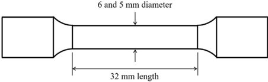

$$\begin{smallmatrix} \text {in } & \sigma = S ( 1 + e ) \\ \text {in } & \sigma \ g a u e \end{smallmatrix}$$

$$\begin{matrix} \text {testing} & \varepsilon = \ln ( 1 + e ) \\ \text {with the} \end{matrix} ( 2 )$$

where S and e are the engineering stress and strain, respectively, and s and ε are the true stress and strain, respectively.

In contrast, the true stress-strain values of the necking zone in the post-necking stage cannot be determined directly based on the engineering stress and strain due to the stress triaxiality in the necked area. In this case, the instantaneous true stress and strain values are calculated in accordance with Eqs. (3) and (4), respectively, using the currently measured load and cross-sectional area of the necked zone.

$$\begin{smallmatrix} \text {ng the} & \sigma = \frac { P } { \overline { A } } \\ \text {eld and} & \end{smallmatrix}$$

$$\begin{smallmatrix} \text {testing} , & & & \\ & \varepsilon = \ln \left ( \frac { A _ { 0 } } { A } \right ) & & \\ & & \varepsilon = \ln \left ( \frac { A _ { 0 } } { A } \right ) & \\ & \text {simple} & & \end{smallmatrix}$$

where P is the currently measured load, and A0 and A denote the original and currently measured cross-sectional area of specimen, respectively.

As large amounts of deformation beyond the onset of necking results in the generation of transverse stresses in the neck region, Bridgman [39] proposed the correction factor of Eq. (5) in order to modify the increased axial stress and make it equivalent to the uniaxial stress. Although the correction factor is the value that is determined by measuring the radius of curvature and the minimum radius at the specimen neck, they are extremely dif fi cult variables to be implemented in practice. Alternatively, Bridgman presented the empirical curve for the correction factor as a function of true strain at the neck exclusively for a cylindrical specimen. Rather than using the correction factor curve, Dowling [40] provided Eq. (6), closely estimating it.

$$\begin{pmatrix} \text {med as} & \sigma ^ { e } = B \sigma \\ \text {e. After} \end{pmatrix}$$

$$\text {s.n.} & - \quad B = 0 . 0 6 8 4 ( \log _ { 1 0 } \varepsilon ) ^ { 3 } + 0 . 0 4 6 1 ( \log _ { 1 0 } \varepsilon ) ^ { 2 } - 0 . 2 0 5 ( \log _ { 1 0 } \varepsilon ) \\ \text {ng.} & - \quad + 0 . 8 2 5 \ ( 0 . 1 2 \leq \varepsilon \leq 3 ) \\ \text {mation} ;$$

where s e is the corrected true stress equivalent to the uniaxial value at the neck of specimen, and B denotes the Bridgman correction factor as a function of true strain only.

As Bridgman ' s experiments were carried out at room temperature under high pressure in quasi-static loading conditions, there are inherent errors due to the difference between Bridgman ' s and the present testing conditions. Additionally, Eq. (6) was approximated from empirical data for various kinds of metals; thus, it implicitly includes some degree of error due to data scattering. For these reasons, when Eqs. (5) and (6) are applied for correction of stress in a large strain region, additional corrections based on the results of fi nite element analysis are iteratively carried out, if necessary.

When the continuous measurement of the curvature and radius of the necked part by the use of special technique such as digital image correlation is available, the true stress-strain values may be determined either directly without fi nite element analysis [19,20] or interactively with fi nite element analysis [21 e 24]. However, when the only available data obtained from the typical tensile testing are the load and displacement values (i.e., engineering stresses and strains), and the necked sectional diameter at fracture (i.e., reduction in area), the true stress-strain values in the postnecking phase should be determined through other means.

Table 2 Tensile properties resulting from testing.

| Material    | Testing Condition   | Testing Condition   | Yield Strength (MPa)   | Tensile   | (MPa) Uniform Elongation   | (%) Total Elongation (%)   | Reduction in Area (%)   |
|-------------|---------------------|---------------------|------------------------|-----------|----------------------------|----------------------------|-------------------------|
| Material    | Temperature (  C)  | Speed (mm/min)      | Yield Strength (MPa)   | Tensile   | (MPa) Uniform Elongation   | (%) Total Elongation (%)   | Reduction in Area (%)   |
| Type 304 SS | 20                  | 1                   | 226.3                  | 579.5     | 66.50                      | 85.80                      | 86.39                   |
| Type 304 SS | 316                 | 1                   | 137.9                  | 410.0     | 31.80                      | 43.70                      | 77.10                   |
| Type 316 SS | 20                  | 1                   | 313.6                  | 590.4     | 54.70                      | 71.40                      | 83.18                   |
| Type 316 SS | 316                 | 1                   | 148.8                  | 429.4     | 34.10                      | 46.80                      | 81.29                   |
| Type 316 SS | 20                  | 2280                | 363.5                  | 637.0     | 35.83                      | 54.94                      | 81.89                   |
| Type 316 SS | 316                 | 2280                | 183.0                  | 448.6     | 29.81                      | 45.59                      | 82.26                   |

Fig. 2. Engineering stress-strain curves.

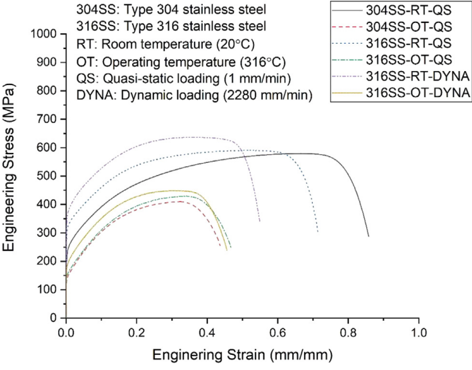

## 3.2. Stress-strain model of type 304 and 316 stainless steels

Several models between stress and strain have been widely used to describe plastic stress fl ow and strain hardening behavior. The most commonly used equations of the models, for instance, Hollomon, Ludwik, and Swift, are the power law forms of Eqs. (7) e (9), respectively. They intrinsically imply that the stress becomes in fi nite when the strain is in fi nite. On the other hand, some stressstrain models, such as those of Voce and Hockett-Sherby, show the exponential forms of Eqs (10) and (11), respectively. These equations, which have been developed with a fundamentally different approach, have a distinct feature with asymptotic stress value after severe deformation.

$$\sigma = H \varepsilon ^ { n } & & ( 7 ) & \text { where } & & \begin{matrix} ( 7 ) & & \text { where } & & & \\ & & & & & \\ & & & & & \\ & & & & & \\ & & & & & \end{matrix} \text { load } \text { and } & & & & &$$

$$\sigma = H ( \varepsilon + \varepsilon _ { 0 } ) ^ { n } & & ( 8 ) & & \text {the man-matrix} \\ & & & & & & & & & & & & & & & & & & & & & & & & & & & & & & & & & & & & & & & & & & & & & & & & & & & & & & & & & & & & & & & & & & & & & & & & & & & & & & & & & & & & & & & & & & & & & & & & & & & & & & & & & & & & & & & & & & & & & & & & & & & & & & & & & & & & & & & & & & & & & & & & & & & & & & & & & & & & & & & & & & & & & & & & & & & & & & & & & & & & & & & & & & & & & & & & & & & & & & & & & & & & & & & & & & & & & & & & & & & & & & & & & & & & & & & & & & & & & & & & & & & & & & & & & & & & & & & & & & & & & & & & & & & & & & & & & & & & & & & & & & & & & & & & & & & & & & & & & & & & & & & & & & & & & & & & & & & & & & & & & & & & & & & & & & & & & & & & & & & & & & & & & & & & & & & & & & & & & & & & & & & & & & & & & & & & & & & & & & & & & & & & & & & & & & & & & & & & & & & & & & & & & & & & & & & & & & & & & & & & & & & & & & & & & & & & & & & & & & & & & & & & & & & & & & & & & & & & & & & & & & & & & & & & & & & & & & & & & & & & & & & & & & & & & & & & & & & & & & & & & & & & & & & & & & & & & & & & & & & & & & & & & & & & & & & & & & & & & & & & & & & & & & & & & & & & & & & & & & & & & & & & & & & & & & & & & & & & & & & & & & & & & & & & & & & & & & & & & & & & & & & & & & & & & & & & & & & & & & & & & & & & & & & & & & & & & & & & & & & & & & & & & & & & & & & & & & & & & & & & & & & & & & & & & & & & & & & & & & & & & & & & & & & & & & & & & & & & & & & & & & & & & & & & & & & & & & & & & & & & & & & & & & & & & & & & & & & & & & & & & & & & & & & & & & & & & & & & & & & & & & & & & & & & & & & & & & & & & & & & & & & & & & & & & & & & & & & & & & & & & & & & & & & & & & & & & & & & & & & & & & & & & & & & & & & & & & & & & & & & & & & & & & & & & & & & & & & & & & & & & & & & & & & & & & & & & & & & & & & & & & & & & & & & & & & & & & & & & & & & & & & & & & & & & & & & & & & & & & & & & & & & & & & & & & & & & & & & & & & & & & & & & & & & & & & & & & & & & & & & & & & & & & & & & & & & & & & & & & & & & & & & & & & & & & & & & & & & & & & & & & & & & & & & & & & & & & & & & & & & & & & & & & & & & & & & & & & & & & & & & & & & & & & & & & & & & & & & & & & & & & & & & & & & & & & & & & & & & & & & & & & & & & & & & & & & & & & & & & & & & & & & & & & & & & & & & & & & & & & & & & & & & & & & & & & & & & & & & & & & & & & & & & & & & & & & & & & & & & & & & & & & & & & & & & & & & & & & & & & & & & & & & & & & & & & & & & & & & & & & & & & & & & & & & & & & & & & & & & & & & & & & & & & & & & & & & & & & & & & & & & & & & & & & & & & & & & & & & & & & & & & & & & & & & & & & & & & & & & & & & & & & & & & & & & & & & & & & & & & & & & & & & & & & & & & & & & & & & & & & & & & & & & & & & & & & & & & & & & & & & & & & & & & & & & & & & & & & & & & & & & & & & & & & & & & & & & & & & & & & & & & & & & & & & & & & & & & & & & & & & & & & & & & & & & & & & & & & & & & & & & & & & & & & & & & & & & & & & & & & & & & & & & & & & & & & & & & & & & & & & & & & & & & & & & & & & & & & & & & & & & & & & & & & & & & & & & & & & & & & & & & & & & & & & & & & & & & & & & & & & & & & & & & & & & & & & & & & & & & & & & & & & & & & & & & & & & & & & & & & & & & & & & & & & & & & & & & & & & & & & & & & & & & & & & & & & & & & & & & & & & & & & & & & & & & & & & & & & & & & & & & & & & & & & & & & & & & & & & & & & & & & & & & & & & & & & & & & & & & & & & & & & & & & & & & & & & & & & & & & & & & & & & & & & & & & & & & & & & & & & & & & & & & & & & & & & & & & & & & & & & & & & & & & & & & & & & & & & & & & & & & & & & & & & & & & & & & & & & & & & & & & & & & & & & & & & & & & & & & & & & & & & & & & & & & & & & & & & & & & & & & & & & & & & & & & & & & & & & & & & & & & & & & & & & & & & & & & & & & & & & & & & & & & & & & & & & & & & & & & & & & & & & & & & & & & & & & & & & & & & & & & & & & & & & & & & & & & & & & & & & & & & & & & & & & & & & & & & & & & & & & & & & & & & & & & & & & & & & & & & & & & & & & & & & & & & & & & & & & & & & & & & & & & & & & & & & & & & & & & & & & & & & & & & & & & & & &$$

$$\sigma = \sigma _ { 0 } + H \varepsilon ^ { n } & & ( 9 ) & & \text {condition} \\$$

$$\sigma = \sigma _ { s } - \sigma _ { r } ( e ^ { - m \varepsilon } ) & & \text {ment at} \quad ( 1 0 ) & \quad \text {ment at} \quad \text {As s}$$

$$\sigma = \sigma _ { S } - \sigma _ { R } \left ( e ^ { - m \varepsilon ^ { n } } \right ) \\ \quad \ \ \ \ \ \ \ \ \ \ \ \ \ \ \ \ \ \ \ \ \ \ \ \ \ \ \ \ \ \ \ \ \ \ \ \ \ \ \ \ \ \ \ \ \ \ \ \ \ \ \ \ \ \ \ \ \ \ \ \ \ \ \ \ \ \ \ \ \ \ \ \ \ \ \ \ \ \ \ \ \ \ \ \ \ \ \ \ \ \ \ \ \ \ \ \ \ \ \ \ \ \ \ \ \ \ \ \ \ \ \ \ \ \ \ \ \ \ \ \ \ \ \ \ \ \ \ \ \ \ \ \ \ \ \ \ \ \ \ \ \ \ \ \ \ \ \ \ \ \ \ \ \ \ \ \ \ \ \ \ \ \ \ \ \ \ \ \ \ \ \ \ \ \ \ \ \ \ \ \ \ \ \ \ \ \ \ \ \ \ \ \ \ \ \ \ \ \ \ \ \ \ \ \ \ \ \ \ \ \ \ \ \ \ \ \ \ \ \ \ \ \ \ \ \ \ \ \ \ \ \ \ \ \ \ \ \ \ \ \ \ \ \ \ \ \ \ \ \ \ \ \ \ \ \ \ \ \ \ \ \ \ \ \ \ \ \ \ \ \ \ \ \ \ \ \ \ \ \ \ \ \ \ \ \ \ \ \ \ \ \ \ \ \ \ \ \ \ \ \ \ \ \ \ \ \ \ \ \ \ \ \ \ \ \ \ \ \ \ \ \ \ \ \ \ \ \ \ \ \ \ \ \ \ \ \ \ \ \ \ \ \ \ \ \ \ \ \ \ \ \ \ \ \ \ \ \ \ \ \ \ \ \ \ \ \ \ \ \ \ \ \ \ \ \ \ \ \ \ \ \ \ \ \ \ \ \ \ \ \ \ \ \ \ \ \ \ \ \ \ \ \ \ \ \ \ \ \ \ \ \ \ \ \ \ \ \ \ \ \ \ \ \ \ \ \ \ \ \ \ \ \ \ \ \ \ \ \ \ \ \ \ \ \ \ \ \ \ \ \ \ \ \ \ \ \ \ \ \ \ \ \ \ \ \ \ \ \ \ \ \ \ \ \ \ \ \ \ \ \ \ \ \ \ \ \ \ \ \ \ \ \ \ \ \ \ \ \ \ \ \ \ \ \ \ \ \ \ \ \ \ \ \ \ \ \ \ \ \ \ \ \ \ \ \ \ \ \ \ \ \ \ \ \ \ \ \ \ \ \ \ \ \ \ \ \ \ \ \ \ \ \ \ \ \ \ \ \ \ \ \ \ \ \ \ \ \ \ \ \ \ \ \ \ \ \ \ \ \ \ \ \ \ \ \ \ \ \ \ \ \ \ \ \ \ \ \ \ \ \ \ \ \ \ \ \ \ \ \ \ \ \ \ \ \ \ \ \ \ \ \ \ \ \ \ \ \ \ \ \ \ \ \ \ \ \ \ \ \ \ \ \ \ \ \ \ \ \ \ \ \ \ \ \ \ \ \ \ \ \ \ \ \ \ \ \ \ \ \ \ \ \ \ \ \ \ \ \ \ \ \ \ \ \ \ \ \ \ \ \ \ \ \ \ \ \ \ \ \ \ \ \ \ \ \ \ \ \ \ \ \ \ \ \ \ \ \ \ \ \ \ \ \ \ \ \ \ \ \ \ \ \ \ \ \ \ \ \ \ \ \ \ \ \ \ \ \ \ \ \ \ \ \ \ \ \ \ \ \ \ \ \ \ \ \ \ \ \ \ \ \ \ \ \ \ \ \ \ \ \ \ \ \ \ \ \ \ \ \ \ \ \ \ \ \ \ \ \ \ \ \ \ \ \ \ \ \ \ \ \ \ \ \ \ \ \ \ \ \ \ \ \ \ \ \ \ \ \ \ \ \ \ \ \ \ \ \ \ \ \ \ \ \ \ \ \ \ \ \ \ \ \ \ \ \ \ \ \ \ \ \ \ \ \ \ \ \ \ \ \ \ \ \ \ \ \ \ \ \ \ \ \ \ \ \ \ \ \ \ \ \ \ \ \ \ \ \ \ \ \ \ \ \ \ \ \ \ \ \ \ \ \ \ \ \ \ \ \ \ \ \ \ \ \ \ \ \ \ \ \ \ \ \ \ \ \ \ \ \ \ \ \ \ \ \ \ \ \ \ \ \ \ \ \ \ \ \ \ \ \ \ \ \ \ \ \ \ \ \ \ \ \ \ \ \ \ \ \ \ \ \ \ \ \ \ \ \ \ \ \ \ \ \ \ \ \ \ \ \ \ \ \ \ \ \ \ \ \ \ \ \ \ \ \ \ \ \ \ \ \ \ \ \ \ \ \ \ \ \ \ \ \ \ \ \ \ \ \ \ \ \ \ \ \ \ \ \ \ \ \ \ \ \ \ \ \ \ \ \ \ \ \ \ \ \ \ \ \ \ \ \ \ \ \ \ \ \ \ \ \ \ \ \ \ \ \ \ \ \ \ \ \ \ \ \ \ \ \ \ \ \ \ \ \ \ \ \ \ \ \ \ \ \ \ \ \ \ \ \ \ \ \ \ \ \ \ \ \ \ \ \ \ \ \ \ \ \ \ \ \ \ \ \ \ \ \ \ \ \ \ \ \ \ \ \ \ \ \ \ \ \ \ \ \ \ \ \ \ \ \ \ \ \ \ \ \ \ \ \ \ \ \ \ \ \ \ \ \ \ \ \ \ \ \ \ \ \ \ \ \ \ \ \ \ \ \ \ \ \ \ \ \ \ \ \ \ \ \ \ \ \ \ \ \ \ \ \ \ \ \ \ \ \ \ \ \ \ \ \ \ \ \ \ \ \ \ \ \ \ \ \ \ \ \ \ \ \ \ \ \ \ \ \ \ \ \ \ \ \ \ \ \ \ \ \ \ \ \ \ \ \ \ \ \ \ \ \ \ \ \ \ \ \ \ \ \ \ \ \ \ \ \ \ \ \ \ \ \ \ \ \ \ \ \ \ \ \ \ \ \ \ \ \ \ \ \ \ \ \ \ \ \ \ \ \ \ \ \ \ \ \ \ \ \ \ \ \ \ \ \ \ \ \ \ \ \ \ \ \ \ \ \ \ \ \ \ \ \ \ \ \ \ \ \ \ \ \ \ \ \ \ \ \ \ \ \ \ \ \ \ \ \ \ \ \ \ \ \ \ \ \ \ \ \ \ \ \ \ \ \ \ \ \ \ \ \ \ \ \ \ \ \ \ \ \ \ \ \ \ \ \ \ \ \ \ \ \ \ \ \ \ \ \ \ \ \ \ \ \ \ \ \ \ \ \ \ \ \ \ \ \ \ \ \ \ \ \ \ \ \ \ \ \ \ \ \ \ \ \ \ \ \ \ \ \ \ \ \ \ \ \ \ \ \ \ \ \ \ \ \ \ \ \ \ \ \ \ \ \ \ \ \ \ \ \ \ \ \ \ \ \ \ \ \ \ \ \ \ \ \ \ \ \ \ \ \ \ \ \ \ \ \ \ \ \ \ \ \ \ \ \ \ \ \ \ \ \ \ \ \ \ \ \ \ \ \ \ \ \ \ \ \ \ \ \ \ \ \ \ \ \ \ \ \ \ \ \ \ \ \ \ \ \ \ \ \ \ \ \ \ \ \ \ \ \ \ \ \ \ \ \ \ \ \ \ \ \ \ \ \ \ \ \ \ \ \ \ \ \ \ \ \ \ \ \ \ \ \ \ \ \ \ \ \ \ \ \ \ \ \ \ \ \ \ \ \ \ \ \ \ \ \ \ \ \ \ \ \ \ \ \ \ \ \ \ \ \ \ \ \ \ \ \ \ \ \ \ \ \ \ \ \ \ \ \ \ \ \ \ \ \ \ \ \ \ \ \ \ \ \ \ \ \ \ \ \ \ \ \ \ \ \ \ \ \ \ \ \ \ \ \ \ \ \ \ \ \ \ \ \ \ \ \ \ \ \ \ \ \ \ \ \ \ \ \ \ \ \ \ \ \ \ \ \ \ \ \ \ \ \ \ \ \ \ \ \ \ \ \ \ \ \ \ \ \ \ \ \ \ \ \ \ \ \ \ \ \ \ \ \ \ \ \ \ \ \ \ \ \ \ \ \ \ \ \ \ \ \ \ \ \ \ \ \ \ \ \ \ \ \ \ \ \ \ \ \ \ \ \ \ \ \ \ \ \ \ \ \ \ \ \ \ \ \ \ \ \ \ \ \ \ \ \ \ \ \ \ \ \ \ \ \ \ \ \ \ \ \ \ \ \ \ \ \ \ \ \ \ \ \ \ \ \ \ \ \ \ \ \ \ \ \ \ \ \ \ \ \ \ \ \ \ \ \ \ \ \ \ \ \ \ \ \ \ \ \ \ \ \ \ \ \ \ \ \ \ \ \ \ \ \ \ \ \ \ \ \ \ \ \ \ \ \ \ \ \ \ \ \ \ \ \ \ \ \ \ \ \ \ \ \ \ \ \ \ \ \ \ \ \ \ \ \ \ \ \ \ \ \ \ \ \ \ \ \ \ \$$

where H, n, ε 0, s 0, s s , s r, m and n are all parameters to be determined depending on the nature of the material.

Although Eqs. 7 e 11 have been developed to be applied to the full range of plastic stress fl ow regardless of uniform or nonuniform deformation, they are intended to be used as the stressstrain model to determine the true stress-strain values only in the non-uniform deformation region for the purpose of this paper. In the uniform deformation region, the stress-strain values can be calculated using Eqs. (1) and (2), as described earlier. The true stress-strain values need to be smoothly connected without a sudden change at maximum loading, namely the necking point where the uniform and non-uniform deform regions join. For this purpose, Consid  ere ' s instability criterion of Eq. (12) [41] should be obeyed at the maximum loading point.

$$\frac { d \sigma } { d \varepsilon } = \sigma$$

In addition to Consid  ere ' s criterion, the true stress ( s u) and strain ( ε u) at the necking point are converted from the engineering stress and strain, respectively, according to Eqs (1) and (2), and the true stress ( s f) and strain ( ε f) at the fracture point are calculated using the value of the reduction in area according to Eqs (3) and (4), respectively. The equivalent true stress ( s e ) to the uniaxial value is obtained by applying the Bridgman correction of Eqs. (5) and (6). Consequently, the true stress-strain values from the necking to the fracture points may be obtained by determining an appropriate stress-strain equation using three pieces of information, that is, d s d ε j ε ¼ ε u ¼ s ' ð ε u Þ ¼ s u, s j ε ¼ ε u ¼ s ð ε u Þ ¼ s u, s j ε ¼ ε f ¼ s ð ε f Þ ¼ s e f , where s u and ε u are the true stress and strain at the necking point, respectively, and s f e and ε f denote the corrected true stress and the true strain at the fracture point, respectively.

Kweon et al. have proposed Eq. (13) as the optimum stressstrain model in the non-uniform deform region for SA-508 lowalloy steel, which is applied to determine the stress-strain values by the use of three pieces of information obtained from a typical tensile test [42]. The equation incorporates linear and constant terms into the commonly used Hollomon model which is shown in Eq. (7), and retains the nature of the power law form of equation.

$$\sigma = H \varepsilon ^ { n } + a \varepsilon + b \\$$

where n is the strain hardening exponent of Eq. (7) at the maximum load, and H, a and b are the coef fi cients dependent on the nature of the material.

Fig. 3 shows the results of the application of Eq. (13) to the type 304 stainless steel at room temperature and quasi-static loading condition. It is con fi rmed that the engineering stress-strain values of the analysis are signi fi cantly different from those of the experiment at the high-strain region.

As shown in Fig. 4, the true stress and strain values of the type 304 stainless steel produced by Eq. (13) are normalized between the necking and the fracture points to check the sensitivity of the curve to the strain hardening exponent, n. Even though the exponent is fl exibly adjusted in Fig. 4, the strain hardening of the curve is insensitive to the change of the exponent, that is, all curves seem to be almost overlapping. Moreover, the hardening rates of the curves hardly change with the increase of strain.

Meanwhile, the Voce and Hockett-Sherby models, which are written in Eqs. (10) and (11), respectively, have the inherent characteristic of being saturated with asymptotic stress, s s, as the strain increases. Eq. (10) has the exponent fi xed at 1 (one), while Eq. (11) is the generalized form that can fl exibly adjust the exponent according to the nature of material. In Fig. 5, the normalized curves in the post-necking region obtained from Eq. (11) illustrate that the strain hardening obviously changes with the variation of exponent and also the hardening rate decreases gradually with the increase of strain. As the exponent value increases, the curve becomes more asymptotical; conversely, as it decreases, the asymptotic property becomes weaker, resulting similar to a power law form of curve. This means that the Hockett-Sherby model is more fl exible than other models, and thus can express various types of curves. In addition, because the stress-strain relations of the 304 and 316 stainless steels are various and dependent on the temperature and strain rate, as seen in Fig. 2, the Hockett-Sherby model is chosen for describing the post-necking stress-strain behavior in this study.

Fig. 3. Stress-strain curves resulting from the modi fi ed Hollomon equation.

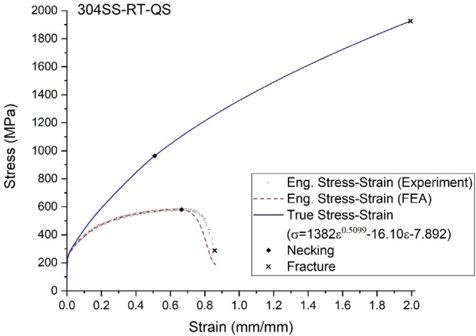

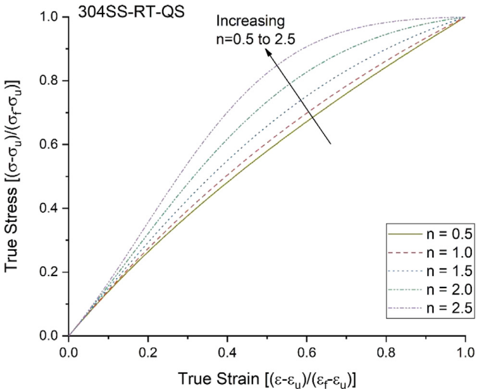

Fig. 4. Normalized true stress-strain curve of Eq. (13) according to exponent, n.

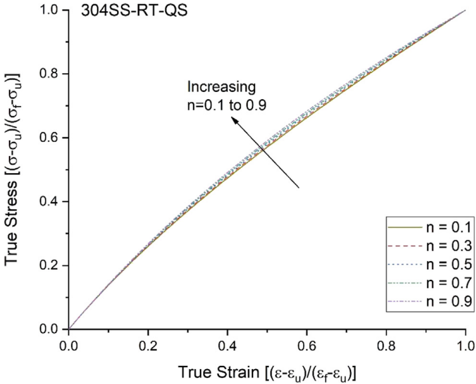

## 3.3. Method for determining true stress-strain curve

The true stress-strain curves of the type 304 and 316 stainless steels are determined by iteratively performing a fi nite element analysis based on typical tensile testing data, as per the following process.

Fig. 5. Normalized true stress-strain curve of Eq. (11) according to exponent, n.

Step 1: A typical tensile test is conducted to acquire fundamental data such as the engineering stresses and strains, the yield and ultimate tensile strengths, the uniform and total elongations, and the reduction in area. Among these data, the engineering stressstrain values and the reduction in area at fracture are required to estimate the true stress-strain values.

Step 2: The true stress and strain values up to the necking point in the uniform deformation region are directly converted from the engineering stress-strain data obtained in Step 1 using Eqs. (1) and (2), respectively.

Step 3: The true stress and stain values at fracture are calculated from Eqs. (3) and (4), respectively, in which the cross-sectional area at fracture is inversely estimated from Eq. (14). The fracture stress is corrected by the Bridgman factor of Eqs. (5) and (6).

$$A _ { f } = A _ { 0 } ( 1 - R A ) \\ \text {ent.} \ n .$$

where A0 and Af are the cross-sectional areas of specimen at original condition and fracture, respectively, and RA is the reduction in area at fracture.

Step 4: The exponent, n, of Eq. (11) is initially set to about 2.0 and 0.5 for the room and operating temperature conditions, respectively. The initial value of the exponent may be fl exibly set depending on the test material and conditions. Three unknown parameters of Eq. (11), that is, m, s s, and s r, are determined by solving three equations, using three pieces of information at both necking and fracture, namely s ' ð ε u Þ ¼ s u, s ð ε u Þ ¼ s u and s ð ε f Þ ¼ s e f . Thus, the true stress-strain values between the necking and the fracture points are obtained from Eq. (11).

Step 5: A fi nite element analysis is undertaken to simulate the tensile testing by inputting the obtained true stress-strain data for the full range of strain as the plastic property of the material corresponding to the specimen. The fi nite element analysis results in obtaining the engineering stresses and strains.

Step 6: The estimated and measured engineering stress-strain curves are compared in shape to con fi rm the adequacy of the exponent. The n-value is increased in the case where more strain hardening is needed, or decreased when less is needed, otherwise, it is maintained. If the exponent is modi fi ed, the true stress-strain values between the necking and the fracture points are updated using the changed equation and the fi nite element analysis is performed again.

Fig. 6. Finite element model of specimen.

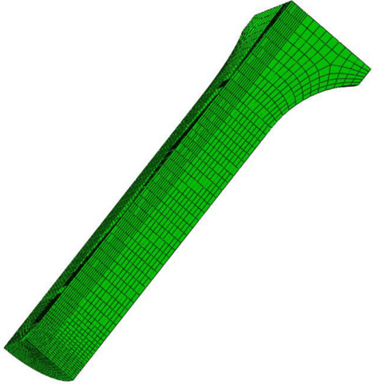

Step 7: The engineering stresses resulting from the analysis are compared with those from experiment at each engineering strain. If the difference between the two engineering stress-strain curves is not satisfactory, the equivalent true stress at fracture, s f e , is corrected depending on the degree of difference. Taking account of the measuring uncertainty of the specimen cross section diameter at fracture and the steepness of the engineering stress-strain curve near fracture, it is recommended that the amount of correction be not more than the value calculated according to Eq. (15), proposed by Joun et al. [27]. If the fracture stress is modi fi ed, the true stressstrain values between the necking and the fracture points are updated using the changed equation and the fi nite element analysis is performed again.

$$\sigma _ { c o r r } = \sigma \times \frac { P _ { e x p } - P _ { f e a } } { P _ { f e a } } & & ( 1 5 ) ^ { ( a ) }$$

where s corr and s are the correcting amount of the true stress and the present true stress, respectively, and Pexp and Pfea are the loads measured from experiment and estimated from analysis, respectively.

Repeat Step 6 and/or Step 7 until the difference between the estimated and the measured engineering stress-strain curves is satisfactory. In the present work, the iterative processes are fi nished if the chi-square values are less than fi ve with minimum three times repetition. However, the criteria for terminating the process should differ from case-by-case depending on the application fi eld and purpose of the work.

## 4. Application

## 4.1. Finite element analysis

A nonlinear 3D fi nite element analysis was performed on the specimen inputting the determined true stress and strain data into the plastic material property. The commercially available fi nite element analysis software, Abaqus/Standard ™ [43], was used for this study. The static and dynamic procedures of analysis were conducted for the quasi-static and dynamic tests, respectively. The nonlinear geometry option was employed for the analysis procedures to take account of the large inelastic deformation during the tensile test. Displacement boundary conditions were applied on the upper end of the specimen to simulate the tensile testing.

Fig. 6 represents the fi nite element model of the specimen used for the analysis. Only one-eighth of the specimen is modeled due to geometrical symmetries to reduce the model size and computing time. The model is composed of a structured mesh arrangement with C3D8 ( fi rst-order integral and three-dimensional solid) elements, strategically placing fi ner meshes along critical regions where plastic localization is expected to occur. The total number of elements and nodes of the model are 17720 and 19949, respectively.

## 4.2. Results and discussion

The true stress-strain curves of type 304 and 316 stainless steels under the test conditions of Table 2 were obtained in accordance with the methodology described in Section 3. In the uniform deformation region, the true stress and strain values are simply converted from the engineering stress and strain values, respectively, and in the non-uniform deformation region, they were taken from the determined stress-strain equation. In order to demonstrate the suitability of the obtained true stress-strain curve, the estimated engineering stress-strain curve was compared with that of experiment.

Fig. 7. (a) True stress-strain curves, and (b) corresponding engineering stress-strain curves with iterations of type 304 stainless steel at room temperature under quasistatic loading.

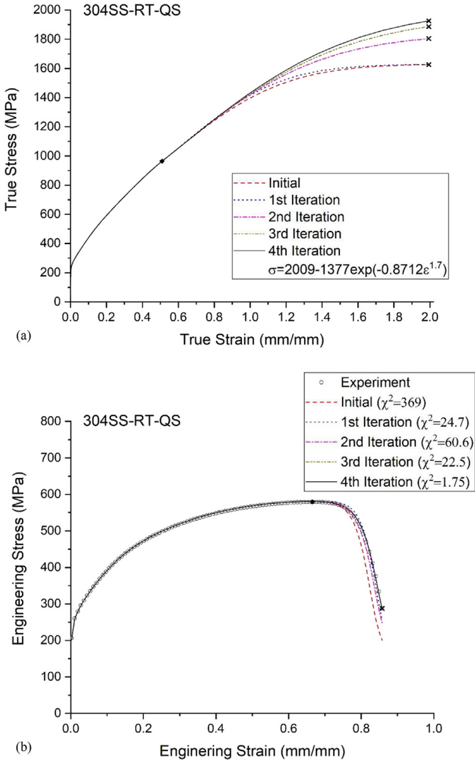

Fig. 8. (a) True stress-strain curves, and (b) corresponding engineering stress-strain curves with iterations of type 304 stainless steel at operating temperature (316  C) under quasi-static loading.

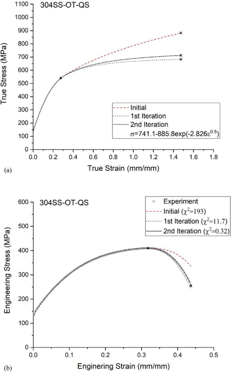

Figs. 7 e 12 illustrate the true and engineering stress-strain curves with iterations for a total of six cases of tests, which include the tested material and condition, the fi nally determined equation, and so on. As the instability criterion of Consid  ere is taken into account at the necking point, the true stress-strain curves are smoothly connected without severe change at the joint of the uniform and non-uniform deformation regions. This is important from the view point of the actual use of the true stress-strain curve for a fi nite element analysis because the sudden variation of the curve frequently causes problem in convergence of equilibrium due to the instability of load at necking. The goodness of the curve estimated from the analysis is judged by the chi-square value, that is, the sum of square of the deviations of the estimated values from the experimental values. The chi-square values have no physical or absolute meaning in this study. They have only relative meanings among the estimated curves indicating their quality to the measured ones. The chi-square values are calculated by Eq. (16).

2000

Fig. 9. (a) True stress-strain curves, and (b) corresponding engineering stress-strain curves with iterations of type 316 stainless steel at room temperature under quasistatic loading.

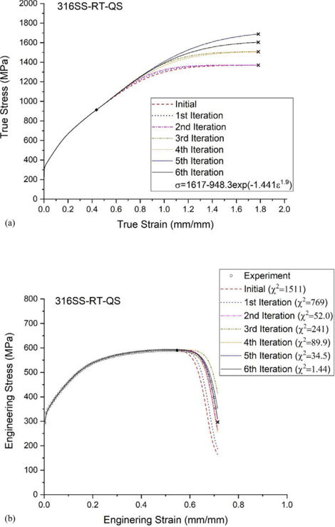

$$\text {even} \quad \chi ^ { 2 } = \sum \frac { ( A _ { i } - E _ { i } ) ^ { 2 } } { E _ { i } }$$

where Ai and Ei are the engineering stresses from the analysis and experiment, respectively, at the equally spaced fi fty points of engineering strains between the necking and the fracture points.

In all cases, it is certain without any further examination that the engineering stress-strain values in the uniform deformation region are almost in perfect agreement with the test results regardless of iterations. This represents that the true stress-strain up to the necking point can be accurately determined from the typical tensile test results.

On the other hand, the difference in two curves in the nonuniform deformation region is strongly dependent on the path of fl ow stress between the necking and the fracture points. The implied uncertainty of the equivalent stress at fracture, which is resulted from both the Bridgman correction and measurement of the cross-sectional diameter of the fractured specimen, may contribute to the deviation between the analysis and the experiment. As illustrated in Figs. 7 e 12, the analysis results are generally approaching the experimental results as the iterations continue.

True Stress (MPa)

Fig. 10. (a) True stress-strain curves, and (b) corresponding engineering stress-strain curves with iterations of type 316 stainless steel at operating temperature (316  C) under quasi-static loading.

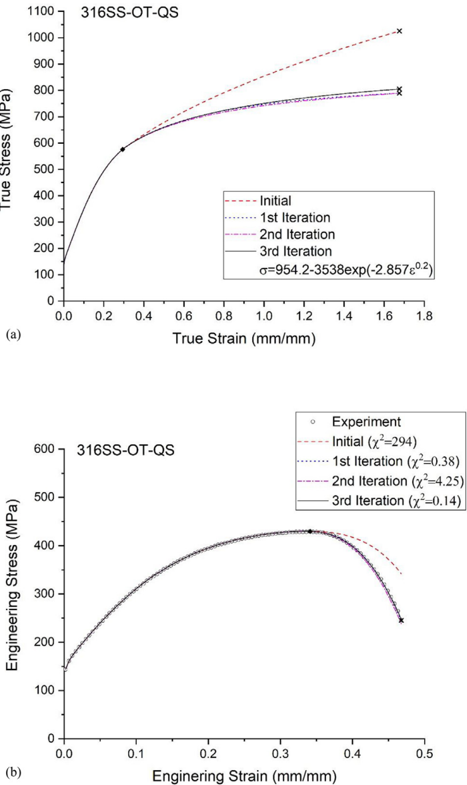

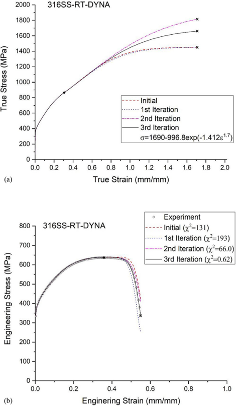

Therefore, iterative analysis is inevitable due to the limited information available at the necking and the fracture points. The exponent, n, of the equations is determined to be 1.7 e 1.9 at the room temperature (20  C), but it becomes smaller at the operating temperature (316  C), resulting in 0.2 e 1.3. This means that even if the strain hardening rate in the region near the necking is bigger at the room temperature than at the operating temperature due to the high strength and elongation, it decreases more rapidly with the increase of strain. The load-line displacement speed, that is, strain rate, does not appear to have a meaningful effect on the determination of the true stress-strain curve. The parameters of Eq. (11) corresponding to the determined post-necking stress-strain curves are summarized in Table 3.

Based on the chi-square values and the whole shapes of curves, the estimated engineering stress-strain curves are in very good agreement with those of experiments. It is veri fi ed that the postnecking true stress-strain curve, which is basically needed for a large plastic deformation analysis, is determined with a relatively high level of goodness according to the methodology described in Section 3.

Fig. 11. (a) True stress-strain curves, and (b) corresponding engineering stress-strain curves with iterations of type 304 stainless steel at room temperature under dynamic loading.

## 5. Conclusion

This study presents a simple methodology to determine the true stress-strain curve of type 304 and 316 austenitic stainless steels in the full range of strain from a typical tensile test. The methodology is summarized as follows:

-  Before necking, the true stress and strain values are directly converted from the engineering stress and strain data, respectively, obtained from testing;
-  After necking, the true stress-strain equation is determined by iteratively conducting fi nite element analysis using three pieces of information at the necking and the fracture points obtained from testing.

The Hockett-Sherby equation is proposed as the optimal stressstrain model in the non-uniform deformation region. The application to the stainless steel under different temperatures and loading conditions veri fi es that the strain hardening behavior of the

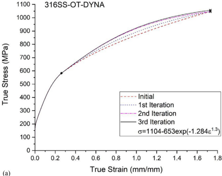

(a)

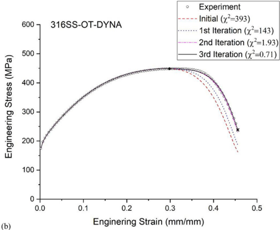

(b)

Fig. 12. (a) True stress-strain curves, and (b) corresponding engineering stress-strain curves with iterations of type 316 stainless steel at operating temperature (316  C) under dynamic loading.

material is adequately described by the determined equation, and the engineering stress-strain curves estimated from analysis have high levels of agreement with those from experiments.

For experimentally determining the true stress and strain values, it is necessary to measure the evolving curvature radius and minimum radius of the necking pro fi le at different stages of a tensile test. This is dif fi cult to implement in practice because of the need for specialist equipment and the signi fi cant amount of experimental work. However, the presented method is intrinsically simple to use and reduces iterations because it does not require much experimental effort and adopts the approach of determining the stress-strain equation instead of correcting the individual stress at each strain point. This requires less time and cost, which is practically important to the industry.

Table 3 Parameters of Eq. (11) corresponding to the determined post-necking stress-strain curves.

| Material    | Testing Condition   | Testing Condition   |   s s | s r     | m        |   n |
|-------------|---------------------|---------------------|-------|---------|----------|-----|
|             | Temperature (  C)  | Speed (mm/min)      |       |         |          |     |
| Type 304 SS | 20                  | 1                   |  2009 |  1377  |  0.8712 | 1.7 |
| Type 304 SS | 316                 | 1                   | 741.1 |  885.8 |  2.826  | 0.5 |
| Type 316 SS | 20                  | 1                   |  1617 |  948.3 |  1.441  | 1.9 |
| Type 316 SS | 316                 | 1                   | 954.2 |  3538  |  2.857  | 0.2 |
| Type 316 SS | 20                  | 2280                |  1690 |  996.8 |  1.412  | 1.7 |
| Type 316 SS | 316                 | 2280                |  1104 |  653   |  1.284  | 1.3 |

## Declaration of competing interest

The authors declare that they have no known competing fi nancial interests or personal relationships that could have appeared to in fl uence the work reported in this paper.

## Acknowledgements

This work was supported by research fund of Chungnam National University, Republic of Korea.

## Appendix A. Supplementary data

Supplementary data to this article can be found online at https://doi.org/10.1016/j.net.2020.07.014.

## References

- [1] [G. Saji, Safety goals for seismic and tsunami risks: lessons learned from the Fukushima Daiichi disaster, Nucl. Eng. Des. 280 (2014) 243 e 249.](http://refhub.elsevier.com/S1738-5733(20)30458-7/sref1)
- [2] [I. Nakamura, N. Kasahara, Excitation tests on elbow pipe specimens to investigate failure behavior under excessive seismic loads, in: ASME 2015 Pressure Vessel and Piping Conference, July 19-23, 2015. Boston, USA.](http://refhub.elsevier.com/S1738-5733(20)30458-7/sref2)
- [3] [P. Sollogoub, The OECD-NEA programme on metallic component margins under high seismic loads (MECOS): towards new criteria, in: ASME 2017 Pressure Vessel and Piping Conference, July 16-20, 2017. Waikoloa, USA.](http://refhub.elsevier.com/S1738-5733(20)30458-7/sref3)
- [4] [S.D. Snow, D.K. Morton, Strain-based acceptance criteria for energy-limited events, in: ASME 2009 Pressure Vessel and Piping Conference, July 26-30, 2009. Prague, Czech Republic.](http://refhub.elsevier.com/S1738-5733(20)30458-7/sref4)
- [5] [C. Mondal, B. Podder, K.R. Kumar, D.R. Yadav, Constitutive description of tensile fl ow behavior of cold fl ow-formed AFNOR 15CDV6 steel at different deformation levels, J. Mater. Eng. Perform. 23 (2014) 3586 e 3599.](http://refhub.elsevier.com/S1738-5733(20)30458-7/sref5)
- [6] [G. Sainath, B.K. Choudhary, J. Christopher, E.I. Samuel, M.D. Mathew, Applicability of Voce equation for tensile fl ow and work hardening behaviour of P92 ferritic steel, Int. J. Pres. Ves. Pip. 132 (2015) 1 e 9.](http://refhub.elsevier.com/S1738-5733(20)30458-7/sref6)
- [7] [L. Li, S. Liu, B. Ye, S. Hu, Z. Zhou, Quantitative analysis of strength and plasticity of a 304 stainless steel based on the stress-strain curve, Met. Mater. Int. 22 (2016) 391 e 396.](http://refhub.elsevier.com/S1738-5733(20)30458-7/sref7)
- [8] [J. Choung, C. Shim, H. Song, Estimation of failure strain of EH36 high strength marine structural steel using average stress triaxiality, Mar. Struct. 29 (2012) 1 e 21.](http://refhub.elsevier.com/S1738-5733(20)30458-7/sref8)
- [9] [R. Schneider, R.J. Grant, N. Sotirov, G. Falkinger, F. Grabner, C. Reichl, M. Scheerer, B. Heine, Z. Zouaoui, Constitutive fl ow curve approximation of commercial aluminium alloys at low temperatures, Mater. Des. 88 (2015) 659 e 666.](http://refhub.elsevier.com/S1738-5733(20)30458-7/sref9)
- [10] [J. Agirre, L. Galdos, E.S. Argandona, J. Mendiguren, Hardening prediction of diverse materials using the digital image correlation technique, Mech. Mater. 124 (2018) 71 e 79.](http://refhub.elsevier.com/S1738-5733(20)30458-7/sref10)
- [11] [Q. Pham, B. Lee, K. Park, Y. Kim, In fl uence of the post-necking prediction of hardening law on the theoretical forming limit curve of aluminium sheets, Int. J. Mech. Sci. 140 (2018) 521 e 536.](http://refhub.elsevier.com/S1738-5733(20)30458-7/sref11)
- [12] [K.B. Othmen, N. Haddar, A. Jegat, P. Manach, K. Elleuch, Ductile fracture of AISI 304L stainless steel sheet in stretching, Int. J. Mech. Sci. 172 (2020) 105404.](http://refhub.elsevier.com/S1738-5733(20)30458-7/sref12)
- [13] J.H. Hollomon, Tensile deformation, Transactions of AIME 162 (1945) 268 e 290.
- [14] H.W. Swift, Plastic instability under plane stress, J. Mech. Phys. Solid. 1 (1952) 1 e 18.
- [15] [P. Ludwik, Elements der Technologischen Mechanik, Verlag Von Julius Springer, Leipzig, 1909, p. 32.](http://refhub.elsevier.com/S1738-5733(20)30458-7/sref15)
- [16] [E. Voce, The relationship between stress and strain from homogeneous deformation, J. Inst. Met. 74 (1948) 537 e 562.](http://refhub.elsevier.com/S1738-5733(20)30458-7/sref16)
- [17] [J.E. Hockett, O.D. Sherby, Large strain deformation of polycrystalline metals at low homologous temperatures, J. Mech. Phys. Solid. 23 (1975) 87 e 98.](http://refhub.elsevier.com/S1738-5733(20)30458-7/sref17)
- [18] [P.E. Armstrong, J.E. Hockett, O.D. Sherby, Large strain multidirectional deformation of 1100 aluminum at 300 K, J. Mech. Phys. Solid. 30 (1982) 27 e 58.](http://refhub.elsevier.com/S1738-5733(20)30458-7/sref18)
- [19] [S.K. Paul, S. Roy, S. Sivaprasad, H.N. Bar, S. Tarafder, Identi fi cation of postnecking tensile stress-strain behavior of steel sheet: an experimental investigation using digital image correlation technique, J. Mater. Eng. Perform. 27 (2018) 5736 e 5743.](http://refhub.elsevier.com/S1738-5733(20)30458-7/sref19)
- [20] [C. Annan, E. Beaumont, Low cycle fatigue of stainless steel plates under large plastic strain demands, Journal of Building Engineering 29 (2020) 101160.](http://refhub.elsevier.com/S1738-5733(20)30458-7/sref20)

- [21] [E.E. Cabezas, D.J. Celentano, Experimental and numerical analysis of the tensile test using sheet specimens, Finite Elem. Anal. Des. 40 (2004) 555 e 575.](http://refhub.elsevier.com/S1738-5733(20)30458-7/sref21)
- [22] [M. Kamaya, M. Kawakubo, A procedure for determining the true stress-strain curve over a large range of strains using digital image correlation and fi nite element analysis, Mech. Mater. 43 (2011) 243 e 253.](http://refhub.elsevier.com/S1738-5733(20)30458-7/sref22)
- [23] [L. Wang, W. Tong, Identi fi cation of post-necking strain hardening behavior of thin sheet metals from image-based surface strain data in uniaxial tension tests, Int. J. Solid Struct. 75 (2015) 12 e 31.](http://refhub.elsevier.com/S1738-5733(20)30458-7/sref23)
- [24] [M. Kamaya, Y. Kitsunai, M. Koshiishi, True stress-strain curve acquisition for irradiated stainless steel including the range exceeding necking strain, J. Nucl. Mater. 465 (2015) 316 e 325.](http://refhub.elsevier.com/S1738-5733(20)30458-7/sref24)
- [25] Y. Ling, Uniaxial true stress-strain after necking, AMP Journal of Technology 5 (1996) 37 e 48.
- [26] [G. Mirone, A new model for the elastoplastic characterization and the stressstrain determination on the necking section of a tensile specimen, Int. J. Solid Struct. 41 (2004) 3545 e 3564.](http://refhub.elsevier.com/S1738-5733(20)30458-7/sref26)
- [27] [M. Joun, J.G. Eom, M.C. Lee, A new method for acquiring true stress-strain curves over a large range of strains using a tensile test and fi nite element method, Mech. Mater. 40 (2008) 586 e 593.](http://refhub.elsevier.com/S1738-5733(20)30458-7/sref27)
- [28] [K. Zhao, L. Wang, Y. Chang, J. Yan, Identi fi cation of post-necking stress e strain curve for sheet metals by inverse method, Mech. Mater. 92 (2016) 107 e 118.](http://refhub.elsevier.com/S1738-5733(20)30458-7/sref28)
- [29] [F. Sebek, P. Kubik, J. Hulka, J. Petruska, Strain Hardening Exponent Role in Phenomenological Ductile Fracture Criteria, vol. 57, 2016, pp. 149 e 164.](http://refhub.elsevier.com/S1738-5733(20)30458-7/sref29)
- [30] [M. Saboori, H. Champliaud, J. Gholipour, A. Gakwaya, J. Savoie, P. Wanjara, Extension of fl ow stress-strain curves of aerospace alloys after necking, Int. J. Adv. Manuf. Technol. 83 (2016) 313 e 323.](http://refhub.elsevier.com/S1738-5733(20)30458-7/sref30)
- [31] [M. Paredes, D.F.B. Sarzosa, R. Savioli, T. Wierzbicki, D.Y. Jeong, D.C. Tyrell, Ductile tearing analysis of TC128 tank car steel under model I loading condition, Theor. Appl. Fract. Mech. 96 (2018) 658 e 675.](http://refhub.elsevier.com/S1738-5733(20)30458-7/sref31)
- [32] [M. Paredes, V. Grolleau, T. Wierzbicki, On ductile fracture of 316L stainless steels at room and cryogenic temperature level, Materialia 10 (2020) 100624.](http://refhub.elsevier.com/S1738-5733(20)30458-7/sref32)
- [33] [K.J.R. Rasmussen, Full-range stress-strain curves for stainless steel alloys, J. Constr. Steel Res. 59 (2003) 47 e 61.](http://refhub.elsevier.com/S1738-5733(20)30458-7/sref33)
- [34] [I. Arrayago, E. Real, L. Gardner, Description of stress-strain curves for stainless steel alloys, Mater. Des. 87 (2015) 540 e 552.](http://refhub.elsevier.com/S1738-5733(20)30458-7/sref34)
- [35] [K. Abdella, Inversion of a full-range stress-strain relation for stainless steel alloys, Int. J. Non Lin. Mech. 41 (2006) 456 e 463.](http://refhub.elsevier.com/S1738-5733(20)30458-7/sref35)
- [36] [W.M. Quach, J.G. Teng, K.F. Chung, Three-stage full-range stress-strain model for stainless steels, J. Struct. Eng. 134 (2008) 1518 e 1527.](http://refhub.elsevier.com/S1738-5733(20)30458-7/sref36)
- [37] [ASME, Materials, ASME Boiler and Pressure Vessel Code Section II, 2015.](http://refhub.elsevier.com/S1738-5733(20)30458-7/sref37)
- [38] [ASTM, Standard Test Methods for Tension Testing of Metallic Materials, ASTM E8/E8M-09, 2009.](http://refhub.elsevier.com/S1738-5733(20)30458-7/sref38)
- [39] [P.W. Bridgman, Studies in Large Plastic Flow and Fracture, Harvard University Press, USA, 1964.](http://refhub.elsevier.com/S1738-5733(20)30458-7/sref39)
- [40] N.E. Dowling, Mechanical Behavior of Materials, fourth ed., Pearson Education, England, 2012.
- [41] [A. Considere, Ann. Ponts Chaussees 9 (1885) 574 e 605.](http://refhub.elsevier.com/S1738-5733(20)30458-7/sref41)
- [42] [H.D. Kweon, E.J. Heo, D.W. Lee, J.W. Kim, A methodology for determining the true stress-strain curve of SA-508 low alloy steel from a tensile test with fi nite](http://refhub.elsevier.com/S1738-5733(20)30458-7/sref42)
23. [element analysis, J. Mech. Sci. Technol. 32 (2018) 3137 e 3143.](http://refhub.elsevier.com/S1738-5733(20)30458-7/sref42)
- [43] [ABAQUS Analysis User ' s Guide, Version 2019, Dassault Systems, 2019.](http://refhub.elsevier.com/S1738-5733(20)30458-7/sref43)