Available online at www.sciencedirect.com

## ScienceDirect

Procedia Engineering   86 (  2014  )   899 - 909

## Procedia Engineering

www.elsevier.com/locate/procedia

1st International Conference on Structural Integrity, ICONS-2014

## Use of Miniature Tensile Specimen for Measurement of Mechanical Properties

Kundan Kumar a,* , Arun Pooleery a , K. Madhusoodanan a , R N Singh b , J K Chakravartty b , c d

B K Dutta and R.K. Sinha

a Reactor Engineering Division, b Mechanical Metallurgy Division, c Reactor Safety Division

Bhabha Atomic Research centre, Mumbai-400085, India d Atomic Energy Commission, DAE, Anushakti Bhavan, Mumbai-400001, India * E-mail ID: kundan@barc.gov.in

## Abstract

This paper gives a comparative study of methods used for evaluation of mechanical properties of materials using miniature and sub-size tensile test specimens. Aim of this paper is to establish the potential of miniature tensile tests which can be useful for life estimation of any in-service-equipment and for development of new materials. Both these applications intend to use very small amount  of  material  for  evaluation  of  the  mechanical  properties.  Apart  from  various  types  of  novel  techniques  developed worldwide, the evaluation of mechanical properties from a miniature tensile test has a greater advantage as it is a direct method of  measurement of mechanical properties. The paper also discusses various challenges in fabrication of miniature tensile  test specimens, testing methodologies and acceptance of the test results. A comparison with the test results from conventional size specimen has been done for establishing the suitability of the miniature test specimen. For establishing the geometrical design of the  miniature  test  specimen  and  its  behaviour  over  application  of  tensile  load,  the  tests  have  been  corroborated  with  a  finite element based analysis.

© 2014 The Authors. Published by Elsevier Ltd. © 2014 The Authors. Published by Elsevier Ltd. This is an open access article under the CC BY-NC-ND license (http://creativecommons.org/licenses/by-nc-nd/3.0/).

Peer-review under responsibility of the Indira Gandhi Centre for Atomic Research. Peer-review under responsibility of the Indira Gandhi Centre for Atomic Research

Keywords:

Type your keywords here, separated by semicolons ;

## 1. Introduction

Efforts  for  evaluation  of  mechanical  properties  from  small  or  miniature  specimen  has  been  a  subject  of interest among researchers for quite long time. The main driving force for development of miniature test specimens is  development  of  new  material.  The  other  reason  is  the  property  evaluation  of  any  in-service  component  by scooping  out  small  volume  of  material.  The  limited  material  available  due  to  scooped  out  volume  from  any  inservice component restricts the shape and size of the test specimens. The basic philosophy adopted in various test standards  for  conventional  tensile  test  specim specimens such standardisation is not availabl specimens  [1-6].  The  miniaturisation  of  spec material behaviour in the microscale compared limited to the strength dependence on cross-sec only to specimen size and geometry, but also, t the  cross-section,  anisotropy  due  to  microstr inhomogeneity etc., surface effect  and  residua characteristics  dependence  on  cross-sectiona conditions, gage length etc. mens  specify  dimensions  and  their  ratios;  however  fo le.  This  has  resulted  in  large  and  different  designs  of  th imen  cause  the  so-called  'scaling  effect',  which  leads d to the mesoscale and macroscale [7].  In mechanics, t ctional area, however in general it is much wider and ma to other factors, such as micro-structural constraints, viz. ructure  and  crystallographic  texture,  micro-structural  an al  stress.  These  papers  [1-6]  also  describe  the  strength  a al  area  of  test  specimen,  specimen  fabrication  metho or  miniature he  miniature to  different this  effect  is ay relate not grain size in nd  chemical and ductility ods,  surface The present work is inspired from th vessels, by way of scooping out small volume is of boat shaped and has dimensions as 40mm various test specimens, viz. miniature tensile, fa boat sample are shown in Fig. 2 [9]. he aim of evaluation of mechanical properties of in-serv of material using a scooping device, Fig. 1 [8]. The scoo m long, 30mm wide and 3mm maximum thickness. The g fatigue, Charpy and small punch test, which can be made vice pressure ped material eometries of out from the This paper is limited to the evaluation of mechanical properties using the miniature tensile test specimen. In order to ensure the usefulness of miniature test techniques it is important to have comparable results of miniature tests and conventional tests with respect to the mechanical properties, viz. UTS, YS and elongation. Two different types of tensile test specimens; namely type-I (conventional round) specimen, type-II (sub-size flat) specimen have been tested and compared with the results of type-III (miniature specimen). The dimensions of all the test specimens are given in Fig. 3. The geometry of the miniature tensile test specimen has also been evaluated using finite element analysis for giving results comparable with conventional tests.

Fig. 1: Scooping device, scooped region and sample scooped

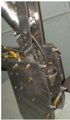

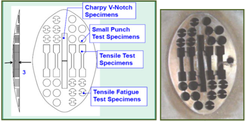

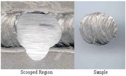

Fig. 2: Test Specimen layout in scooped s ample

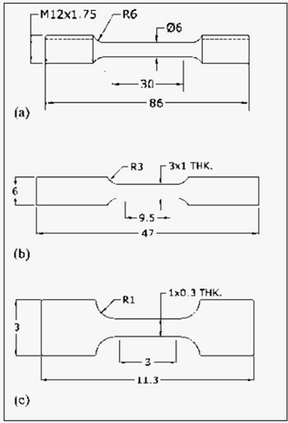

Fig. 3: Dimensional details of (a) Conventional (c) Miniature Tensile (T l Round Specimen (Type-I), (b) Sub-size Flat Specimen (T ype-III) Test Specimens and their photographs Type-II) and

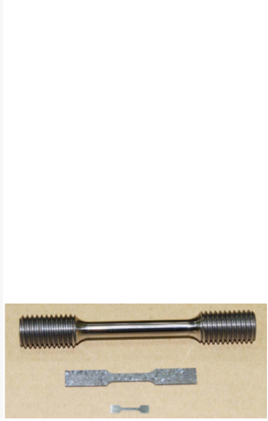

## 2. Issues Related to Miniature Tensile Tests

Micro-scale  uniaxial  tests  are  not  yet  standardized  except  for  the  specific  requirements  for  testing  foil materials given in ASTM E345-93 but have the potential to provide uniaxial stress strain data that is representative to  macro  behaviour.  There  are  many  metrological  issues,  such  as  specimen  geometry,  specimen  preparation methods, microstructural changes, alignment, ductility, resolution of load cells &amp; strain-measuring devices etc. that can influence the test results. The various issues with respect to development of Miniature Test techniques can be listed as follows [10]:

- a) Conformity of geometry of the test specimen with standards: The test specimen may not represent the bulk material due to various methods applied on it for its fabrication, such as EDM, grinding, polishing etc. The damage caused due to specimen preparation methods may be significant in volume-wise so that the result can  be  affected.  Specimen  geometry,  preparation  and  surface  finish  are  important  parameters  to  be precisely standardized. Micro-structural features, such as grain shape, phase, orientation, texture, precipitate distribution, and their size relative to the dimensions of the test specimen can have significant effect on the flow stress and ductility.
- b) Strain measurement: The miniature-size of test specimen does not allow the use of standard extensometers for  strain  measurement  data.  The  displacement  data  obtained  from  crosshead  travel  of  the  machine  may give  large  scatter  in  data.  These  days  different  techniques  are  being  employed  for  measurement  of displacement in miniature testing. LVDT, electrical resistance based transducer, capacitance gauges, line scan cameras, laser interferometry, digital speckle pattern interferometry, digital image correlation (DIC), photoelastic  stress  analysis  and  thermoelastic  stress  analysis  are  such  techniques  having  their  own advantages and disadvantages [10].
- c) Validation  of  test  procedures:  Even  in  case  of  conventional  test  specimens,  the  ductility  varies  due  to change in shape and sizes of test specimens. In order to have comparing ductility, the test specimens must be geometrically similar, like L/D ratio for round specimens and L/ ¥ A ratio for flat specimens [11]. It is likely that similar relation will be required for miniature test specimens as well. Also, there is a need to address the scattering in data by addressing the proper methods for specimen preparation and limiting the variation in various metrological and metallurgical parameters of the test specimens.

## 3. Materials and Experimental Procedures

Three different materials, listed in Table-1, were used for carrying out the specimen preparation and testing in the present investigation. Same block and heat of material were used for fabrication of type-I, type-II and type-III test specimens for each material. The tests have been carried out at different test laboratories in order to minimise any result-bias for any particular machine.

Table-1: Materials used for experiments

| Material    |     C |    Cr | Mo   |    Mn |   Ni |     S |     P |    Si |    Cu |     Co | N      | V     |
|-------------|-------|-------|------|-------|------|-------|-------|-------|-------|--------|--------|-------|
| 20MnNiMo 55 |  0.18 | 0.078 | 0.49 |  1.24 | 0.58 | 0.007 | 0.014 |  0.23 | 0.067 | 0.0069 | 0.0068 | --    |
| CrMoV       |  0.17 |  2.51 | 0.63 |  0.38 |  0.8 | 0.009 | 0.015 |  0.28 | 0.054 |  0.013 | 0.065  | 0.1 7 |
| SS304 LN    | 0.036 |  18.6 | --   | 0.264 |  8.3 | 0.001 | 0.074 | 0.346 | 1.178 |  0.112 | --     | --    |

## 3.1 Testing Fixtures

The miniature specimen having very limited size and grip section, required development of special testing fixture,  Fig.  4.  Two  types  of  test  fixtures  were  developed  are  for  pinned  specimen  and  for  shoulder  supported specimens.

Fig. 4: Test Fixtures for Miniature Tensile Test Specimen

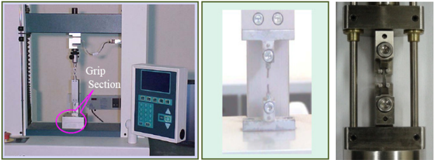

## 3.2 Ductility Measurement for Different-Sized Specimens

In tensile tests, apart from UTS and YS, elongation is also an important measurement which needs to be correlated with conventional test specimen results. As the gage length of miniature specimen is only 5mm, it did not allow mounting of any mechanical extensometer, so earlier the extension measurements were done using the crosshead travel. In general, the measurement of elongation using the cross-head travel gives lower value of extensometer due to the effective smaller length of necking region. In order to minimise the difference in the elongation properties of different gage length specimen, it is important that they are geometrically similar.

The  ductility  measurement  consists  of  two  components,  the  uniform  extension  up  to  necking  and  the localised extension once necking begins. The extent of uniform extension depends upon the metallurgical condition of material and the effects of specimen size and shape on the development of the neck. Fig. 5 shows the variation of local elongation along with the gage length of a prominently necked tensile specimen [11].

It  is  seen  that  shorter  the  gage  length  the  greater  the  influence  of  localised  deformation  at  the  neck  on  the  total elongation of the gage length. The total extension is given as

Final Length -Initial Length =uniform extension + local extension at necking

$$i . e . \, L _ { f } \cdot L _ { 0 } = e _ { u } L _ { 0 } + \alpha \quad ( 1 )$$

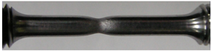

Fig. 5: Ductility results dependence on Gage length

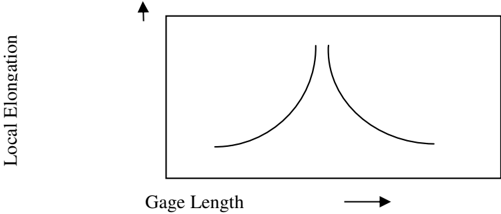

## The tensile elongation is given as

$$e _ { f } = ( L _ { f } \cdot L _ { 0 } ) / L _ { 0 } = e _ { u } + \omega / L _ { 0 }$$

A number of attempts have been made to ration been  concluded  that  geometrically  similar  spec Barba's law, Į = ȕ √ A0, [11], where A0 is the initia nalise the strain distribution in tensile test and based on w cimens  develop  geometrically  similar  necked  region.  A al area of cross-section and ȕ is coefficient, the elongation which it has According  to n becomes

$$e _ { f } = & e _ { u } + \beta \sqrt { A _ { 0 } / L _ { 0 } } & & ( 3 )$$

It  is  generally  recognised  that  in  order  to  co specimens  must  be  geometrically  similar.  The different-sized  specimen  the  ratio L0/ √ A0 for  s Table-2 gives the dimensional relationship follo mpare  elongation  measurements  of  different-sized  spec e  equation  shows  that  for  measurement  of  ductility  pr sheet  specimen  and L0/D 0 for  round  specimen must  be wed by different countries vis-a-vis followed in the prese cimens,  the roperties  of maintained. nt work.

Table-2: Dimensional relations ships of tensile specimens used in different countries

| Type of Specimen     | ASTM A370   | ASTM E8M   | G (b Great Britain before 1962)   |   Great Britain (Current) |   Germany | Present repor rt    |
|----------------------|-------------|------------|-----------------------------------|---------------------------|-----------|---------------------|
| Round (L 0 /D 0 )    | 4           | 5          | 3. .54                            |                         5 |        10 | 5.0 (Type-I)        |
| Sheet (L 0 / √ A 0 ) | 2.8-14.1    | 3.2-14.1   | 4                                 |                      5.65 |      11.3 | 5.5 (Type-II & III) |

## 3.3 Use of Video Extensometer

As the miniature test specimen size d section, it has driven the need for using non-co been  used  by  many  researchers  [10],  like  la extensometer, Fig. 6,  having  single camera, Fi section  extensions.  The  video  extensometer  w specimen is marked with contrast patterns prior the test specimen, Fig. 6(c), and works as an ext oes not allow mounting any mechanical extensometer o ontact type extensometer. Various types of such extensom aser  based,  DCM,  video  extensometer  etc.  In  present ig.  6(b),  with  fixed  focus  has  been  used  for  measuremen works  on  the  principle  of  pattern  recognition  techniqu r to loading in the machine. The camera tracks the marke tensometer which gives the displacement values during th on its  gauge meters have case  video nt  of  gauge ue.  The  test d targets on e test.

(a) Testing Machine

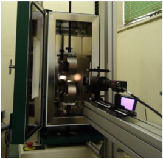

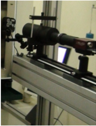

(b) Camera

Fig . 6: Video Extensometer

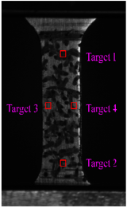

(c) dĞƐƚ ^ƉĞĐŝŵ ŵĞŶ

## 4.  Results and Discussions

The tests were conducted at room temperature for three materials with a strain rate of 1x10 -3 per sec. Fig 7 &amp; 8 give the results of the various tests conducted on the specimens. For 20MnMoNi55, the test of conventional, Type-I specimen, gives the minimum UTS and YS values as 622 MPa and 485 MPa respectively. In comparison to these values the UTS values given by miniature test specimens (type-III) are in the range of 2%-4.5% less. The YS values given by type-III test specimens are in the range of 0.2%-6% less in comparison to type-I specimens. The uniform elongation given by type-III test specimens are in the range of 7.7%-9.8% in comparison to the range of 8.1%-8.2% for type-I specimens. The total elongation of type-III test specimens are 18.2%-20.9% in comparison to 20.3%-21.5% of the type-I specimens. For CrMoV steels there are significant differences in mechanical properties in two perpendicular directions, marked as B1 and C1 as suffixes in the nomenclature in the table-3. Out of total six specimen of type-I tested, three each from block B1 and block C1, the UTS values are 603-605 MPa for block B1, and 615-618 MPa for block C1. The corresponding YS values for B1 and C1 blocks for type-I specimens are 456459 MPa and 471-477 MPa. The elongation values of these specimens are, however, in the same range, 26.5%28.9% irrespective  of  their  orientation.  Block  B1  was  used  for  fabrication  of  miniature  specimens  and  their  test results  give  UTS  values  as  582-606MPa  and  YS  values  as  448-460MPa,  which  are  comparable  to  their  type-I values. The uniform elongation values for type-I and type-III are in agreement however, the total elongation values (22%-23.8%), are less in comparison to type-I specimens' elongation values (~27%). This may be due to the reason the  thickness/width ratio 0.445  was taken in this case,  whereas specified value of 0.3. For the third  material SS304LN,  the  minimum  UTS  and  YS  values  for  type-III  specimens  are  540MPa  and  225MPa  in  comparison  to 571MPa and 237MPa for type-I specimens. The higher YS values may be attributed to any residual stresses in the type-III  specimen  during  the  fabrication  and  polishing  stage.  This  needs  further  tests  and  analysis.  The  uniform elongation and total elongation of type-I and type-III specimens are comparable. Overall it can be concluded that the results  obtained  by  miniature  test  specimens  are  comparable  with  those  obtained  by  conventional  test  specimens within  a  certain  error  band.  With  the  precise  control  of  surface  finish  of  test  specimen,  dimensional  deviations, alignment of test fixtures, better strain measurement, the error band can be minimised and potentiality of miniature test specimen can be enhanced.

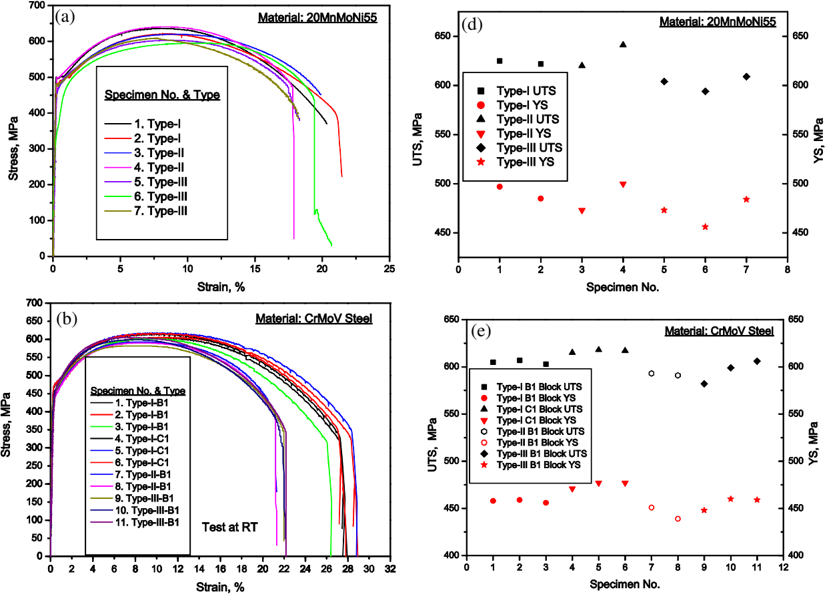

Fig. 7: The engineering stress - strain plot for (a) 20MnMoNi55 steel, (b) Cr-Mo-V steel and (c) SS304LN obtained using Type I, Type II and Type III specimens. The respective variation in yield strength (YS) and ultimate tensile strength (UTS) is shown in (d), (e) and (f).

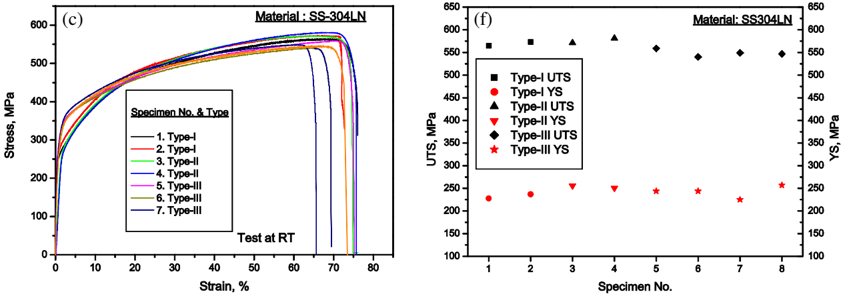

Fig. 8: Variation in uniform and total elongation for (a) 20MnMoNi55 steel, (b) Cr-Mo-V steel and (c) SS304LN obtained using Type I, Type II and Type III specimens.

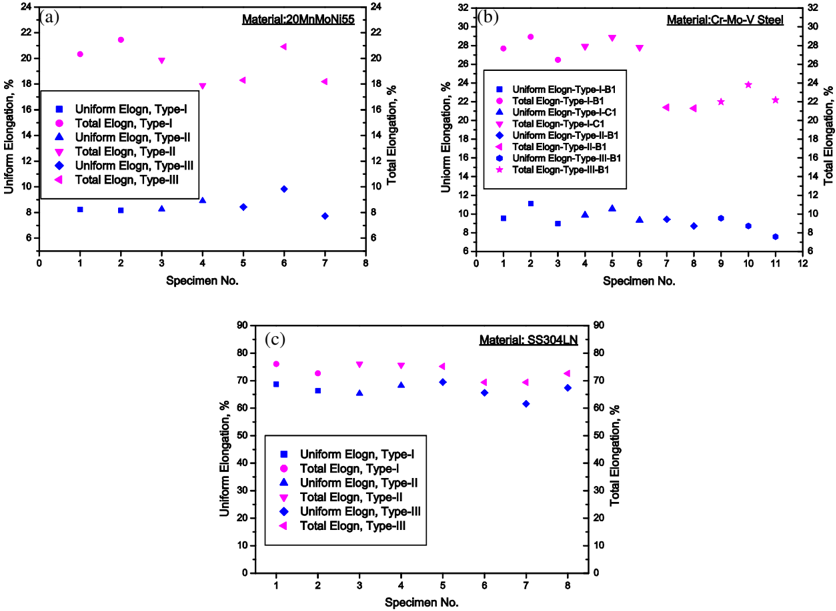

## 5. Finite Element Modeling (FEM)

## 5.1 Geometrical Modeling

The finite element modelling computations were conducted using a commercial finite element modeling software. The 2-D finite element model of quarter shape of the miniature test specimen was used due to geometric symmetricity, as shown in Fig. 9. The test specimen is modelled with four noded quadrilateral plane stress elements because the thickness of the body or domain is small relative to its lateral (in-plane) dimensions. Mapped meshing was adopted for  the  gauge  length  while  other  sections  were  free  meshed  with  emphasis  given  to  the  number  of elements in the gauge section and shoulder sections of the specimen. Geometric nonlinearity was also modeled on top  of  material  non  linearity.  In  order  to  represent  the  experimental  setup,  the  loading  pin  was  simulated  for providing load to the specimen. The loading pin was treated as 2-D rigid body with friction coefficient of zero. Due to symmetricity only one pin is modeled and the motion in X-direction was arrested. However, it was allowed to experience displacement in the Y direction as in the experimental situation. Contact elements were defined between the  loading  pin  and  the  shoulder  contact  line  of  the  specimen  model.  A  concentrated  force  was  applied  to  the reference point of the pin in the Y direction. The load is applied through the amplitude field in a linear fashion i.e. at time zero, the load value is zero and at time t=1 the load is maximum. All these prescribed conditions are applied in the respective reference node of load pins.

## 5.2 Material Modeling

In the elastic analysis of simulation, the material properties of the columns were defined by elastic modulus and  Poisson's  ratio.  In  the  nonlinear  analysis  stage,  material  nonlinearity  or  plasticity  was  included  in  the  FEM using a mathematical model known as the associated plasticity flow rule with von-Mises yield criterion. In the finite element simulation of miniature specimen, the plastic properties are defined together with the isotropic hardening rule. It means that the yield surface size changes uniformly in all directions such that the yield stress increases in all stress  directions  as  plastic  straining  occurs.  In  the  incremental  plasticity  model  true  stresses  (t)  and  true  plastic strains (tp) of a conventional test specimen were specified.  This is because, during the tensile test, the cross-section area of the sample decreases due to elongation, while each subsequent increase of sample length takes place over an already elongated sample length. The true stress-true strain defines the flow curve appropriately as they represent the basic flow characteristics of the material. The incremental plasticity model requires the true stress-strain curve from  the  point  corresponding  to  the  last  value  of  the  linear  range  of  the  engineering  stress-strain  curve  to  the ultimate  point  of  the  stress-strain  curve.  The  material  properties  used  for  the  finite  element  simulation  were determined through standard uniaxial tensile test and are shown in Table-3.

Table-3: Material Properties Used In FE Simulation

Material: 20MnMoNi55

Young's modulus (GPa): 194

Poisson's ratio 0.29

|   True stress(MPa) |   True plastic strain |
|--------------------|-----------------------|
|                401 |                0.0021 |
|                455 |                0.0027 |
|                479 |                0.0044 |
|                503 |                0.0097 |
|                534 |                0.0177 |
|                583 |                0.0322 |
|                620 |                0.0476 |

## 5.3 Finite Element Results

A concentrated load of 300 N (for two in a linearly varying manner i.e. at time t=0, the use  of  amplitude  option  in  FEM  software.  F corresponding elongation in the specimen is stor the FE simulation of specimen and experimental pins load would be 600N) is applied on the reference nod e load was zero and at time t=1, the load applied is (300 For  each  time  step  both  the  load  taken  by  the  specim red in the software. Fig. 10 shows the load-time diagram l results, which are in good agreement. de of the pin 0N) with the men  and  the obtained by

Y

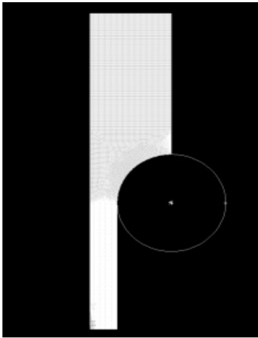

X

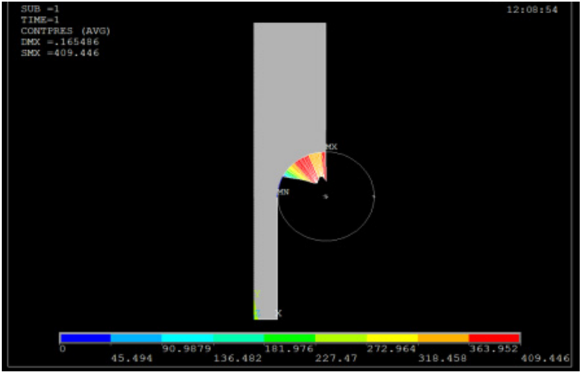

Fig. 9: Geometrical Modelling and Results of FE analysis

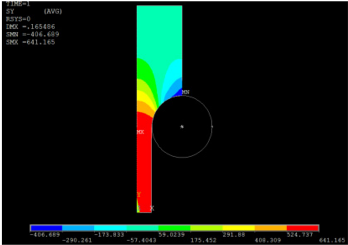

Fig. 10: Comparison of true stress - tru ue strain curves obtained experimentally and from FE anal lysis

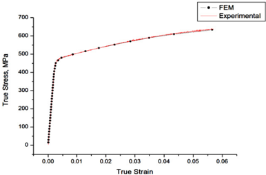

## 6. Conclusion

Tensile  properties  were  determined  f specimens and their results were found to be in range of 2%-4.5% less in comparison to typetest specimens are in the range of 0.2%-6% le steel,  however these values are approximately may be attributed to any residual stresses in th needs further tests and analysis. The uniform el less  in  agreement  to  the  type-I  specimen  for  2 agreement as different thickness of specimen w experimentally and through FEM analysis of m the  usefulness  of  miniature  specimen  technol international  effort  for  standardizing  the  tech property evaluation. for  three  different  material  using  Type  I,  Type  II  and  T n good agreement. UTS values given by type-III specime I specimens for all three materials. The YS values given ss in comparison to type-I specimens for 20MnMoNi55 7-12% higher in case of SS304LN material. The highe he type-III specimen during the fabrication and polishing longation and total elongation values of type-III specimen 20MnMoNi55 and SS304LN, however these values cou was used for CrMoV steel. The true stress - true strain curv miniature specimen were also in good agreement. These res logy  and  for  tapping  this  potential  there  is  a  need  for hnique  and  to  adopt  these  as  standard  practices  for  the Type  III  test ens are in the n by type-III and CrMoV er YS values g stage. This n are more or uld not be in ves obtained sults suggest r  a  coherent mechanical

## 7. Acknowledgements

Some  part  of  the  present  work  has  been  done  at  National  Metallurgical  Laboratory,  Jamshedpur  under BRNS project. Authors are thankful to both BRNS and NML for their respective works.

## References

1. Panayotou N F et al, 'Design and use of Nonstandard Tensile Specimens for Irradiated Materials Testing' SPT888, P201-219
2. Rosinski Stan T et al, 'Application of Sub-size specimens in Nuclear Plant Life Extension' ASTM STP 1204, pp 405-416
3. Yuanchao  Xu  et  al,  'Application  of  the  miniature  specimen  technique  to  material  irradiation  tests  and surveillance for reactor components' International Journal of Pressure Vessels and Piping 77 (2000), pp 715721
4. Yutaka Kohno et al, 'Specimen size effects on the tensile properties of JPCA and JFMS' Journal of Nuclear Materials, pp 283-287 (2000) 1014-1017
5. Recommendation of miniaturized techniques for mechanical testing of fusion materials in an intense neutron source, P. Jung et al, Journal of Nuclear Materials 232 (1996) 186-205
6. Miniature Tensile Test Specimens for Fusion Reactor Irradiation Studies, R.L. Klueh, Nuclear Engineering and Design/Fusion 2 (1985) 407-416
7. Sergueeva A V et al, 'Gage length and Sample size effect on measured properties during tensile testing', A526 (2009), Mat.Sc and Engg A
8. Kumar K et al, 'Development of Boat Sampling Technique' Report No. BARC/2002/I/013
9. Kumar K et al, 'Miniature Specimen Technique as an NDT Tool for Estimation of Service Life of Operating Pressure  Equipment'  Proceeding  of  the  International  Conference  &amp;  Exhibition  on    Pressure  Vessels  and Piping,  'OPE 2006 - CHENNAI', 7-9, February 2006, Chennai, India
10. Lord J D et al, 'Aspects of strain and strength measurement in miniaturised testing for engineering metals and ceramics' Materials Science and Technology, pp 127-148 (2010) Vol 26
11. Dieter G. E. 'Fundamentals of Mechanical Metallurgy'