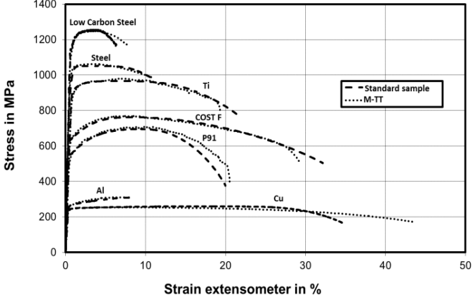
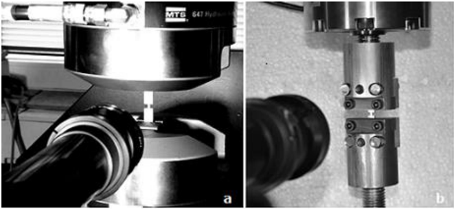
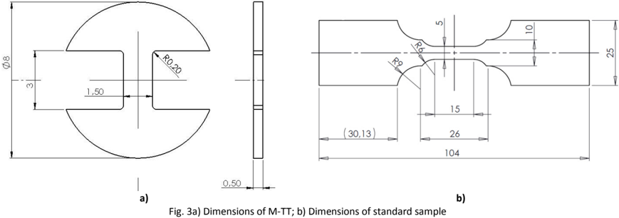
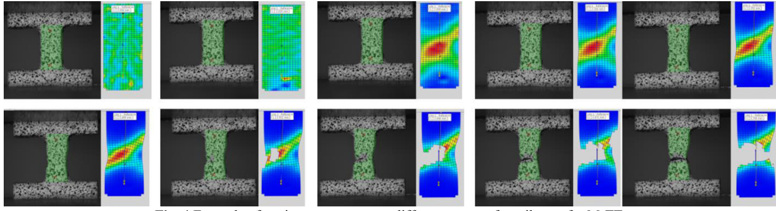
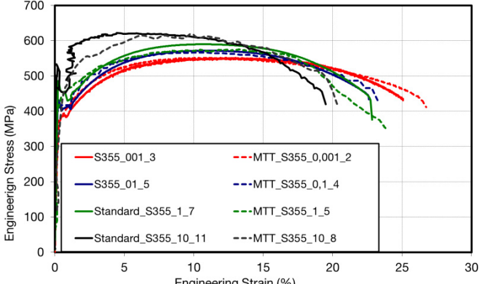
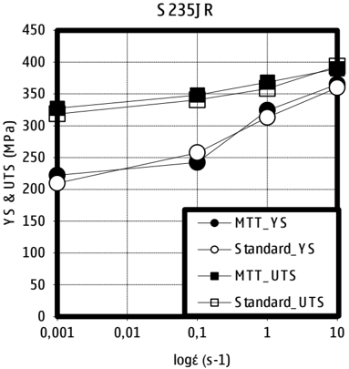
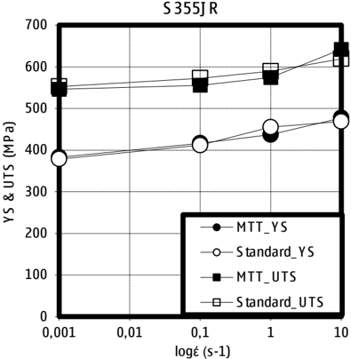
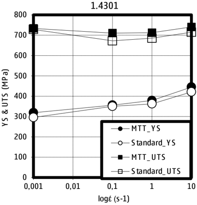
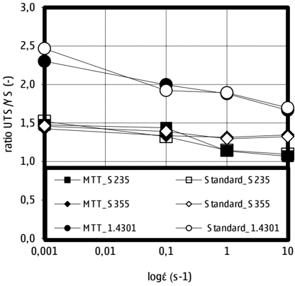

## Abstract

The paper deals with the determination of dynamic mechanical properties of steel sheets by the miniature testing technique. Several materials were investigated, namely S235, S355 and 1.4301.  The newly developed micro-tensile test (M-TT) allows local mechanical properties measurement which can be successfully used for example for weld heterogeneity  determination.  Furthermore,  due  to  small  size  samples  (tensile  sample  gauge  section  dimension  of 0,5x1,5x3mm), much higher strain rates can be attained using relatively slow loading velocities in comparison to standard dynamic tests resulting in high results consistency thanks to significant reduction of the oscillations which are  typical  for  common  high  strain  rate  tests.  The  results  obtained  from  M-TT  and  standard  tensile  tests  were compared.

© 2015 The Authors. Published by Elsevier Ltd. Peer-review under responsibility of INEGI - Institute of Science and Innovation in Mechanical and Industrial Engineering. © 2015 The Authors. Published by Elsevier Ltd. This is an open access article under the CC BY-NC-ND license (http://creativecommons.org/licenses/by-nc-nd/4.0/).

Peer-review under responsibility of INEGI - Institute of Science and Innovation in Mechanical and Industrial Engineering

Keywords: micro tensile test; M-TT; strain rate; DIC, S355, S235, 1.4301

* Corresponding author. Tel.: 00420 377 197 356; fax: 00420 377 197 310. E-mail address: martin.rund@comtesfht.cz

## ScienceDirect

Procedia Engineering   114 (  2015  )   410 - 415

## 1st International Conference on Structural Integrity

## Investigation of sample-size influence on tensile test results at different strain rates

Martin Rund a , Radek Procházka b , Pavel Konopík c , Jan Džugan d , Hugo Folgar d

*

a,b,c,d,e Prumyslova 995, Dobrany 33441, Czech Republic

## Procedia Engineering

www.elsevier.com/locate/procedia

## 1. Introduction

The paper deals with the determination of dynamic mechanical properties of steel sheets by the miniature testing technique in comparison with standard samples.  Especially in terms of constructors there is need of determination of local mechanical properties. If the structure is dynamically loaded then the tests should also correspond to this loading.  Standard  testing  procedures  require  a  large  materials  volume  for  properties  assessment  making  it impossible to evaluate local properties. At the same time requirements for the high speed loading leads to need of appropriate test machine, which are usually very costly.

Developed  micro-tensile  test  (M-TT)  not  only  allows  local  properties  measurement  with  the  use  of  small  size samples (tensile  sample  gauge  section  dimension  0,5x1,5x3mm),  but  also  enable  determination  of  local  dynamic tensile properties. The samples can be obtained from the same material volume as small punch test, but maintaining the same loading conditions as a standard samples, do not need any kind of correlations, enabling direct standard test parameters determination. The M-TT thanks to minute specimen size allow to attain high strain rates with the use of relatively  slow  loading  velocities  in  comparison  to  standard  dynamic  tests  resulting  in  high  results  consistency thanks to significant oscillations reduction typical for high strain rate tests [1].The testing procedure was verified for several  materials  exhibiting  a  wide  range  of  strength  levels  and  very  good  agreement  was  found  confirming  the procedure applicability Fig. 1.

Fig. 1 Comparison of records obtained with the use of M-TT and standard tensile samples for various metallic materials.

## 2. Experimental material

For this tests several material were used, namely S355JR, S235JR and 1.4301 (X5CrNi18-10). These materials are very  typical  representatives  of  structural  steels  and  are  very  widespread.    S355JR  and  S235JR  are  perlitic-feritic steels with defined minimal yield stress and absorbed energy (27J at 20°C).  Steel 1.4301 (X5CrNi 18-10) is referred to as resistant to corrosion in the environment of conventional type.

## 3. Tensile test

Tests execution was done at room temperature at different loading velocities resulting in initial strain rates ranging from    0.001;  0,1;  1;  10s -1 .  The  servo-hydraulic  system  MTS  BIONIX  (load  capacity  25kN  and  velocity  of  the actuator 1000mm/s) (see Fig. 2a)) was used for standard samples. M-TT samples were measured primarily at servoelectric test machine with load capacity of 5kN (see Fig. 2b)). This machine was used up to strain rates 0.1 s-1 . For stain rates 1 and 10s -1 the MTS BIONX was used. Dimension of the samples is pictured in Fig. 3a,b.

Fig. 2a) Servohydraulic test machine MTS BIONIX; b) Servo-electric test machine 5kN

## 3.1  Digital Image Correlation (DIC)

Traditionally  used  mechanical  extensometers  attached  to  the  sample  can  successfully  measure  longitudinal  and transversal  strains;  however,  their  use  at  high  strain  rate  testing  is  almost  impossible.  Firstly,  there  is  often insufficient amount of data acquired from the extensometer during the dynamic event, and secondly, dynamic tests could be destructive to the extensometer itself. Especially for high strain rate testing, optical methods proved to be more suitable [2]. For the optical measurement there is possible to use a various of systems. Very good know and often used is for example laser extensometer or video extensometer. These systems are more convenient for standard samples. Because the accuracy of strain measurement is crucial in the case of M-TT, it was found [3, 4] that the best results can be attained with the use of Digital Image Correlation (DIC) system. The principle of the Digital Image Correlation (DIC) method has been known since 1970s [5]. It is based on the recognition of change in the sequence of images.

For the need of this work DIC system Aramis was used. For this system is necessary application of the random pattern on the specimen prior the testing. The test itself is recorded by one (2D in-plane deflection measurement) or two (3D) cameras. Under the load, the specimen is deformed and so is the applied pattern. Comparing the images, changes in the pattern are registered and displacements and strains are calculated. Systems based on this method enable  3D  strains  measurements  of  either  testing  samples  or  real  components.  Accuracy  of  this  system  is  up  to 0,01% strain [6]. Example of strain measurement with DIC system is pictured on Fig. 4.

Fig. 4 Example of strain measurement at different stages of tensile test for M-TT.

Tests were performed in constant actuator velocity and the strain rate was calculated from the initial gauge length and initial velocity. After tests specimen dimensions were measured and also cross section reduction and elongation was evaluated.

An example of the records obtained from the material S355JR are shown in Fig. 5. For greater clarity all data were processed and average values of Ultimate strength (UTS) and Yield Strength (YS) in dependency of strain rate are summarized in Tab. 1. Graphical representation could be found in Fig. 6 to Fig. 8. The reduction in ductility can be shown analysing the stress ratio between the ultimate tensile strength and the yield stress (UTS/YS). Dependency of the strain rate and the ration of UTS and YS is plotted in Fig. 9.

Fig. 5 Comparison of results obtained from standard samples and M-TT, material S355JR

Engineering Strain (%)

Tab. 1 Tensile test results

| Material   | έ     | YS    | UTS   |               | έ     | YS    | UTS   | Material        | έ     | YS    | UTS   |
|------------|-------|-------|-------|---------------|-------|-------|-------|-----------------|-------|-------|-------|
| Material   | s -1  | MPa   | MPa   |               | s -1  | MPa   | MPa   |                 | s -1  | MPa   | MPa   |
|            | 0,001 | 209,7 | 318,6 | Standard_S355 | 0,001 | 378,6 | 552,6 | Standard_1.4301 | 0,001 | 295,6 | 728,5 |
|            | 0,1   | 257,5 | 340,5 | Standard_S355 | 0,1   | 411,8 | 572,6 | Standard_1.4301 | 0,1   | 350,1 | 672,4 |
|            | 1     | 313,1 | 358,4 | Standard_S355 | 1     | 455,3 | 589,5 | Standard_1.4301 | 1     | 362,2 | 685,3 |
|            | 10    | 359,9 | 393,5 | Standard_S355 | 10    | 468,7 | 619,5 | Standard_1.4301 | 10    | 421,2 | 714,8 |
|            | 0,001 | 222,2 | 327,6 | Standard_S355 | 0,001 | 383,0 | 546,1 | Standard_1.4301 | 0,001 | 319,0 | 733,7 |
|            | 0,1   | 242,4 | 348,3 | Standard_S355 | 0,1   | 416,5 | 555,7 | MTT_1.4301      | 0,1   | 356,0 | 710,4 |
|            | 1     | 324,2 | 368,6 | Standard_S355 | 1     | 437,1 | 574,3 | Standard_1.4301 | 1     | 379,0 | 712,3 |
|            | 10    | 365,0 | 389,6 | Standard_S355 | 10    | 477,2 | 641,9 | Standard_1.4301 | 10    | 445,0 | 740,6 |

Fig. 6 YS and UTS dependence on various strain rates, S235JR

Fig. 8 YS and UTS dependence on various strain rates, 1.4301

Fig. 7 YS and UTS dependence on various strain rates, S355JR

Fig. 9 Ratio UTS/YS vs. strain rate

## 4. Conclusion

Within  this  work,  tensile  tests  using  standard  and  M-TT  specimens  were  performed.  Tests  were  carried  out  at room temperature with strain rate 0.001-10s -1 . The investigated materials were two perlitic-feritic structure materials S355JR and S235JR. Third investigated material was austenitic steel 1.4301. On the basis of results shown in Tab. 1 it is clearly visible, that there is no significant difference between standard and M-TT specimen. Difference in the results does not exceed 8%. Subsequently should be noted, that using the M-TT samples not only saves costs for samples  production  but  also  allow  dynamic  measurement  on  standard  machines.  Actuator  velocity  for  standard samples was 150 mm/s and for M-TT 27 mm/s.

Concerning the dynamic testing for the evaluation of strain rate sensitivity, there is clearly shown trend of strain rate sensitivity increase with strain at steels S355JR and S235JR. According to our expectation, austenitic steel did not show significant strain rate sensitivity for UTS but only in YS. Similar results were described in e.g. [7], where the increase of UTS begins with higher strain rates (about 10 2 s -1 ). It can also be seen that the increase of strain rate leads to a decrease of area reduction, in other words a decrease of ductility. The reduction in ductility can be shown analysing the stress ratio between the ultimate tensile strength and the yield stress (UTS/YS).

## Acknowledgements

This  study  was  created  by  project  Development  of  West-Bohemian  Centre  of  Materials  and  Metallurgy  No.: LO1412, financed by the MEYS of the Czech Republic.

## References

- [1] Konopík, P., Dzugan, J., Prochazka, R.: Determination of fracture toughness and tensile properties of structural steels by sm all punch test and micro-tensile test, Metal 2013, 15-17.5. 2013, Brno, Czech Republic.
- [2] Konopik, P., Dzugan, J., Rund, M.: Dynamic Tensile And Micro-Tensile Testing Using DIC Method, Metal 2014, May 21st -23rd 2014, Brno, Czech Republic, ISBN 978-80-87294-52-9.
- [3] Konopík, P., Dzugan, J., Prochazka, R.: Evaluation of local mechanical properties of steel weld by miniature testing technique, Materials Science &amp; Technology 2013, October 27-31, 2013, Montreal, Quebec, Canada, ISBN 978-0-87339-762-9, pp. 2404-2411
- [4] Džugan,  J.,  Procházka,  R.,  and  Konopík,  P.,  "Micro -Tensile  Test  Technique  Development  and  Application  to  Mechanical  Property Determination,"  Small  Specimen  Test  Techniques,  6th  Volume,  STP  1576,  Mikhail  A.  Sokolov  and  Enrico  Lucon,  Eds.,  pp.  12-29, doi:10.1520/STP157620140022, ASTM International, West Conshohocken, PA 2014.
- [5]  Sutton,  m.  Digital  Image  Correlation:  Principles  Develpments  and  Applications  for  Paramter  Estimation,  University  of  South  Carolina. http://www.gdr2519.cnrs.fr/ecole2011/ET\_2011/M\_Sutton.pdf.
- [6] GOM: ARAMIS System. [online] http://www.gom.com/3d-software/aramis-software.html.
- [7]  Cadoni,  E.,  Fenu,  l.,  Forni,  D.,  Strain  rate  behaviour  in  tension  of  austenitic  stainless  steel  used  for  reinforcing  bars,  Construction  and Building Materials, Volume 35, October 2012, Pages 399-407, ISSN 0950-0618, http://dx.doi.org/10.1016/j.conbuildmat.2012.04.081.