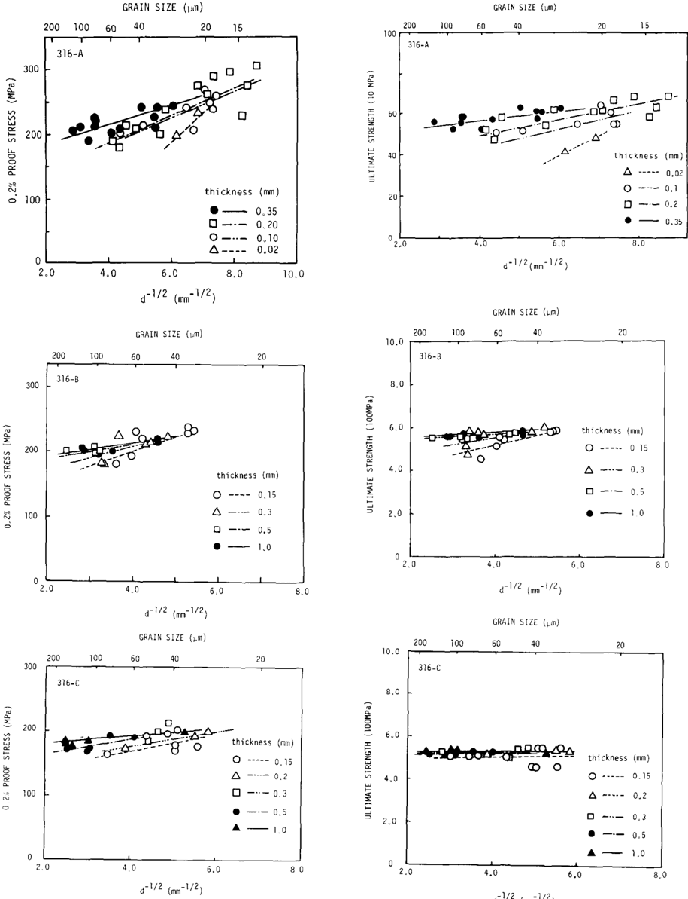
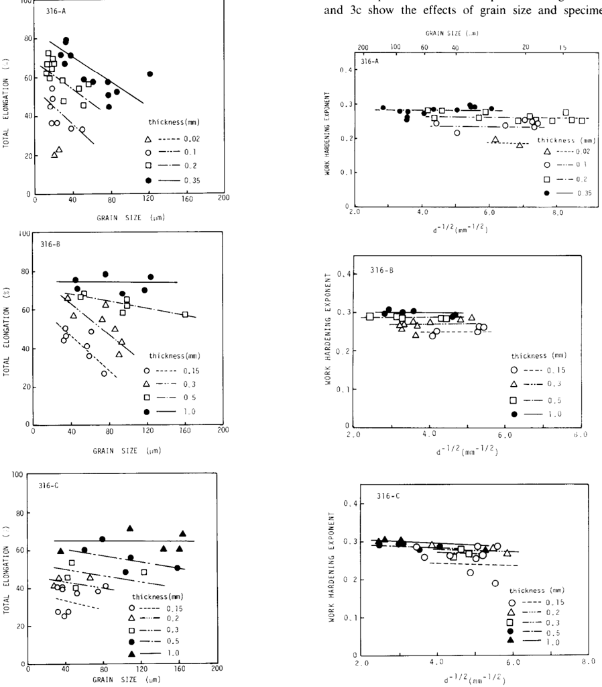
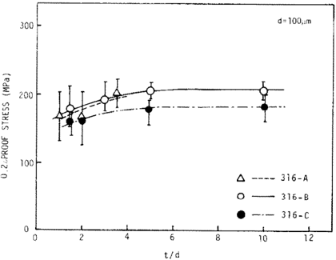
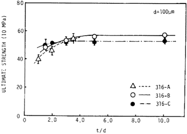

## THE  EFFECTS OF  GRAIN  AND  SPECIMEN SIZES  ON  MECHANICAL PROPERTIES OF TYPE  316  AUSTENITIC STAINLESS STEEL

## K.  MIYAHARA. C. TADA. T.  UDA and N. IGATA

Depurtmenr  of  Materids Science, (/nwrrsr!,~ of  Tokyo.  Hongo,  Bunky ku.  Tok,,o  11.3, Jupun

The effects of grain size  and specimen thickness on the mechanical properties (0.2% proof stress, ultimate strength, total elongation and work hardening exponent) of  specimens of  type 316  austenitic stainless steels have been investigated by tensile testing at  room temperature. The  0.2%  proof stress and the ultimate strength of thin specimens with small grain size ( &lt;  -40 pm) can be  the  same as  for  bulk material. On  the  other hand. the  specimen thickness effect on  the  total elongation is  large, and there is  a  case  where it  is  difficult to  deduce the total elongation of  bulk material from that of  the thin specimen. Generally. the mechamcal prope:ties deteriorate with decreasing specimen thickness for  a  constant grain  size.

## 1.  Introduction

## 2. Experimental procedure

In  charged particle irradiation for  the  simulation of  1 MeV and 14  MeV neutron irradiation, the ranges are very small and the specimen thickness is  limited by  the ranges of  ion  particles in  specimen materials. The  volume of  specimens available for  intense neutron irradiation is also limited. Therefore the mechanical properties of miniature specimens have to  be  investigated for a  basic understanding of the behaviour of deformation and fracture under neutron or charged particle irradiation, and the relations between the properties of small sized specimens and those of bulk specimens must be clarified.

In the present work, the tensile properties of thin specimens of  three kinds of  type 316  austenitic stainless steel have been investigated, focusing on the effects of specimen thickness and grain size. Miyazaki et al. [I] have reported the effects of grain size and specimen thickness on the flow stress of Fe, Al,  Cu  and Cu-AI alloy. and Auer et  al.  [2]  have studied these effects on  a 316  stainless steel. Igata et  al.  have also reported results on 304  and 316  stainless steels [3,4].  The results of the present work have  been compared with their results and discussed.

Table 1 Chemical compositions cf the materials (wt%)

| Material   | Thickness   | C     | Si     | Mn    | P     | S      |     Cu | NI    |    Cr |
|------------|-------------|-------|--------|-------|-------|--------|--------|-------|-------|
| 316-A      | 20- 200 nm  | 0.05  | 0.60   | 10.6  | 0.031 | 0.005  |   0.28 | 10.41 | 16.86 |
| 316-A'     | 350 bm      | 0.04  | 0.58   | 0.99  | 0.030 | 0.004  |   0.26 | 10.83 | 17.40 |
| 316-B      | 150-1000nm  | 0.058 | 0.66   | 1.51  | 0.036 | 0.005  |        | 11.42 | 17.35 |
| 316-C      | 150-1000pm  | 0.055 | 0.53   | 1.88  | 0.024 | 0.009  |        | 15.80 | 15.27 |
| Material   | Thickness   | MO    | N      | co    | Ti    | B      |      0 | Fe    |       |
| 316-A      | 20-200 pm   | 2.23  | 0.0658 |       | _     |        |        | Bal   |       |
| 316-A'     | 350 nm      | 2.20  | 0.0220 |       |       |        |        | Bal   |       |
| 316-B      | 150-1000 pm | 2.14  | 0.014  | _     |       |        |        | Bal   |       |
| 316-C      | 150-1000 pm | 2.66  | 0.0039 | 0.048 | 0.24  | 0.0032 | 0.0041 | Bal   |       |

The materials used in this work are  commercial 316 stainless steels (hereafter designated 316-A, A'  and B) and the Japanese Primary Candidate Alloy (second heat, JPCA-2) for the first wall material (designated 316-C  here). 316-A  and  A'  are  commercial foils  supplied by Nippon Kinzoku Co. Ltd (thickness; 30-350 pm), and thin sheets of the 316-B and C  were obtained by cold rolling of  the  as-received materials. The  as-received materials of 316-B and C  were supplied by Sumitomo Metal Industries and Kobe Steel Ltd, respectively. Tensile test specimens (gauge length, 15  mm; gauge width, 4.0 mm) were cut from foils and thin sheets. Solution treatments of the specimens were done at various temperatures in  the  range 1320  to  1570  K  for  30 to  60  min in  an  Ar  atmosphere of  about 8 X  10' Pa,  in order to  vary the  average grain size.  Chemical compositions of the materials are  shown in table 1.  The mean grain size  was measured by the usual intercept method. The  tensile tests were  performed at  room temperature at a  strain rate of  4.5  X  10e4 5-l.

## 3. Experimental results

Figs. la, lb and lc  show the  effects of  grain size  and specimen thickness on the 0.2% proof stress of the

Fig. 1.  The effects of  grain size  and specimen thickness on the 0.2% proof stress of (a, :op) 316-A and A',  (b, middle) 316-B and (c.  bottom) 316-C stainless steels.

)

Fig. 2.  The effects of  grain size  and specimen thickness on the ultimate strength of (a, top) 316-A and A'.  (b. middle) 316-B and (c,  bottom) 316-C stainless steels.

316-A and A'.  316-B and 316-C respectively. Though the scatter in  the data points in  these figures is  large, it is  recognised that the strength of  the thinner specimens becomes lower at  a  constant average grain size  and that, at  small grain size  (&lt; -40  pm). the  0.2%  proof stress of

100

Fig. 3.  The effects of  grain size  and specimen thickness on the total elongation of  (a,  top) 316-A and A',  (b,  middle) 316-B and (c.  bottom) 316-C stainless steels.

the thin specimens becomes the same as that of the thick specimens. Figs. 2a,  2b  and 2c  show the grain size dependencies of  the ultimate strength of  316-A and A'. 316-B and 316-C at each specimen thickness, respectively. It is noticeable in fig. 2c that in the 316-C stainless steel the ultimate strength has almost no  grain size and specimen thickness dependence. Figs. 3a. 3b and 3c show the effects of grain size and specimen thickness on the total elongation of the materials. The grain size  dependence of  the total elongation of  316-C is different from those of 316-A, A' and B.  The total elongation of  all  the materials decreases as  the  specimen thickness decreases, and the  magnitude of  this  specimen thickness effect on the total elongation is  considerable. Figs. 4a,  4b and 4c  show the effects of grain size and specimen thickness on the  work hardening exponent of the materials. The  work hardening exponent is  obtained by  the  data of  true stress and true strain at  the  nominal strain of  0.2. 1.0,  2.0,  5.0,  10,  15,  20,  25.. .  . and ultimate strain (%),  using the  method of least squares. The  basic equation is CJ  = kc', where CI is  the true stress, E is  the true strain, X  is  a  constant and n  is  the  work  hardening exponent. From these figures it is  clear that the work hardening exponent has almost no grain size dependency and that the  specimen thickness effect on  the  work hardening is  small, compared with its  effect on the total elongation.

Fig. 4.  The effects of  grain size  and specimen thickness on the work hardening exponent of  (a. top) 316-A and A'.  (b.  middle) 316-B and (c.  hottom) 316-C stainless steels.

## 4.  Discussion

Miyazaki et  al. [I] have analyzed the  effects of  specimen thickness (t) and grain size (d) on the flow stress of thin specimens. They have concluded that the flow stress decreases with  decreasing specimen thickness when the value of r/d ratio is  smaller than a  critical value and that the critical value of t/d depends on the stacking fault energy of material. Auer et al. [2]  have also investigated the effects of  specimen thickness and grain size on the flow stress of 316 stainless steel. According to  Miyazaki et  al.  and Auer et  al.,  the  critical values of t/d for the yield stress are fairly small, i.e., about 3 for  aluminium (d  = 180  pm) [l]  and about 2  for a 316  stainless steel [2],  respectively. Igata et al. have reported that the critical values of t/d for the 0.2% proof stress of 304  and 316  stainless steel are about 4 and 6.  respectively. Fig.  5  shows the  0.2%  proof stresses

Fig. 5.  The  0.2%  proof stresses of  316-A, B and C  as  a  function of i/d.

80

J

Fig. 6.  The ultimate strength of  316-A. B and C  as  functions of r/d.

of  316-A. A',  B and C  as  a  function of t/d. The  critical value of t/d is  considered to  be  about 5  for the  316-B and C.  This small value agrees roughly with the results of  Auer et  al.  [2]  and Igata et al.  ]3.4]  for the austenitic stainless steels.

Auer et al. [2]  also report that the grain size dependence of  the  ultimate tensile strength of their 316  stainless steel is  smaller than that of  the yield stress and that the critical value of t/d is  greater than 3.  In  the present work, the  grain size  dependence of  the  ultimate strength is not necessarily smaller than that of the 0.2% proof stress, and the critical values of r/d for the ultimate strength are about 3  for the 316-C and about 5  for the 316-A, A'  and B,  as  shown in fig. 6.  These values are considered to be in  good agreement with Auer et al.'s result.

Figs. 3a,  3b  and 3c  indicate that the total elongation of  316  stainless steels depends remarkably on the specimen thickness. According to the data sheet of  NIRM [S].  the total elongation of the bulk material of a  316 stainless steel is (65  \_+  5)%. Therefore, in the present work, the total elongation of the 1.0  mm thick specimens of 316-B and C  is  considered to be that of the bulk material. and as  for the thin specimens (thickness; 0.2-0.5 mm) of 316-A, A'  and B,  the total elongation becomes equal to that of the bulk material, when the grain size is  sufficiently small. For the 316-C. however, the total elongation is  mainly determined by  the specimen thickness and there is  no total elongation of the thin specimen which corresponds to that of the bulk material, even when the grain size is adjusted. Such small or  zero gram size  dependency of the total elongation was  reported by  Igata et  al.  [3,4]  on a  304  stainless steel foil. Therefore it is considered to be generally difficult to deduce the total elongation of the bulk material from that of the thin specimen.

As  shown in figs. 4a,  4b  and 4~.  the effect of grain size on the  work hardening exponent of  the materials is very small. and the  work hardening exponent gradually decreases with decreasing specimen thickness. As the work hardening exponent (n) has a  complex meaning

(n  =  (do/dc)/( a/e)), the effect of the specimen thickness on n  cannot be simply analyzed, but a  dominant factor in this effect (the gradual decrease of n with decreasing the specimen thickness) is  considered to be due to  the  decrease of e.

## 5.  Conclusion

- (1) The 0.2% proof stress of the 316 stainless steels shows the grain size and specimen thickness dependencies. When the value of r/d is larger than the critical value, the 0.2%  proof stress of the thin specimen becomes equal to  that of  the  bulk material. In  the  present work, the  critical value of r/d for the 316  stainless steels is  about 5.
- (2) The  ultimate strength of  the 316  stainless steels also shows grain size  and specimen thickness dependencies.  When the  value of t/d is  larger than about 3 to 5, the ultimate strength of the thin specimens is equal to that of the  bulk material.
- (3) The total elongation of the 316 stainless steels is considerably affected by  the  specimen thickness at  a constant grain size. It  is  difficult to  deduce the total
4. elongation of bulk material from the results uamg the thin specimen. when the grain size  dependence of  the total elongation is  small.
- (4) The  effects of  grain size  and specimen thickness on the work hardening exponent of the 316  stainless steels are not large. However. the work hardening exponent gradually decreases with decreasing specimen thickness.

## References

- [l] S.  Miyazaki, K.  Shibata and H.  Fujita. Acta Met 27  (1979) 855.
- [2] J. Auer and A.A. Sagues. Proc. Int. Conf. on Radiation Effects and Tritium Technology for Fusion Reactors, eds.. J.S.  Watson and F.W. Wiffen (Gatlinburg. Tennessee. USA. 1975) p,  11-64.
- [3] N. Igata. K. Miyahara. K. Ohno and T. Uda. J. Nucl. Mater. 122-123 (1984) 354.
- [4] N. Igata, K. Miyahard. T. Uda and S.  Asada. to he published in  ASTM  STP  888.
- [5]  NRIM Creep Data Sheet. No. 15  (National Research Institute of  Metals, Japan. 1974).