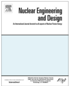
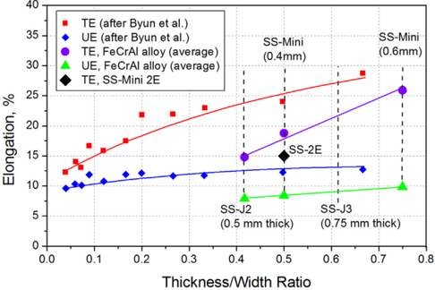
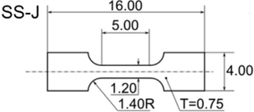
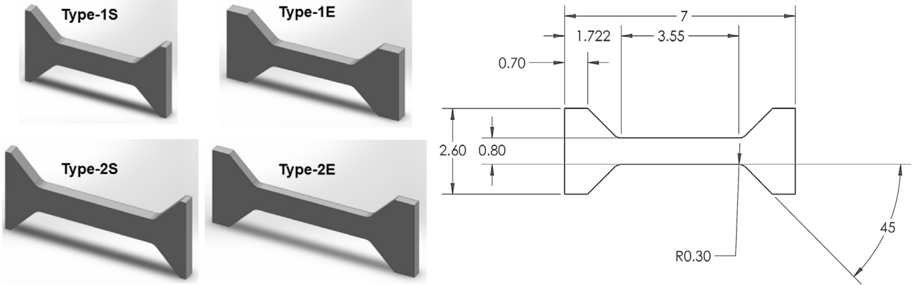
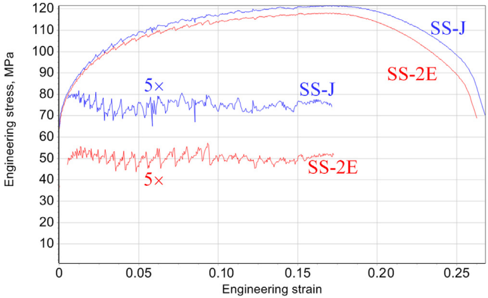
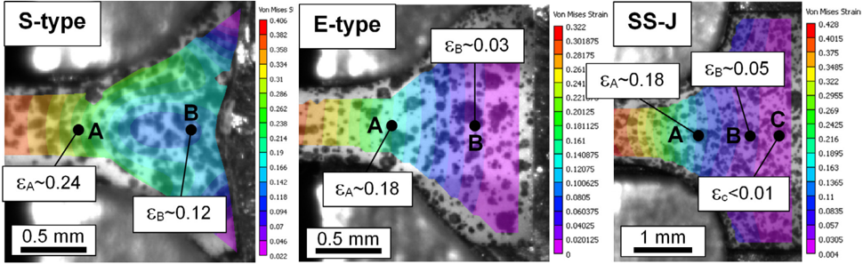
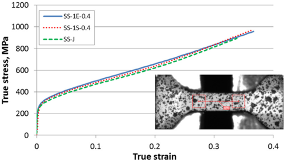
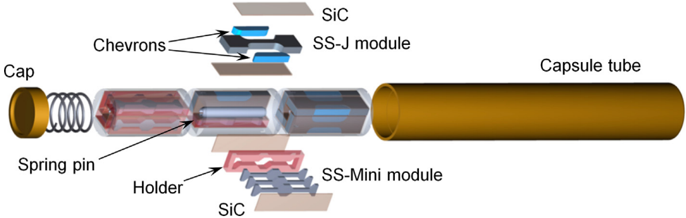
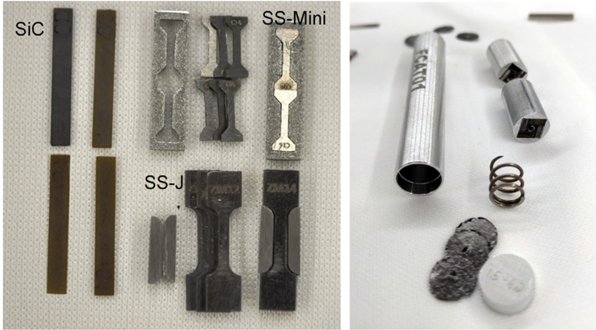
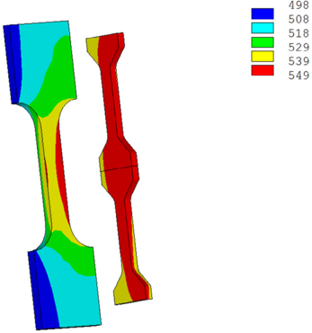

Contents lists available at ScienceDirect

## Nuclear Engineering and Design

[j o u r n a l homepage: www.elsevier.com/locate/nucengdes](http://www.elsevier.com/locate/nucengdes)

## Sub-size tensile specimen design for in-reactor irradiation and post-irradiation testing

Maxim N. Gussev ⇑ , Richard H. Howard, Kurt A. Terrani, Kevin G. Field

Oak Ridge National Laboratory, Oak Ridge, TN 37831, USA

## h i g h l i g h t s

-  New specimen geometry for post-irradiation testing (PIE) was designed.
-  Scale factor role was discussed in detail.
-  The new geometry performance was evaluated for several commercial and model alloys.

## a r t i c l e i n f o

Article history: Received 12 October 2016 Received in revised form 30 May 2017 Accepted 3 June 2017

Keywords: Scale factor Sub-size specimen geometry Post-irradiation investigation In-situ testing Flexible design for neutron irradiation capsules

## 1. Introduction

There is a constant and growing interest in the mechanical testing of small specimens and analyzing material behavior at small scales. In general materials science, this interest is driven by introducing smaller devices and exploring the microand nanomechanics areas (Connolley et al., 2005; Jaya and Alam, 2013). The goal is to analyze the properties and performance of microparts and components in detail while understanding materials behavior at lower length scales.

At the same time, the nuclear industry often has a different goal (Klueh, 1985; Kohno et al., 2000; Hindley et al., 2015; Viehrig et al., 2015): testing of miniature samples taken from nuclear installations should provide information that is applicable to bulk

⇑ Corresponding author at: PO Box 2008, Oak Ridge, TN 37831, USA. E-mail address: gussevmn@ornl.gov (M.N. Gussev).

## a b s t r a c t

The present work aims to provide a complete engineering solution, an appropriate experimental database, and a brief physical background on designing a miniature specimen geometry suitable for irradiation in materials test reactors such as the High Flux Isotope Reactor and post-irradiation out-of-hot cell testing. The physical limits of specimen miniaturization and a background of the scale factor effect are discussed, and principal limitations are defined. The advantages of modern test methods like digital image correlation, as well as some limitations connected to small specimen size, are analyzed. A subsized specimen geometry, ''SS-Mini,' is designed; the geometry employs existing irradiation capsules leading to the reduced cost of any irradiation campaign. The new geometry performance is evaluated using a commercial 304 L stainless steel, an aluminum alloy including advanced 3D-printed material, a high nickel 718-alloy, tungsten, and an advanced fuel cladding FeCrAl alloy. Mechanical tests are conducted to compare the engineering mechanical properties (yield and ultimate tensile stress, uniform and total elongation values) and plastic behavior of the proposed miniature specimen with common specimen types for irradiation testing.

Ó 2017 Elsevier B.V. All rights reserved.

mechanical properties or at a minimum yield coherent scaling parameters from small scale testing. The motivation for smallscale mechanical testing in the nuclear industry is to best take advantage of the limited experimental space in materials test reactors and minimize the radiological dose produced from activated materials that directly scales with their volume.

Additionally, recent progress in different in-situ test methods, (Dehm et al., 2006), and the next decade is likely to see a considerable rise in the in-situ test techniques for general materials science and nuclear engineering. For instance, micro-pillar testing (Dehm et al., 2006; Shin et al., 2015), high-resolution EBSD (Jiang et al., 2013), advanced tools for 3D structure reconstruction, and other techniques are quickly providing new, unique, and-most importantly-insightful data. Employing these methods is an attractive idea for the investigation of radiation effects in materials, including plastic strain at small scales (Greer and De Hosson, 2011).

Moreover, the development of innovative nuclear systems constantly requires new materials, which, in turn, means increasing needs for advanced comprehensive testing methods (Fazio et al., 2011; Yvon et al., 2015), like in-situ corrosion testing (Klecka et al., 2015), while simultaneously reducing the time to achieve such data and analysis.

The deployment of the advanced in-situ techniques on neutron irradiated materials is of special importance. Although significant progress was made to use light ion and heavy ion irradiations to simulate neutron irradiation while producing samples with little or no radioactivity [e.g., see (Was et al., 2002)], the discrepancies in the observed microstructure and mechanical properties still exist. Hence, data for neutron irradiated materials are still essential to fully develop a nuclear-grade alloy ripe for commercial deployment.

Irradiation may stimulate specific processes not observed without irradiation, including swelling, increased diffusion and creep, radiation-induced segregation (RIS), and irradiation-assisted stress corrosion cracking (IASCC), just to name a few. Advanced in-situ tools may bring new insights into well-known processes. For instance, a preliminary, not-on-purpose analysis of the deformation localization in neutron irradiated austenitic steels revealed specific phase transformation at the irradiated specimen's surface (Gussev et al., 2014b) along with areas of localized deformation and high dislocation density spots (Field et al. 2014a) in addition to the expected and well-known defect-free channels. It is important to be able to test the irradiated specimen in-situ, registering, for example, the evolution of dislocation density and the evolution of local misorientation (Jiang et al., 2013) with direct measurements of acting stress or observations of stress corrosion crack appearance and propagation. These data, coupled with modern modeling tools, allow for complex analysis of material behavior, including constitutive crystal plasticity approaches. However, to reach these goals, one has to at least have direct access to the specimen for preparing the appropriate quality surface.

Miniature sub-size specimens for post-radiation testing have a long history and are widely used for investigating mechanical properties and deformation-hardening behavior of irradiated and non-irradiated metals and alloys (Klueh, 1985; Panayotou et al., 1986; Kohyama et al., 1991; Kohno et al., 2000; Gussev et al., 2014a), weldments (Field et al., 2014b), nanostructured materials, and different composites. A variety of different sizes and geometries are used in nuclear materials science (Klueh, 1985; Pierron et al., 2003; Wakai et al., 2011), with new geometries and testing methods being constantly developed (Rickerby and Fenici, 1986; Dz ˇugan et al., 2014; Hurst and Matocha, 2015; Rund et al., 2015). Specimen miniaturization often involved other methods, not only tensile testing. Thus, Jung et al., (1996) offered a miniature tensile specimen with gauge section of 5 -1 -0.4 mm; additionally, a number of testing methods for miniature specimens (tensile, facture toughness, punching, impact testing) were discussed in detail (Jung et al., 1996) focusing on the detailed correlation between miniature and bulk behavior. The offered tensile specimen geometry was intensively used in a number of projects (see for instance, (Dai and Bauer, 2001)).

Through the past few decades, there has been a tendency to decrease the overall specimen size and volume (Klueh, 1985). Prior to this work, two miniature tensile specimen geometries were commonly used for irradiations in the High Flux Isotope Reactor (HFIR): the SS-3 and the SS-J type specimens (Klueh, 1985; Gussev et al., 2014a). These two geometries provide acceptable mechanical properties compared to standard-scale specimens (Gussev et al., 2014a). However, the post-irradiation activity level is usually too high for nuclear reactor metals after discharge, and this limits the post-irradiation analysis to testing within a hot cell facility only, especially when moderate to high damage dose (dpa)

samples are of interest. Reaching the acceptable level of radioactivity may require unacceptable waiting times that exceed the lifetime of the funding program or project interested in such data.

Thus, there is a need for a specimen geometry capable of supporting the modern in-situ testing methods on moderate to highly neutron irradiated materials, while still providing repeatable bulkscale mechanical properties. It is important for the new geometry to provide appropriate mechanical test results and keep a continuity and comparability with the existing databases in the literature. If suitable, these small-scale mechanical testing specimens impact scientific productivity in the nuclear materials area in two important ways. First, by avoiding in-cell testing, a whole host of new characterization techniques too costly or simply inviable for incell deployment-where high radiation fields detrimentally interact with electronic components-suddenly become available for utilization. Second, the costs associated with in-cell testing are often very high (e.g., at least a factor of 2-3x higher at ORNL) and would, in turn, limit the depth and breadth of the R&amp;D project.

The circumstances discussed above motivated the development of a new specimen geometry allowing for: (1) in-HFIR irradiation within the existing ''rabbit capsule' geometry and specifications, (2) out-of-hot cell testing with short ''cool-down' (reduction in radioactivity by decay) time, and (3) the capability to perform insitu measurements using advanced techniques. The present work discusses the design, geometry, and implementation of a miniature sub-size specimen that meets these requirements.

## 2. The background of scale and size effects

The scale factor and size effects usually become apparent when the specimen size approaches the characteristic length scale of the material microstructure (Connolley et al., 2005). For common steels and alloys, this tends to be the grain size. Another size effect, often observed in brittle materials (Baz ˇant, 1999), occurs when the size of the specimen becomes small compared to the spatial distribution and density of critical defects. Additionally, size effects may appear due to physical, chemical, or corrosion processes that are negligible for relatively large objects but become critical when the size of the test specimen decreases. Most of these processes, like oxidation, usually do not appear in common mechanical tests; however, some important physical phenomena sensitive to the scale factor are briefly analyzed below.

Considering the scale factor role, researchers most often focus on the uniform strain area, where the uniaxial stress state exists, and on the necking behavior, where the complex stress state and the stress triaxiality play an important role.

In the first case, under uniaxial stress, the specimen is often presented as a ''multilayer' object with a layer of near-surface grains. The ratio of the ''near-surface grains' to the ''bulk grains' impacts the specimen deformation behavior and strain hardening rate (Wang et al., 2013; Shin et al., 2015). The near-surface grains (or the near-surface layer if a single crystal specimen is considered) have smaller dislocation density and internal back stress level compared to the bulk grains (Keller et al., 2010; Shin et al., 2015) because of the dislocation escape through the free surface. Also, the surface plays a key role in crack initiation during fatigue (Signor et al., 2016) and stress corrosion cracking (SCC). To handle very thin specimens (10-20 l msheets), some special test method (s) may be needed. For instance, Hoffman and Hong (Hoffmann and Hong, 2006) offered an aero-bulging test method for testing thin foils of different materials.

It is worth noting that the near-surface layer is not necessarily ''weak;' that is to say, it does not necessarily have a decreased strength. Often, specimens are produced by electric discharge machining (EDM) followed by mechanical grinding or polishing to fit the dimensional requirements. EDM leads to the formation of a recast surface layer, often referred to as the ''white layer' (Bleys et al., 2006), which may be hard and brittle depending on the material system. The subsequent mechanical grinding removes the EDM layer but introduces cold-work related artifacts or even results in the formation of fine grains (Kaneda et al., 2011). Electropolishing or controlled chemical etching may eliminate the modified layer, but these techniques are both costly and timeconsuming or produce specimens with thickness and edge shape variations that can significantly skew results.

Strictly speaking, it is impossible to avoid the free surface influence. Instead, the question is how thick should the specimen be to provide acceptable data? Usually, in mechanical test practice, the smallest specimen dimension should exceed 5-6 grains to minimize the scale factor influence (Kohno et al., 2000). This rule may not be fully valid in some specific cases (e.g., in nano-structured materials with high defect density). If defect spacing is much smaller than grain size, the bulk mechanical properties may be measured by using smaller specimens that contain as little as 2-4 grains across the smallest dimension (Howard et al., 2016).

Sometimes, there are additional limitations if the material being tested exhibits phenomena sensitive to the active volume or surface conditions. For instance, plastic deformation generates energy release in the form of heat and leads to a temperature increase (Ayres, 1985), but this process is usually ignored. However, the temperature at the specimen gauge may rise by 10 ° C or more even at a moderate strain rate (  10  3 s  1 ) (Ayres, 1985). In the case of fracture, a large amount of energy is being released in a small volume resulting in a temperature jump that can reach 100 ° C. For example, a temperature rise of  300 ° C was observed in the shear bands in metallic glass specimens (Yang et al., 2006). As an ultimate case, melting of a metallic glass specimen during fracture was observed in-situ (Yang et al., 2004). In the tensile test, the heat generation is proportional to the specimen volume (  d 3 ) in the uniform strain area, whereas the heat losses rely on the specimen surface or cross-sectional area (  d 2 ). Thus, the heating intensity is proportional to the specimen size (d), being less pronounced in small specimens compared to larger ones. If the material of interest experiences strain-induced phase instability (Chen et al., 2013; Shirdel et al., 2015), such as the transformation induced plasticity (TRIP) effect, deformation twinning, or dynamic deformation aging, the effects of strain-induced heating should not be ignored.

Additionally, some materials, like carbon steels and Al-Mg alloys, often exhibit Luders band propagation. In this case, a deformation plateau is observed in the tensile curves (Mazière and Forest, 2015). It appears that Luders deformation may also be scale-sensitive. For instance, the plateau disappeared in a ferritic A533B steel when a thin specimen geometry such as an SS-2 type tensile specimen (T = 0.25 mm) is used (Gussev et al., 2014a). Also, the material of interest may be sensitive to texturing; orientation effects may appear in the specimens produced from rolled or extruded material (Zhang et al., 2014).

The scale factor's role during deformation localization and necking may be more complex compared to the uniform strain area. In addition to the free surface effects and the different behavior of the near-surface grains, the neck also experiences a complex stress state. The neck shape and principal strain ratio may depend on specimen thickness and thickness-to-width ratio (T/W). Byun et al. (Byun et al., 1998) investigated the effect of specimen thickness on the mechanical properties of miniature specimens with a particular focus on deformation localization and necking. Regarding the yield and ultimate stress and uniform ductility for ferritic steels, Byun et al. concluded (Byun et al., 1998) that these values will be close to the bulk material data of the specimen if thickness exceeds  0.3-0.4 mm (or  7-10 -grain size).

However, the total elongation value demonstrated a more complex behavior, as shown in Fig. 1, where saturation in the total elongation values was reached at  2 mm thickness (T/W ratio of  0.67 in Fig. 1). Necking angle, the angle between the loading axis and the fracture plane, was also affected by thickness. The parameter controlling these processes was found to be the T/W ratio that influences the stress state in the neck (Byun et al., 1998). A similar result-post-necking elongation increased with thickness-was obtained by (Yuan et al., 2012). In the context of the present work, this means that the T/W value of the conventional small-scale specimens, like SS-3 [T/W  0.5, (Klueh, 1985)], and new miniature geometries discussed later should be close, if not identical.

If the material behavior under the complex stress state is of interest, a proper specimen geometry may be employed to analyze the stress triaxiality role on plastic behavior and fracture, as discussed recently in (Algarni et al., 2015). If necessary, the stress state may be directly addressed via neck geometry measurements [e.g., by multi-camera 3D DIC, (Kamaya and Kawakubo, 2014)] or by a finite element modeling (FEA) approach (Kim and Byun, 2010).

A number of additional phenomena exist beyond the few discussed above (Jaya and Alam, 2013); however, a detailed analysis is out of the present scope of work. In summary, it appears that geometrical (specimen thickness and presence of natural internal boundaries, like grain boundaries), technological (surface and near-surface layer conditions), and physical (potential scalesensitive phenomena) limitations should be analyzed for the particular material before designing a specimen geometry for nuclear materials development applications.

## 3. Materials and test methods

As discussed above, the scale-factor limiting criteria can vary from material to material and can be significant or insignificant depending on the data of interest from a mechanical test. Thus, it is important to cover a wide range of strength and ductility values and different types of strain hardening behavior by using a vast array of different material systems. The present work included both well-known and advanced modern materials, as shown in Table 1. Aluminum 6061 alloy is employed to cover the low strength/low ductility range; also, after annealing, this material demonstrates specific deformation behavior with propagating deformation bands. Austenitic AISI 304L stainless steel is selected as a representative commercial, widely used nuclear material.

40

Fig. 1. The effect of the T/W ratio on the uniform (UE) and total (TE) elongation values. The plot includes the data from (Byun et al., 1998) on an RPV steel and the present work's results on the advanced FeCrAl alloy (see below). The positions of the designed small specimens on the T/W scale are shown by vertical, dashed lines.

Table 1 Element composition of the investigated materials.

| Material       | Composition, wt% (or ppm wt. for tungsten).                                                                                        |
|----------------|------------------------------------------------------------------------------------------------------------------------------------|
| 6061 Al- alloy | Al: bal., Mg: 0.86, Si: 0.66, Fe: 0.35, Cu: 0.23, Cr: 0.13, Ti: 0.08, Mn: 0.08, Zn: 0.08, Ni: 0.02                                 |
| 304 L          | Fe: bal., C: 0.02, Mn: 1.3, Si: 0.45, Cr: 18.3, Ni: 8.02, Mo: 0.074                                                                |
| FeCrAl- alloy  | Fe: 79.4, Cr: 13.1, Al: 5.3, Y: 0.05, Mo: 2.0, Si: 0.13, Nb: <0.01                                                                 |
| 718-alloy      | Ni: bal., Cr: 18.5, Fe: 18.7, Mn: 0.23, Mo: 3.03, Al: 0.48, Co: 0.29.                                                              |
| Tungsten       | (ppm wt.) W: bal., Al: 0.23, Si: 0.55, P: 0.68, V: 0.82, Cr: 1.7, Fe: 3, Ni: 0.75, As: 0.39, Sn: 0.69, Ta < 5, other: <0.1 ppm wt. |

Commercial 718-alloy is added as a high strength material. Advanced FeCrAl alloy is selected to represent a system currently undergoing alloy development efforts for accident tolerant cladding and hence a material with a limited material database (Field et al., 2014b; Yamamoto et al., 2015). Tungsten was selected as a material to exhibit high strength, but low, if not zero, ductility.

To provide a baseline for comparison, Fig. 2 shows the geometry and dimensions of the common specimen (the SS-J type with 0.75 mm thickness) used in the present work. The SS-J type sample shown in Fig. 1 is typically used as the sheet type dog bone specimen. This geometry provides effective heat transfer across the stacked faces during irradiation. Shoulder loading without pinholes provides sufficient material in the head of the tensile specimen for microhardness testing and electron microscopy sample preparation.

Both SS-J and SS-Mini specimens discussed below are produced from the bulk material using EDM. The specimens are also ground down mechanically by a vendor to fit the dimensions. All specimens are produced by the same vendor. Before the tensile test, the thickness and width of each specimen are measured with an accuracy of 10 l m or better; gauge length variations (±0.02 mm) are too small to influence the plasticity results. For each geometry and material, 4-5 specimens are tested per point. The strain rate is close to 10  3 s  1 (with no more than a 5% difference) for all specimen geometries.

Tensile tests are performed on an MTS Insight 2-52 one-column tensile screw machine. All tensile specimens are shoulder loaded and tested at room temperature. Before the tensile tests, a subset of specimens are painted with a random speckle pattern. Highresolution Allied Vision GT6600 and GX3300 cameras are used in the experiments; the lenses used provide a resolution of  1015 l m per pixel for the GT6600 and  2-2.5 l m per pixel for the GX3300 for both the SS-J type and miniature specimens. Strain fields and true stress-true strain curves are calculated using VIC2D commercial software and a custom program utilizing common digital image correlation (DIC) algorithms. DIC is a modern, constantly developing experimental tool (Sutton et al., 2009) that allows for non-contact strain measurements; the details, peculiarities, and limitations of the DIC-based strain measurements are widely discussed in the literature, see (Sutton et al., 2009) and those cited within.

Fig. 2. Geometry and dimensions of the common miniature specimen (SS-J type). Dimensions are in mm; ''T' designates thickness. Dimensional tolerances were as follows: gauge length ±0.02 mm, gauge width ±0.02 mm, specimen thickness ±0.01 mm, and other dimensions ±0.04 mm. Grips used to test the specimen are shown in (Gussev et al., 2014a).

## 4. Miniature specimen design and properties

## 4.1. Design and geometry considerations

The following aspects based on the prior discussion were considered during the sub-size specimen design phase:

1. The miniature specimen geometry should reproduce a polycrystalline-like behavior. To achieve this, the specimen should contain at least 5-6 (or more) grains per the smallest dimension. Generally, if the thinnest area has less than 5 grains, the specimen will demonstrate reduced strength. The most common grain size for ferrous and non-ferrous alloys is near 40-50 l m, resulting in  300-400 l m being the limiting minimal thickness for the specimen.
2. To accurately reproduce necking and strain localization behavior (or, at an absolute minimum, close to the SS-J types), the geometry should meet specific thickness/width and length/ cross-section requirements.
3. The specimen should have limited activity after irradiation. Currently, at the ORNL's LAMDA (Low-Activation Materials Development and Analysis) (Parish et al., 2015) facility, the limit is 100 mR/h at 30 cm per specimen to allow for the outof-hot cell research activity. This limit is generally within typical limits for many research facilities within the United States. Thus, specimen volume should be significantly reduced, compared to an SS-J, especially if high dose (&gt;10 dpa) specimens are of interest.
4. Sample geometry should be simple and avoid or minimize rounded shapes to reduce the sample production cost. In the future, it would be advantageous to allow for machining the same samples from irradiated materials in a hot cell facility.
5. Additionally, the specimens should fit into existing irradiation capsule designs, thereby eliminating the need for conducting complex heat transfer calculations. The number of specimens per capsule should be larger compared to the SS-J types, allowing for larger statistics or distributing the specimens among the collaborating groups. Additionally, each capsule should be able to carry both new and old specimen types and optimize the number of specimens of each type as necessary for a particular project.

## 4.2. The geometries included in the preliminary analysis

After analyzing the criteria and limitations listed above, several geometries were considered for the preliminary analysis, as shown in Fig. 3. Two gauge lengths were chosen: 2.55 mm and 3.55 mm (Types 1 and 2, respectively), and two head types were employed. Small heads (S) were expected and allowed to deform during the test; however, these heads were strong enough to carry the load. For this geometry, the head shape stability was sacrificed to reduce mass and radioactivity level after neutron irradiation. As will be discussed below, DIC allows for retrieving correct true stress-true strain curves for the gauge portion of the specimen, regardless of the selected head geometry. Extended heads (E) were designed to carry the load with minimal plastic strain in the head. Further head size increase would eliminate the plastic strain in the heads completely, but the price paid would be the extra sample mass and extra radioactivity after neutron irradiation. For each small specimen geometry (Types 1 and 2, S- and E-heads), two different specimen thicknesses (0.4 mm and 0.6 mm) were considered. All Table 2

A number of specimens per irradiation capsule and mechanical properties of the investigated FeCrAl alloy.

| Mechanical properties   | Mechanical properties   | Mechanical properties   | Mechanical properties                      | Mechanical properties   | Mechanical properties   | Mechanical properties   | Mechanical properties   | Mechanical properties   |
|-------------------------|-------------------------|-------------------------|--------------------------------------------|-------------------------|-------------------------|-------------------------|-------------------------|-------------------------|
| Specimen geometry       | Specimen geometry       |                         | Specimens per standard HFIR rabbit capsule | Yield stress, MPa       | Ultimate stress, MPa    | Uniform elongation,%    | Total elongation,%      | Grading points          |
| SS-J type SS-Mini ***   | Short                   |                         | 12  2 *                                   | 710 ± 25 **             | 767 ± 28 760            | 7.9 ± 2.5               | 14.8 ± 3.7              |                         |
|                         | (2.55mm gauge)          | 1S-0.4                  | 12  9                                     | 607                     | 782                     | 10.8                    | 23.1                    |                        |
|                         |                         | 1E-0.4                  | 12  9                                     | 725 663                 |                         | 6.6 10                  | 18.2                    |                       |
|                         |                         | 1S-0.6                  | 12  6                                     |                         | 796                     |                         | 29                      | -                       |
|                         |                         | 1E-0.6                  | 12  6                                     | 761                     | 826                     | 9                       | 28                      |                       |
|                         | Long (3.55mm gauge)     | 2S-0.4                  | 12  6                                     | 708                     | 821                     | 9                       | 18                      |                        |
|                         |                         | 2E-0.4                  | 12  6                                     | 705 ± 50                | 761 ± 52                | 7 ± 1                   | 15 ± 2                  |                      |
|                         |                         | 2S-0.6                  | 12  4                                     | 702                     | 822                     | 11                      | 25                      |                        |
|                         |                         | 2E-0.6                  | 12  4                                     | 753                     | 821                     | 9                       | 22                      |                       |

miniature specimens, regardless of thickness and gauge length, could be tested using the same grips.

Table 2 shows the number of different specimens allowable per capsule using standard packing configurations for irradiation capsules in the central flux position of the HFIR. As discussed later in Section 5, each irradiation capsule (commonly referred to as ''rabbits') contains three small cylindrical holders with four stack positions each. Thus, there may be 12 stacks total, with two SS-J type 0.75 mm thickness specimens in each-or 24 SS-J type [Thickness (T)=0.75 mm] specimens in total. Using miniature geometries, each stack may contain a larger number of small specimens, from 9 (SS-Mini 1E-0.4) to 4 (SS-Mini 2E-0.6). Specimens of different types may be combined without disturbing the capsule's internal temperature field and dose distribution; this aspect is discussed in greater detail in Section 5.

Comparable specimens are constantly being developed and are used by a number of authors. For instance, small specimen geometry with a gauge of 2 mm -1 mm -0.2 mm was designed, irradiated, and used to investigate the radiation tolerance of ultra-fine grained steel (Alsabbagh et al., 2013). Additionally, Dz ˇugan et al. (2014) offered a tensile specimen with a 3 mm -1.5 mm -0.5 mm gauge; the specimen may be produced from an 8 mm diameter disk. It was shown that non-contact optic measurements (e.g., DIC) may provide additional important information and true stress-true strain curves; the offered geometry (Dz ˇugan et al., 2014) provides good tensile test results in comparison with standard geometries for some common materials (aluminum alloy, 99.99% copper, 14% chromium-steel, etc.). However, compared to the geometries proposed here, their specimen requires fixed mechanical grips and has higher mass and volume. In the present work, pneumatic grips were rejected since they require much larger heads to fix the specimen in a timely and reliable manner-a key factor when working with highly radioactive samples. The grips geometry employed within this work (Gussev et al., 2014a) provides some degrees of freedom to allow for alignment of the specimen to the loading axis.

## 4.3. Geometry comparison and selection

The mechanical test results obtained for the SS-Mini geometries are compared with the data obtained for the SS-J type geometry. Table 2 demonstrates a typical dataset for the FeCrAl alloy. Scattering (one standard deviation value) is shown for several geometries.

Here, close matching (i.e., the known, repeatable deviation) in the mechanical properties was deemed beneficial as it allows for comparing the new data with an existing database of mechanical properties. Thus, using the data in Table 2, the best geometry was chosen among the analyzed set using the following logic:

1. The specimens with small heads (S) demonstrated, as a rule, smaller yield stress and larger ductility (especially total elongation) compared to the SS-J type. The extended heads (E) provided much better matching of the yield stress with less than 10% difference compared to the SS-J type, Table 2. To grade the different geometries, all E-headed specimens received one point in the selected ranking system for the selection of the best geometry.

Fig. 3. General view of the preliminary geometries (left) and the detailed geometry of the Type-2E (right).

Table 3 Mechanical properties of the tested materials (SS-J vs. SS-Mini 2E-0.4).

| Material                   | Geometry                   | Yield stress, MPa          | Ultimate stress, MPa       | Uniform elongation,%       | Total elongation,%         |
|----------------------------|----------------------------|----------------------------|----------------------------|----------------------------|----------------------------|
| SS-Mini feasible materials | SS-Mini feasible materials | SS-Mini feasible materials | SS-Mini feasible materials | SS-Mini feasible materials | SS-Mini feasible materials |
| 6061-0                     | SS-J                       | 72                         | 122                        | 18.1                       | 27.3                       |
|                            | SS-2E                      | 73                         | 119                        | 16.9                       | 26.5                       |
| 6061-T6                    | SS-J                       | 294                        | 315                        | 7.2                        | 15.4                       |
|                            | SS-2E                      | 279                        | 301                        | 5.8                        | 14.3                       |
| Annealed 304 L             | SS-J                       | 274 ± 22 *                 | 789 ± 14                   | 67 ± 3                     | 76 ± 3                     |
|                            | SS-2E                      | 272 ± 23                   | 781 ± 34                   | 69 ± 3                     | 80 ± 4                     |
| FeCrAl                     | SS-J                       | 710                        | 767                        | 7.9                        | 14.8                       |
|                            | SS-2E                      | 705                        | 761                        | 7.0                        | 15.0                       |
| 718-alloy                  | SS-J                       | 1237 ± 13                  | 1461 ± 25                  | 16.3 ± 0.4                 | 22.5 ± 0.9                 |
|                            | SS-2E                      | 1170 ± 33                  | 1386 ± 36                  | 15.4 ± 0.8                 | 21.0 ± 1.5                 |
| Non-SS-mini feasible       | Non-SS-mini feasible       | Non-SS-mini feasible       | Non-SS-mini feasible       | Non-SS-mini feasible       | Non-SS-mini feasible       |
| Tungsten,W                 | SS-J                       | 820 **                     | -                          | -                          | -                          |
|                            | SS-2E                      | 603 **                     | -                          | -                          | -                          |

* One standard deviation is shown for several materials to illustrate the typical result scattering.

** Fracture stress is given for tungsten.

2. The specimens with a short gauge (Type 1, 2.55 mm) demonstrated slightly higher uniform elongation and higher total elongation compared to the specimens with a long gauge (Type 2, 3.55 mm); this result agrees with (Pierron et al., 2003). Ductility values for the Type 2, in general, were closer to the SS-J type compared to the Type 1. This provided an additional selection point for the Type 2 specimen group.
3. The thick specimens (0.6 mm) always had larger total elongation compared to the thin ones (0.4 mm). Thin 0.4 mm specimens were closer to the SS-J type, thus providing the third selection point as shown in Table 3. The resulting grading indicated the SS-Mini 2E-0.4 geometry (or shortened, the SS-2E, Fig. 3) as the best SS-mini prototype for further analysis. The same process that was applied to the FeCrAl alloys was then applied to the 304 steel, with the same conclusion: SS-2E is the best geometry to mimic the SS-J type while also meeting the criterion provided in Section 4.1.

## 4.4. Mechanical properties of the tested materials

Table 3 demonstrates the average mechanical test results for the SS-J type geometry compared to the SS-2E for the tested materials. As shown in the table, for many materials the miniature geometry provided close matching of the data between the two types of specimen geometries. The typical difference in the yield and ultimate stress values did not exceed  5-8%, which is within the typical margin of error of a single measurement using either geometry. Ductility values had slightly higher scattering, but, nevertheless, the matching was deemed reasonable for most alloy development efforts and comparative studies.

Aluminum 6061 alloy is of special interest in research reactor core structures to form the skeleton, cladding, or the fuel or absorber matrix (Kim et al., 2008). Due to its good fabricability, excellent corrosion performance (with appropriate pH control), high strength in the low-temperature water coolant of these reactors (  60-80 ° C), and low neutron absorption rate, this material is routinely used in the fuel and control components of these cores. During straining at room temperature with a conventional strain rate (  10  3 s  1 ), this alloy after annealing (6061-0) demonstrated a specific phenomenon known as the Portevin-Le-Chatelier effect (PLC). The PLC effect causes deformation localization and consecutive formation of the localized shear bands. Numerous force drops appeared in the tensile curves, as seen in Fig. 4.

The evolution of the shear bands and amplitude of the force drops depend on the collective behavior of grains in the polycrystalline aggregate. Detailed analysis of this phenomena reveals a complex, multi-scale background (Mazière and Forest, 2015). The specimen geometry change and the strong decrease in the number of grains involved in the process is expected to affect, at a minimum, the kinetics of the serration flow and amplitude of the force drops. However, the data shows not only good matching in the mechanical properties (Table 3) but also excellent agreement in the tensile behavior for SS-J and SS-Mini geometries (Fig. 4). The magnitude and type of the serrations were nearly identical.

Fig. 4. Engineering tensile curves in ''plastic strain-engineering stress' coordinates for alloy 6061-0 for specimens of different geometry. To demonstrate the PLC-effect peculiarities, the tensile curves were approximated and subtracted by the polynomic curve.

Most alloys analyzed above demonstrate some ductility and fracture after demonstrating significant area reduction. In contrast, tungsten usually has very limited, if any, ductility and shows a brittle fracture at room temperature. Small inaccuracies in specimen and grips geometry can lead to minor deviations in the loading axis, which may become particularly problematic with specimen miniaturization. As outlined in Table 3, the SS-Mini 2E-0.4 geometry provided smaller fracture stress values (up to  25%) for tungsten, compared to the SS-J type geometry. As believed, this issue may appear for brittle materials in general, not for tungsten only. If so, special attention should be paid on the small deviations in the specimen geometry, surface quality, and other factors influencing the test results.

## 4.5. Geometry limitations due to non-traditional scale factors

As discussed earlier, the grain size is a natural scale and allows for estimating specimen size in ''dimension-less' or ''natural'

units. Such a ''natural scale' may be found in some other cases, for instance, in the materials produced by ultrasonic additive manufacturing (UAM) (Dehoff and Babu, 2010). The UAM technique exploits ultrasonic vibrations to effect a solid-state bonding between metal tapes of  100-150 m m thickness, yielding a multi-layer structure with numerous welded interfaces. The UAM-produced materials have strong property inhomogeneity depending on the loading direction (relative to the welding interfaces) (Schick et al., 2010). The direction perpendicular to the welding interfaces (often named ''Z-direction') is usually the weakest one; Z-direction loading often leads to a quasi-brittle crack propagation and fracture with zero uniform and total ductility values. The UAM-produced tensile bars studied here had  7 and  3 metal tape layers across the thickness of the SS-J and SS2E specimens, respectively.

To estimate the role of the welding interface on a scale factor, mechanical tests are conducted with tensile specimens produced from UAM blocks (Fabrisonic, Columbus, OH) made of aluminum 6061-H18 alloy. The details of the UAM fabrication, bulk part production, structure, and role of direction (X, Y, Z) on mechanical behavior are given elsewhere (Sridharan et al., 2016) and will not be discussed here. Table 4 shows the mechanical properties of the SS-J type geometry specimens compared to the SS-Mini 2E-0.4.

As shown in Table 3, the same bulk commercial aluminum alloy is almost insensitive to the scale factor; the results for the SS-J type and SS-Mini 2E-0.4 geometries are within reason. In contrast, the UAM-produced specimens demonstrate strong sensitivity to the specimen geometry. In the case of SS-Mini 2E-0.4, the yield stress is much smaller, and total elongation is much higher for X and Y directions compared to the SS-J type. SS-Mini 2E-0.4 Z-direction specimens have higher yield (fracture) stress than the SS-J type. Most likely, this is caused by the probability of finding a welding flaw of a critical size capable of crack initiation and fracture.

This limited study on the UAM objects highlights the need for close inspection on the different scale factors contributing to the mechanical response of a specimen of interest. In the case of the UAM material, the grain size is not the dominating factor, and the observed properties of the 3D-printed material might be more sensitive to the specimen geometry and thickness, compared to a conventional bulk alloy.

Table 4 The scale factor role on UAM-produced aluminum 6061 alloy.

| Direction                                   | Specimen geometry   |   Yield stress, MPa | Ultimate stress, MPa   | Uniform elongation,%   | Total elongation,%   |
|---------------------------------------------|---------------------|---------------------|------------------------|------------------------|----------------------|
| X - along the tape length                   | SS-J type           |               202.9 | 206.9                  | 0.5                    | 6.8                  |
|                                             | SS-Mini (SS-2E)     |               176.9 | 216.7                  | 0.7                    | 8.5                  |
| Y - direction of straining during welding   | SS-J type           |               211.3 | 212.0                  | 0.3                    | 6.0                  |
|                                             | SS-Mini (SS-2E)     |               109.1 | 226.2                  | 1.8                    | 9.6                  |
| Z - perpendicular to the welding interfaces | SS-J type           |                61.7 | -                      | -                      | -                    |
| Z - perpendicular to the welding interfaces | SS-Mini (SS-2E)     |                80.0 | -                      | -                      | -                    |

Fig. 5. Strain level (von Mises strain, Hencky's strain tensor) in the head of the deformed specimens at a strain level of  0.4. Note the reduction in the local strain level in the specimen head (from point A to point C for SS-J specimen geometry).

## 4.6. Some methodological aspects of DIC tensile testing

If a set of images has been taken during the test and a reference (non-deformed) image is available, strain field evolution may be analyzed using DIC algorithms (Sutton et al., 2009). The most common goals of DIC use are the strain field measurement (Fonseca et al., 2005; Sutton et al., 2009; Ambriz et al., 2013), analysis of property gradients in weldments (Field et al., 2014b), investigation of constitutive behavior and true stress-true strain curves (Dz ˇugan et al., 2014; Kamaya and Kawakubo, 2014), dealing with phenomena such as Luders bands (Zhu et al., 2015), and investigating deformation localization and necking (Suzuki et al., 2010). Among these, true curves and constitutive behavior parameters are especially important for designing nuclear reactor components (Christopher et al., 2015).

In the mechanical test practice, plastic deformation in the specimen heads is often ignored; however, it may be of concern if there is a need to perform focused ion beam (FIB) lift-out or produce transmission electron microscopy (TEM) disks using the head material, which is a common practice for producing electron microscopy samples from irradiated material. Fig. 5 shows plastic strain distribution obtained by DIC analysis in 304L steel specimens deformed at the overall strain level of  0.4. As shown in the data, the strain level reaches about half of the overall strain level (  0.2) observed at the gauge-head transition location (point A), and this value ( e A) is close for all specimen geometries. At the distance of  0.8 mm from this location (point B), the strain level ( e B) is still significant in the S-type specimen with reduced head size, whereas it drops to  0.03 in the E-type and SS-J specimen. Note that even the SS-J specimen, with relatively massive heads (in relation to the miniature specimens under investigation), is not large enough to completely eliminate plastic deformation in the heads. As distance from the gauge increases, local strain decreases quickly (see point C for SS-J specimen in Fig. 5). For the widest head portion, E- and SS-J geometries can provide virtually non-deformed material. Note also that plastic strain in the heads should reduce quickly with strength level increase.

Fig. 6. Typical true stress-true strain curves for specimens of annealed austenitic steel. Some increase in strain hardening rate is caused by martensitic transformation.

Fig. 6 shows the true stress-true strain curves calculated using DIC for the annealed 304L steel. The measurements are conducted using a ''virtual digital extensometer' for the middle portion of the specimen gauge. Here, annealed austenitic 304L steel is selected due to its relatively low yield stress and pronounced strain hardening. The difference between yield stress and ultimate stress reaches  3 -as shown in Table 3, leading to increased stress in the heads during straining. Nevertheless, as shown in the results from Fig. 6, the curves are practically identical for all specimen geometries. Small specimen geometries, even the ones with the smallest heads, provide close matching. This result was expected (Dz ˇugan et al., 2014); DIC eliminates the inaccuracy caused by the plastic strain in the heads.

In the context of the present work, annealed 304L steel with a strong strain hardening rate represents the worst case scenario. Most likely, as mentioned above, plastic deformation in the heads and its impact on the overall specimen behavior will be less pronounced in irradiated specimens and materials with smaller hardening rates such as the FeCrAl or 718-alloys.

One methodological aspect worth noting here is that in the case of miniature specimens, creating DIC patterns may become an issue. Traditional spray paint cans usually do not work well and only provide a moderate speckle pattern density (Berfield et al., 2007). Much denser patterns with smaller speckles can be created with commercially available airbrushes, as noted by (Berfield et al., 2007). With airbrushes, the air pressure (and therefore the speckle pattern density) can be adjusted to suit the video system resolution to get the optical pattern quality and data volume. Most often, speckles of 3-7 pixels provide the best sensitivity and smallest error (Sutton et al., 2009).

## 5. Test case for materials test reactor

It is unlikely that the effects of neutron irradiation experiments could be fully simulated in the near future with tools like multiple simultaneous ion-bombardment tests and advanced modeling and simulation, even with substantial development activities ongoing in both of these areas. If an irradiation project considers a new specimen geometry, it may be advantageous to maintain compatibility with existing infrastructure. To perform specimen irradiation at HFIR, which is an 85 MWt beryllium-reflected, pressurized, light-water-cooled and moderated flux-trap-type reactor (Xoubi and Primm III, 2005), small cylindrical ''rabbit' capsules were developed over two decades ago to take advantage of the very high neutron flux in this reactor (&gt;10 15 n/cm 2 s in both the thermal and fast regions of the spectrum). Each of these capsules accommodated up to 24 SS-J type specimens. The general internal capsule design remains the same from project to project, with only the gas gap value being adjusted to meet projectspecific requirements for the irradiation temperature.

In the present work, the rabbit capsule design is tailored to contain various tensile specimen styles, as shown in Fig. 7. This versatile, modular configuration was developed to provide flexibility in specimen loading and accommodates a useful range of irradiation temperatures in support of nuclear materials research. Each unique specimen configuration was designed to share the thermal equivalency, allowing the SS-J2 and SS-2E specimen modules to be interchangeable with no impact on the design performance. This equivalency was achieved by making the tensile specimens and their supporting parts (chevrons, holders, liners, etc.) form a uniform ''coupon' module with common mass, geometry, neutronic, and thermal properties. The internal components for the assembly configuration are shown in Fig. 8.

A key component of any irradiation program is to obtain the desired irradiation dose (in dpa and/or neutron fluence) and irradiation temperature. To address the newly developed SS-2E geometry impact on design temperatures, an ANSYS finite element analysis (FEA) model is used. Given the modular nature of the design, only a single tensile configuration layer located at the capsule centerline is analyzed to determine thermal performance. Scoping analyses are performed to show that all generic configurations of SS-J2/SS-2E tensile specimens perform in the same fashion, given the virtually identical heat loading and contact gaps seen in the loading permutations. Table 5 outlines this thermal equivalency for an irradiation running at a nominal temperature of 550 ° C. There is a larger span of temperatures for the SS-J specimen caused by the large temperature gradients observed in the grip section of the specimens. However, the tensile gauge lengths for the specimens are more analogous, as seen in Fig. 9. Hence, the SS2E specimen geometry and the pre-existing capsule design may be used in all flux trap positions available in the HFIR. Furthermore, the modular subassemblies provide inherent specimen grouping and simplify the post-irradiation disassembly. This feature provides valuable cost savings, given the relatively high cost of hot cell facility usage.

Fig. 7. The HFIR rabbit capsule design for SS-J and SS-Mini tensile specimens. SiC: irradiation temperature sensor for SiC-thermometry.

Fig. 8. Specimens and modules prior to capsule assembly (left) and rabbit capsule internals (right). Also see Fig. 7.

Table 5 Design performance of the modular tensile design demonstrating thermal equivalence of the 550 ° C temperature case.

| Type         | Component           |   Mass(g) | Location   | Temperature ( ° C)   | Temperature ( ° C)   | Temperature ( ° C)   |
|--------------|---------------------|-----------|------------|----------------------|----------------------|----------------------|
|              |                     |           |            | Avg.                 | Min.                 | Max                  |
| SS-2E module | 6 SS-2E specimens   |     0.186 | Inner      | 550                  | 530                  | 560                  |
|              |                     |           | Middle     | 540                  | 536                  | 547                  |
|              |                     |           | Outer      | 525                  | 515                  | 531                  |
| SS-J module  | 3 SS-J (T = 0.5 mm) |     0.526 | Inner      | 547                  | 506                  | 580                  |
|              |                     |           | Middle     | 536                  | 502                  | 570                  |
|              |                     |           | Outer      | 515                  | 498                  | 548                  |

Fig. 9. Analyzed temperature comparison between SS-J2 and SS-2E specimens ( ° C).

As stated previously, the design of the miniature test specimen should have reduced mass to limit the activated volume during neutron irradiation. Because the SS-2E specimen geometry is newly developed, no irradiation data-and hence no activation data-exists for the materials studied in Table 1. Given this, the reduced mass of the miniaturized specimen geometry (nearly 7 -less) should result in a significantly reduced radiological threat on a per specimen basis. Clearly, follow-on work will address the performance of the SS-2E geometry in the irradiated state, including tensile performance, thermal performance, and radiological threat performance.

## 6. Conclusions

The present work provides a complete engineering solution and experimental database on a small specimen geometry suitable for irradiation in materials test reactors and post-irradiation out-ofhot cell testing. A sub-sized specimen geometry, ''SS-Mini,' was designed; the new geometry leverages existing geometries, and configurations for irradiation capsules lead to reduced cost for deployment. The performance of the proposed geometry was evaluated using 304L stainless steel and several commercial alloys with several different strength and ductility levels. Mechanical tensile tests were carried out to compare the engineering mechanical properties (yield stress, ultimate tensile stress, and uniform and total elongation values) and plastic behavior of different miniature specimens. It is shown that the proposed specimen geometry provides acceptable mechanical property results and meets the design parameters for use in a materials test reactor.

## Acknowledgements

This research was primarily funded by the U.S. Department of Energy, Office of Nuclear Energy, for the Nuclear Energy Enabling Technologies (NEET) program for the Reactor Materials effort. Laboratory Directed R&amp;D funds at ORNL were used for testing of UAM manufactured aluminum. The authors would like to thank Dr. L.M. Garrison (ORNL) for providing tungsten tensile specimens for the present work and D.P. Stevens and S. Crawford (ORNL) for help with manuscript preparation.

## References

- [Algarni, M., Bai, Y., Choi, Y., 2015. A study of Inconel 718 dependency on stress triaxiality and Lode angle in plastic deformation and ductile fracture. Eng. Fract. Mech. 147, 140-157.](http://refhub.elsevier.com/S0029-5493(17)30278-9/h0005)

[Alsabbagh, A., Valiev, R.Z., Murty, K., 2013. Influence of grain size on radiation effects in a low carbon steel. J. Nucl. Mater. 443, 302-310.](http://refhub.elsevier.com/S0029-5493(17)30278-9/h0010)

- [Ambriz, R., Froustey, C., Mesmacque, G., 2013. Determination of the tensile behavior at middle strain rate of AA6061-T6 aluminum alloy welds. Int. J. Impact Eng. 60, 107-119.](http://refhub.elsevier.com/S0029-5493(17)30278-9/h0015)
- [Ayres, R.A., 1985. Thermal gradients, strain rate, and ductility in sheet steel tensile specimens. Metall. Trans. A 16, 37-43.](http://refhub.elsevier.com/S0029-5493(17)30278-9/h0020)
- Baz ˇant, Z.P., 1999. Size effect on structural strength: a review. Arch. Appl. Mech. 69, 703-725.
- [Berfield, T., Patel, J., Shimmin, R., Braun, P., Lambros, J., Sottos, N., 2007. Micro-and nanoscale deformation measurement of surface and internal planes via digital image correlation. Exp. Mech. 47, 51-62.](http://refhub.elsevier.com/S0029-5493(17)30278-9/h0030)
- [Bleys, P., Kruth, J.-P., Lauwers, B., Schacht, B., Balasubramanian, V., Froyen, L., Van Humbeeck, J., 2006. Surface and sub-surface quality of steel after EDM. Adv. Eng. Mater. 8, 15-25.](http://refhub.elsevier.com/S0029-5493(17)30278-9/h0035)
- [Byun, T.S., Kim, J.H., Chi, S.H., Hong, J.H., 1998. Effect of Specimen Thickness on the Tensile Deformation Properties of SA508 Cl. 3 Reactor Pressure Vessel Steel. In: Small Specimen Test Techniques. ASTM International.](http://refhub.elsevier.com/S0029-5493(17)30278-9/h0040)
- [Chen, M., Terada, D., Shibata, A., Tsuji, N., 2013. Identical area observations of deformation-induced martensitic transformation in SUS304 austenitic stainless steel. Mater. Trans. 54, 308-313.](http://refhub.elsevier.com/S0029-5493(17)30278-9/h0045)
- [Christopher, J., Choudhary, B., Kumar, R.V., Karthik, V., 2015. Constitutive description of flow behaviour of post-irradiated type 316 austenitic stainless steel at low dpa. Nucl. Eng. Des. 291, 163-167.](http://refhub.elsevier.com/S0029-5493(17)30278-9/h0050)
- [Connolley, T., Mchugh, P., Bruzzi, M., 2005. A review of deformation and fatigue of metals at small size scales. Fatigue Fract. Eng. Mater. Struct. 28, 1119-1152.](http://refhub.elsevier.com/S0029-5493(17)30278-9/h0055)
- [Dai, Y., Bauer, G., 2001. Status of the first SINQ irradiation experiment, STIP-I. J. Nucl. Mater. 296, 43-53.](http://refhub.elsevier.com/S0029-5493(17)30278-9/h0060)
- [Dehm, G., Motz, C., Scheu, C., Clemens, H., Mayrhofer, P.H., Mitterer, C., 2006. Mechanical size-effects in miniaturized and bulk materials. Adv. Eng. Mater. 8, 1033-1045.](http://refhub.elsevier.com/S0029-5493(17)30278-9/h0065)
- [Dehoff, R., Babu, S., 2010. Characterization of interfacial microstructures in 3003 aluminum alloy blocks fabricated by ultrasonic additive manufacturing. Acta Mater. 58, 4305-4315.](http://refhub.elsevier.com/S0029-5493(17)30278-9/h0070)
- [Dz ˇugan, J., Procházka, R., Konopik, P., 2014. Micro-Tensile Test Technique Development and Application to Mechanical Property Determination. In: Small Specimen Test Techniques 6th Volume. ASTM International.](http://refhub.elsevier.com/S0029-5493(17)30278-9/h0075)
- [Fazio, C., Briceno, D.G., Rieth, M., Gessi, A., Henry, J., Malerba, L., 2011. Innovative materials for Gen IV systems and transmutation facilities: the cross-cutting research project GETMAT. Nucl. Eng. Des. 241, 3514-3520.](http://refhub.elsevier.com/S0029-5493(17)30278-9/h0080)
- [Field, K.G., Gussev, M.N., Busby, J.T., 2014a. Microstructural characterization of deformation localization at small strains in a neutron-irradiated 304 stainless steel. J. Nucl. Mater. 452, 500-508.](http://refhub.elsevier.com/S0029-5493(17)30278-9/h0085)
- [Field, K.G., Gussev, M.N., Yamamoto, Y., Snead, L.L., 2014b. Deformation behavior of laser welds in high temperature oxidation resistant Fe-Cr-Al alloys for fuel cladding applications. J. Nucl. Mater. 454, 352-358.](http://refhub.elsevier.com/S0029-5493(17)30278-9/h0090)
- [Fonseca, J..Quinta., P., Withers, P.,, da, Mummery., 2005. Full-field strain mapping by optical correlation of micrographs acquired during deformation. J. Microsc. 218, 9-21.](http://refhub.elsevier.com/S0029-5493(17)30278-9/h0095)
- [Greer, J.R., De Hosson, J.T.M., 2011. Plasticity in small-sized metallic systems: Intrinsic versus extrinsic size effect. Prog. Mater Sci. 56, 654-724.](http://refhub.elsevier.com/S0029-5493(17)30278-9/h0100)
- [Gussev, M., Busby, J., Field, K., Sokolov, M., Gray, S., 2014a. Role of scale factor during tensile testing of small specimens. In: Small Specimen Test Techniques 6th Volume. ASTM International.](http://refhub.elsevier.com/S0029-5493(17)30278-9/h0105)
- [Gussev, M.N., Field, K.G., Busby, J.T., 2014b. Strain-induced phase transformation at the surface of an AISI-304 stainless steel irradiated to 4.4 dpa and deformed to 0.8% strain. J. Nucl. Mater. 446, 187-192.](http://refhub.elsevier.com/S0029-5493(17)30278-9/h0110)
- [Hindley, M.P., Blaine, D.C., Groenwold, A.A., Becker, T.H., 2015. Failure prediction of full-size reactor components from tensile specimen data on NBG-18 nuclear graphite. Nucl. Eng. Des. 284, 1-9.](http://refhub.elsevier.com/S0029-5493(17)30278-9/h0115)
- [Hoffmann, H., Hong, S., 2006. Tensile test of very thin sheet metal and determination of flow stress considering the scaling effect. CIRP Ann. Manuf. Technol. 55, 263-266.](http://refhub.elsevier.com/S0029-5493(17)30278-9/h0120)

[Howard, C., Frazer, D., Lupinacci, A., Parker, S., Valiev, R., Shin, C., Choi, B.W., Hosemann, P., 2016. Investigation of specimen size effects by in-situ microcompression of equal channel angular pressed copper. Mater. Sci. Eng., A 649, 104-113.](http://refhub.elsevier.com/S0029-5493(17)30278-9/h0125)

- [Hurst, R.C., Matocha, K., 2015. A Renaissance in the use of the small punch testing technique. In: ASME2015 Pressure Vessels Piping Conference. American Society of Mechanical Engineers, pp. V01BT01A048-V01BT01A048.](http://refhub.elsevier.com/S0029-5493(17)30278-9/h0130)
- [Jaya, N.B., Alam, M.Z., 2013. Small-scale mechanical testing of materials. Curr. Sci. 105, 1073-1099.](http://refhub.elsevier.com/S0029-5493(17)30278-9/h0135)

[Jiang, J., Britton, T., Wilkinson, A., 2013. Evolution of dislocation density distributions in copper during tensile deformation. Acta Mater. 61, 7227-7239.](http://refhub.elsevier.com/S0029-5493(17)30278-9/h0140)

- [Jung, P., Hishinuma, A., Lucas, G., Ullmaier, H., 1996. Recommendation of miniaturized techniques for mechanical testing of fusion materials in an intense neutron source. J. Nucl. Mater. 232, 186-205.](http://refhub.elsevier.com/S0029-5493(17)30278-9/h0145)
- [Kamaya, M., Kawakubo, M., 2014. True stress-strain curves of cold worked stainless steel over a large range of strains. J. Nucl. Mater. 451, 264-275.](http://refhub.elsevier.com/S0029-5493(17)30278-9/h0150)

[Kaneda, J., Koshiishi, M., Morra, M.M., Rebak, R.B., et al., 2011. Microstructural characterization of surface modified alloy 82 welds regarding susceptibility to environmentally assisted cracking. In: CORROSION2011. NACE International.](http://refhub.elsevier.com/S0029-5493(17)30278-9/h0155)

[Keller, C., Hug, E., Retoux, R., Feaugas, X., 2010. TEM study of dislocation patterns in near-surface and core regions of deformed nickel polycrystals with few grains across the cross section. Mech. Mater. 42, 44-54.](http://refhub.elsevier.com/S0029-5493(17)30278-9/h0160)

[Kim, J.W., Byun, T.S., 2010. Analysis of tensile deformation and failure in austenitic stainless steels: Part I-Temperature dependence. J. Nucl. Mater. 396, 1-9.](http://refhub.elsevier.com/S0029-5493(17)30278-9/h0165)

[Kim, Y.S., Hofman, G., Robinson, A., Snelgrove, J., Hanan, N., 2008. Oxidation of aluminum alloy cladding for research and test reactor fuel. J. Nucl. Mater. 378, 220-228.](http://refhub.elsevier.com/S0029-5493(17)30278-9/h0170)

- [Klecka, J., Di Gabriele, F., Hojna, A., 2015. Mechanical properties of the steel T91 in contact with lead. Nucl. Eng. Des. 283, 131-138.](http://refhub.elsevier.com/S0029-5493(17)30278-9/h0175)
- [Klueh, R., 1985. Miniature tensile test specimens for fusion reactor irradiation studies. Nucl. Eng. Des. Fusion 2, 407-416.](http://refhub.elsevier.com/S0029-5493(17)30278-9/h0180)
- [Kohno, Y., Kohyama, A., Hamilton, M.L., Hirose, T., Katoh, Y., Garner, F.A., 2000. Specimen size effects on the tensile properties of JPCA and JFMS. J. Nucl. Mater. 283, 1014-1017.](http://refhub.elsevier.com/S0029-5493(17)30278-9/h0185)
- [Kohyama, A., Hamada, K., Matsui, H., 1991. Specimen size effects on tensile properties of neutron-irradiated steels. J. Nucl. Mater. 179, 417-420.](http://refhub.elsevier.com/S0029-5493(17)30278-9/h0190)
- [Mazière, M., Forest, S., 2015. Strain gradient plasticity modeling and finite element simulation of Lüders band formation and propagation. Continuum Mech. Thermodyn. 27, 83-104.](http://refhub.elsevier.com/S0029-5493(17)30278-9/h0195)
- [Panayotou, N., Atkin, S., Puigh, R., Chin, B., 1986. Design and use of nonstandard tensile specimens for irradiated materials testing. In: The Use Small-Scale Specimens Testing Irradiated Material. ASTM International.](http://refhub.elsevier.com/S0029-5493(17)30278-9/h0200)
- [Parish, C.M., Kumar, N.K., Snead, L.L., Edmondson, P.D., Field, K.G., Silva, C., Williams, A.M., Linton, K., Leonard, K.J., 2015. LAMDA: irradiated-materials microscopy at Oak Ridge National Laboratory. Microsc. Microanal. 21, 1003-1004.](http://refhub.elsevier.com/S0029-5493(17)30278-9/h0205)
- [Pierron, O., Koss, D., Motta, A., 2003. Tensile specimen geometry and the constitutive behavior of Zircaloy-4. J. Nucl. Mater. 312, 257-261.](http://refhub.elsevier.com/S0029-5493(17)30278-9/h0210)
- [Rickerby, D., Fenici, P., 1986. Ductility of thin sheet tensile specimens for irradiation experiments. Nucl. Eng. Des. Fusion 3, 423-424.](http://refhub.elsevier.com/S0029-5493(17)30278-9/h0215)
- [Rund, M., Procházka, R., Konopik, P., Dz ˇugan, J., Folgar, H., 2015. Investigation of sample-size influence on tensile test results at different strain rates. Proc. Eng. 114, 410-415.](http://refhub.elsevier.com/S0029-5493(17)30278-9/h0220)
- [Schick, D., Hahnlen, R., Dehoff, R., Collins, P., Babu, S., Dapino, M., Lippold, J., 2010. Microstructural characterization of bonding interfaces in aluminum 3003 blocks fabricated by ultrasonic additive manufacturing-methods were examined to link microstructure and linear weld density to the mechanical properties of ultrasonic additive manufacturing. Weld. J. 89, 105S.](http://refhub.elsevier.com/S0029-5493(17)30278-9/h0225)
- [Shin, C., Lim, S., Jin, H., Hosemann, P., Kwon, J., 2015. Specimen size effects on the weakening of a bulk metastable austenitic alloy. Mater. Sci. Eng., A 622, 67-75.](http://refhub.elsevier.com/S0029-5493(17)30278-9/h0230)

[Shirdel, M., Mirzadeh, H., Parsa, M., 2015. Estimation of the kinetics of martensitic](http://refhub.elsevier.com/S0029-5493(17)30278-9/h0235)

[transformation in austenitic stainless steels by conventional and novel](http://refhub.elsevier.com/S0029-5493(17)30278-9/h0235)

[approaches. Mater. Sci. Eng., A 624, 256-260.](http://refhub.elsevier.com/S0029-5493(17)30278-9/h0235)

- [Signor, L., Villechaise, P., Ghidossi, T., Lacoste, E., Gueguen, M., Courtin, S., 2016. Influence of local crystallographic configuration on microcrack initiation in fatigued 316LN stainless steel: Experiments and crystal plasticity finite elements simulations. Mater. Sci. Eng., A 649, 239-249.](http://refhub.elsevier.com/S0029-5493(17)30278-9/h0240)
- [Sridharan, N., Gussev, M., Seibert, R., Parish, C., Norfolk, M., Terrani, K., Babu, S.S., 2016. Rationalization of anisotropic mechanical properties of Al-6061 fabricated using ultrasonic additive manufacturing. Acta Mater. 117, 228237.](http://refhub.elsevier.com/S0029-5493(17)30278-9/h0245)
- Sutton, M.A., Orteu, J.J., Schreier, H., 2009. Image correlation for shape, motion and deformation measurements: basic concepts, theory and applications. Springer Science &amp; Business Media.
- [Suzuki, K., Jitsukawa, S., Okubo, N., Takada, F., 2010. Intensely irradiated steel components: plastic and fracture properties, and a new concept of structural design criteria for assuring the structural integrity. Nucl. Eng. Des. 240, 12901305.](http://refhub.elsevier.com/S0029-5493(17)30278-9/h0255)
- [Viehrig, H.-W., Altstadt, E., Houska, M., 2015. Radiation response of the overlay cladding from the decommissioned WWER-440 Greifswald unit 4 reactor pressure vessel. Nucl. Eng. Des. 286, 227-236.](http://refhub.elsevier.com/S0029-5493(17)30278-9/h0260)

[Wakai, E., Nogami, S., Kasada, R., Kimura, A., Kurishita, H., Saito, M., Ito, Y., Takada, F., Nakamura, K., Molla, J., et al., 2011. Small specimen test technology and methodology of IFMIF/EVEDA and the further subjects. J. Nucl. Mater. 417, 1325-1330.](http://refhub.elsevier.com/S0029-5493(17)30278-9/h0265)

- [Wang, C., Wang, C., Guo, B., Shan, D., Huang, G., 2013. Size effect on flow stress in uniaxial compression of pure nickel cylinders with a few grains across thickness. Mater. Lett. 106, 294-296.](http://refhub.elsevier.com/S0029-5493(17)30278-9/h0270)

[Was, G., Busby, J., Allen, T., Kenik, E., Jensson, A., Bruemmer, S., Gan, J., Edwards, A., Scott, P., Andreson, P., 2002. Emulation of neutron irradiation effects with protons: validation of principle. J. Nucl. Mater. 300, 198-216.](http://refhub.elsevier.com/S0029-5493(17)30278-9/h0275)

[Xoubi, N., Primm III, R., 2005. Modeling of the High Flux Isotope Reactor Cycle 400. ORNL/TM-2004/251. Oak Ridge National Laboratory, Oak Ridge, Tennessee.](http://refhub.elsevier.com/S0029-5493(17)30278-9/h0280)

- [Yamamoto, Y., Pint, B., Terrani, K., Field, K., Yang, Y., Snead, L., 2015. Development and property evaluation of nuclear grade wrought FeCrAl fuel cladding for light water reactors. J. Nucl. Mater. 467, 703-716.](http://refhub.elsevier.com/S0029-5493(17)30278-9/h0285)
- [Yang, B., Liaw, P., Wang, G., Morrison, M., Liu, C., Buchanan, R., Yokoyama, Y., 2004. In-situ thermographic observation of mechanical damage in bulk-metallic glasses during fatigue and tensile experiments. Intermetallics 12, 1265-1274.](http://refhub.elsevier.com/S0029-5493(17)30278-9/h0290)
- [Yang, B., Liu, C., Nieh, T., Morrison, M., Liaw, P., Buchanan, R., 2006. Localized heating and fracture criterion for bulk metallic glasses. J. Mater. Res. 21, 915922.](http://refhub.elsevier.com/S0029-5493(17)30278-9/h0295)
- [Yuan, W., Zhang, Z., Su, Y., Qiao, L., Chu, W., 2012. Influence of specimen thickness with rectangular cross-section on the tensile properties of structural steels. Mater. Sci. Eng., A 532, 601-605.](http://refhub.elsevier.com/S0029-5493(17)30278-9/h0300)
- [Yvon, P., Le Flem, M., Cabet, C., Seran, J.L., 2015. Structural materials for next generation nuclear systems: Challenges and the path forward. Nucl. Eng. Des. 294, 161-169.](http://refhub.elsevier.com/S0029-5493(17)30278-9/h0305)
- [Zhang, Y., Topping, T.D., Lavernia, E.J., Nutt, S.R., 2014. Dynamic micro-strain analysis of ultrafine-grained aluminum magnesium alloy using digital image correlation. Metall. Mater. Trans. A 45, 47-54.](http://refhub.elsevier.com/S0029-5493(17)30278-9/h0310)
- [Zhu, F., Bai, P., Zhang, J., Lei, D., He, X., 2015. Measurement of true stress-strain curves and evolution of plastic zone of low carbon steel under uniaxial tension using digital image correlation. Opt. Lasers Eng. 65, 81-88.](http://refhub.elsevier.com/S0029-5493(17)30278-9/h0315)