## ILL - DOCUMENT DELIVERY

## Copyright Warning

The copyright law of the United States (Title 17, United States Code) governs the making  of  photocopies  or  other  reproductions  of  copyrighted  material.  Under certain  conditions  specified  in  the  law,  libraries  and  archives  are  authorized  to furnish a photocopy or other reproduction. One of these specified conditions is that the photocopy or reproduction is not to be 'used for any purpose other than private study,  scholarship  or  research.'  If  a  user  makes  a  request  for,  or  later  uses,  a photocopy or reproduction for purposes in excess of 'fair use,' that user may be liable  for  copyright  infringement.  This  institution  reserves  the  right  to  refuse  to accept a copying order if, in its judgement, fulfillment of the order would involve violation of copyright law.

## I n t e r l i b r a r y   L o a n

915-747-5678

[l i b r a r y i l l @ u t e p . e d u](mailto:libraryill@utep.edu)

## Jun-Min Seo

Department of Mechanical Engineering, Korea University, 145 Anam-ro, Seongbuk-gu, Seoul 02841, South Korea

e-mail: jms214@korea.ac.kr

## Sang-Seop Jeong

Department of Mechanical Engineering, Korea University, 145 Anam-ro, Seongbuk-gu, Seoul 02841, South Korea e-mail: resfla@korea.ac.kr

## Yun-Jae Kim 1

Department of Mechanical Engineering, Korea University, 145 Anam-ro, Seongbuk-gu, Seoul 02841, South Korea

e-mail: kimy0308@korea.ac.kr

## Jin-Weon Kim

Department of Nuclear Engineering, Chosun University, 309 Pilmun-daero, Dong-gu, Gwangju 61452, South Korea e-mail: jwkim@chosun.ac.kr

## Chang-Young Oh

Joining Technology Department, Korea Institute of Materials Science, 797 Changwon-daero, Seongsan-gu, Changwon 51508, South Korea

e-mail: cyoh@kims.re.kr

## Hayato Tokunaga

Materials Science Laboratory, Central Research Institute of Electric Power Industry, 2-6-1, Nagasaka, Yokosuka, Kanagawa 240-0196, Japan e-mail: t-hayato@criepi.denken.or.jp

## Tomohisa Kumagai

Materials Science Laboratory, Central Research Institute of Electric Power Industry, 2-6-1, Nagasaka, Yokosuka, Kanagawa 240-0196, Japan

e-mail: kumagai@criepi.denken.or.jp

## Naoki Miura

Materials Science Laboratory, Central Research Institute of Electric Power Industry, 2-6-1, Nagasaka, Yokosuka, Kanagawa 240-0196, Japan e-mail: miura@criepi.denken.or.jp

1 Corresponding author.

Contributed by the Pressure Vessel and Piping Division of ASME for publication in the JOURNAL OF PRESSURE VESSEL TECHNOLOGY. Manuscript received November 24, 2020; final manuscript received April 2, 2021; published online August 4, 2021. Assoc. Editor: Naoya Tada.

## Modification of the Johnson-Cook Model for the Strain Rate Effect on Tensile Properties of 304/316 Austenitic Stainless Steels

In this study, tensile tests of 304 and 316 austenitic stainless steels (ASS) at various strain rates were performed to investigate the strain rate effect on tensile properties. It is shown that the strain rate effect on stress depends not only on the strain rate but also on the plastic strain level. Accordingly, a modification of the existing Johnson-Cook (J-C) model is proposed to incorporate the interacting effect of plastic strain and strain rate for 304 and 316 ASS. The proposed modified J-C model can reduce the difference from the experimental data at various strain levels, compared to the existing J-C model. [DOI: 10.1115/1.4050833]

## 1 Introduction

Because of its excellent corrosion resistance, weldability, and toughness, 304 and 316 austenitic stainless steels (ASS) are widely used as a material for major piping and component systems in power plants and for a nuclear spent fuel canister [1-3]. Structural integrity assessment of those components should be

Table 1 Chemical composition of austenitic stainless steels (wt %, Fe 5 Bal.)

| Material   |    C |   Si |   Mn |    P |     S |    Cr |    Ni | Mo   | N     | Co   | Cu   |
|------------|------|------|------|------|-------|-------|-------|------|-------|------|------|
| 304        | 0.05 |  0.4 | 1.08 | 0.03 | 0.005 | 18.12 |  8.07 | -    | -     | -    | -    |
| 304L       | 0.02 | 0.43 | 1.67 | 0.03 | 0.002 | 18.27 |  8.07 | 0.13 | 0.072 | 0.21 | 0.24 |
| 316L       | 0.02 | 0.45 | 1.25 | 0.04 | 0.004 | 16.31 | 12.21 | 2.06 | -     | -    | -    |

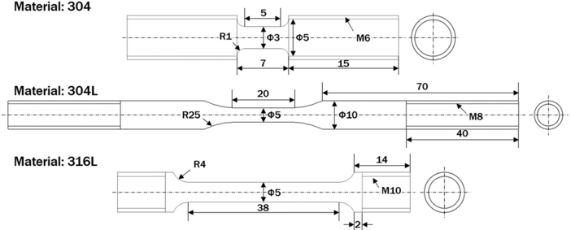

→2↑

Fig. 1 Geometries and dimensions of the smooth round bar tensile test specimens (unit: mm)

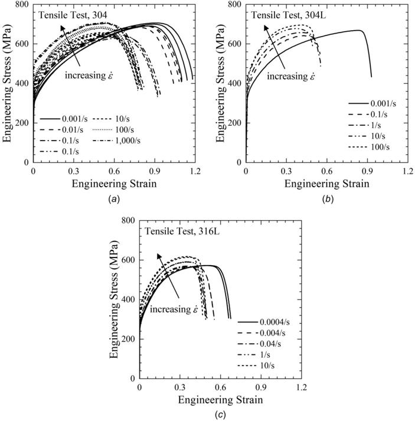

Fig. 2 Experimental engineering stress-strain curves: ( a ) 304 ASS, ( b ) 304L ASS, and ( c ) 316L ASS

performed not only for static loads but also for dynamic loads such as earthquake and impact loading. For instance, the spent fuel storage cask can be subject to high impact loading due to accidental events such as drop and tip-over [1-3]. Since the material properties depend on the strain rate, structural integrity assessment requires quantification of the strain rate effect on material tensile properties.

Constitutive models considering the strain rate effect on material behaviors can be classified into two categories [4-6]: phenomenological models such as the Cowper-Symonds model [7],

Table 2 Summary of the strain rate effect on smooth bar tensile test results for various austenitic stainless steels

| Material   |   Strain rate (/s) |   Yield strength (MPa) |   Tensile strength (MPa) |   Uniform elongation (%) |   Total elongation (%) |   Reduction of area (%) |
|------------|--------------------|------------------------|--------------------------|--------------------------|------------------------|-------------------------|
| 304        |              0.001 |                    248 |                      699 |                       88 |                    114 |                      83 |
|            |               0.01 |                    264 |                      689 |                       80 |                    107 |                      85 |
|            |                0.1 |                    285 |                      639 |                       63 |                     93 |                      85 |
|            |                  1 |                    343 |                      643 |                       53 |                     81 |                      79 |
|            |                 10 |                    344 |                      651 |                       50 |                     79 |                      77 |
|            |                100 |                    371 |                      682 |                       50 |                     78 |                      74 |
|            |               1000 |                    484 |                      706 |                       53 |                     78 |                      70 |
| 304L       |              0.001 |                    278 |                      669 |                       83 |                     94 |                      84 |
|            |                0.1 |                    325 |                      645 |                       43 |                     55 |                      78 |
|            |                  1 |                    360 |                      660 |                       41 |                     55 |                      78 |
|            |                 10 |                    368 |                      680 |                       37 |                     49 |                      76 |
|            |                100 |                    426 |                      698 |                       42 |                     52 |                      73 |
| 316L       |             0.0004 |                    255 |                      573 |                       50 |                     66 |                      83 |
|            |              0.004 |                    272 |                      565 |                       39 |                     55 |                      82 |
|            |               0.04 |                    283 |                      566 |                       35 |                     50 |                      81 |
|            |                  1 |                    326 |                      590 |                       36 |                     49 |                      76 |
|            |                 10 |                    348 |                      619 |                       35 |                     47 |                      77 |

All data are averaged values.

Fig. 3 Effect of the strain rate on ( a ) yield and tensile strengths, ( b ) uniform elongation, and ( c ) the ratio of tensile and yield strength

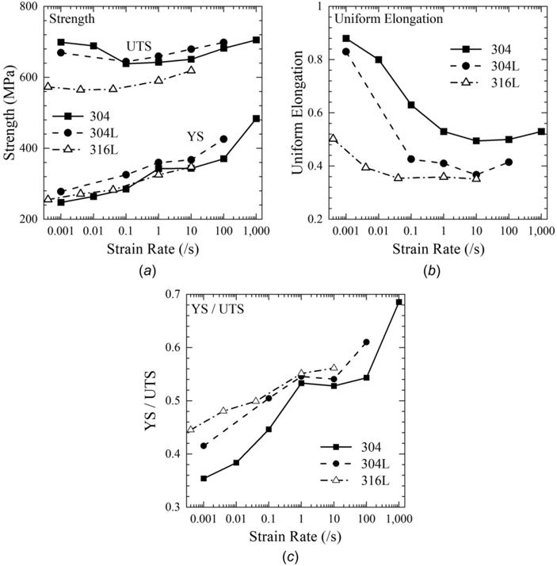

Johnson-Cook (J-C) model [8,9], and Khan-Huang-Liang model [4,5], for instance, and physically based models such as the Zerilli-Armstrong model [10], Mecking-Kocks model [11], and mechanical threshold stress model [12]. The physically based models would be suitable for explaining physical phenomena such as microscopic dislocation mechanism of plastic deformation, but they tend to have many material constants to be determined. The phenomenological models, on the other hand, tend to have fewer material constants and thus are more widely used in a computational scheme such as finite element analysis [13].

The Johnson-Cook model is one of the most widely used phenomenological models. This model has been embedded in many commercial FE programs because of its simplicity. It has five material constants and can describe the stress as the multiplications of three terms: plastic strain hardening term [14], strain rate term, and temperature term. Many researchers have modified the terms in the J-C model for more accurate prediction of tensile behaviors under various conditions. Maheshwari et al. [15] modified the temperature term to predict the hot deformation processing of aluminum alloy steel at high temperature. Zhang et al. [16] and Huh and Kang [17] introduced nonlinear strain rate terms (instead of linear term in the J-C model) to predict the stress of aluminum alloy and high strength steel. However, these J-C type models assume that the effect of plastic strain, strain rate, and temperature can be separated and thus is independent with no interacting effect. Some coupled models combining the effect of two or three terms have also been proposed. Hou et al. [18] added a temperature term into the strain hardening term to predict the behavior of titanium alloy in a wide range of temperature. Tan el al. [19] added a plastic strain term into the strain rate effect term to predict the stress of aluminum alloy at high strain rates. Li et al. [20] and Lin et al. [21] combined all effects of plastic strain, strain rate, and temperature to predict the behavior of low alloy steel and Al-Cu-Mg alloy at various strain rate and temperature conditions. As such, the effect of plastic strain, strain rate, and temperature on the stress can be coupled when the range or effect of work hardening, strain rate, and temperature becomes larger.

The hardening behavior of austenitic stainless steels is related to the dislocation interactions, martensite phase transformation, and twinning [22-26]. The contribution of these factors to the hardening behavior depends on various conditions such as chemical composition of the material, strain level, stress state, grain size, strain rate, temperature, and so on [22-26]. As results, the hardening of austenitic stainless steels with high ductility shows complex behaviors due to the competitive influence of these factors. Gupta et al. [27] showed that the original J-C model could not well reflect the dynamic strain aging effect of 304 austenitic stainless steel, and Cadoni et al. [28] showed that the dynamic increase factor (DIF) of the yield and tensile strength is different for 304 material. Kotkunde et al. [29] used the coupled constitutive model to predict the hot deformation behavior of 304 and 316 austenitic stainless steels. For complex material behaviors, it would be clear that a model with the combined effects of plastic strain, strain rate, and temperature can better predict the material behavior. In order to focus to the discussion of the effect of strain rate on stress-strain rate in austenitic stainless steel, the test temperature is fixed on room temperature in this paper.

In this study, tensile tests of 304 and 316 austenitic stainless steels were performed at the strain rate ranging from 0.001/s to 1000/s to see the strain rate effect on tensile properties.

Fig. 4 True stress-true plastic strain curves for ( a ) 304 ASS, ( b ) 304L ASS, and ( c ) 316L ASS

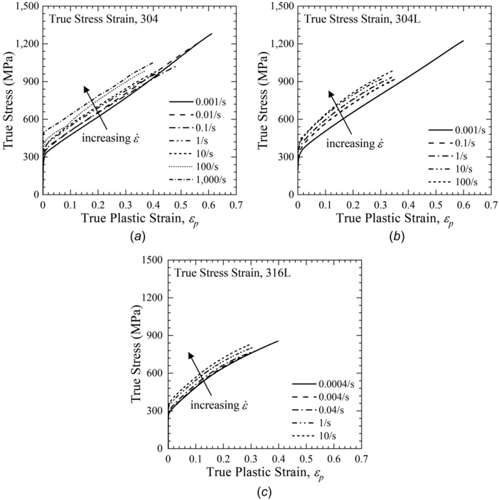

Application of the J-C model showed that the strain rate effect on stresses is different at a different plastic strain level. Based on such observation, a modification of the J-C model is proposed for 304 and 316 austenitic stainless steels. Section 2 presents experimental data. Sections 3 and 4 explain the J-C model and the modified J-C model, respectively, and the predicted stresses are compared with test data. Section 5 concludes the presented work.

## 2 Experiment

2.1 Test Materials. Tensile tests using round bar specimens were performed for 304 and 316 series ASS under various strain rates at room temperature. Table 1 shows chemical compositions of the tested materials (304: JIS G4304 SUS304, 304 L: ASME SA240M TP304L, and 316L: ASME SA312 TP316L). The dimensions of the specimens are shown in Fig. 1. Note that experiments were carried out at three different institutes. Although the experiments were conducted at different institutes, the effect of the different test facility on measured stress-strain curve is believed to be minor, because the experimental and data calibration procedures were based on the standard procedure. For 304 ASS, the strain rate ranged from 0.001/s to 1000/s. The tests from 0.001/s to 0.1/s were carried out using standard tensile testing machine (Shimadzu AG-100kNG, Kyoto, Japan), whereas those from 1/s to 1000/s using high-speed tensile testing machine (Shimadzu HITS-TX). For each strain rate, three tests were performed. For 304 L ASS, the strain rate ranged from 0.001/s to 100/s, and all tests were carried out using high strain rate testing machine (Instron VHS system). For 316 L ASS, the strain rate ranged from 0.0004/s to 10/s. The tests from 0.0004/s to 0.04/s were carried out using universal testing machine (RB 301 Unitech-M), and 1/s and 10/s were carried out using servohydraulic testing machine (Instron 8501). For each strain rate, two tests were performed.

2.2 Test Results. The effect of the strain rate on engineering stress-strain curves is shown in Fig. 2. In the case of 1000/s of 304 ASS, stress-strain curves were postprocessed by smoothening (adjacent-averaging) to remove data oscillation. Resulting mechanical tensile properties are summarized in Table 2, and the effect of the strain rate on yield/tensile strengths and uniform elongation is graphically shown in Figs. 3( a ) and 3( b ). In this study, the yield strength corresponds to the 0.2% proof strength. For all materials, the yield strength tends to increase monotonically with increasing the strain rate, while the ultimate tensile strength decreases first and then increases again. Uniform elongation also decreases and slightly increases again with increasing the strain rate. The 304 series stainless steels show higher uniform elongation values than 316 series one, suggesting higher ductility.

It is known that the hardening behavior of austenitic stainless steels due to plastic deformation is related to the phase transformation of metastable c -austenite to a 0 -martensite (transformationinduced plasticity, TRIP), twinning-induced plasticity, and dislocation interactions [22-26,30-33]. The 304 series stainless steels have the low stability of c -austenite phase, the TRIP effect on hardening behavior dominates. On the other hand, the 316 series stainless steels have the high stability of c -austenite phase, the twinning-induced plasticity effect is more dominant than the TRIP effect [31,32]. In addition, dislocation slip and density of dislocation also affect the hardening behavior. The degree of effect of these factors varies depending not only on chemical composition but also on various conditions such as plastic strain, strain rate, temperature, stress state, and others [22-26,30-32].

Fig. 5 Work hardening rates for ( a ) 304 ASS, ( b ) 304 L ASS, and ( c ) 316 L ASS

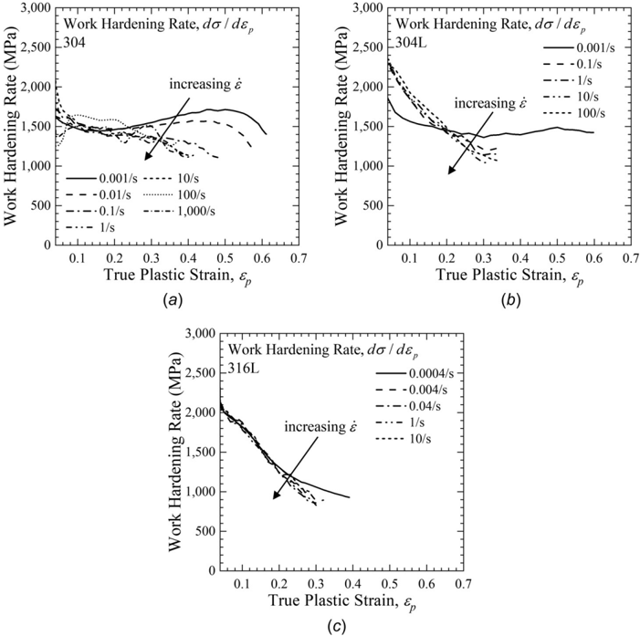

Fig. 6 Schematic process of calculation of dynamic increase factor at various plastic strain levels

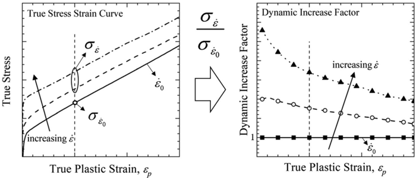

The complex behaviors for the strain rate effect on the yield strength, tensile strength, and uniform elongation, shown in Figs. 3( a ) and 3( b ), can also be found in other papers [24-26]. Figure 3( c ) shows the ratio of yield and tensile strength.

## 2.3 True Stress-Strain Curves Up to the Tensile Strength.

Figure 4 shows true stress-strain curves up to the ultimate tensile strength, converted from the engineering stress and strain data using the following relationship:

$$\sigma = s ( 1 + e ) , \ \varepsilon _ { t } = \ln ( 1 + e ) \quad \ \ ( 1 ) \quad 3 0 4 \ s$$

$$\varepsilon _ { p } = \varepsilon _ { t } - \varepsilon _ { e } , \ \varepsilon _ { e } = \sigma / E$$

where r is the true stress, s is the engineering stress, e is the engineering strain, e is the true strain, and E is the Young's modulus, E ¼ 200GPa. The subscript t , e , and p denote total, elastic, and plastic, respectively. As shown in Fig. 4, the true stress increases with increasing the strain rate for all materials.

To see the effect of the strain rate more clearly, the work hardening rates (WHRs), d r = d e p , are shown in Fig. 5. In the case of 304 series stainless steels at low strain rates (0.001 or 0.01/s), the WHR decreases first and increases again (secondary hardening) with increasing the plastic strain. However, at the higher strain rates, the WHR monotonically decreases with increasing the plastic strain. In the case of 316L, on the other hand, the WHR decreases with increasing the plastic strain at all strain rates.

Fig. 7 Dynamic increase factor for ( a ) 304 ASS, ( b ) 304 L ASS, and ( c ) 316 L ASS

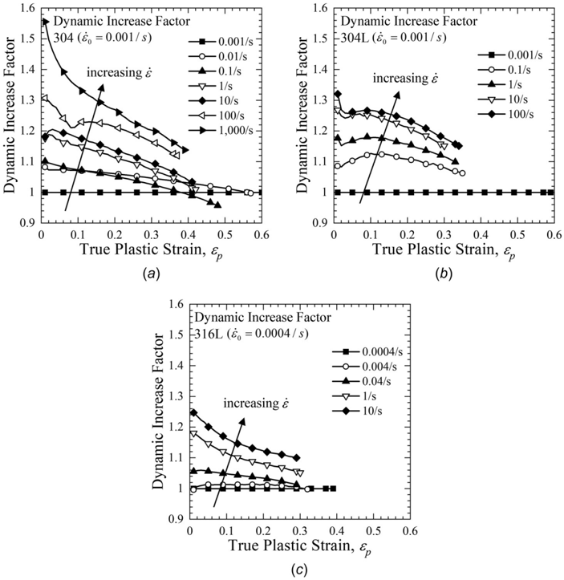

Table 3 Determine material constants of the J-C and the modified J-C models

| Material   |   _ e 0 (s  1 ) |   A (MPa) |   B (MPa) |    n |   C JC |   C 1 | C 2     |
|------------|------------------|-----------|-----------|------|--------|-------|---------|
| 304        |            0.001 |       325 |      1616 | 1.06 |  0.022 | 0.028 |  0.053 |
| 304L       |                  |       325 |      1423 | 0.91 |  0.025 | 0.028 |  0.034 |
| 316L       |           0.0004 |       250 |      1143 | 0.67 |  0.015 | 0.020 |  0.047 |

2.4 Effect of Plastic Strain Level on the Dynamic Increase Factor. To quantify the strain rate effect on true stresses at different plastic strain level, the DIF is used, defined as follows:

Fig. 9 Comparison of true stress-strain curve using the Johnson-Cook model with test data for ( a ) 304, ( b ) 304 L, and ( c ) 316 L

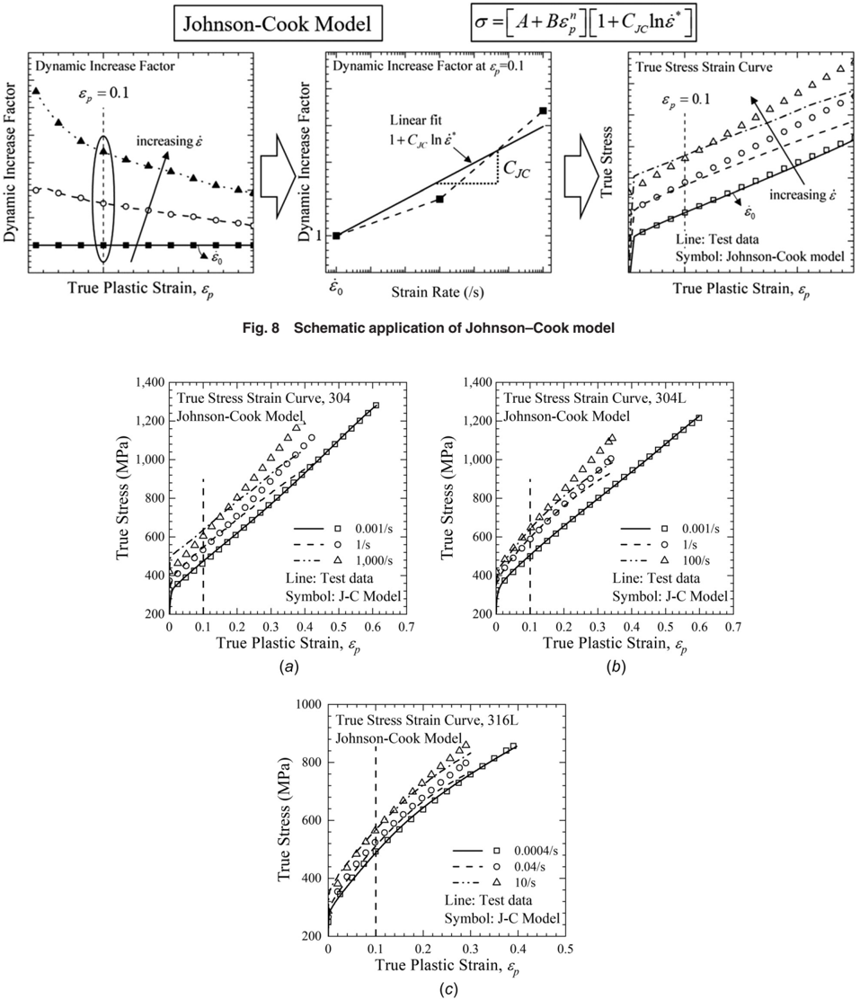

$$\frac { \ D I F = \sigma \dot { \varepsilon } } { \sigma _ { i _ { 0 } } }$$

where r \_ e denotes the true stress at a certain strain rate \_ e , and r \_ e 0 denotes the true stress of the reference strain rate \_ e 0. The reference strain rate for each material was chosen to be the lowest strain rate for each material; 0.001/s for 304 and 304 L but 0.0004/s for 316 L. Figure 6 shows schematic illustration how to calculate the dynamic increase factor at different plastic strain levels. The DIF values were determined by dividing the stress at certain strain rate by the stress at the reference strain rate. They were determined at various strain levels for each strain rate.

Resulting dynamic increase factors at various plastic strain levels are shown in Fig. 7, showing that the dynamic increase factor tends to decrease with increasing plastic strain and increases with increasing strain rate. This result is important and will be a basis of modifying the Johnson-Cook constitutive model later. Note that in the Johnson-Cook constitutive model, the effect of the plastic strain and strain rate on the dynamic increase factor cannot be properly considered.

## 3 Application of the Johnson-Cook Model

3.1 Johnson-Cook Constitutive Model. The Johnson-Cook constitutive model incorporating the effects of the strain rate and temperature effect term is given by [8,9]

$$\sigma & = [ A + B \varepsilon _ { p } ^ { n } ] [ 1 + C _ { J C } \ln \dot { \varepsilon } ^ { * } ] [ 1 - T ^ { * m } ] \\ \dot { \varepsilon } ^ { * } & = \frac { \dot { \varepsilon } } { \dot { \varepsilon } _ { 0 } } , \quad T ^ { * } = \frac { T - T _ { r o o m } } { T _ { m e l t } - T _ { r o o m } }$$

where r is an equivalent stress, e p is an equivalent plastic strain, A , B , n , C JC, and m are the material constants related to hardening behavior, strain rate effect, and temperature effect, \_ e  is a normalized strain rate to reference strain rate, and T  is the homologous temperature. As all tests in this paper were performed at room temperature, the temperature effect term becomes unity, leading to

$$\sigma = [ A + B \varepsilon _ { p } ^ { n } ] [ 1 + C _ { J C } \ln \dot { \varepsilon } ^ { * } ]$$

3.2 Determination of the Johnson-Cook Model Parameters. For the materials considered in this paper, the values of A , B , and n at the reference strain rate (assumed to be \_ e 0 ¼ 0.001 and 0.0004/s in this paper) are given in Table 3. Figure 8 shows the schematic process to determine the parameters in the JohnsonCook model, summarized as:

- (1) Determine the dynamic increase factor at the specific plastic strain level ( e p ¼ 0.1 was used in this paper).
- (2) Determine the strain rate effect term by linear fitting the dynamic increase factor in the logarithmic scale.

Note that the choice of e p ¼ 0.1 has been previously used by Johnson-Cook and other researchers. A different choice does not affect our conclusion, because the austenitic stainless steels used in this study have large ductility and the DIF values depend on the plastic strain level. The determined values of C JC in Eq. (5) are also given in Table 3.

Fig. 10 Percentage errors in true stresses between test data and the Johnson-Cook model: ( a ) 304, ( b ) 304 L, and ( c ) 316 L. The percentage error is defined in Eq. (6).

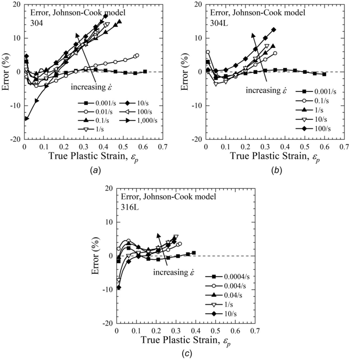

Fig. 11 ( a ) Dynamic increase factors at e p 5 0 and ( b ) decreasing slope in dynamic increase factor

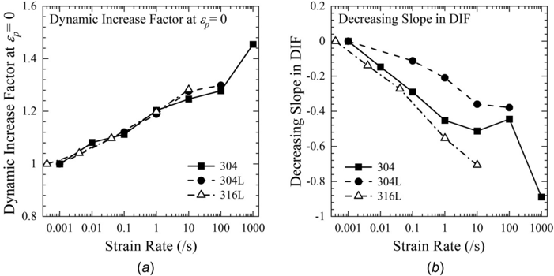

## 3.3 Comparison of Predicted Results With Test Data.

Figure 9 compares experimental data with the determined Johnson-Cook model. It shows that agreement is not so good at other strains than the one used for fitting. Although other results are not shown here for clarity, poor agreement is general for all materials and for other strain rates.

Figure 10 shows the percentage error between the experimental data and predicted true stress using the Johnson-Cook model, which is defined as follows:

$$Error ( \% ) = \frac { \sigma _ { \text {pred} } - \sigma _ { \text {exp} } } { \sigma _ { \text {exp} } } \times 1 0 0$$

Fig. 12 Comparison of true stress-strain curves using the modified Johnson-Cook model with test data for ( a ) 304, ( b ) 304 L, and ( c ) 316 L

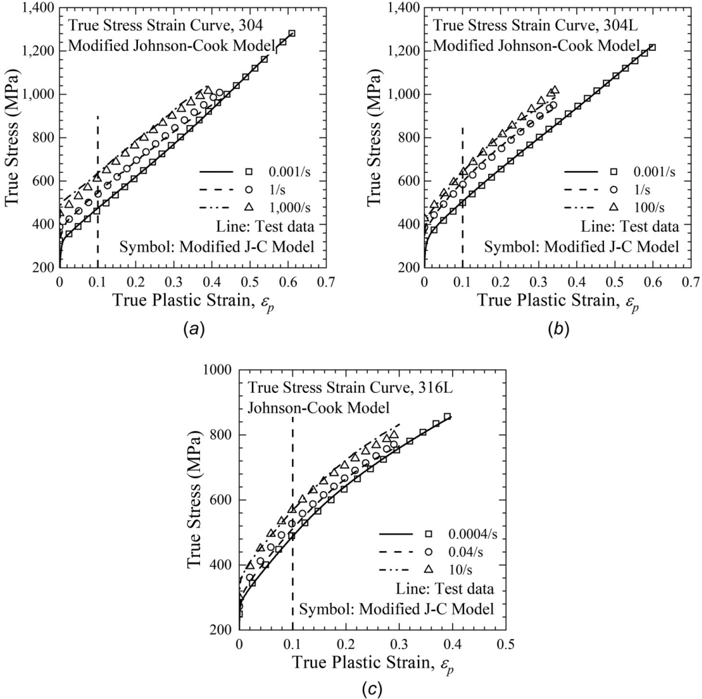

where r exp and r pred denote the experimental true stress and the predicted true stress using the J-C model, respectively. As shown in Fig. 10, the error tends to increase with increasing the plastic strain and strain rate for all materials. As described above, the J-C model has poor prediction other than the strain used for fitting ( e p ¼ 0.1). The maximum error for 304 is 16.6%, which is the largest compared to other materials, and the maximum errors of 304 L and 316 L are 12.5% and 9.3%, respectively.

## 4 Modified Johnson-Cook Model

4.1 Modification of the Constitutive Model and Determination of Model Parameters. The strain rate effect term in Eq. (5) has been modified using nonlinear equations by many researchers as follows [17,33,34]:

$$[ e ^ { C _ { K L } \ln i } ] \ by Khan \, \text { and } \, \text {Liang} \, [ 3 3 ] & & \text {is the } & & \text {intersected} \\ [ ( \dot { \varepsilon } ^ { * } ) ^ { C _ { W } } ] \ by Holmquist \, \text { and } \, \text {Johnson} \, [ 3 4 ] & & \text {dynamically} \\ [ 1 + C _ { H K 1 } \ln \dot { \varepsilon } ^ { * } + C _ { H K 2 } \ln ^ { 2 } \dot { \varepsilon } ^ { * } ] \ by \text {Huh} \, \text { and } \, \text {Kang} \, [ 1 7 ] & & \text {ing the } & & \text {intercepted}$$

The above models have been applied to see whether any model can capture the strain rate effect on true stress for stainless steels. However, it was found that these models could accurately reflect the strain rate effect at a specific strain level, but could not properly reflect the effect of plastic strain at all plastic strain levels. It was shown in Fig. 7, the dynamic increase factor depends not only on the strain rate but also on the plastic strain magnitude for the present stainless steels.

Tan et al. [19] have proposed a modified constant C JC in the Johnson-Cook model (Eq. (4)) using a higher order function between the plastic strain and strain rate

$$\text {rs of } \quad C _ { \text {JC} } = C _ { 0 } + C _ { 1 } \varepsilon _ { p } + C _ { 2 } \varepsilon _ { p } ^ { 2 } + C _ { 3 } \ln \dot { \varepsilon } ^ { * } + C _ { 4 } \ln ^ { 2 } \dot { \varepsilon } ^ { * } + C _ { 5 } \varepsilon _ { p } \ln \dot { \varepsilon } ^ { * } \quad ( 8 )$$

In this study, the following strain rate term is proposed:

$$\bar { \sigma } = [ A + B \varepsilon _ { p } ^ { n } ] [ 1 + C _ { 1 } \ln \dot { \varepsilon } ^ { * } + C _ { 2 } \ln ( \dot { \varepsilon } ^ { * } ) \varepsilon _ { p } ]$$

which can be regarded as a simplified version of Eq. (8). The parameters in Eq. (9) are determined using the following procedure. Note that the dynamic increase factors were presented in Fig. 7. From the results in Fig. 7, two values can be extracted; one is the dynamic increase factor at e p ¼ 0 (corresponding to the intersecting value), and the other is the decreasing slope of the dynamic increase factor. Figure 11( a ) shows the dynamic increase factors at e p ¼ 0, showing that they increase linearly with increasing the strain rate. The C 1 can be determined by linearly fitting the intercepts as a function of the strain rate in the logarithmic scale (1 þ C 1ln \_ e  ). Then, the slopes can be defined as follows:

$$\ D e c { \real } { \sin g } \ s l o p e \ i D F = \frac { \ D i F - ( 1 + C _ { 1 } \ln \dot { \varepsilon } ^ { * } ) } { \varepsilon _ { p } } \quad ( 1 0 )$$

Fig. 13 Percentage errors in true stresses between the experimental data and predicted stress using the modified Johnson-Cook model: ( a ) 304, ( b ) 304 L, and ( c ) 316 L

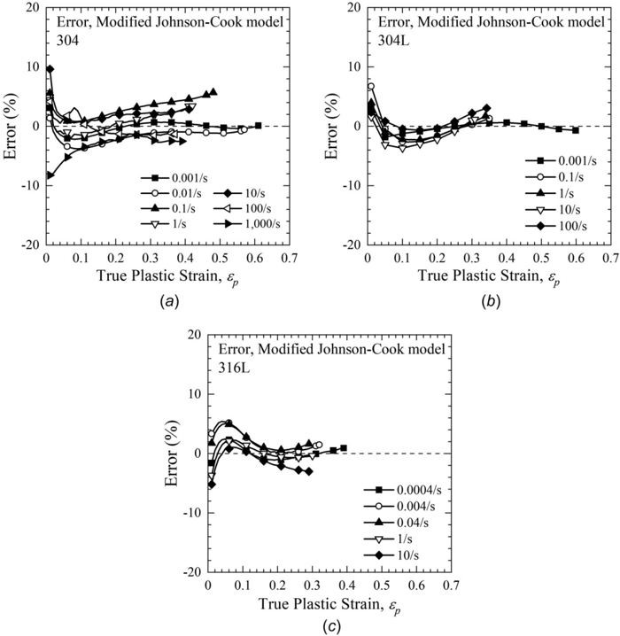

As shown in Fig. 11( b ), they tend to decrease linearly with increasing the strain rate. By linearly fitting the slopes in Fig. 11( b ) as a function of the strain rate in the logarithmic scale, the value of C 2 can be determined ( C 2ln \_ e  ). The determined values of C 1 and C 2 are summarized in Table 3.

Comparison of Predicted Results With Test Data. Figure 12 compares experimental data with the determined modified Johnson-Cook model. Compared to the existing Johnson-Cook model in Fig. 9, it shows better agreement at all strain levels.

Figure 13 shows percentage errors in true stresses between the experimental data and predicted stress using the modified Johnson-Cook model. The error is defined in Eq. (6). Compared to the error of the Johnson-Cook model shown in Fig. 10, the maximum error decreased from 16.6% to 9.6% for 304, from 12.5% to 6.8% for 304 L, and from 9.3% to 5.8% for 316 L.

## 5 Conclusion

In this study, the strain rate effect on tensile properties of three different 304 and 316 series austenitic stainless steels is investigated. Tensile tests are performed at room temperature at the strain rate ranging from 0.001 to 1000/s. With increasing the strain rate, the yield strength increases monotonically, whereas the ultimate tensile strength and uniform elongation decrease first and then increase again.

One interesting finding from experimental data is that, for 304 and 316 austenitic stainless steels with high ductility and complex material hardening behavior, the strain rate effect on true stress depends on a plastic strain level, and thus the interacting effect of the strain rate and plastic strain should be considered. Many existing models such as the Johnson-Cook type models, popularly used to characterize the strain effect on tensile properties, assume that the term for the strain rate effect can be separable to the term for the plastic strain, and thus cannot properly incorporate the combined effect of the strain rate and plastic strain. To take this account into consideration, a modified Johnson-Cook model is proposed, where a term including the plastic strain and strain rate is introduced. Compared to the existing Johnson-Cook model, the modified Johnson-Cook model can reduce the errors between the test data and predicted true stress at various strain levels; for instance, the maximum error is reduced from 16.6% to 9.6%.

## Funding Data

-  National Research Foundation of Korea (NRF) grant funded by the Korea government (MSIT) (NRF-2019M2D2A 2048296; Funder ID: 10.13039/501100003725).

## Nomenclature

- A , B ¼ material constants in a hardening model
- C JC ¼ constant in the Johnson-Cook model
- C 1 , C 2 ¼ constants in the modified Johnson-Cook model
- e ¼ engineering strain
- E ¼ Young's modulus
- m ¼ temperature effect constant in the Johnson-Cook model
- n ¼ plastic hardening exponent
- s ¼ engineering stress
- T ¼ temperature
- T  ¼ homologous temperature
- T melt , T room ¼ melting temperature and room temperature \_ e ¼ strain rate
- e e , e p , e t ¼ equivalent true elastic strain, plastic strain, and total strain
- \_ e 0 , \_ e  ¼ reference strain rate and normalized strain rate r ¼ equivalent true stress
- r exp , r pred ¼ experimental true stress and predicted true stress

## References

- [1] Lin, C. Y., Wu, T. Y., and Huang, C. C., 2015, 'Nonlinear Dynamic Impact Analysis for Installing a Dry Storage Canister Into a Vertical Concrete Cask,' Int. J. Pressure Vessels Piping, 131 , pp. 22-35.
- [2] Wu, T. Y., Lee, H. Y., and Kang, L. C., 2012, 'Dynamic Response Analysis of a Spent-Fuel Dry Storage Cask Under Vertical Drop Accident,' Ann. Nucl. Energy, 42 , pp. 18-29.
- [3] Kim, S. P., Kim, J., Sohn, D., Kwon, H., and Shin, M., 2019, 'Stress-Based Vs. Strain-Based Safety Evaluations of Spent Nuclear Fuel Transport Casks in Energy-Limited Events,' Nucl. Eng. Des., 355 , p. 110324.
- [4] Liang, R., and Khan, A. S., 1999, 'A Critical Review of Experimental Results and Constitutive Models for BCC and FCC Metals Over a Wide Range of Strain Rates and Temperatures,' Int. J. Plast., 15 (9), pp. 963-980.
- [5] Khan, A. S., Suh, Y. S., and Kazmi, R., 2004, 'Quasi-Static and Dynamic Loading Responses and Constitutive Modeling of Titanium Alloys,' Int. J. Plast., 20 (12), pp. 2233-2248.
- [6] Lodygowski, T., and Rusinek, A., 2014, Constitutive Relations Under Impact Loading , Springer, Heidelberg, Germany.
- [7] Cowper, G., and Symonds, P., 1957, 'Strain Hardening and Strain-Rate Effects in the Impact Loading of Cantilever Beam,' Division of Applied Mathematics, Brown University, Providence, RI, Report No. 28.
- [8] Johnson, G. R., and Cook, W. H., 1983, 'A Constitutive Model and Data From Metals Subjected to Large Strains, High Strain Rates and High Temperatures,' Seventh International Symposium on Ballistics, The Hague, The Netherlands, Apr. 19-21, pp. 541-547.
- [9] Johnson, G. R., and Cook, W. H., 1985, 'Fracture Characteristics of Three Metals Subjected to Various Strains, Strain Rates, Temperatures and Pressures,' Eng. Fract. Mech., 21 (1), pp. 31-48.
- [10] Zerilli, F. J., and Armstrong, R. W., 1987, 'Dislocation-Mechanics-Based Constitutive Relations for Material Dynamics Calculations,' J. Appl. Phys., 61 (5), pp. 1816-1825.
- [11] Mecking, H., and Kocks, U. F., 1981, 'Kinetics of Flow and Strain-Hardening,' Acta Metall., 29 (11), pp. 1865-1875.
- [12] Follansbee, P. S., and Kocks, U. F., 1988, 'A Constitutive Description of the Deformation of Copper Based on the Use of the Mechanical Threshold Stress as an Internal State Variable,' Acta Metall., 36 (1), pp. 81-93.
- [13] Huh, H., Lee, H. J., and Song, J. H., 2012, 'Dynamic Hardening Equation of the Auto-Body Steel Sheet With the Variation of Temperature,' Int. J. Automot. Technol., 13 (1), pp. 43-60.
- [14] Ludwik, P., 1909, Elemente Der Technologischen Mechanik, Springer, Berlin.
- [15] Maheshwari, A. K., Pathak, K. K., Ramakrishnan, N., and Narayan, S. P., 2010, 'Modified Johnson-Cook Material Flow Model for Hot Deformation Processing,' J. Mater. Sci., 45 (4), pp. 859-864.
- [16] Zhang, D. N., Shangguan, Q. Q., Xie, C. J., and Liu, F., 2015, 'A Modified Johnson-Cook Model of Dynamic Tensile Behaviors for 7075-T6 Aluminum Alloy,' J. Alloys Compd., 619 , pp. 186-194.
- [17] Huh, H., and Kang, W. J., 2002, 'Crash-Worthiness Assessment of ThinWalled Structures With the High-Strength Steel Sheet,' Int. J. Veh. Des., 30 (1/ 2), pp. 1-21.
- [18] Hou, X., Liu, Z., Wang, B., Lv, W., Liang, X., and Hua, Y., 2018, 'StressStrain Curves and Modified Material Constitutive Model for Ti-6Al-4V Over Thewide Ranges of Strain Rate and Temperature,' Materials (Basel), 11 (6), p. 938.
- [19] Tan, J. Q., Zhan, M., Liu, S., Huang, T., Guo, J., and Yang, H., 2015, 'A Modified Johnson-Cook Model for Tensile Flow Behaviors of 7050-T7451 Aluminum Alloy at High Strain Rates,' Mater. Sci. Eng. A, 631 , pp. 214-219.
- [20] Li, H. Y., Wang, X. F., Duan, J. Y., and Liu, J. J., 2013, 'A Modified Johnson Cook Model for Elevated Temperature Flow Behavior of T24 Steel,' Mater. Sci. Eng. A, 577 , pp. 138-146.
- [21] Lin, Y. C., Li, Q. F., Xia, Y. C., and Li, L. T., 2012, 'A Phenomenological Constitutive Model for High Temperature Flow Stress Prediction of Al-Cu-Mg Alloy,' Mater. Sci. Eng. A, 534 , pp. 654-662.
- [22] Olson, G. B., and Cohen, M., 1975, 'Kinetics of Strain-Induced Martensitic Nucleation,' Metall. Trans. A, 6 (4), pp. 791-795.
- [23] Hecker, S. S., Stout, M. G., Staudhammer, K. P., and Smith, J. L., 1982, 'Effects of Strain State and Strain Rate on Deformation-Induced Transformation in 304 Stainless Steel: Part I. Magnetic Measurements and Mechanical Behavior,' Metall. Trans. A, 13 (4), pp. 619-626.
- [24] Talonen, J., Nenonen, P., Pape, G., and H € anninen, H., 2005, 'Effect of Strain Rate on the Strain-Induced c ! a 0 -Martensite Transformation and Mechanical Properties of Austenitic Stainless Steels,' Metall. Mater. Trans. A, 36 , pp. 421-432.
- [25] Qin, Z., and Xia, Y., 2020, 'Role of Strain-Induced Martensitic Phase Transformation in Mechanical Response of 304 L Steel at Different Strain-Rates and Temperatures,' J. Mater. Process. Technol., 280 , p. 116613.
- [26] Lichtenfeld, J. A., Mataya, M. C., and Van Tyne, C. J., 2006, 'Effect of Strain Rate on Stress-Strain Behavior of Alloy 309 and 304 L Austenitic Stainless Steel,' Metall. Mater. Trans. A, 37 (1), pp. 147-161.
- [27] Gupta, A. K., Krishnamurthy, H. N., Singh, Y., Prasad, K. M., and Singh, S. K., 2013, 'Development of Constitutive Models for Dynamic Strain Aging Regime in Austenitic Stainless Steel 304,' Mater. Des., 45 , pp. 616-627.
- [28] Cadoni, E., Fenu, L., and Forni, D., 2012, 'Strain Rate Behaviour in Tension of Austenitic Stainless Steel Used for Reinforcing Bars,' Constr. Build. Mater., 35 , pp. 399-407.
- [29] Kotkunde, N., Krishnamurthy, H. N., Singh, S. K., and Jella, G., 2018, 'Experimental and Numerical Investigations on Hot Deformation Behavior and

Processing Maps for ASS 304 and ASS 316,' High Temp. Mater. Process., 37 (9-10), pp. 873-888.

- [30] Pham, M. S., Dovgyy, B., and Hooper, P. A., 2017, 'Twinning Induced Plasticity in Austenitic Stainless Steel 316 L Made by Additive Manufacturing,' Mater. Sci. Eng. A, 704 , pp. 102-111.
- [31] Shen, Y. F., Li, X. X., Sun, X., Wang, Y. D., and Zuo, L., 2012, 'Twinning and Martensite in a 304 Austenitic Stainless Steel,' Mater. Sci. Eng. A, 552 , pp. 514-522.
- [32] Weidner, A., 2020, Deformation Processes in TRIP/TWIP Steels , Springer, Heidelberg, Germany.
- [33] Khan, A. S., and Liang, R., 1999, 'Behaviors of Three BCC Metal Over a Wide Range of Strain Rates and Temperatures: Experiments and Modeling,' Int. J. Plast., 15 (10), pp. 1089-1109.
- [34] Holmquist, T. J., and Johnson, G. R., 1991, 'Determination of Constants and Comparison of Results for Various Constitutive Models,' J. Phys. IV, 1 (C3), pp. C3-853-C3-860.