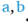
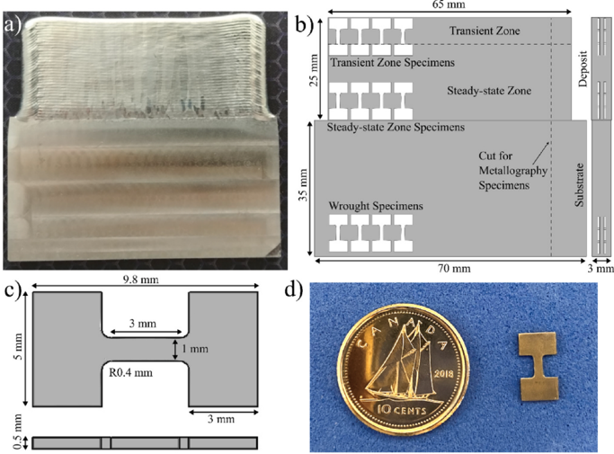
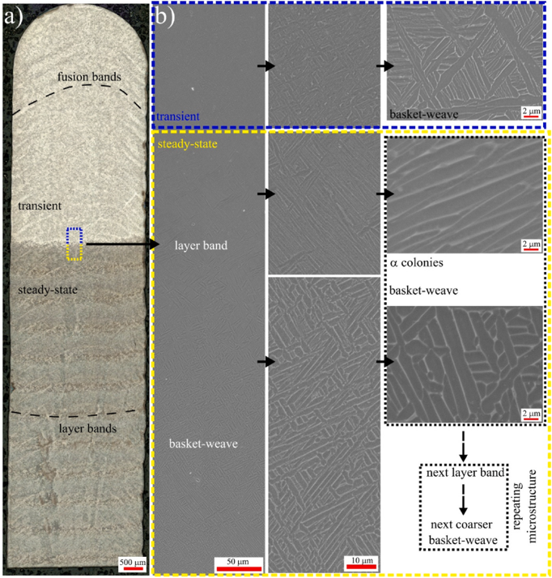
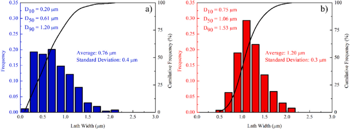
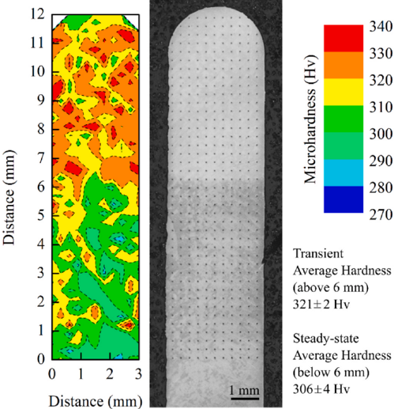
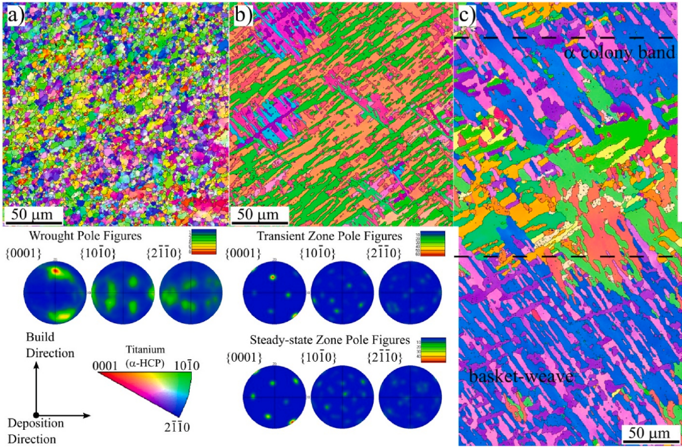
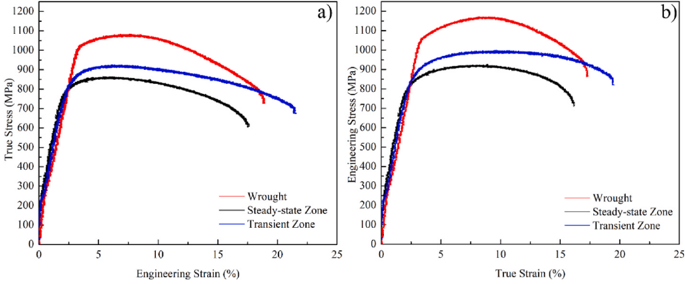
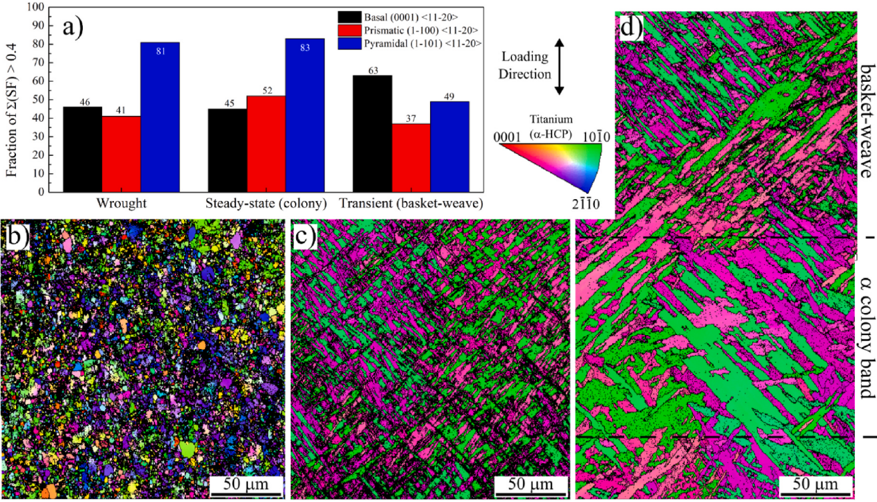
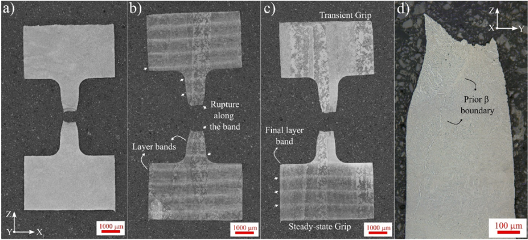
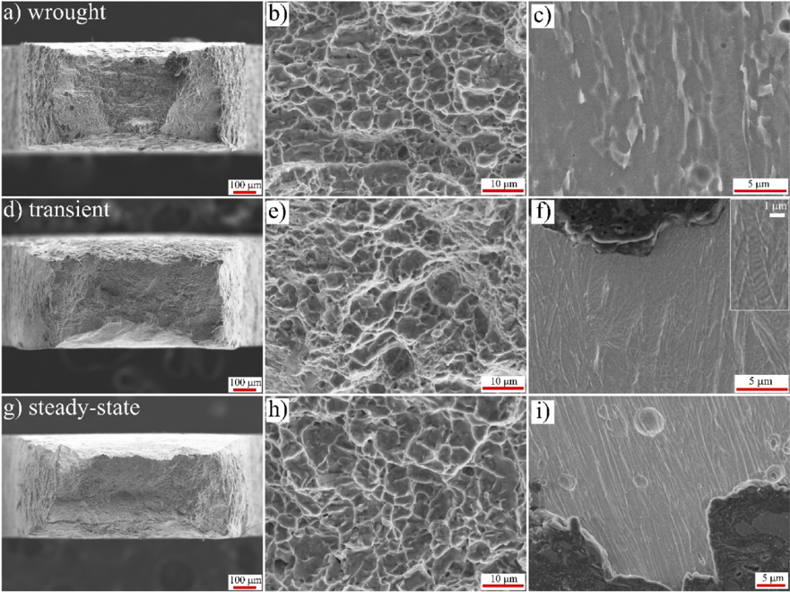

Contents lists available at ScienceDirect

## Materials Science &amp; Engineering A

[journal homepage: www.elsevier.com/locate/msea](https://www.elsevier.com/locate/msea)

## Use of miniature tensile specimens for measuring mechanical properties in the steady-state and transient zones of Ti -6Al -4V wire-fed electron beam deposits

Fatih Sikan a,b , Priti Wanjara b , Javad Gholipour b , Mathieu Brochu

- a McGill University, Department of Mining and Materials Engineering, Montreal, QC, H3A 0C5, Canada
- b National Research Council Canada, Aerospace Research Center, Montreal, H3T 2B2, Canada

## A R T I C L E  I N F O

## Keywords:

Part-specific small-scale tensile testing Titanium alloys Ti -6Al -4V Electron beam wire fed additive manufacturing Mechanical properties Microstructure

## 1. Introduction

Developments in the additive manufacturing (AM) of titanium (Ti) alloys are critical for the aerospace industry because they have excellent properties  for  structural  applications,  such  as  high  specific  strength, good  creep  resistance,  good  fatigue  performance,  reasonable  weld­ ability, and excellent corrosion resistance [1 -4]. However, high material and manufacturing costs pose challenges to the further exploitation of Ti alloys  in  the  aerospace  industry  [5].  These  challenges  are  especially significant for conventional manufacturing methods where scrap ma­ terial can exceed 80% of the starting material [6,7]. Therefore, near-net production  with  reduced  material  waste,  geometric  freedom,  shorter lead  times,  and  reduced  energy  consumption  [8,9]  provided  by state-of-the-art AM technologies is seen as an attractive solution.

## A B S T R A C T

Recent developments in additive manufacturing (AM) have shown the importance of small-scale mechanical testing due to material availability issues, the microstructural variance within the complex build geometries, or thin-type features such as lattices. The current approach in AM is to test standard-sized coupons and postulate that a component with complex geometry has similar mechanical properties even though their thermal histories are completely different in many cases. In this research, small-scale tensile testing methodologies of AM parts made  by  electron  beam  wire-fed  (EB-WF)  deposited  Ti -6Al -4V  were  investigated.  Specifically,  specimens extracted  from  well-established  Ti -6Al -4V  microstructural  zones  of  transient  and  steady-state  regions  were compared to  understand  the  effect  of  local  microstructure  on  mechanical  properties,  which  were  evaluated through microhardness and miniature tensile testing. The average microhardness in the transient and steadystate zones are 321 Hv  and 306 Hv, respectively. Although distinct microstructural features were observed in these zones, their tensile properties were similar. Both deposited zones had tensile yield and ultimate strength values ranging between 825-832 MPa and 880 -907 MPa, respectively. The measured properties of the miniature specimens were comparable with E8 standard-sized specimens, higher than the ASTM F1108 cast and lower than the AMS 4911P wrought Ti -6Al -4V standards. Deformation and fractography analysis were used to correlate microstructure and property relationships for different α lath morphologies. Basket-weave morphology in the transient zone specimen showed profound grain splitting by basal slip which led to microstructural refinement and hindered softening during plastic flow.

Among many metals AM technologies [10 -15], a directed energy deposition (DED) technique, electron beam wire-fed (EB-WF) additive deposition -also  commercially  known  as  electron  beam  additive manufacturing (EBAM) [16 -19] -attracts attention for larger scale parts due to its high deposition rates (reaching up to kilograms per hour) and cost/safety  effectiveness  associated  with  the  use  of  wire  instead  of powder feedstock [20]. Similar to other wire-fed DED techniques, the feedstock wire is continuously fed into the moving melt pool during EBAM to build up the deposit geometry. EBAM generally employs travel speeds, melt pool sizes, and layer heights that range between 2 and 15 mm/s, 1 -10 mm wide, and 0.5 -2 mm, respectively [16,21 -23]. Due to these  processing  conditions,  the  solidification  front  velocity  (1 -10 mm/s) and cooling rates (10 2 K/s) [9,16] are considerably lower than those observed in laser (10 6 K/s) [24] or electron beam (10 5 K/s) [25]

* Corresponding author. E-mail address: mathieu.brochu@mcgill.ca (M. Brochu).

a,*

F. Sikan et al.

powder bed fusion (PBF) techniques. Lower cooling rates and thermal gradients generate coarser microstructures throughout the build height [10].  This  results  in  larger  scale  microstructure  variance  in  DED compared to PBF.

Microstructural/property variance within the thermal cycle depen­ dent local zones is more evident for Ti alloys due to the allotropic phase transformations  [1,2].  Such  microstructural  variations  are  sequential and attributed to the moving heat source creating thermal profiles and cyclic heating and cooling steps. Multiple literature studies reported that cyclic thermal history creates regularly spaced 'layer bands ' in deposits of the widely studied Ti -6Al -4V alloy [7,9,26 -30]. Layer bands have been vaguely observed in PBF built Ti -6Al -4V coupons [31], but they are distinctively more visible in wire-fed [32] and powder-fed [27] DED deposits where layer height and heat input is greater. These bands were observed to have straight lines that are parallel to the deposition di­ rection for single-bead multi-layer [7,30] and curved lines for multi-bead  multi-layer  [9,28]  deposits.  Kobryn  and  Semiatin  [33] explained this banding in Ti alloys to be caused by the re-heating of the substrate just below the beta-Ti ( β ) transus temperature. Kelly et al. [27, 29]  studied  layer  banding  phenomenon  on  powder-fed  laser  metal deposition (LMD) of Ti -6Al -4V and reported a layer band-free zone with finer alpha-Ti ( α ) laths compared to the rest of the deposit, which was labeled as the transient zone and formed during the full β anneal of the final layer deposition. The rest of the deposit with regularly spaced layer bands  was  designated  as  the  steady-state  zone  [27,29].  The  micro­ structure in the steady-state zone consisted of α laths colonies along the layer bands and basket-weave morphology in between the layer bands [27,29]. Baufeld et al. studied laser wire-fed deposition (LWD) [26] and Zhu et al. [34] studied LMD of Ti -6Al -4V and both suggested that the reduction in α phase fraction at temperatures slightly below the β transus resulted  in  the  layer  banding  and  observed  secondary α laths  in  the bands. Ho et al. [22] investigated the compositional differences in the layer bands of Ti -6Al -4V produced by wire arc additive manufacturing (WAAM) and reported no segregation at the layer bands. Their study showed that cyclic heating and cooling did not result in any composi­ tional variation along the layer bands and the differences were purely morphological. Few studies also investigated the effect of the transient zone  and  layer  banding  on  mechanical  properties  [9,26,27,30].  For instance, Baufeld et al. [26] compared hardness in the transient and steady-state zone for both LWD and tungsten inert gas (TIG) deposition [26] and showed that these zones had similar hardness, unless when α ′ martensite  formed  in  the  transient  zone.  However,  a  knowledge  gap emerges from these few studies.  The mechanical property character­ ization of the transient zone and comparison with the steady-state zone has been limited to microhardness measurements, due to the limited size of the transient zone (i.e. upper 5 -15 layers of the deposit, depending on the process). Tensile characterization of these zones requires utilization of miniature tensile specimens, which are starting to emerge as a valid testing route. Such specimens have only been applied to electron beam melting  (EBM)  [35],  LPBF  [36],  LMD  [37]  systems  previously.  To address this knowledge gap, protocol for testing miniature specimens must be available.

In this study, small-scale mechanical testing was utilized to under­ stand the variation in microstructure and mechanical properties of an EB-WF deposited Ti -6Al -4V alloy. The miniature tensile test samples were  fully  extracted  from  the  transient  and  steady  state  regions  to determine similarities/differences in their tensile properties. The data was compared with a miniature wrought specimen (for which the me­ chanical  properties  from  E8  standard  [38]  specimen  testing  were known), as well as with AMS 4911P wrought [39] and ASTM F1108 cast [40] Ti -6Al -4V standards. Post fracture analysis of the tested specimens from the cross-section that is parallel to the loading direction as well as from the fracture surface was conducted to understand their respective deformation and fracture behaviors.

## 2. Materials and experimental methods

A 42 kW Sciaky EB-WF AM system was used to fabricate single bead Ti -6Al -4V thin wall deposits under 5 × 10 3 Pa (5 × 10 5 mbar) vac­ uum at the Aerospace Manufacturing Technologies Centre of the Na­ tional Research Council of Canada in Montreal, QC, Canada. Timetal Ti -6Al -4V (AMS4911P) wrought plate and Timetal Ti -6Al -4V (AMS 4954) wire with a 0.9 mm diameter were used for the deposition ex­ periments. The chemical compositions of the feedstock wire and sub­ strate  are  given  in  Table  1.  Substrate  plates  were  sectioned  to  have dimensions of 70 mm in width, 35 mm in height, and 3 mm in thickness, and  all  surfaces  were  machined.  The  rolling  direction  (RD)  of  the wrought  plate  was  aligned  parallel  to  the  build  direction  (BD).  The deposition was carried out with a travel speed and wire feed rate of 3.81 mm/s and 8.5 mm/s, respectively. The deposition direction (DD) was reversed after each successive layer. In addition, a waiting time of 35 s between layers was utilized to reduce heat accumulation on the coupon. A total of 50 consecutive layers (500 μ m layer thickness) were deposited to reach a build height of approximately 25 mm. The fabricated coupon was cooled down to room temperature under vacuum.

Fig. 1(a) shows the EB-WF deposited Ti -6Al -4V coupon. Two sets of specimen  geometries -namely  miniature  tensile  test  specimens  and microstructural/hardness analysis specimens -were then extracted from the coupons by electrical discharge machining (EDM). Dimensions and locations of these geometries can be seen in Fig. 1(b) and (c) . Linear (Ra) and areal (Sa) arithmetic mean heights of the miniature tensile speci­ mens ' surfaces were measured as 0.7 ± 0.2 μ m and 1.1 ± 0.2 μ m using a VK-X (Keyence, Mississauga, Canada) 3D laser scanning confocal/opti­ cal  microscope  (OM),  respectively.  The  microstructural  specimens (extracted  according  to  Fig.  1(b))  were  metallographically  prepared using an automated Tegramin 30 (Struers, Ballerup, Denmark) grinding/polishing system. Specimens were initially ground using 80, 240,  and  1200  grit  SiC  grinding  papers,  then  polished  with  a  9 μ m diamond suspension on a rigid composite disk followed by a 0.02 μ m silica suspension on a synthetic cloth. The texture and grain orientations of the specimens were analyzed by electron back-scattered diffraction (EBSD)  using  a  Hitachi  SU3500  tungsten  filament  scanning  electron microscope (SEM) (Hitachi, Tokyo, Japan) with operating conditions of 15 kV voltage and 0.5 μ m step size. Pole figures were extracted from the EBSD data using a half width of 10 ◦ and cluster size of 5 ◦ .  Chemical etching  for  microstructural  examination  was  applied  using  Kroll ' s etchant  with 2  ml  HF,  10  ml  HNO3  and  88  ml  H2O.  The  previously mentioned OM and JCM-7000 NeoScope (Jeol, Peabody, USA) Benchtop SEM equipped with energy dispersive spectroscopy (EDS) were used for metallographic and elemental investigations. Microstructural observa­ tions were used as a guideline to define the extent of the transient zone from the top of the deposit.

Vickers microhardness mapping was carried out on a cross-sectional surface along the build height (3 × 12 mm 2 area) using a DuraScan 80 tester (Struers, Ballerup, Denmark) equipped with an automated X -Y stage and testing cycle. A total of 451 individual hardness measurements were undertaken using an indent spacing of 300 μ m, a load of 500 g, and a dwell period of 15 s to construct the hardness maps using OriginPro software.

The miniature tensile test specimen locations were designed within the various microstructural zones. These are namely, the transient zone, steady-state zone, and the wrought substrate. Note that the transient zone specimens were designed to have their gauge lengths fully within the  transient  microstructural  zone.  However,  their  lower  grip  was located  inside  the  steady-state  zone  due  to  the  limited  height  of  the transient zone. At least 15 specimens from each zone were tensile tested at room temperature using a 250 kN MTS testing frame integrated with a non-contact  laser  extensometer  (MTS,  Eden  Prairie,  USA).  Newly developed MTS Advantage Mini Grips (Eden Prairie, USA) with 2.2 kN static force capacity [41] was used to safely fixate the miniature speci­ mens on the main frame and test the extremely small specimens by F. Sikan et al.

Table 1 Chemical compositions of the substrate and feedstock wire used to fabricate Ti -6Al -4V coupons.

| Material       |   Al |    V | Fe   |     C |    O |     N | H     |     Y | Ti      |
|----------------|------|------|------|-------|------|-------|-------|-------|---------|
| AMS 4911 Plate | 6.21 | 4.00 | 0.18 | 0.006 | 0.18 | 0.005 | -     | 0.005 | Balance |
| AMS 4954 Wire  | 6.66 | 4.18 | -    |  0.03 | 0.18 | 0.007 | 0.003 | 0.005 | Balance |

65 mm

Fig. 1. a) EB-WF deposited Ti -6Al -4V coupon with its schematic showing the b) locations, c) dimensions and d) photograph of the extracted miniature tensile test specimens with a Canadian dime.

preventing slippage and maintaining proper alignment during tensile loading. The tensile tests were conducted at a crosshead speed of 0.09 mm/min  which  corresponds  to  a  strain  rate  of  5 × 10 4 s 1 until rupture. The fractographic analysis was investigated on fracture surfaces and cross sections near the fracture area using a Jeol JCM-7000 Neo­ Scope SEM operated at an accelerating voltage of 5 -15 kV.

## 3. Results and discussions

## 3.1. Microstructure

Fig.  2  illustrates  the  macro-  and  microstructure  of  the  EB-WF deposited Ti -6Al -4V coupons through a series of OM and SEM micro­ graphs at various magnifications. In the OM micrograph shown in Fig. 2 (a), two regions can be identified at low magnification: a lighter contrast transient zone and a darker contrast steady-state zone. The transient zone comprises roughly the last 12 layers, which is approximately the top  6  mm of  the  build  height  of  the  deposit.  The  remaining  portion underneath  is  labeled  as  the  steady-state  zone.  A  repetitive  banded structure was observed in the steady-state zone. These repeating ' layer bands ' are approximately 100 μ m wide and 500 μ m apart from each other  along  the  build  direction  and  appear  to  have  darker  contrast. Further examination shows the second type of banding structure with a lighter contrast and a curved shape. These bands are known as ' fusion bands ' [22]. Although layer bands are extensively characterized in the literature [9,26 -28], fusion bands were only observed a few times by Ho et al. [22] for WAAM and by Fachinotti et al. [42] for TIG produced Ti -6Al -4V.  Unlike  layer  bands,  fusion  bands  appear  to  be  repetitive throughout all build heights extending through both zones. Fig. 2(b) illustrates the mosaic assembly of SEM micrographs from the dashed rectangle at the interface between the transient and steady-state zones, as demarcated in Fig. 2(a). The transient and steady-state (inside bands &amp; between bands) microstructures are shown at various magnifications in  this  figure.  The  transient  microstructure  contains  basket-weave morphology where α laths are in multiple orientations and separated by the β phase. In this zone α lath widths appear to be non-homogeneous, as some laths are visibly larger than the others. The steady-state zone starts with the first layer band from the top of the deposit. The layer band area contains α colonies (colony island size is roughly 20 -30 μ m), where each lath is in the same orientation as its neighboring laths. Below the layer band, a basket-weave morphology continues once again; however, the α lath  widths are more homoge­ neous,  and  larger  in  this  area.  Alternating  colony  and  basket-weave morphology gives rise to the repeating microstructural pattern throughout the steady-state zone.

The  formation  of  the  banded  structure  depends  on  the  deposited layer  height  and  the  thermal  profile  generated  by  the  moving  heat source. Two effective transition temperatures that dictate the charac­ teristics of layer and fusion bands are the β -transus temperature (~1273 K) and the liquidus temperature (~1933 K), respectively [16]. Deposi­ tion of a new layer elevates the heat source position to a higher location. This consequently increments both the β -transus and liquidus isotherms upwards to a new position by an amount approximately equal to the layer height. Thus, the layer bands form where the temperature reaches just below the β -transus temperature, and partial β transformation re­ sults in α colony formation during cooling. Colony formation at the layer bands has  been  attributed  to  local  cooling  rate  differences  [29]  and dislocation density gradients [43], but the most detailed explanation was given by Ho et al. [22]. They discussed that partial β transformation left some ' survivor ' α laths within the β matrix, which, in turn, act as F. Sikan et al.

Fig. 2. a) OM and b) SEM micrographs showing the banding/zone structure of the Ti -6Al -4V EB-WF deposit.

heterogeneous  nucleation  sites  for α colonies  to  form  [22].  Further deposition of additional layers forces the full β -annealed section to move up and the remaining section (steady-state zone) no longer experiences a full allotropic phase transformation. However, the steady-state zone still experiences  coarsening  due  to  heat  diffusion  towards  the  substrate material.  The  extent  to  which  the  last β -transus  spreads  defines  the height of the transient zone. Previous modeling work to simulate EB-WF deposition of Ti -6Al -4V with the same process parameters showed that the height of the β -transus isotherm is about 7 mm for 10 layers [16].

Lath widths in the transient and steady-state zones were thoroughly investigated using high magnification SEM microscopy. Fig. 3 shows the lath width distribution frequency and cumulative frequency plots for both zones. Lath distributions are different as qualitatively pointed out previously in Fig. 2(b). Fig. 3(a) shows the distribution in the transient zone as skewed right or almost uniform below 1 μ m width, which points to  a  lack  of  a  dominant  lath  width  within  the  microstructure.  The calculated D10, D50, and D90 values for the transient zone are 0.20 μ m, 0.61 μ m, and 1.20 μ m respectively, with an average lath width of 0.76 ± 0.4 μ m.  Distinctively,  Fig.  3(b)  shows  a  normal  distribution  for  the steady-state zone. The calculated D10, D50, and D90 values for the steadystate  zone are 0.75 μ m, 1.06 μ m, and 1.53 μ m, respectively with an average lath width of 1.20 ± 0.3 μ m. According to the t -test at 0.05 level these results indicate that the average α laths in the steady-state zone are coarser than in the transient zone. This is because the steady-state zone experiences coarsening at sub-transus temperatures. It has been previ­ ously reported that the α laths are approximately 25% thicker in the F. Sikan et al.

Fig. 3. Lath ( α ) width distribution from a) transient and b) steady-state zones of the Ti -6Al -4V EB-WF deposit.

steady-state zone compared to the transient zone for both EB-WF [44] and LWD [45]. The coarsening phenomenon in the steady-state zone has been also reported for other DED techniques [26,27,30,45]. Large dif­ ferences in α lath widths are commonly observed due to secondary α phase formation in titanium alloys [46,47]. For example, Baufeld et al. [26] showed the formation of secondary α lamellae in the steady-state region of their LWD Ti -6Al -4V coupons. They discussed the origin of the secondary α phase to be cyclic heating/cooling and the consequent change in the phase fractions within the steady-state zone [26]. How­ ever,  since  secondary α formation  requires  partial β phase  trans­ formation and subsequent α transformation with cooling, it is thought that the thinner laths inside the transient zone are not secondary α laths in this work.

Fig.  4  shows  the  EBSD  grain  orientation  maps  acquired  from  the wrought substrate, the transient zone, and the steady state zone of an EB-WF deposited Ti -6Al -4V coupon. The grain boundaries are denoted as black lines in the maps for misorientations greater than 10 ◦ . Firstly, this Figure shows that the wrought microstructure had a typical bimodal morphology  with  equiaxed α grains.  The  pole  figure  reveals  this microstructure exhibits a texture (multiples of uniform density (mud) intensity of 8) with maxima near &lt; 10 -11 &gt; direction. This texture is related to the original thermomechanical process of the wrought sub­ strate  [48].  Secondly,  the  transient  zone  orientation  map  reveals basket-weave α laths that exhibit 6 possible crystallographic orienta­ tions  on  the  pole  figure  for  the  basal  plane.  These  orientations  are defined by Burger ' s relationship ({110} β //{0001} α ) during the allo­ tropic phase transformation during cooling. Six possible {110} planes of the BCC β phase would then transform to 6 possible {0001} basal planes of the HCP α phase. The pole figure for the basket-weave morphology thus shows 6 maxima (maximum intensity of 50) that are associated with initial β orientation. Multiple β grains create further possible ori­ entations and result in the multiple configuration variants of the α laths in  this  zone.  This  results  in  a  non-textured  structure  in  macroscopic scale. Lastly, the grain orientation map of the steady-state zone showed both α colony band and basket-weave morphologies. Colony islands are shown as a single grain in the grain orientation maps, due to the low angle  grain  boundaries  (LAGB)  ( &lt; 10 ◦ )  between  the  constituent  indi­ vidual α laths  with  similar  crystallographic  orientations  [49].  Again, there are 6 possible crystallographic orientations for the colony islands, thus  a  similar ' random ' texture  with  larger  scales  is  present  for  the steady-state zone with colonies.

## 3.2. Mechanical properties

## 3.2.1. Hardness

Fig. 5 shows the Vickers hardness map and the corresponding OM micrograph with the measurement indents from the last ~24 layers (12 mm build height) of the Ti -6Al -4V EB-WF deposit. The map shows that the measured hardness in the transient zone (above 6 mm) is mainly above 310 Hv  with an average hardness of 321 ± 2 Hv. On the other hand, the hardness in the steady-state zone (below 6 mm)  is F. Sikan et al.

Fig. 5. Vickers hardness map from the top 12 mm height of the Ti -6Al -4V EBWF deposit.

Fig. 4. EBSD grain orientation maps and corresponding pole figures for a) wrought substrate, b) transient zone, and c) steady-state zone (colony) of the Ti -6Al -4V EB-WF deposit.

predominantly below 310 Hv with an average hardness of 306 ± 4 Hv. Firstly, these results show that the transient zone is roughly 10 -20 Hv harder than the steady-state zone. This slightly higher hardness in the transient zone is associated with the finer microstructure in this region, as previously shown. Although many studies reported the α lath width variance between the transient and steady-state zones of Ti -6Al -4V in literature [22,27,45], to our knowledge only Baufeld et al. [26] inves­ tigated  its  corresponding  effects  on  hardness  for  TIG  deposition  and LWD. Their results showed comparable hardness in both zones for TIG, but significantly higher hardness (100 Hv) in the transient zone for the LWD. However, this difference in the latter was attributed to  the α' martensite  formation  with  solid  solution  strengthening  [26].  Consid­ ering the lack of martensite formation in this study the observed smaller variation in the hardness can be explained by the lath size difference between the transient and steady-state zones. This explanation is more plausible considering their hardness results for TIG coupons [26]. Sec­ ondly, there was no evident hardness variation in the steady-state zone even when the morphology of the α laths alternated between colony and basket-weave at 500 μ m intervals. This is in good agreement with the findings of Kelly et al. [29] for LMD-built Ti -6Al -4V. Their hardness maps showed a homogeneous hardness profile within the steady-state zone with no distinct change at the layer band area [29]. This shows that hardness is mainly affected by the individual α lath size rather than collective morphology.

## 3.2.2. Miniature tensile test

The summary of the tensile test results in terms of YS, UTS, and fracture strain of the miniature specimens in comparison to ASTM E8 standard-sized  wrought  and  EB-WF  deposited  Ti -6Al -4V  specimens from previous studies in the literature [17,50] are shown in Table 2. This table  also  includes  the  minimum  standard  values  for  AMS  4911P wrought  [39]  and  ASTM  F1108  cast  [40]  Ti -6Al -4V  standards.  The engineering tensile properties of the wrought miniature specimen con­ sisted of a yield strength (YS) of 1009 ± 20 MPa, an ultimate tensile strength (UTS) of 1062 ± 15 MPa, and a fracture strain of 19 ± 1%. The engineering tensile properties of the steady-state and transient zones consisted of YS of 825 ± 41 MPa and 832 ± 27 MPa, UTS of 880 ± 27 MPa and 907 ± 24 MPa, and a fracture strain of 18 ± 2% and 20 ± 1%, respectively. The following observations can be made:

- The first key observation is that the miniature wrought (AMS 4911) specimens  showed  comparable  YS  and  UTS  values  with  their  E8 standard-sized counterparts [17,50]. Additionally, miniature wrought  specimens  showed  YS  and  UTS  values  higher  than  the minimum requirement of AMS 4911P wrought [39] standard. The maximum difference observed in the strength values between the two E8-sized specimens from the literature was calculated as 5.0% (approximately 50 MPa) [17,50]. Similarly, the maximum difference observed in the strength values between the miniature specimens of this  study  and  standard-size  specimens  [17,50]  was  4.7%.  This

means the current difference is comparable to the deviation in the literature for wrought Ti -6Al -4V standard tensile specimens.

- The second key information is that the EB-WF deposit (both steadystate and transient zone) miniature specimens showed statistically similar YS and UTS values. It is also worth noting that the steadystate specimen showed similar strength values with its E8 counter­ parts in the literature (maximum difference of 3.9%) [17].
- Finally, compared to the minimum requirements of the ASTM F1108 cast Ti -6Al -4V standard [40], the YS and UTS values of steady-state and transient zone specimens were higher, however, falling below AMS 4911P wrought Ti -6Al -4V standard [39].

The  main  disparity  between  E8  and  miniature  specimens  is  the observed elongation at break. The steady-state and wrought miniature specimens exhibited higher elongation at break (6 -8%) compared to their  E8  wrought  counterparts  [17,50].  Additionally,  all  miniature specimens  showed  8 -10%  higher  elongation  than  the  minimum requirement of ASTM F1108 cast [40] and AMS 4911P wrought [39] Ti -6Al -4V standards.

Specimen  size  and  its  effect  on  mechanical  properties  have  been investigated  for  various  alloy  systems  and  it  is  well  established  that specimen thickness to microstructure unit [51] (grain diameter) ratio is an  effective  value  to  describe  the  geometry  dependence  of  the  me­ chanical properties [52 -55]. Sergueeva et al. showed that the tensile strength does not change with gauge length, but the tensile elongation exponentially increases below a gauge length of 10 mm for Ti -6Al -4V foil specimens. They observed an increase in elongation from 10 to 24% when the gauge length was reduced from 10 to 1 mm. For their specimen with a 3 mm gauge length, they reported approximately 20% elongation similar to this study [52]. However, it has been reported that elongation of the miniature specimens is sensitive to not only gauge length but also gauge thickness and width, and often requires a correlation factor to compare  to  standard-sized  specimens.  Generally,  the  Bertella-Oliver formula [56], as shown in Equation (1), is used to correlate the pre­ dicted elongation for different gauge dimensions or slimness ratios as described in Equation (2) [36,51,57].

$$0 \pm 2 7 & & & & & & & & & & & & & & & & & & & & & & & & & & & & & & & & & & & & & & & & & & & & & & & & & & & & & & & & & & & & & & & & & & & & & & & & & & & & & & & & & & & & & & & & & & & & & & & & & & & & & & & & & & & & & & & & & & & & & & & & & & & & & & & & & & & & & & & & & & & & & & & & & & & & & & & & & & & & & & & & & & & & & & & & & & & & & & & & & & & & & & & & & & & & & & & & & & & & & & & & & & & & & & & & & & & & & & & & & & & & & & & & & & & & & & & & & & & & & & & & & & & & & & & & & & & & & & & & & & & & & & & & & & & & & & & & & & & & & & & & & & & & & & & & & & & & & & & & & & & & & & & & & & & & & & & & & & & & & & & & & & & & & & & & & & & & & & & & & & & & & & & & & & & & & & & & & & & & & & & & & & & & & & & & & & & & & & & & & & & & & & & & & & & & & & & & & & & & & & & & & & & & & & & & & & & & & & & & & & & & & & & & & & & & & & & & & & & & & & & & & & & & & & & & & & & & & & & & & & & & & & & & & & & & & & & & & & & & & & & & & & & & & & & & & & & & & & & & & & & & & & & & & & & & & & & & & & & & & & & & & & & & & & & & & & & & & & & & & & & & & & & & & & & & & & & & & & & & & & & & & & & & & & & & & & & & & & & & & & & & & & & & & & & & & & & & & & & & & & & & & & & & & & & & & & & & & & & & & & & & & & & & & & & & & & & & & & & & & & & & & & & & & & & & & & & & & & & & & & & & & & & & & & & & & & & & & & & & & & & & & & & & & & & & & & & & & & & & & & & & & & & & & & & & & & & & & & & & & & & & & & & & & & & & & & & & & & & & & & & & & & & & & & & & & & & & & & & & & & & & & & & & & & & & & & & & & & & & & & & & & & & & & & & & & & & & & & & & & & & & & & & & & & & & & & & & & & & & & & & & & & & & & & & & & & & & & & & & & & & & & & & & & & & & & & & & & & & & & & & & & & & & & & & & & & & & & & & & & & & & & & & & & & & & & & & & & & & & & & & & & & & & & & & & & & & & & & & & & & & & & & & & & & & & & & & & & & & & & & & & & & & & & & & & & & & & & & & & & & & & & & & & & & & & & & & & & & & & & & & & & & & & & & & & & & & & & & & & & & & & & & & & & & & & & & & & & & & & & & & & & & & & & & & & & & & & & & & & & & & & & & & & & & & & & & & & & & & & & & & & & & & & & & & & & & & & & & & & & & & & & & & & & & & & & & & & & & & & & & & & & & & & & & & & & & & & & & & & & & & & & & & & & & & & & & & & & & & & & & & & & & & & & & & & & & & & & & & & & & & & & & & & & & & & & & & & & & & & & & & & & & & & & & & & & & & & & & & & & & & & & & & & & & & & & & & & & & & & & & & & & & & & & & & & & & & & & & & & & & & & & & & & & & & & & & & & & & & & & & & & & & & & & & & & & & & & & & & & & & & & & & & & & & & & & & & & & & & & & & & & & & & & & & & & & & & & & & & & & & & & & & & & & & & & & & & & & & & & & & & & & & & & & & & & & & & & & & & & & & & & & & & & & & & & & & & & & & & & & & & & & & & & & & & & & & & & & & & & & & & & & & & & & & & & & & & & & & & & & & & & & & & & & & & & & & & & & & & & & & & & & & & & & & & & & & & & & & & & & & & & & & & & & & & & & & & & & & & & & & & & & & & & & & & & & & & & & & & & & & & & & & & & & & & & & & & & & & & & & & & & & & & & & & & & & & & & & & & & & & & & & & & & & & & & & & & & & & & & & & & & & & & & & & & & & & & & & & & & & & & & & & & & & & & & & & & & & & & & & & & & & & & & & & & & & & & & & & & & & & & & & & & & & & & & & & & & & & & & & & & & & & & & & & & & & & & & & & & & & & & & & & & & & & & & & & & & & & & & & & & & & & & & & & & & & & & & & & & & & & & & & & & & & & & & & & & & & & & & & & & & & & & & & & & & & & & & & & & & & & & & & & & & & & & & & & & & & & & & & & & & & & & & & & & & & & & & & & & & & & & & & & & & & & & & & & & & & & & & & & & & & & & & & & & & & & & & & & & & & & & & & & & & & & & & & & & & & & & & & & & & & & & & & & & & & & & & & & & & & & & & & & & & & & & & & & & & & & & & & & & & & & & & & & & & & & & & & & & & & & & & & & & & & & & & & & & & & & & & & & & & & & & & & & & & & & & & & & & & & & & & & & & & & & & & & & & & & & & & & & & & & & & & & & & & & & & & & & & & & & & & & & & & & & & & & & & & & & & & & & & & & & & & & & & & & & & & & & & & & & & & & & & & & & & &$$

$$S _ { \ } 4 9 1 1 ) \quad K = \frac { ( L _ { 0 } ) } { \sqrt { ( a _ { 0 } ) ( b _ { 0 } ) } }$$

In equation (1), ε and ε r  are the elongations at fracture for tensile specimens with slimness ratios of K and Kr, respectively. The subscript r defines the gauge dimensions in terms of L0  (gauge length), a0  (gauge thickness),  and  b0 (gauge  width).  Finally,  n  is  a  material-dependent constant. For example, n for Ti -6Al -4V is reported as 0.690 ± 0.046 [35]. It should be noted that some limitations apply to the utilization of this formula: the ratio of the width to thickness should be smaller than 20 and the slimness ratio should be smaller than 25 [36]. The miniature F. Sikan et al.

Summary of the tensile properties in comparison to standard-sized E8 literature [17,50] and minimum requirement for AMS 4911P wrought [40] and ASTM F1108 cast

Table 2 [39] Ti -6Al -4V standards.

| Specimen #                       | Elongation   | Bertella-Oliver Elongation   | YS        | UTS       | Onset of Necking   | Ref.       |
|----------------------------------|--------------|------------------------------|-----------|-----------|--------------------|------------|
| Units                            | (%)          | (%)                          | (MPa)     | (MPa)     | (%)                |            |
| Mini Wrought                     | 19 ± 1       | 14 ± 1                       | 1009 ± 20 | 1062 ± 15 | 7 ± 1              | This study |
| Mini Transient                   | 20 ± 1       | 15 ± 1                       | 832 ± 27  | 907 ± 24  | 7 ± 1              |            |
| Mini Steady-state                | 18 ± 2       | 13 ± 2                       | 825 ± 41  | 880 ± 27  | 6 ± 1              |            |
| Wanjara et al. (Wrought E8)      | 14 ± 1       |                              | 1058 ± 12 | 1115 ± 10 | -                  | [17]       |
| Wanjara et al. (Steady-state E8) | 13 ± 1       |                              | 849 ± 13  | 915 ± 11  | -                  | [17]       |
| Shrestha et al. (Wrought E8)     | 15 ± 1       |                              | 1057 ± 5  | 1057 ± 5  | -                  | [50]       |
| ASTM F1108                       | 8            |                              | 758       | 860       | -                  | [40]       |
| AMS 4911P                        | 10           |                              | 869       | 920       | -                  | [39]       |

specimens used in this study have a width-to-thickness ratio of 2 and a slimness  ratio  of  4.24,  suggesting  the  possible  utilization  of  the Bertella-Oliver formula. According to this formula, the corresponding elongation at break for the E8 standard size (slimness ratio of 6.6) for the wrought, steady-state, and transient zone specimens was calculated as 14 ± 1%, 13 ± 2%, and 15 ± 1%, respectively. This correlation high­ lights that E8, and miniature specimens also show similar ductility when the effect of slimness is considered.

## 3.2.3. Deformation analysis

The representative engineering and true stress-strain curves acquired during the testing of the miniature specimens can be seen in Fig. 6(a) and (b), respectively. Only one representative curve from each specimen condition is shown, but all tested specimens showed good repeatability, as observed from the low standard deviations. In addition, all specimens showed roughly 60 -70 MPa strain hardening ( Δσ = σ UTSσ YS) [58], but differences in their deformation behaviors were observed. In the present study,  the  true  stress-strain  curves  of  all  specimens  show  a  similar characteristic before necking. Initially, strain hardening occurs and the stress  increases  until  the  UTS;  then  the  stress  decreases.  After  the necking point, plastic instability occurs according to Consid ` ere Criterion [59,60]. The onset of the necking point ( ε ), where the strain-hardening rate ( ∂σ / ∂ε )  drops  below the value of true stress ( σ T)  was calculated using the first derivative of the true stress-strain curves as 7 ± 1%, 7 ± 1%, and 6 ± 1% for the wrought, transient zone, and steady-state zone specimens,  respectively.  Even  though  the  necking  starts  at  the  same strain for all specimens, once they are in the plastic instability region, the  transient  zone  specimen  shows  higher  resistance  to  softening compared to others.

It is well known that strain hardening is associated with the gener­ ation,  multiplication  and  interactions  between  dislocations  [61,62]. Also, it has been shown that the dislocations in Ti -6Al -4V are prefer­ entially emitted from α / β interfaces and glide in prismatic, basal, and pyramidal planes of α laths [63]. Thus the difference observed in the stress-strain  curves  could  be  attributed  to  the  differences  in α lath morphologies.  To  investigate  this  further,  Schmid  factor  (SF)  fre­ quencies for basal, prismatic, and pyramidal slips of the HCP α phase were calculated from the undeformed EBSD grain orientation maps for each microstructural zone in Fig. 4, and Σ SF ( &gt; 0.4) values were reported in Fig. 7(a). SF describes the slip plane and slip direction in a material that can resolve the highest shear stress. A higher SF means that this specific slip system will be preferentially activated during deformation [64,65].  It  can  be  seen  that  for  both  wrought  and  steady-state  zone (colony) Σ SF ( &gt; 0.4) values for pyramidal slip were higher, which in­ dicates  pyramidal  slip  is  more  active  than  basal  and  prismatic  slip. However, for  the  transient  zone  with  basket-weave  morphology,  the basal slip shows higher Σ SF ( &gt; 0.4) value compared to pyramidal and prismatic  slip.  Furthermore,  the  transient  zone  in  general  showed  a lower Σ SF ( &gt; 0.4) fraction compared to others. Lower overall SF could qualitatively imply the deformation-induced realignment of the laths are more difficult [64 -66]. Ullah et al. [65] previously showed that α laths with low SF ( &lt; 0.4) would deform by splitting into smaller laths with an evident increase in LAGB fraction. On the other hand, α laths with higher SF ( &gt; 0.4) would deform by grain reorientation rather than grain split­ ting [65]. Thus, it is expected that the deformation by grain splitting would be more evident in the transient zone due to its lower calculated Σ SF ( &gt; 0.4) fractions.

To verify this hypothesis, EBSD analysis was conducted from a region within the gauge near the rupture zone for the deformed wrought sub­ strate,  transient  zone,  and  steady-state  zone  (colony)  specimens, and grain orientation maps are shown in Fig. 7(b-d). Black regions in the maps  correspond  to  the  heavily  deformed  areas  that  could  not  be indexed in the EBSD analysis. Fig. 7(c) shows that the α laths within the basket-weave morphology are heavily deformed and split into smaller grains with similar orientations. On the other hand, the colony island in Fig.  7(d)  remains  intact  during  deformation,  while  the  basket-weave structure above the colony band reveals more grain splitting similar to the transient zone. Furthermore, LAGB fraction changes with deforma­ tion were calculated from the EBSD orientation maps for each specimen. Increase in the LAGB fraction after deformation were 26%, 23%, and 34% for the wrought, steady-state zone (colony), and transient zone, respectively. The higher increase in the LAGB fraction also indicates a higher degree of grain splitting. It was previously discussed that for­ mation  of  sub-grains  by  grain  splitting  and  LAGBs  would  block  the dislocation  motion,  which  could  contribute  to  the  dislocation  entan­ glement and improve the work hardening during the plastic deformation [48].  Hindered  softening  in  the  transient  zone  specimens  could  be attributed  to  a  higher  degree  of  grain  splitting  in  the  basket-weave morphology.

These investigations highlight that even if tensile properties or lath dimensions are mostly similar for the transient and steady-state zones of the EB-WF deposits, their thermal histories, consequent microstructure morphologies and deformation mechanisms are different. These differ­ ences could be possibly dismissed as non-significant for EB-WF deposits or even could be viewed as an advantage to eliminate the need for ho­ mogenization heat treatments. But it should be noted that such hetero­ geneities  could  be  more  significant  depending  on  the  geometry  or process type. For example, the mechanical properties of the laser based DED techniques could be more affected, since higher dislocation den­ sities and larger microstructural variations could be expected within the transient  zone.  Thus  understanding  these  process  related  differences within the build volume are critical for Ti -6Al -4V.

## 3.2.4. Fractography analysis

The  representative  cross-sectional  low-magnification  OM  micro­ graphs of the fractured miniature specimens are shown in Fig. 8. At the F. Sikan et al.

Fig. 6. The representative a) engineering and b) true stress-strain curves were determined using miniature tensile specimens of the wrought, steady-state zone, and transient zone Ti -6Al -4V materials.

Fig. 7. a) Quantitative comparison of Σ SF ( &gt; 0.4) for basal, prismatic, and pyramidal slip systems and EBSD grain orientation maps of the deformed b) wrought substrate, c) transient zone, and d) steady-state zone specimens.

Fig. 8. OM micrographs from the XZ cross-section of a) wrought, b) steady-state zone, c) transient zone, and d) from the YZ cross-section of steady-state zone miniature tensile specimens after rupture.

macro level, the type of failure observed for all the tested specimens was a ductile fracture having shear lips and a rupture zone, with indications of necking and failure occurring at the mid-section of the gauge length. Periodically appearing layer bands, through both the grips and gauge section, are noticeable in Fig. 8(b) for the fractured steady-state zone specimen. The main fracture crack is located roughly 500 μ m away from the  neighboring  bands,  indicating  the  necking  and  rupture  occurred along the colony band for this specimen. Previous literature studies also showed  that  the  fracture  surfaces  followed α colony  bands  while deflecting at the prior β grain boundaries or basket-weave zones, where α laths  with  multiple  crystallographic orientations are present [1,44, 67 -69]. Fig. 8(c) shows the fractured transient zone specimen. The layer bands are only present in the lower grip for this sample as previously illustrated  in  Fig.  1(b).  The  steady-state/transient  zone  interface  is located exactly at the gauge fillet where the gauge length starts. No layer bands  were  present  within  the  gauge  length  proving  that  the  tested specimen microstructure is truly the transient zone microstructure. In the XZ cross-sectional plane of the gauge width, only 2 columnar prior β grains with no horizontal prior β grain boundary were present. This was the case for all investigated deposit specimens. Because the measured prior β grain widths (800 -900 μ m) were slightly smaller than the gauge width (1000 μ m), it is reasonable to have 2 prior β grains within the gauge width. Furthermore, Fig. 8(d) shows the YZ cross-section of the steady-state zone specimen. In the YZ cross-sectional plane only a few specimens showed prior β grain boundaries. This shows that the gauge area contains a minimum of 2 and a maximum of 4 prior β grains. It should  be  mentioned  that  among  the  15  tested  specimens  for  each sample type, 1 or 2 specimens failed with a 45 ◦ angle in a shear manner, F. Sikan et al.

while the majority failed as shown in Fig. 9. Wan et al. [51] discussed that in case the ratio of gauge thickness to microstructure unit is smaller than 1 for LPBF built Inconel 718 and the number of grains within the gauge thickness is less than 3, deformation predominantly occurs in one grain leading to premature necking and shear fracture. However, in such cases observed yield strength is also reduced below the normal value [51]. Alternatively, Moura et al. [35] showed fracture behavior strongly depends on gauge width-to-thickness ratio, and for thin samples with a very  high  width/thickness  ratio  (6.25)  shear  fracture  occurs  [35]. Considering  comparable  observed  strength  values  and  the  smaller width/thickness  ratio  (2)  of  this  study,  the  presence  of  the  central rupture zone is plausible.

Fig.  9  shows  the  SEM  micrographs  of  the  fracture  area  that  is perpendicular (a, b, d, e, g, h) and parallel (c, f, i) to the loading di­ rection. Fig. 9 (a), (d), and (g) show the overall fracture surface at low magnification for the wrought, transient zone, and steady-state zone, respectively.  At  lower  magnification,  all  specimens  showed  identical failure characteristics. The fracture surface exhibited a typical ductile profile where deep dimples and torn edges are present in the middle. Relatively flat or shallow dimples are also observed at the shear lips.

The dimpled structure in the center of the fracture surfaces can be seen  in  Fig.  9(b),  (e),  and  (h)  at  higher  magnification.  The  average dimple size for the wrought, transient zone, and steady-state zone are measured as 4.6 ± 1.3 μ m, 5.2 ± 1.2 μ m, and 5.1 ± 1.5 μ m, respectively. These dimple sizes are approximately 5 times the measured α lath widths for the steady-state and transient zone microstructures. Xu et al. also reported  dimple  diameters  of  approximately  5 μ m  for  L-PBF  built Ti -6Al -7Nb and Ti -6Al -4V alloys with 0.75 -1.25 μ m thick α laths. It is well established that the main failure mechanism of the Ti -6Al -4V alloy involves crack formation and progression through microvoid formation, growth,  and  coalescence  [1,2,70].  Previous  works  showed  that  the microvoid formation preferentially occurs at the α / β interfaces due to the strength difference and strain incompatibility between α laths and β matrix  [44,71].  Although  no  general  quantification  exists,  uniformly distributed fine and deep dimpled structures are usually associated with a high degree of ductility in titanium alloys [72].

Finally, cross-sectional SEM micrographs of the fractured area can be seen in Fig. 9(c), (f), and (i) for the wrought, transient zone, and steadystate zone, respectively. Elongated α grains inside the β phase with the presence of microvoids can be seen for the wrought in Fig. 9(c). SEM micrographs shown in Fig. 9(f) and (i) also further support the previous discussion regarding the differences between the deformation mecha­ nisms of the transient and steady-state zones. Fig. 9(f) shows that the individual α laths are highly deformed and distorted, which makes them difficult to distinguish. This could be explained by the profound grain splitting occurring in this zone leading to the refinement of the micro­ structure.  Some of  the laths  that  could  be  distinguished  in  this  zone (inset  in  Fig.  9(f))  also  had  slip  band  features  that  were  previously associated with grain splitting of α laths during deformation [65]. These features were not observed for the steady-state colony bands as shown in Fig. 9(i). Individual α laths within the colony island are distinctively visible even when they are heavily deformed and along the main frac­ ture crack. These laths appeared to be elongated and thinned collec­ tively.  It  has  been  previously  shown  that α laths  deform  mainly  by thinning and curving when they are aligned together, while they kink and split if they are in different configurations as in the basket-weave morphology [44].

## 4. Conclusions

In this study, build height-dependent microstructure and local me­ chanical properties of an EB-WF deposited Ti -6Al -4V coupon has been F. Sikan et al.

Fig. 9. SEM micrographs showing the fracture analysis of a-c) wrought, d-f) transient zone and g-i) steady-state zone Ti -6Al -4V miniature specimens.

investigated. The formation of periodic layer bands coupled with tran­ sient and steady-state zones that originated from the allotropic phase transformations  in  titanium  alloys  was  explained  in  detail.  The  me­ chanical  properties  of  each  zone  have  been  characterized  through Vickers microhardness and miniature tensile testing. The reliability of the miniature tensile testing has been validated through comparison to E8 standard-sized specimens [17,50] and available ASTM F1108 cast [40]  and  AMS  4911P  wrought  [39]  Ti -6Al -4V  standards.  Finally, deformation and fractography analysis was carried out to correlate the microstructure and tensile properties. The following conclusions can be drawn:

- The  microstructure  of  the  EB-WF  Ti -6Al -4V  deposits  exhibited  a typical 6 mm long transient zone at the top of the build height. Below the transient zone, repeating layer bands were observed throughout the  deposit  in  the  steady-state  zone.  The  microstructure  in  the transient  zone  showed  finer  basket-weave  morphology  with  nonhomogeneous  lath  size  distribution.  By  contrast,  the  steady-state zone microstructure consisted of alternating morphology between α colonies and coarser basket-weave with a normal distribution of α laths.
- The hardness map of the EB-WF deposit showed 10 -20 Hv  higher hardness in the transient zone compared to the steady-state zone due to the variation in their lath size. The measured average hardness in the transient and steady-state zone are 321 ± 2 Hv and 306 ± 4 Hv, respectively.
- Steady-state and transient zone miniature tensile specimens showed similar tensile properties. The steady-state zone specimen exhibited engineering YS of 825 ± 41 MPa, UTS of 880 ± 27 MPa, and fracture strain of 18 ± 2%. The transient zone specimen exhibited engineer­ ing YS of 832 ± 27 MPa, UTS of 907 ± 24 MPa, and fracture strain of 20 ± 1%. This shows that even if there are distinct microstructural regions within large build heights in EB-WF deposits, tensile prop­ erties  are  statistically  similar.  This  gains  significance  as  it  could eliminate  the  need  for  homogenization  heat  treatments  of  asfabricated/repaired parts.
- Although tensile properties were similar deformation and fracture analysis showed that profound grain splitting by basal slip occurred in the transient zone specimen which led to microstructural refine­ ment and hindered softening during plastic flow.
- Miniature tensile testing is shown to provide representative proper­ ties and is key for advancing/maturing AM where complex thermal histories create locally different microstructures.

## Funding

This research received financial support from the Natural Sciences and  Engineering  Research  Council  of  Canada  (NSERC)  network  for Holistic Innovation in Additive Manufacturing (HI-AM) (NSERC Project Number:  NETGP  494158-16)  and  the  National  Research  Council  of Canada.

## CRediT authorship contribution statement

Fatih Sikan: Conceptualization, Methodology, Software, Validation, Formal analysis, Investigation, Data curation, Writing -original draft, Writing -review &amp; editing, Visualization. Priti Wanjara: Conceptuali­ zation, Methodology, Validation, Resources, Writing -review &amp; editing, Supervision, Project administration, Funding acquisition. Javad Gho­ lipour: Conceptualization, Methodology, Software, Resources, Writing -review &amp; editing,  Supervision,  Project  administration,  Funding acquisition. Mathieu Brochu: Conceptualization,  Methodology, Vali­ dation, Resources, Writing -review &amp; editing, Visualization, Supervi­ sion, Project administration, Funding acquisition.

## Declaration of competing interest

The authors declare that they have no known competing financial interests or personal relationships that could have appeared to influence the work reported in this paper.

## Data availability

The authors confirm that the data supporting the findings of this study are available within the article.

## Acknowledgement

The authors are thankful to Xavier Pelletier, Maxime Guerin, and Daniel O ' Keefe at the National Research Council of Canada for technical support on EB-WF AM, metallography, tensile testing, and miniature tensile specimen preparation via EDM.

## References

- [1] G. Lütjering, J.C. Williams, Titanium, Springer Berlin Heidelberg, Berlin, Heidelberg, 2007, https://doi.org/10.1007/978-3-540-73036-1.
- [2] C. Leyens, M. Peters, Titanium and Titanium Alloys, Wiley, 2003, https://doi.org/ 10.1002/3527602119.
- [3] S. Rajan, P. Wanjara, J. Gholipour, A.S. Kabir, Microstructure, tensile properties, and fatigue behavior of linear friction-welded ti-6al-2sn-4zr-2mo-0, 1si, Materials (Basel) 14 (2021) 1 -21, https://doi.org/10.3390/ma14010030.
- [4] P. Wanjara, M. Brochu, M. Jahazi, Thin gauge titanium manufacturing using multiple-pass electron beam welding, Mater. Manuf. Process. 21 (2006) 439 -451, https://doi.org/10.1080/10426910500471425.
- [5] S. Rajan, P. Wanjara, J. Gholipour, A.S. Kabir, Fatigue behavior of linear friction welded ti-6al-4v and ti-6al-2sn-4zr-2mo-0.1si dissimilar welds, Materials 14 (2021), https://doi.org/10.3390/ma14113136.
- [6] I. Gibson, D. Rosen, B. Stucker, M. Khorasani, Additive Manufacturing Technologies, Springer International Publishing, Cham, 2021, https://doi.org/ 10.1007/978-3-030-56127-7.
- [7] P. Åkerfeldt, M.L. Antti, R. Pederson, Influence of microstructure on mechanical properties of laser metal wire-deposited Ti-6Al-4V, Mater. Sci. Eng. 674 (2016) 428 -437, https://doi.org/10.1016/j.msea.2016.07.038.
- [8] R. Huang, M. Riddle, D. Graziano, J. Warren, S. Das, S. Nimbalkar, J. Cresko, E. Masanet, Energy and emissions saving potential of additive manufacturing: the case of lightweight aircraft components, J. Clean. Prod. 135 (2016) 1559 -1570, https://doi.org/10.1016/j.jclepro.2015.04.109.
- [9] N. Chekir, Y. Tian, R. Gauvin, N. Brodusch, J.J. Sixsmith, M. Brochu, Laser wire deposition of thick Ti-6Al-4V buildups: heat transfer model, microstructure, and mechanical properties evaluations, Metall. Mater. Trans. A Phys. Metall. Mater. Sci. 49 (2018) 6490 -6508, https://doi.org/10.1007/s11661-018-4927-2.
- [10] T. Debroy, H.L. Wei, J.S. Zuback, T. Mukherjee, J.W. Elmer, J.O. Milewski, A. M. Beese, A. Wilson-Heid, A. De, W. Zhang, Progress in Materials Science Additive manufacturing of metallic components -process , structure and properties, Prog. Mater. Sci. 92 (2018) 112 -224, https://doi.org/10.1016/j.pmatsci.2017.10.001.
- [11] C. Xu, F. Sikan, S.E. Atabay, J.A. Mu ˜ niz-Lerma, O. Sanchez-Mata, X. Wang, M. Brochu, Microstructure and mechanical behavior of as-built and heat-treated Ti -6Al -7Nb produced by laser powder bed fusion, Mater. Sci. Eng. 793 (2020), https://doi.org/10.1016/j.msea.2020.139978.
- [12] [N. Chekir, Laser Wire Deposition Additive Manufacturing of Ti-6Al-4V for the Aerospace Industry, 2018.](http://refhub.elsevier.com/S0921-5093(22)01867-6/sref12)
- [13] P. Wanjara, D. Backman, F. Sikan, J. Gholipour, R. Amos, P. Patnaik, M. Brochu, Microstructure and mechanical properties of Ti-6Al-4V additively manufactured by electron beam melting with 3D Part Nesting and powder reuse influences, J. Manuf. Mater. Process. 6 (2022), https://doi.org/10.3390/jmmp6010021.
- [14] J.J. Lin, Y.H. Lv, Y.X. Liu, B.S. Xu, Z. Sun, Z.G. Li, Y.X. Wu, Microstructural evolution and mechanical properties of Ti-6Al-4V wall deposited by pulsed plasma arc additive manufacturing, Mater. Des. 102 (2016) 30 -40, https://doi.org/ 10.1016/j.matdes.2016.04.018.
- [15] S. Rajan, P. Wanjara, J. Gholipour, A.S. Kabir, Joining of dissimilar alloys Ti-6Al4V and Ti-6Al-2Sn-4Zr-2Mo-0.1Si using linear friction welding, Materials 13 (2020) 1 -25, https://doi.org/10.3390/MA13173664.
- [16] F. Sikan, P. Wanjara, J. Gholipour, A. Kumar, M. Brochu, Thermo-mechanical modeling of wire-fed electron beam additive manufacturing, Materials 14 (2021) 1 -21, https://doi.org/10.3390/ma14040911.
- [17] P. Wanjara, K. Watanabe, C. de Formanoir, Q. Yang, C. Bescond, S. Godet, M. Brochu, K. Nezaki, J. Gholipour, P. Patnaik, Titanium alloy repair with wirefeed electron beam additive manufacturing technology, Adv. Mater. Sci. Eng. 2019 (2019) 1 -23, https://doi.org/10.1155/2019/3979471.
- [18] P. Wanjara, J. Gholipour, E. Watanabe, K. Watanabe, T. Sugino, P. Patnaik, F. Sikan, M. Brochu, High frequency vibration fatigue behavior of Ti6Al4V fabricated by wire-fed electron beam additive manufacturing technology, Adv. Mater. Sci. Eng. 2020 (2020), https://doi.org/10.1155/2020/1902567.

F. Sikan et al.

- [19] P. Wanjara, M. Brochu, M. Jahazi, Electron beam freeforming of stainless steel using solid wire feed, Mater. Des. 28 (2007) 2278 -2286, https://doi.org/10.1016/ j.matdes.2006.08.008.
- [20] N.F.P. Association, L.E. Moreno, NFPA 484 Standard for Combustible Metals, National Fire Protection Association, 2018. https://books.google.ca/books? id = H4IsvgEACAAJ.
- [21] D. Ding, Z. Pan, D. Cuiuri, H. Li, Wire-feed additive manufacturing of metal components: technologies, developments and future interests, Int. J. Adv. Manuf. Technol. 81 (2015) 465 -481, https://doi.org/10.1007/s00170-015-7077-3.
- [22] A. Ho, H. Zhao, J.W. Fellowes, F. Martina, A.E. Davis, P.B. Prangnell, On the origin of microstructural banding in Ti-6Al4V wire-arc based high deposition rate additive manufacturing, Acta Mater. 166 (2019) 306 -323, https://doi.org/ 10.1016/j.actamat.2018.12.038.
- [23] P. Wanjara, M. Brochu, S. Girard, M. Jahazi, Electron beam freeforming on type 321 stainless steel using BNi-2 brazing paste, Mater. Sci. Technol. 21 (2005) 613 -618, https://doi.org/10.1179/174328405X39671.
- [24] S.E. Atabay, O. Sanchez-Mata, J.A. Mu ˜ niz-Lerma, R. Gauvin, M. Brochu, Microstructure and mechanical properties of rene 41 alloy manufactured by laser powder bed fusion, Mater. Sci. Eng. 773 (2020), https://doi.org/10.1016/j. msea.2019.138849.
- [25] P. Karimi, E. Sadeghi, P. Åkerfeldt, J. Ålgårdh, J. Andersson, Influence of successive thermal cycling on microstructure evolution of EBM-manufactured alloy 718 in track-by-track and layer-by-layer design, Mater. Des. 160 (2018) 427 -441, https://doi.org/10.1016/j.matdes.2018.09.038.
- [26] B. Baufeld, E. Brandl, O. Van Der Biest, Wire based additive layer manufacturing: comparison of microstructure and mechanical properties of Ti-6Al-4V components fabricated by laser-beam deposition and shaped metal deposition, J. Mater. Process. Technol. 211 (2011) 1146 -1158, https://doi.org/10.1016/j. jmatprotec.2011.01.018.
- [27] S.M. Kelly, S.L. Kampe, Microstructural evolution in Laser-Deposited multilayer Ti6Al-4V build: Part I. Microstructural characterization, Metall. Mater. Trans. 35 (2004) 1861 -1867, https://doi.org/10.1007/s11661-004-0094-8.
- [28] E. Brandl, A. Schoberth, C. Leyens, Morphology, microstructure, and hardness of titanium (Ti-6Al-4V) blocks deposited by wire-feed additive layer manufacturing (ALM), Mater. Sci. Eng. 532 (2012) 295 -307, https://doi.org/10.1016/j. msea.2011.10.095.
- [29] S.M. Kelly, Thermal and Microstructure Modeling of Metal Deposition Processes with Application to Ti-6Al-4V, Virginia Polytechnic Institute and State University, 2004. http://hdl.handle.net/10919/29731.
- [30] B. Baufeld, O. Van Der Biest, Mechanical properties of Ti-6Al-4V specimens produced by shaped metal deposition, Sci. Technol. Adv. Mater. 10 (2009), https://doi.org/10.1088/1468-6996/10/1/015008.
- [31] S.S. Al-Bermani, M.L. Blackmore, W. Zhang, I. Todd, The origin of microstructural diversity, texture, and mechanical properties in electron beam melted Ti-6Al-4V, Metall. Mater. Trans. A Phys. Metall. Mater. Sci. 41 (2010) 3422 -3434, https://doi. org/10.1007/s11661-010-0397-x.
- [32] F. Martina, P.A. Colegrove, S.W. Williams, J. Meyer, Microstructure of interpass rolled wire + arc additive manufacturing Ti-6Al-4V components, Metall. Mater. Trans. A Phys. Metall. Mater. Sci. 46 (2015) 6103 -6118, https://doi.org/10.1007/ s11661-015-3172-1.
- [33] P. Kobryn, S. Semiatin, Microstructure and texture evolution during solidification processing of Ti -6Al -4V, J. Mater. Process. Technol. 135 (2003) 330 -339, https:// doi.org/10.1016/S0924-0136(02)00865-8.
- [34] Y. Zhu, X. Tian, J. Li, H. Wang, Microstructure evolution and layer bands of laser melting deposition Ti-6.5Al-3.5Mo-1.5Zr-0.3Si titanium alloy, J. Alloys Compd. 616 (2014) 468 -474, https://doi.org/10.1016/j.jallcom.2014.07.161.
- [35] L.S. Moura, G.D. Vittoria, A.H.G. Gabriel, E.B. Fonseca, L.P. Gabriel, T.J. Webster, ´ E.S.N. Lopes, A highly accurate methodology for the prediction and correlation of mechanical properties based on the slimness ratio of additively manufactured tensile test specimens, J. Mater. Sci. 55 (2020) 9578 -9596, https://doi.org/ 10.1007/s10853-020-04654-y.
- [36] L. Zhang, W. Harrison, M.A. Yar, S.G.R. Brown, N.P. Lavery, The development of miniature tensile specimens with non-standard aspect and slimness ratios for rapid alloy prototyping processes, J. Mater. Res. Technol. 15 (2021) 1830 -1843, https:// doi.org/10.1016/j.jmrt.2021.09.029.
- [37] R. Darabi, E. Azinpour, F.K. Fiorentin, M.J. Abarca, J. Cesar de S ´ a, J. Dzugan, Experimental and computational analysis of additively manufactured tensile specimens: assessment of localized-cooling rate and ductile fracture using the Gurson -Tvergaard -Needleman damage model, Proc. Inst. Mech. Eng. Part L J. Mater. Des. Appl. 235 (2021) 1430 -1442, https://doi.org/10.1177/ 1464420721990049.
- [38] ASTM International, Standard Test Methods for Tension Testing of Metallic Materials (E8/E8M), ASTM Int. Stand., 2010, pp. 1 -27, https://doi.org/10.1520/ E0008.
- [39] AMS, Titanium alloy bars, wire, forgings, rings, and drawn shapes 6Al-4V annealed, SAE Int 4928 (2007) 2007. https://www.normstream.com/en/SAE/183 455219/SAE-AMS-4928.
- [40] ASTM International, Standard specification for titanium-6aluminum-4vanadium alloy castings for surgical implants (F1108), ASTM Int. Stand. 4 (2010) 1 -4, https://doi.org/10.1520/F1108-14.2.
- [41] MTS Systems, MTS Advantage TM Mini grips, USA, https://www.mts.com/ -/media/materials/pdfs/brochures/mts-advantage-mini-grips-brochure.pdf?as = 1, 2021.
- [42] D. Fachinotti, A. Cardona, B. Baufeld, O. Van Der Biest, Finite-element modelling of heat transfer in shaped metal deposition and experimental validation, Acta Mater. 60 (2012) 6621 -6630, https://doi.org/10.1016/j.actamat.2012.08.031.
- [43] B. Radhakrishnan, S. Gorti, S.S. Babu, Phase field simulations of autocatalytic formation of alpha lamellar colonies in Ti-6Al-4V, Metall. Mater. Trans. 47 (2016) 6577 -6592, https://doi.org/10.1007/s11661-016-3746-6.
- [44] F. Sikan, P. Wanjara, J. Gholipour, S.E. Atabay, M. Brochu, Effect of substrate condition on wire fed electron beam additive deposition, Mater. Sci. Eng. 849 (2022), 143448, https://doi.org/10.1016/j.msea.2022.143448.
- [45] N. Chekir, Y. Tian, R. Gauvin, N. Brodusch, J.J. Sixsmith, M. Brochu, Effect of travel speed and stress relief on thin Ti-6Al-4V laser wire deposits, Mater. Sci. Eng. 724 (2018) 335 -347, https://doi.org/10.1016/j.msea.2018.03.101.
- [46] H. Zhang, C. Wang, S. Zhang, G. Zhou, L. Chen, Evolution of secondary α phase during aging treatment in novel near β Ti-6Mo-5V-3Al-2Fe alloy. https://doi.org /10.3390/ma11112283, 2018.
- [47] [M. Wang, Y. Lu, B. Pang, Z.T. Kloenne, H.L. Fraser, Y.L. Chiu, M.H. Loretto, Origins and Importance of Fine Secondary α in Slowly Cooled Ti6Al4V vol. 12042, 2020, pp. 1 -6.](http://refhub.elsevier.com/S0921-5093(22)01867-6/sref47)
- [48] W. Li, S. Yamasaki, M. Mitsuhara, H. Nakashima, In situ EBSD study of deformation behavior of primary α phase in a bimodal Ti-6Al-4V alloy during uniaxial tensile tests, Mater. Char. 163 (2020), 110282, https://doi.org/10.1016/j. matchar.2020.110282.
- [49] X. Wang, K. Chou, EBSD study of beam speed effects on Ti-6Al-4V alloy by powder bed electron beam additive manufacturing, J. Alloys Compd. 748 (2018) 236 -244, https://doi.org/10.1016/j.jallcom.2018.03.173.
- [50] S. Shrestha, R.P. Panakarajupally, M. Kannan, G. Morscher, A.L. Gyekenyesi, O. E. Scott-Emuakpor, Analysis of microstructure and mechanical properties of additive repaired Ti -6Al -4V by Direct Energy Deposition, Mater. Sci. Eng. 806 (2021), 140604, https://doi.org/10.1016/j.msea.2020.140604.
- [51] H.Y. Wan, W.K. Yang, L.Y. Wang, Z.J. Zhou, C.P. Li, G.F. Chen, L.M. Lei, G. P. Zhang, Toward qualification of additively manufactured metal parts: tensile and fatigue properties of selective laser melted Inconel 718 evaluated using miniature specimens, J. Mater. Sci. Technol. 97 (2022) 239 -253, https://doi.org/10.1016/j. jmst.2021.04.049.
- [52] A.V. Sergueeva, J. Zhou, B.E. Meacham, D.J. Branagan, Gage length and sample size effect on measured properties during tensile testing, Mater. Sci. Eng. 526 (2009) 79 -83, https://doi.org/10.1016/j.msea.2009.07.046.
- [53] F. Sıkan, S.E. Atabay, A. Motallebzadeh, S. ¨ Ozerinç, I. Kalay, Y.E. Kalay, Effect of Sm on thermal and mechanical properties of Cu-Zr-Al bulk metallic glasses, Mater. Sci. Eng. 743 (2019) 168 -174, https://doi.org/10.1016/j.msea.2018.11.068.
- [54] L.M. Vogl, P. Schweizer, G. Richter, E. Spiecker, Effect of size and shape on the elastic modulus of metal nanowires, MRS Adv 6 (2021) 665 -673, https://doi.org/ 10.1557/s43580-021-00103-3.
- [55] S. Wang, L. Niu, C. Chen, Y. Pang, B. Liao, Z.H. Zhong, P. Lu, P. Li, X.D. Wu, J. W. Coenen, L.F. Cao, Y.C. Wu, Size effects on the tensile properties and deformation mechanism of commercial pure titanium foils, Mater. Sci. Eng. 730 (2018) 244 -261, https://doi.org/10.1016/j.msea.2018.06.009.
- [56] D.A. Oliver, Proposed new criteria of ductility from a new law connecting the percentage elongation with size of test-piece, Proc. Inst. Mech. Eng. 2 (1928) 827 -864. https://www.scopus.com/inward/record.uri?eid = 2-s2.0-5944254 811 &amp; partnerID = 40 &amp; md5 = 409200acabff3d5e3660ce2d5a92ca20.
- [57] [K. May, Small scale tensile testing of titanium alloys, PhD Thesis (2010) 1 -61.](http://refhub.elsevier.com/S0921-5093(22)01867-6/sref57)
- [58] C. de Formanoir, G. Martin, F. Prima, S.Y.P. Allain, T. Dessolier, F. Sun, S. Viv ` es, B. Hary, Y. Br ´ echet, S. Godet, Micromechanical behavior and thermal stability of a dual-phase α + α' titanium alloy produced by additive manufacturing, Acta Mater. 162 (2019) 149 -162, https://doi.org/10.1016/j.actamat.2018.09.050.
- [59] X. Wang, J.A. Mu ˜ niz-Lerma, O. Sanchez-Mata, M. Attarian Shandiz, N. Brodusch, R. Gauvin, M. Brochu, Characterization of single crystalline austenitic stainless steel thin struts processed by laser powder bed fusion, Scripta Mater. 163 (2019) 51 -56, https://doi.org/10.1016/j.scriptamat.2018.12.032.
- [60] I.S. Yasnikov, A. Vinogradov, Y. Estrin, Revisiting the Consid ` ere criterion from the viewpoint of dislocation theory fundamentals, Scripta Mater. 76 (2014) 37 -40, https://doi.org/10.1016/j.scriptamat.2013.12.009.
- [61] Y.C. Lin, X.Y. Wu, X.M. Chen, J. Chen, D.X. Wen, J.L. Zhang, L.T. Li, EBSD study of a hot deformed nickel-based superalloy, J. Alloys Compd. 640 (2015) 101 -113, https://doi.org/10.1016/j.jallcom.2015.04.008.
- [62] S.E. Atabay, O. Sanchez-Mata, J.A. Mu ˜ niz-Lerma, M. Brochu, Effect of heat treatment on the microstructure and elevated temperature tensile properties of Rene 41 alloy produced by laser powder bed fusion, J. Alloys Compd. 858 (2021), https://doi.org/10.1016/j.jallcom.2020.157645.
- [63] P. Castany, J. Crestou, J. Douin, A. Coujou, Experimental Study of Dislocation Mobility in a Ti -6Al -4V Alloy, vol. 55, 2007, pp. 6284 -6291, https://doi.org/ 10.1016/j.actamat.2007.07.032.
- [64] M. Shamir, A.K. Syed, V. Janik, R. Biswal, X. Zhang, The role of microstructure and local crystallographic orientation near porosity defects on the high cycle fatigue life of an additive manufactured Ti-6Al-4V, Mater. Char. 169 (2020), 110576, https://doi.org/10.1016/j.matchar.2020.110576.
- [65] R. Ullah, J. Lu, L. Sang, M. Rizwan, Y. Zhang, Z. Zhang, Investigating the microstructural evolution during deformation of laser additive manufactured Ti -6Al -4V at 400 ◦ C using in-situ EBSD, Mater. Sci. Eng. 823 (2021), 141761, https://doi.org/10.1016/j.msea.2021.141761.
- [66] S. H ´ emery, P. Villechaise, In situ EBSD investigation of deformation processes and strain partitioning in bi-modal Ti-6Al-4V using lattice rotations, Acta Mater. 171 (2019) 261 -274, https://doi.org/10.1016/j.actamat.2019.04.033.
- [67] C. Tan, Y. Fan, Q. Sun, G. Zhang, Improvement of the crack propagation resistance in an α + β titanium alloy with a trimodal microstructure, Metals 10 (2020) 1 -11, https://doi.org/10.3390/met10081058.
- [68] S. Shrestha, J. El Rassi, M. Kannan, G. Morscher, A.L. Gyekenyesi, O.E. ScottEmuakpor, Fracture toughness and fatigue crack growth rate properties of AM

F. Sikan et al.

repaired Ti -6Al -4V by Direct Energy Deposition, Mater. Sci. Eng. 823 (2021), 141701, https://doi.org/10.1016/j.msea.2021.141701.

- [69] G. Lütjering, Influence of processing on microstructure and mechanical properties of ( α + β ) titanium alloys, Mater. Sci. Eng. 243 (1998) 32 -45, https://doi.org/ 10.1016/S0921-5093(97)00778-8.
- [70] B. Ralph, Titanium alloys: an atlas of structures and fracture features. https://doi. org/10.1016/j.matchar.2007.01.007, 2008.
- [71] S.Y. Wu, B.X. Bie, D. Fan, T. Sun, K. Fezzaa, Z.D. Feng, J.Y. Huang, S.N. Luo, Dynamic shear localization of a titanium alloy under high-rate tension characterized by x-ray digital image correlation, Mater. Char. 137 (2018) 58 -66, https://doi.org/10.1016/j.matchar.2018.01.011.
- [72] D. Hoeppner, A fractographic analysis of flaw growth in a high strength titanium alloy, Metallography 11 (1978) 129 -154, https://doi.org/10.1016/0026-0800(78) 90031-9.