Contents lists available at ScienceDirect

## Journal of Nuclear Materials

journal homepage: www.elsevier.com/locate/jnucmat

## Size effects on tensile properties of Chinese reactor pressure vessel steels and its semi-empirical normalization

Shaochun Yin a , Xuejiao Wang a , ∗ , Wenjiang Qiang b , Junwei Qiao a , ∗ , Yucheng Wu c

a College of Materials Science and Engineering, Taiyuan University of Technology, Taiyuan, 030024, China

b School of Materials Science and Engineering, University of Science and Technology Beijing, Beijing, 10 0 083, China

c National-Local Joint Engineering Research Center of Non-ferrous Metal Materials and Processing Technology, Hefei University of Technology, Hefei, 230 0 09, China

## a r t i c l e i n f o

Article history: Received 24 October 2022 Revised 9 March 2023 Accepted 9 March 2023 Available online 12 March 2023

Keywords:

Reactor pressure vessel steels

Tensile tests

Size effects

Fracture behavior

## 1. Introduction

On the demand of energy shortage and carbon neutrality, nuclear power plays an indispensable role in modern society. Since the painful Chernobyl and Fukushima accidents, nuclear security has been raising increasing attention of the public. Reactor pressure vessel (RPV), which contains nuclear reactor and suffers from neutron radiation, is one of core security barriers of the reactors [ 1 , 2 ]. The evaluation of its mechanical properties, including impact properties, tensile properties, etc., is vital to the safety evaluation of nuclear power plants, therefore the performance of pre-placed monitoring specimens of RPV steels needs to be evaluated periodically during operation. Due to the radioactivity of specimens after neutron irradiation and limited space inside nuclear plants, small specimens are expected to be developed [3-5] . Nevertheless, the size effects would cause the difference of tested results from different samples and affect the accurate evaluation of mechanical properties, hence it is urgent to figure out the size effects of small specimens of RPV steels, and to normalize the mechanical properties of small specimens to standard ones.

[∗ Corresponding authors. qiaojunwei@gmail.com](mailto:qiaojunwei@gmail.com)

[E-mail addresses: wangxuejiao@tyut.edu.cn (X. Wang), (J. Qiao).](mailto:qiaojunwei@gmail.com)

## a b s t r a c t

As one of major barriers of nuclear reactors, reactor pressure vessels (RPVs) are subjected to neutron irradiation and faced with degradation during operation, therefore their mechanical properties are vital to the safety evaluation of nuclear power plants. Due to the radioactivity of specimens and limited space in the reactors, small tensile specimens are expected to be utilized for tensile property evaluation of RPV steels. However, the size effect would influence the tested tensile results and precise evaluation of mechanical properties of materials. This research is aimed to study the size effects of Chinese RPV steels in detail. It is found that size parameters of tensile specimen will affect the yield behavior, fracture behavior, tensile strength and the elongation, which causes are discussed as well. Moreover, a semi-empirical normalization model is built to normalize the total elongation after fracture of small specimens to the standard industrial specimens, which could make contributes to the normalization of results from different size specimens and serve for the design of small specimen of Chinese RPV steels in industry.

© 2023 Elsevier B.V. All rights reserved.

There have already been some studies on size-dependent effects of tensile properties of different materials and some rough regularities have been found [6-13] . Total elongation after fracture, δ , as an important parameter to indicate the plasticity of materials, is found to be affected by some parameters of the specimens [14] . For example, significant drops of δ are observed with the increase of original gauge length, L 0 , in pure titanium foils [8] and HY-100 steels [12] , etc. Moreover, thinner specimens always have lower δ than standard specimens [4] . However, synergistic effects caused by multi size parameters and the normalization based on that are still scarce.

Yield strength, σ s , and tensile strength, σ b , vital parameters of tensile tests as well, are found to increase with the increase of the thickness and in many materials, there exists a critical thickness, T c , above which the yield strength will not increase anymore [ 9 , 15-17 ]. It is found that for ferrite steels, the critical thickness is about 6 to 15 times of the average grain size, d [13] . However, other studies find that yield strength will significantly increase in micro-leveled thin specimen, including Ni, Cu and Au [19-21] . Besides, it is found that the critical value of tensile strength of Cu also depends on the grain size, and the larger the grain size, the smaller the critical value [18] . Moreover, the aspect ratio (the ratio of thickness and width) on tensile strength of neutron-irradiated modified 316 SS steel and modified dual phase steel has been studied by Kohyama and it is found that there also exists a critical value of the aspect ratio, ranging from 0.1-0.2 for different irradiation states [13] . Some other study finds the aspect ratio of ferritic/martensitic dual phase steel is about 0.18 [6] .

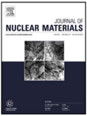

| Nomenclature    | Nomenclature                                                            |
|-----------------|-------------------------------------------------------------------------|
| A               | cross-sectional area                                                    |
| c ( x , t )     | composition content                                                     |
| c s             | the content at surface                                                  |
| D , D 0         | diffusion coefficient and constant                                      |
| d               | grain size                                                              |
| e               | true strain                                                             |
| e u             | uniform true strain                                                     |
| F               | loading force                                                           |
| Delta1 G        | the difference of activation energy between sur- face and inside grains |
| K               | coefficient of strain hardening                                         |
| k , k ∗         | material constants                                                      |
| L 0 , L         | original and final gauge length                                         |
| L u , L p       | uniform and post-necking deformation                                    |
| M               | Taylor factor                                                           |
| m               | power exponent                                                          |
| n               | the exponent of strain hardening                                        |
| Q , Q s         | activation energy inside grains and at surface                          |
| R               | the radius of transition arc                                            |
| R ′             | gas constant                                                            |
| S V , S bulk V  | grain boundary density of specimen and bulk ma- terials                 |
| T , T c         | thickness and critical thickness                                        |
| T ′             | temperature                                                             |
| t               | time                                                                    |
| x               | the distance away from the surface                                      |
| α               |                                                                         |
|                 | the softness coefficient of stress state                                |
| δ , δ ′         | tested and normalized total elongation after frac- ture                 |
| δ u , δ p       | uniform and post-necking elongation                                     |
| δ ′ p ε         | normalized post-necking elongation true stress                          |
| θ               | the fracture angle                                                      |
| κ               | the normalized coefficient of post-necking elonga- tion                 |
| κ ′             | integrated size factor                                                  |
| ξ               | grain shape coefficient                                                 |
| σ               | normal stress                                                           |
| σ b             | tensile strength                                                        |
| σ max           | maximum normal stress                                                   |
| σ s , σ s bulk  | yield strength of specimen and bulk materials, re- spectively           |
| σ 1 , σ 2 , σ 3 | the normal stresses of three orthogonal axes                            |
| η               | the fitting coefficient                                                 |
| τ               | shear stress                                                            |
| τ c τ           | critical resolved shear stress maximum shear stress                     |
| max             | the initial resistance of                                               |
| τ 0             | crystal                                                                 |

What's more, the fracture behavior will be affected by the thickness as well [22] . To give an illustration, the fracture angle of thicker specimens (0.15-0.2 mm) of 20MnMoNi55, CrMoV and SS304LN steels are smaller than the thinner (0.25-0.4 mm) [22] . Nevertheless, the fracture behaviors, such as fracture mode, fracture angle, are also affected by different types of materials and even with different grain sizes [ 18 , 23 ].

As vital materials of nuclear power plants, the exact influence of size parameters on tensile properties of Chinese RPV steels has not been totally revealed yet. Based on the demand for small specimens in nuclear power plants, the present study is aimed to explore the size-dependent effect on tensile properties and deformation behaviors of Chinese RPV steels comprehensively by the extensometer as well as Digital Image Correlation (DIC) analysis, and to normalize the tensile properties of small specimens to standard ones.

## 2. Materials and experimental

## 2.1. Materials

As shown in Fig. 1 a, the bulk of RPV steels was taken from the cylinder of Chinese commercial SA508-3 steels supplied by nuclear power plants. The chemical compositions were listed in Table 1 , and the initial heat treatment was quenched at 1163 K and then tempered at 923 K.

## 2.2. Experimental

The microstructures and phase constitutions were respectively characterized by optical microscope (OM), scanning electron microscope (SEM) and X-ray diffraction (XRD) (Co-K α ) with scanning angle from 20 ° to 105 ° .

Variable-controlling method was adopted to design tensile specimens with different size parameters to explore the sizedependent effect on tensile properties. The size parameters included thickness T , width of the gauge W , original gauge length L 0 , and the radius of transition arc R , and the specimens were labeled by P W -T -L 0 -R , as demonstrated in Fig. 1 b. Tensile specimens were cut by wire electrical-discharge machining and then ground by sandpapers to obtain a smooth surface. The length of the gauge was measured by vernier caliper with the accuracy of 0.02 mm, and the width as well as thickness were measured by spiral micrometer with the accuracy of 0.01 mm. At least three samples were used for each geometry.

The tensile tests were conducted on Instron 5969 mechanical test machine with maximum load of 50 kN. The tensile strain rate was 10 -3 s -1 and the accuracy of loading force was better than 0.5%. The 2620-601 type of the extensometer, which gauge length and accuracy were 12.5 mm and 0.5% respectively, was used to detect the strain of specimens whose L 0 &gt; 12.5 mm. Three sets of gauge length ( L 0 = 15, 10, 6 mm, respectively) were drawn on one specimen to study the influence of gauge length. For smaller specimens whose L 0 &lt; 12.5 mm, non-contact DIC method was used, which could perform stain analysis based on the image of deformation and acquire strain fields of different gauge lengths at one time [24] . The flow charts of DIC procedure were displayed in Fig. 1 c. It included test record, file convert, software installation, GOM correlate platform, strain computation method, DIC parameters setting, DIC processing analysis, calibration and scaling. In the GOM software, the von Mises equivalent strain was used to determine the local strain of the specimens, and based on that, the stress-strain curves could be drawn. Moreover, two sets of gauge lengths ( L 0 = 10 mm and 6 mm, respectively) were set to study the effect of gauge length, whose elongation could be calculated by the GOM software. Based on the parameters of mechanical test machine and its tensile standards, the uncertainty of measurement for strength and elongation is 5 MPa and 0.05%, respectively.

## 3. Results

## 3.1. The microstructures

Fig. 2 shows the microstructure of RPV steels. According to the continuous cooling transformation (CCT) curve of RPV steels

Table 1 Chemical compositions of RPV steels.

| Composition    |    C |   Mn |   Ni |   Mo |   Cr |   Si |     P |     S |   Cu |   Al | Co     | Fe   |
|----------------|------|------|------|------|------|------|-------|-------|------|------|--------|------|
| Content (wt.%) | 0.18 | 1.39 | 0.71 | 0.47 | 0.12 | 0.22 | 0.005 | 0.002 | 0.03 | 0.01 | < 0.02 | Bal  |

Fig. 1. (a) The bulk of RPV steels; (b) the shape and size parameters of tensile specimen; (c) flowchart of Digital Image Correlation (DIC) method.

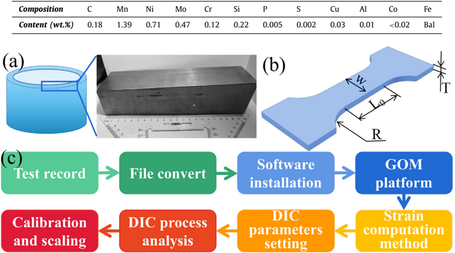

Fig. 2. Microstructure of RPV steels.

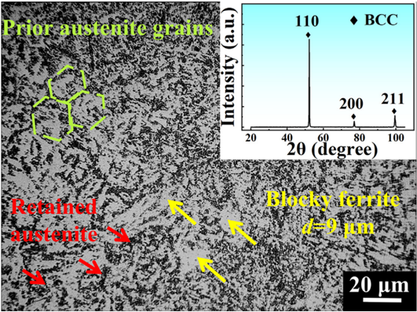

[2] and the heat treatment mentioned above, it could be inferred that the microstructure is granular bainite, which is typical microstructures of RPV steels [24-26] and formed by the slow cooling in the core of RPV. Since the thickness of RPV is above 200 mm, the quenching in the core of RPV is quite slow to let bainite transformation happen. Carbon atoms would diffuse from the prior austenite grains, as shown in the green circles in Fig. 2 , and then blocky ferrite and carbon-rich austenite island form. As the materials cool down, the retained austenite, as shown in the red arrows on Fig. 2 , could remain or decompose into mixture and carbides. The XRD analysis in the insert of Fig. 2 presents that it is singlephase body center cubic (BCC) structure and there are no peaks of austenite, indicating that the austenite has already decomposed. Besides, the estimated average size of blocky ferrite, d , is approximately 9 μm.

## 3.2. Tensile test by the extensometer

Stress-strain curves tested by the extensometer are shown in Fig. 3 and it can be found that the yield platform vanishes when the thickness is less than 0.5 mm. The vanishing of yield platform in thin specimens has also occurred in some materials, such as 20MnMoNi55 and CrMoV steels [22] , but others have not, such as Ti foils [8] .

The influences of T, W, R, L 0 on yield strength, σ s , tensile strength, σ b , uniform elongation, δ u , and total elongation after fracture, δ , of RPV steels are exhibited in Fig. 4 . Firstly, when T &gt; 0.5 mm, all the size parameters exhibit inapparent influence on the yield strength, tensile strength, and uniform elongation (whose variations are less than 10% for all specimens), while the tensile strength and uniform elongation decrease when T &lt; 0.5 mm. It is different from that many studies have found that the yield strength increases with the increase of the thickness and there usually exists a critical thickness, T C , which is about 6 to 10 times of the average grain size of materials [ 9 , 15 , 16 ].

In contrast, Fig. 4 indicates that all parameters have remarkable influences on total elongation after fracture, which varies from 4.3% to 57.0% for different dimensional parameters. Specially, δ decreases from 24.3% to 4.4% when the thickness decreases from 2 mm to 0.15 mm, as shown in Fig. 4 a. It has also been found in other studies that the elongation is affected by the thickness of specimens [14] , and generally, thinner specimens have less total elongation than thicker specimens [4] . In addition, the decrease of the width also cause that the elongation decreases from 21.6% to 13.2%, as shown in Fig. 4 b. Some studies find that the tensile behavior is affected by the aspect ratio ( T / W ) and when the ratio is above one critical value, the tensile behavior will not change [ 9 , 13 ]. The influence of aspect ratio will be discussed in 4.2.

Fig. 3. Stress-strain curves of different specimens of RPV steels tested by the extensometer, which inset is enlarging of yield platform, the schematic diagram of Cottrell atmosphere and its pinning on dislocations.

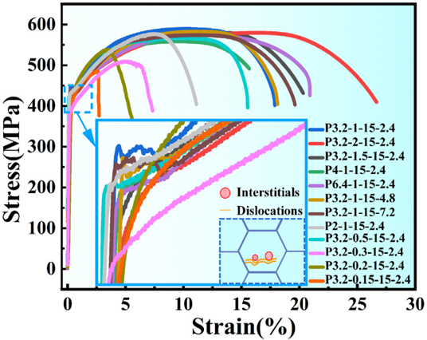

Fig. 4. Impact of the thickness (a), width (b), radius (c) on tensile properties of RPV steels, where L 0 = 15 mm for (a-c), and the total elongation after fracture at different origin gauge length (d).

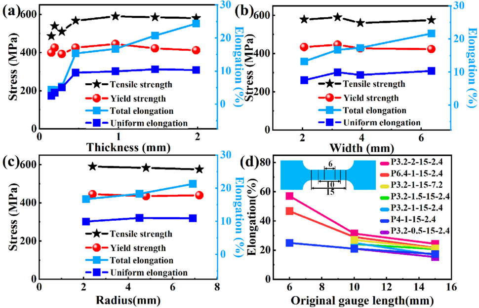

Moreover, Fig. 4 d shows that the total elongation after fracture increases obviously with the decrease of original gauge length L 0 . Taken P3.2-2-15-2.4 as an example, δ increases from 24.3% to 57.0% when L 0 decreases from 15 mm to 6 mm. A significant increase of δ with the decrease of L 0 is also observed in pure titanium foils [8] and HY-100 steels [12] , etc. Since δ is an important parameter to evaluate the plasticity of materials, its size-dependent effect of RPV steels needs further understanding and proper normalization.

Fig. 5. Stress-strain curves of different size specimens tested by the DIC.

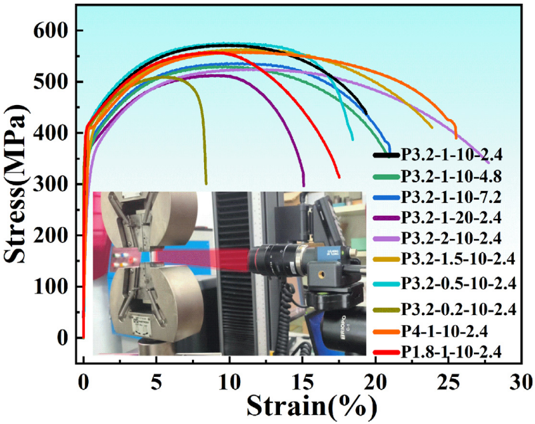

Fig. 6. Impact of the thickness (a), width (b), radius (c) on tensile properties of RPV steels, where L 0 = 10 mm for (a-c), and total elongation after fracture at different origin gauge length (d).

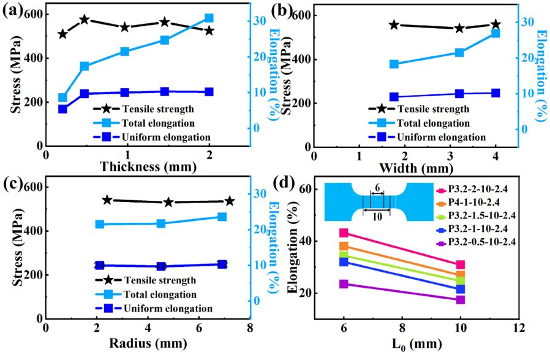

## 3.3. Tensile test by DIC

The stress-strain curves and results of tensile properties of smaller specimens, which original gauge length is less than 12.5 mm and tested by DIC, are shown in Fig. 5 and 6 respectively. Limited by the accuracy of DIC analysis, the yield strength is not precise and therefore not presented in Fig. 6 . In general, the rules are similar with those found in Fig. 4 , where the parameters of specimen have little influence on tensile strength as well as uniform elongation, but have large influence on the total elongation after fracture (ranging from 8.6% to 43.2%). The total elongation after fracture increases with the increase of thickness T , width W , transition arc radius R , and decreases with the increase of original gauge length L 0 of the specimens. And the reason will be discussed together with results of the extensometer in the discussion part.

Fig. 7 shows strain distribution of specimens with different thicknesses after fracture detected by DIC. When the thickness increases from 0.45 mm to 2 mm, the fracture angle, θ , which is the angle between the fracture plane and the perpendicular direction of specimen, decreases from 34 ° to 1.3 ° , and the fracture morphology gradually changes from shear to normal. It has also been found that the fracture angles of thicker specimens (0.15 ∼ 0.2 mm) in 20MnMoNi55 steels, CrMoV steels and SS304LN are smaller than the thinner (0.25-0.4 mm) [22] .

Fig. 7. Fracture mode with different thickness.

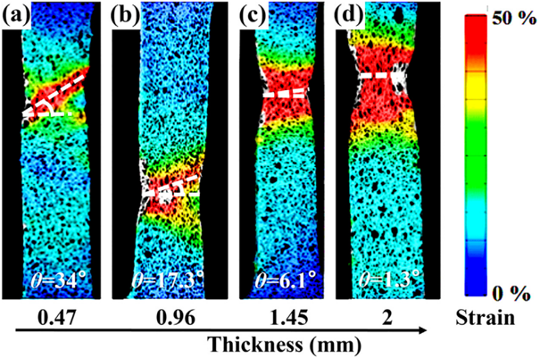

Fig. 8. Deformation trace of the specimen with the thickness of 2 mm.

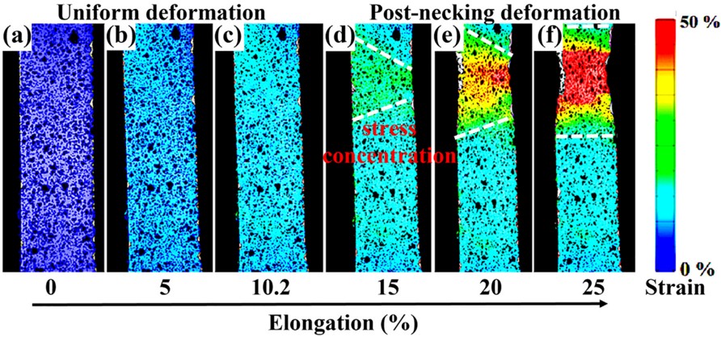

For an in-depth understanding about the evolution of the strain throughout the deformation, strain of the specimen with thickness of 2 mm is traced in Fig. 8 . It could be found that the deformation of the whole specimen is uniform at first, as shown in Fig. 8 a-c, the uniform deformation reaches its maximum at the elongation of 10.2%, which is in accordance with the uniform elongation found in Fig. 4 and Fig. 6 . After that, stress concentration appears at some position, where post-necking deformation happens. With the deformation of the other region maintains almost the same, subsequent deformation mainly takes place at the stress concentration region, which develops into necking position and finally leads to fracture.

## 4. Discussion

## 4.1. Yield behavior

## 4.1.1. The thickness dependent effect of yield strength

Many studies have found that the yield strength increases with the increase of the thickness of thin specimens and there usually exists a critical thickness, which is about 6 to 15 times of the av- erage grain size and above which the yield strength maintain unchanged [ 9 , 15 , 16 , 22 , 27 ] . Liu et al [27] refers that this thickness dependent effect of yield strength is driven from Hall-Petch effect caused by grain boundaries (GBs). Specifically, the classical HallPetch relation of Eq. (1) could rewritten as Eq. (2) .

$$\begin{array} { c c } \text {out in} \\ \text {at some} & \tau _ { c } = \tau _ { 0 } + k \sqrt { \frac { 1 } { d } } \\ \text {the de-} & \quad \text {sub.} \end{array} ( 1 )$$

$$\text {entration} \quad & \quad \tau _ { c } = \tau _ { 0 } + k \sqrt { \frac { 1 } { d } - \frac { 1 } { T } } = \tau _ { 0 } + k ^ { * } \sqrt { S _ { V } } \\ & \quad \text {reads to } & \quad \tau _ { c } = \tau _ { 0 } + k ^ { * } \sqrt { S _ { V } }$$

where τ c is critical resolved shear stress (CRSS), τ 0 is the initial resistance of crystal, k and k ∗ are material constants, d is grain size, T is the specimen thickness, S V is GB density and could be calculated by

$$S _ { V } = \xi \left ( \frac { 1 } { d } - \frac { 1 } { T } \right ) \\ \text {es with} \\ \text {with}$$

where ξ is grain shape coefficient and ξ ≈ 2 for columnar grains and ξ ≈ 3 for equiaxed grains. For polycrystal, the relationship between normal stress, σ , and shear stress, τ , is

Fig. 9. The plots of C content with the distance from surface.

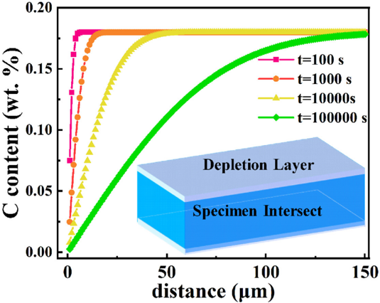

$$\sigma = M \tau & & ( 4 ) & c ( x , t ) = 0$$

where M is the Taylor factor for the cubic polycrystalline materials. Hence the yield strength of thin specimen, σ s , could be calculated by

$$\frac { \sigma _ { s } } { \sigma _ { s } ^ { b u l k } } & = \frac { M ( \tau _ { 0 } + k ^ { * } \sqrt { S _ { V } } ) } { M \left ( \tau _ { 0 } + k ^ { * } \sqrt { S _ { V } ^ { b u l k } } \right ) } \\ \text {where } \sigma _ { s } ^ { b u l k } \text { and } S _ { V } ^ { b u l k } \text { are the yield strength and GB density of } \quad & \text {turing} \quad \text {and} \quad \text {G} \text { a density of } \quad \text {turing} \quad \text {a}$$

where σ s bulk and S bulk V are the yield strength and GB density of bulk materials respectively. It is found that S V / S bulk V increases rapidly at T / d &lt; 5 and gradually saturates after that, therefore, the thickness dependent effect of yield strength is obvious at T / d &lt; 5 and will gradually saturate after that.

In this research, as shown in Fig. 3 a, the size of blocky ferrite is around 9 μm, which five times is 45 μm. In contrast, the minimum thickness is about 0.2 mm and far beyond the region influenced by thickness, leading to the vanishing of thickness dependent effect of yield strength. Unfortunately, limited by our present process technology, the attainable minimum thickness is 0.2 mm and it is too thick to reach the critical thickness for yield strength. But it indicates that due to the fine grains of industrial RPV steels, the thickness dependent effect of yield strength will not appear except for extremely thin specimen, which makes it is possible to evaluate yield strength by thin specimens after ion irradiation or neutron irradiation.

## 4.1.2. The disappearance of yield platform in thin specimens

Interestingly, the yield platform of specimens which thickness is less than 0.5 mm is found to disappear, as shown in the insert of Fig. 4 . Generally, BCC steels containing carbon (C) or nitrogen (N) as interstitial always have yield platform, which upper yield point is driven from the pinning on dislocations of C or N atoms, called Cottrell atmospheres [28] . Meanwhile, the surface would lower the activation energy for diffusion and introduce in image force to the solute atoms, hence drives the diffusion of them. Since the content of carbon of RPV steels is higher than the air, carbon atoms will diffuse from the matrix to the surface and result in the depletion of carbon nearby the surface. The content of carbon, c ( x , t ) , could be described by

$$c ( x , t ) = c _ { s } - ( c _ { s } - c _ { 0 } ) e r f \left ( \frac { x } { 2 \sqrt { D t } } \right )$$

where x is the distance away from the surface and always roughly estimated by √ Dt , t is time, c s is the content at surface, erf(x) is error function, D is diffusion coefficient and could be calculated by

$$D = D _ { 0 } e x p \left ( - \frac { \Delta G } { R ^ { \prime } T ^ { \prime } } \right )$$

where D 0 is diffusion constant, R ′ is gas constant, T ′ is temperature, Delta1 G is the difference of between surface activation energy, Q s , and activation energy inside grains, Q , i.e.

$$T / d < 5 \quad \Delta G = Q - Q _ { s } \\$$

Assuming that Q s = 0.5 Q , given that c s = 0 , c 0 = 0 . 18 wt . % , D 0 and Q of carbon in α -Fe is 88 kJ/mol and 0.011 cm 2 /s [29] , respectively, R ′ = 8.3 J/ (K · mol), T ′ = 298 K, then c ( x , t ) could be expressed by

$$\text {t} \text { is } \text {too} \quad c ( x , t ) = 0 . 1 8 \ e r f \left ( \frac { x \times 1 0 ^ { 5 } } { 2 . 5 8 \sqrt { t } } \right ) w t . \%$$

Fig. 9 gives the plots of c ( x , t ) with x at t = 100 s, 10 0 0 s and 10 0 0 0 s. It could be found that with the prolonging of diffusion time, t , the depletion layer could reach dozens or even hundreds of micrometers. The critical thickness for vanishing of yield platform observed in Fig. 3 is around 0.5 mm (500 μm), therefore it could be inferred that the losing of interstitial carbon atoms of the two surfaces of thin specimen might lead to the weakening of pinning from Cottrell atmosphere, resulting in the vanish of yield platform.

## 4.2. Deformation and fracture behavior

## 4.2.1. The stages of deformation

With the proceeding of deformation, uniform deformation happens after yielding at first, as shown in Fig. 8 a-c. After the uniform deformation as well as strain reach their maximum, postnecking deformation takes over when stress concentration appears, as shown in Fig. 8 d-f. Therefore, deformation after yielding could be divided into two parts, uniform deformation, L u , and postnecking deformation, L p , as shown in Fig. 10 .

(a) Before deformation Deformation

(b) Uniform deformation

L0+ Lu

(c) Post-necking deformation

L0+ Lu+ Lp

Fig. 10. The diagram of the strain of the specimen during deformation.

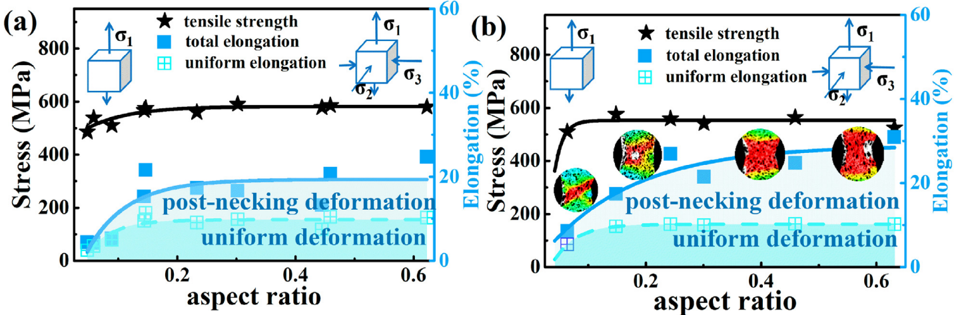

Fig. 11. The variation of tensile strength, uniform elongation and post-necking elongation with the aspect ratio of the extensometer (a) and DIC (b), where the insets present different fracture morphology with the increase of the aspect ratio.

The total elongation after fracture, δ , could be defined by

$$\delta = \frac { ( L _ { u } + L _ { p } + L _ { 0 } ) - L _ { 0 } } { L _ { 0 } } = \frac { L _ { u } } { L _ { 0 } } + \frac { L _ { p } } { L _ { 0 } } = \delta _ { u } + \delta _ { p } \quad \ \ ( 1 0 ) \quad \ \ d F = 0$$

where δ u and δ p are the elongation of uniform and post-necking respectively. Since it is found that the aspect ratio is always responsible for the deformation modes, Fig. 11 indicates the variation of tensile strength, σ b , uniform elongation, δ u , and postnecking elongation, δ p , with the aspect ratio. It could be found that the critical value of the aspect ratio is also around 0.15, in accordance with the critical aspect ratio found in ferritic/martensitic dual phase steels [6] .

## 4.2.2. Uniform deformation

Hollomon equation for uniform deformation is

$$\varepsilon = K e ^ { n }$$

where ε is ture stress, e is true strain, K is coefficient of strain hardening and n is the exponent of strain hardening. In addition, the loading force, F , during tensile test could be calculated by

$$F = \varepsilon \cdot A & & ( 1 2 ) & \frac { \frac { U L } { L } } { L } = -$$

where A is the cross-sectional area. When loading force reaches its maximum, its differential is zero, i.e.

$$( 1 0 ) \quad d F = 0$$

$$\text {ways } \, \mathrm r e ^ { - } \quad A \cdot d \varepsilon + \varepsilon \cdot d A = 0 \\ \mathrm e \, \mathrm v a r _ { - }$$

$$\begin{smallmatrix} \text {post} - & d \varepsilon \\ \text {found} & \frac { \varepsilon } { \varepsilon } = - \frac { d A } { A } \\ \text {in ac} & \end{smallmatrix}$$

Moreover, the differential of true strain is defined by

$$d e = \frac { d L } { L }$$

where L is the length of the gauge. Since volume remains unchanged during uniform deformation, therefore

$$( 1 1 ) \quad d V = 0$$

$$\begin{smallmatrix} \text { $dition} , & \text { $A \cdot dL + L \cdot dA = 0$} \\ \end{smallmatrix}$$

$$\int ( 1 2 ) \quad \frac { d L } { L } = - \frac { d A } { A }$$

Combining Eq. (15) , Eq. (16) and Eq. (19) , then

$$d e = \frac { d L } { L } = - \frac { d A } { A } = \frac { d \varepsilon } { \varepsilon } & & \text {raised} \, t \\ \alpha = \frac { \tau _ { m } } { \sigma _ { m } } & & \tau _ { m }$$

Combining Eq. (11) and Eq. (20) , then

$$\varepsilon = \frac { d \varepsilon } { d e } = \frac { d ( K e ^ { n } ) } { d e } = K n e ^ { n - 1 } = K e ^ { n } & & \text {normal} \\$$

Hence there exists the relationship

$$n = e _ { u } & & \stackrel { 3 } { ( 2 2 ) } & \stackrel { 2 } { \text { the inc } } \\ & & \text {state} \ & &$$

where e u is the uniform true strain. The exponent of strain hardening, n , represents the ability of uniform deformation of materials and is a constant for one specific materials, therefore the uniform (true) strain is supposed to be a constant for one specific material as well. As shown in Fig. 11 , when the aspect ratio &gt; 0.15, it could be found that the tensile strength and uniform deformation remain unchanged, which are around 570 MPa and 10% respectively, indicating the uniform plastic deformation can be carried out sufficiently and maximum ability of uniform deformation is reached.

However, when the aspect ratio &lt; 0.15, both the tensile strength as well as uniform elongation increases with the increase of the aspect ratio, meanwhile, the post-necking elongation is quite low, indicating that the uniform deformation insufficiently carries out and ends up at some weak positions to stop further deformation. It is known that cracks are derived from the nucleation and growth of micro-voids [22] . Based on GursonTvergaard-Needleman (GTN) meso-damage model analysis, Yang et al. [30] have found that the decrease of thickness makes the nucleation and integration of micro-voids much harder, resulting the hindrance of crack propagation and early fracture of specimen. In addition, the surface roughness would act as weak position to let cracks initiate, which will be more significant for thin specimens, resulting in the insufficiency of uniform deformation and fracture in advance [ 18 , 31 ]. In this research, the minimum width is around 2 mm, while the minimum thickness is around 0.2 mm, therefore it could be inferred that the decrease of uniform deformation at low aspect ratio is mainly ascribed to the decrease of thickness.

## 4.2.3. Post-necking deformation

Different from the unchanged uniform deformation and tensile strength, the post-necking deformation keeps growing with the increase of the aspect ratio. The aspect ratio would affect the stress state of specimens, and the softness coefficient of stress state, α , is raised to describe the difficulty of deformation,

$$\alpha & = \frac { \tau _ { \max } } { \sigma _ { \max } } = \frac { \sigma _ { 1 } - \sigma _ { 3 } } { 2 \sigma _ { 1 } - 0 . 5 ( \sigma _ { 2 } + \sigma _ { 3 } ) } \\ \text {where } \tau _ { w } & \text { is the maximum shear stress } \sigma _ { w } \text { is the maximum}$$

$$\text {uniform} \quad \alpha = \frac { \sigma _ { 1 } + \sigma _ { 2 } } { 2 \sigma _ { 1 } + \sigma _ { 2 } } = 0 . 5 + \frac { 0 . 5 \sigma _ { 2 } } { 2 \sigma _ { 1 } + \sigma _ { 2 } } > 0 . 5 \\ \text {it could} \quad \text {Therefor with the increase of the aspect ratio } \alpha \, \text {increases}$$

where τ max is the maximum shear stress, σ max is the maximum normal stress, σ 1 , σ 2 , σ 3 is the normal stresses of three orthogonal axis. The larger α is, the easier to deform. At low aspect ratio, the stress state approaches to uniaxial tensile, where σ 2 = σ 3 = 0 , as shown in the insert of Fig. 11 , therefore α = 0 . 5 . With the increase the aspect ratio, it gradually turns into triaxial stress state, where σ 2 and σ 3 are some negative values, given that | σ 1 | = σ 1 , | σ 2 | = | σ 3 | = σ 2 , hence

Therefore, with the increase of the aspect ratio, α increases, meaning that the deformation ability increases to let deformation keeps going after necking, causing that the necking length increasing, the necking angle gradually tends to zero, and the fracture mode turns from shear to normal. Related finite element analyses are carried out by Kumar [22] on series of specimens which thickness varies from 0.1 mm to 1 mm, and find that compared with thinner specimens, thicker specimens tend to exhibit triaxial stress state and develop the necked cross-section.

## 4.2.4. The influence of set original gauge length

Figs. 4 d and 6 d present that the total elongation after fracture increases with the decrease of set original gauge length. Based on Eq. (10) , total elongation after fracture consists of uniform elongation, δ u , and post-necking elongation, δ p . Fig. 8 as well as the analyses in 4.2.2 present the uniform elongation would remain at round 10% when the aspect ratio &gt; 0.15, which makes δ u constant. Meanwhile, the post-necking length, L p , is constant for the same specimen, shown as Fig. 8 , makes δ p increase with the decrease of L 0 . Therefore the influence of set original gauge length is driven from the post-necking deformation, and low L 0 would result in the increase of posting necking deformation part, finally increase the total elongation after fracture.

## 4.3. The normalization of total elongation after fracture

Based on the discussion above, the total elongation after fracture of small specimens could be divided into size-independent uniform elongation and size-dependent post-necking elongation, therefore the tested total elongation, δ , could be normalized to the normalized total elongation, δ ′ , by

Fig. 12. The fitting of tested elongation with 1 /κ ′ , which R 2 = 0.97.

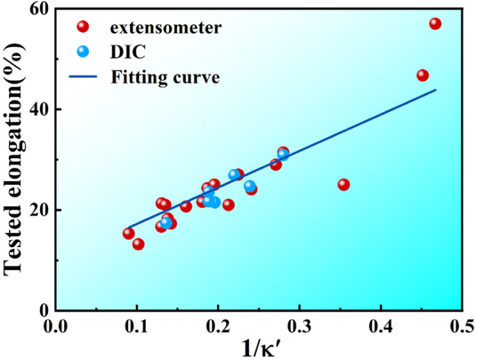

$$\delta ^ { \prime } & = \delta _ { u } + \delta _ { p } ^ { \prime } = \delta _ { u } + \kappa ( \delta - \delta _ { u } ) \\ & = 1 + \delta _ { p } \tau ^ { 2 } - 1 + 1 - 1 + \tau ^ { 2 } - 1 + 1 + \tau ^ { 2 } \\$$

where δ ′ p is normalized elongation of post-necking, κ is the normalized coefficient of post-necking elongation, which is related to the parameters of specimen and could be expressed by

$$\kappa & = \eta \kappa ^ { \prime } = \eta \frac { L _ { 0 } } { \sqrt { ( T \cdot W ) } } R ^ { m } \\ \text {where } & \ \eta \text { is the fitting coefficient, } \kappa ^ { \prime } \text { is integrated size factor,} \\$$

where η is the fitting coefficient, κ ′ is integrated size factor, L 0 √ ( T · W ) is derived from the regulation about the ratio of L 0 and √ ( T · W ) in standard sample, and m is the fitting power exponent to describe the influence of stress concentration caused by low R . Hence

$$\delta & = \frac { 1 } { \eta \kappa ^ { \prime } } \left ( \delta ^ { \prime } - \delta _ { u } \right ) + \delta _ { u } & & \text { (27)} \\ & \text {Given that } \delta _ { u } = 1 0 \% , \text { and using the data of standard specimen}$$

Given that δ u = 10%, and using the data of standard specimen with size of P15-1-22-20 and total elongation of 23% as a constraint, the fitting of δ with 1 /κ ′ is made based on results of both DIC and the extensometer, shown in Fig. 12 , where η = 0.179, m = -0.1247 and R 2 = 0.97, therefore the normalization equation is

$$\delta ^ { \prime } & = 1 0 + 0 . 1 7 9 \times \frac { L _ { 0 } } { \sqrt { ( T \cdot W ) } } R ^ { - 0 . 1 2 4 7 } \times ( \delta - 1 0 ) & & ( 2 8 ) & & \text {doi} & & \text {doi} \\ & \text {Since the uniform elongation will decrease when } T & < 0 . 2 \ m m , & & 9 0 & &$$

Since the uniform elongation will decrease when T &lt; 0.2 mm, and related documents find that the influence of R would disappear when R &gt; 20 mm [32-34] , it is noteworthy that Eq. (28) is only suitable for T &gt; 0.2 mm and R &lt; 20 mm. Based on theoretical analysis and experimental data, Eq. (28) is semi-empirical and could apply to the normalization of total elongation after fracture of different small specimens, and would make contribute to the design of small specimen of Chinese RPV steels in industry.

## 5. Conclusion

On demand for miniaturization of specimen in nuclear power plants to reduce the radioactivity, size effect on tensile properties of Chinese RPV steels are studied and the influence of the thickness, width, transition arc radius, gauge length on tensile behavior is studied in detail. It is found that yield planform vanishes when T &lt; 0.5 mm, but the yield strength seems to be not affected by the size parameters. Moreover, uniform elongation and tensile strength remain unchanged when the aspect ratio &gt; 0.15, in comparison, post-necking elongation keeps increasing with the increase of the aspect ratio and the decrease of set original gauge length. Finally, based on deformation theory and experimental data, a semi-empirical model is raised to normalize the total elongation of small specimens into standard proportional specimen in industry.

## Declaration of Competing Interest

The authors declare that they have no known competing financial interests or personal relationships that could have appeared to influence the work reported in this paper.

## CRediT authorship contribution statement

Shaochun Yin: Data curation, Formal analysis, Investigation, Writing - original draft. Xuejiao Wang: Conceptualization, Data curation, Formal analysis, Funding acquisition, Methodology, Project administration, Writing - review &amp; editing. Wenjiang Qiang: Conceptualization, Funding acquisition. Junwei Qiao: Funding acquisition, Investigation, Supervision, Writing - review &amp; editing. Yucheng Wu: Funding acquisition, Supervision, Project administration.

## Data availability

The raw/processed data required to reproduce these findings can be shared upon request.

## Acknowledgments

The work was supported by the Natural Science Foundation of Shanxi Province , China (No. 20210302124043 ), the National Key Research and Development Program of China (No. 2019YFE03120 0 02 ), the National Natural Science Foundation of China (Nos. 52020105014 , 51828101 ).

## References

- [1] G.R. Odette, G.E. Lucas, Embrittlement of nuclear reactor pressure vessels, JOM 53 (2001) 18-22, doi: 10.1007/s1183700100810 .
- [2] B. Marini, X. Averty, P. Wident, P. Forget, F. Barcelo, Effect of the bainitic and martensitic microstructures on the hardening and embrittlement under neutron irradiation of a reactor pressure vessel steel, J. Nucl. Mater. 465 (2015) 20-27, doi: 10.1016/j.jnucmat.2015.05.023 .
- [3] N.F. Panayotou, R.J. Puigh, E.K. Opperman, Miniature specimen tensile data for high energy neutron source experiments, J. Nucl. Mater. 104 (1981) 1523-1526, doi: 10.1016/0022-3115(82)90816-9 .
- [4] [R.L. Klueh, Miniature tensile test specimens for fusion reactor irradiation studies, Nucl. Eng. Des. Fusion. 2 (1985) 407-416, doi: 10.1016/0167-899X(85) 90028-X .](https://doi.org/10.1016/0167-899X(85)90028-X)
- [5] E.M. Rabenberg, B.J. Jaques, B.H. Sencer, F.A. Garner, P.D. Freyer, T. Okita, D.P. Butt, Mechanical behavior of AISI 304SS determined by miniature test methods after neutron irradiation to 28 dpa, J. Nucl. Mater. 448 (2014) 315324, doi: 10.1016/j.jnucmat.2014.02.018 .
- [6] Y. Kohno, A. Kohyama, M.L. Hamilton, T. Hirose, Y. Katoh, F.A. Garner, Specimen size effects on the tensile properties of JPCA and JFMS, J. Nucl. Mater. 283-287 (20 0 0) 1014-1017, doi: 10.1016/S0022-3115(00)00245-2 .
- [7] G.E. Lucas, Review of small specimen test techniques for irradiation testing, Metall. Trans. A. 21 (1990) 1105-1119, doi: 10.1007/BF02656531 .
- [8] S. Wang, L. Niu, C. Chen, Y. Pang, B. Liao, Z.H. Zhong, P. Lu, P. Li, X.D. Wu, J.W. Coenen, L.F. Cao, Y.C. Wu, Size effects on the tensile properties and deformation mechanism of commercial pure titanium foils, Mater. Sci. Eng. A. 730 (2018) 244-261, doi: 10.1016/j.msea.2018.06.009 .
- [9] R.A. Bragg, O.B. Andersland, Strain rate, temperature, and sample size effects on compression and tensile properties of frozen sand, Dev. Geotech. Eng. 28 (1982) 35-46, doi: 10.1016/B97804 4 4420107.50 0 08-6 .
- [10] Z. Zhang, W. Li, F. Wang, J. Li, Sample geometry and size effects on tensile properties of friction stir welded AA2024 joints, Mater. Lett. 162 (2016) 94-96, doi: 10.1016/j.matlet.2015.09.122 .
- [11] B.W. Baker, T.R. McNelley, L.N. Brewer, Grain size and particle dispersion effects on the tensile behavior of friction stir welded MA956 oxide dispersion strengthened steel from low to elevated temperatures, Mater. Sci. Eng. A. 589 (2014) 217-227, doi: 10.1016/j.msea.2013.09.092 .
- [12] P. Matic, G.C. Kirby, M.I. Jolles, Relationship of tensile specimen size and geometry effects to unique constitutive parameters for ductile materials, Proc. R. Soc. Lond. Ser. A 417 (1988) 309-333, doi: 10.1098/rspa.1988.0063 .
- [13] [A. Kohyama, K. Hamada, H. Matsui, Specimen size effects on tensile properties of neutron-irradiated steels, J. Nucl. Mater. 179-181 (1991) 417-420, doi: 10. 1016/0022-3115(91)90113-L .](https://doi.org/10.1016/0022-3115(91)90113-L)
- [14] K. Miyahara, C. Tada, T. Uda, N. Igata, The effects of grain and specimen sizes on mechanical properties of type 316 austenitic stainless steel, J. Nucl. Mater. 133-134 (1985) 506-510, doi: 10.1016/0022-3115(85)90199-0 .
- [15] N.F. Panayotou, The use of microhardness to determine the strengthening and microstructural alterations of 14 MeV neutron irradiated metals, J. Nucl. Mater. 108-109 (1982) 456-462, doi: 10.1016/0022-3115(82)90517-7 .
- [16] A. Kohyama, H. Matsui, K. Abe, K. Hamada, K. Asano, Specimen size effects on mechanical properties of 14 MeV neutron irradiated metals, J. Nucl. Mater. 155-157 (1988) 1354-1358, doi: 10.1016/0022-3115(88)90526-0 .
- [17] L.V. Raulea, A.M. Goijaerts, L.E. Govaert, F.P.T. Baaijens, Size effects in the processing of thin metal sheets, J. Mater. Process. Technol. 115 (2001) 44-48, doi: 10.1016/S0924-0136(01)00770-1 .
- [18] [L. Yang, L. Lu, The influence of sample thickness on the tensile properties of pure Cu with different grain sizes, Scr. Mater. 69 (2013) 242-245, doi: 10.1016/ j.scriptamat.2013.04.009 .](https://doi.org/10.1016/j.scriptamat.2013.04.009)
- [19] [T.A. Parthasarathy, S.I. Rao, D.M. Dimiduk, M.D. Uchic, D.R. Trinkle, Contribution to size effect of yield strength from the stochastics of dislocation source lengths in finite samples, Scr. Mater. 56 (2007) 313-316, doi: 10.1016/ j.scriptamat.2006.09.016 .](https://doi.org/10.1016/j.scriptamat.2006.09.016)

- [20] S.W. Lee, W.D. Nix, Size dependence of the yield strength of fcc and bcc metallic micropillars with diameters of a few micrometers, Philos. Mag. 92 (2012) 1238-1260, doi: 10.1080/14786435.2011.643250 .
- [21] Y.H. Zhao, Y.Z. Guo, Q. Wei, T.D. Topping, A.M. Dangelewicz, Y.T. Zhu, T.G. Langdon, E.J. Lavernia, Influence of specimen dimensions and strain measurement methods on tensile stress-strain curves, Mater. Sci. Eng. A. 525 (2009) 68-77, doi: 10.1016/j.msea.2009.06.031 .
- [22] [K. Kumar, A. Pooleery, K. Madhusoodanan, R.N. Singh, A. Chatterjee, B.K. Dutta, R.K. Sinha, Optimisation of thickness of miniature tensile specimens for evaluation of mechanical properties, Mater. Sci. Eng. A. 675 (2016) 32-43, doi: 10. 1016/j.msea.2016.08.032 .](https://doi.org/10.1016/j.msea.2016.08.032)
- [23] C.H. Suh, Y.C. Jung, Y.S. Kim, Effects of thickness and surface roughness on mechanical properties of aluminum sheets, J. Mech. Sci. Technol. 24 (2010) 20912098, doi: 10.1007/s12206-010-0707-7 .
- [24] C. Gasparrini, A. Xu, K. Short, T. Wei, J. Davis, T. Palmer, D. Bhattacharyya, L. Edwards, M.R. Wenman, Micromechanical testing of unirradiated and helium ion irradiated SA508 reactor pressure vessel steels: nanoindentation vs in-situ microtensile testing, Mater. Sci. Eng. A. 796 (2020), doi: 10.1016/j.msea. 2020.139942 .
- [25] X. Dai, T. Peng, Y.F. Chen, X.D. Chen, B. Yang, The correlation between martensite-austenite islands evolution and fatigue behavior of SA508-IV steel, Int. J. Fatigue. 139 (2020) 105776, doi: 10.1016/j.ijfatigue.2020.105776 .
- [26] C. Xie, Z. Liu, X. Wang, X. He, S. Qiao, Effect of two-step tempering treatment on microstructure and impact toughness of bainitic steel for heavy

wall thickness reactor pressure vessels, Mater. Charact. 160 (2020) 110070, doi: 10.1016/j.matchar.2019.110070 .

- [27] [W. Liu, Y. Liu, Y. Cheng, L. Chen, L. Yu, X. Yi, H. Duan, Unified model for size-dependent to size-independent transition in yield strength of crystalline metallic materials, Phys. Rev. Lett. 124 (2020) 235501, doi: 10.1103/PhysRevLett. 124.235501 .](https://doi.org/10.1103/PhysRevLett.124.235501)
- [28] A .H. Cottrell, B.A . Bilby, Dislocation theory of yielding and strain ageing of iron, Proc. Phys. Soc. Sect. A. 62 (194 9) 4 9-62, doi: 10.1088/0370-1298/62/1/308 .
- [29] [Z.X. Cui , Y.C. Tan , Metallography and Heat Treatment, 2th ed., China Machine PRESS, 20 0 0 .](http://refhub.elsevier.com/S0022-3115(23)00154-X/sbref0029)
- [30] [W. Yang , W. Zhong , J. Li , S. Li , G. Ning , W. Yang , Necking behavior of small tensile specimen of domestic A508-3 steel, At. Energy Sci. Technol. 55 (2021) 1177-1183 .](http://refhub.elsevier.com/S0022-3115(23)00154-X/sbref0030)
- [31] [Y.H. Zhao, Y.Z. Guo, Q. Wei, A.M. Dangelewicz, C. Xu, Y.T. Zhu, T.G. Langdon, Y.Z. Zhou, E.J. Lavernia, Influence of specimen dimensions on the tensile behavior of ultrafine-grained Cu, Scr. Mater. 59 (2008) 627-630, doi: 10.1016/j. scriptamat.2008.05.031 .](https://doi.org/10.1016/j.scriptamat.2008.05.031)
- [32] [BS EN 10 0 02-1:20 01 /ISO 6892-1Metallic Materials -Tensile Testing -Part 1: Method of Test at Room Temperature, DIN Mitteilungen, 2009 .](http://refhub.elsevier.com/S0022-3115(23)00154-X/sbref0032)
- [33] [GB/T228-2002Metallic Materials-Tensile Testing at Ambient Temperature, PRC National Standard, 2002 .](http://refhub.elsevier.com/S0022-3115(23)00154-X/sbref0033)
- [34] [ASTM Standard E8/E8M-13aStandard Test Methods for Tension Testing of Metallic Materials, ASTM International, West Conshohocken, 2013 http://www. astm.org/Standards/E8.htm .](http://www.astm.org/Standards/E8.htm)