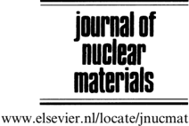
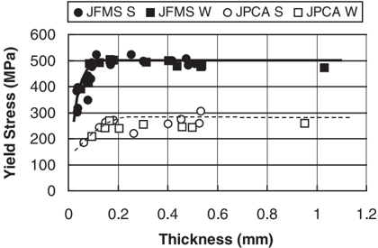
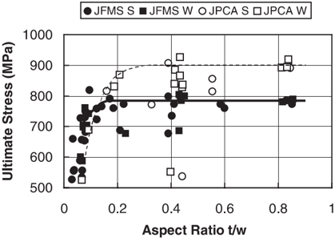
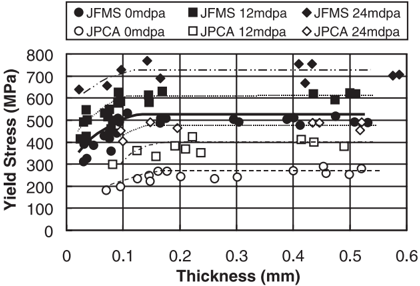
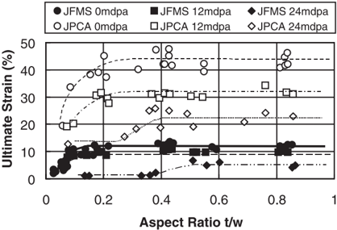
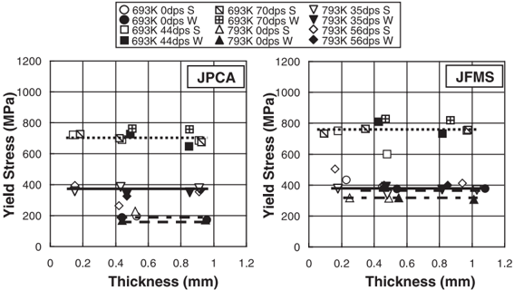
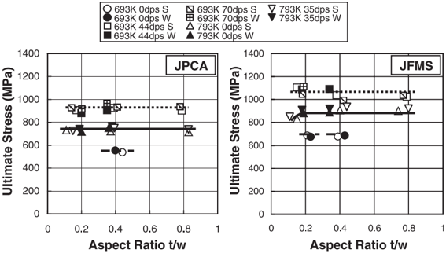
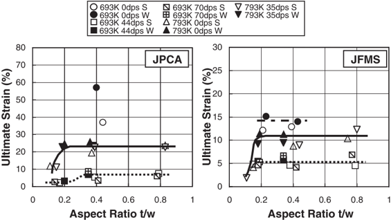

Journal of Nuclear Materials 283-287 (2000) 1014-1017

## Specimen size e€ects on the tensile properties of JPCA and JFMS

Yutaka Kohno a, * , Akira Kohyama b , Margaret L. Hamilton c , Takanori Hirose b , Yutai Katoh b , Frank A. Garner c

a

Department of Materials Science and Engineering, Muroran Institute of Technology, Mizumoto 27-1,

Muroran, Hokkaido 050-8585, Japan

b Institute of Advanced Energy, Kyoto University, Gokasho, Uji, Kyoto 611-0011, Japan c Battelle Pacific Northwest National Laboratory, Richland, WA 99352, USA

## Abstract

Examinations of specimen size e€ects on tensile properties were performed with and without neutron irradiation. Specimen thickness was varied to investigate the e€ect of aspect ratio as well as the thickness itself. Thickness dependence of yield stress, aspect ratio dependence of ultimate stress and aspect ratio dependence of ultimate strain showed good consistency and reproducibility even in heavy neutron irradiation condition. The e€ect of specimen size on yield stress and ultimate stress was small, but the ductility showed significant dependence on specimen aspect ratio. 2000 Elsevier Science B.V. All rights reserved.

## 1. Introduction

In studies for the development of fusion reactor materials, small specimens have been utilized to investigate irradiation e€ects on the mechanical properties of materials [1-12]. One of the major motivations to establish small specimen testing methods is the severe limitation of specimen space in irradiation facilities. Reduction of radiation dose during post-irradiation testing is also an important motivation.

In the Japanese Monbusho fusion materials research and development (R&amp;D) program, a standard small tensile specimen (S type) has been proposed and utilized in various irradiation programs. This is much smaller than the SS-3 type specimen in US programs.

The objectives of this work are to determine the limitation in small specimen tensile tests and to apply the

* Corresponding author. Tel.: +81-143 46 5660; fax: +81-143 46 5601.

E-mail address: kohno@mmm.muroran-it.ac.jp (Y. Kohno).

method to post-irradiation examination of the ferrous alloys.

## 2. Experimental

Materials used were modified 316 austenitic stainless steel (JPCA) and ferritic/martensitic dual phase steel (JFMS) [13-16]. They were heat-treated to obtain plates with grain sizes ranging from 26 to 171 l m for JPCA and with ferrite/martensite volume ratios ranging from 0.32 to 0.37 for JFMS.

Two types of tensile specimens, S type and W type, were used. The gauge dimensions are 1 : 2 w 5 : 0 l 0 : 25 t mm 3 for the S type and 2 : 4 w 10 l 0 : 5 t mm 3 for W type. The blanks were cut from the thick plate with profiles of S and W type specimens, and they were sliced with a wire saw to obtain specimens. The ratio of specimen thickness to the specimen width (aspect ratio) was varied over a range from 0.01 to 1.

Neutron irradiation was performed in JMTR and FFTF. Specimens were irradiated to 24 mdpa at 430 K in JMTR, and to 44 and 70 dpa at 693 K and to 35 and 56 dpa at 793 K in FFTF.

Tensile tests were performed at room temperature with a strain rate of 6 : 7 10 4 s 1 .

## 3. Results and discussion

## 3.1. Specimen size e€ects in unirradiated materials

Yield strength is known to be thickness independent for thickness larger than a critical thickness t c ; Y [79,11,12]. The critical thickness depends on material. t c ; Y for aluminum alloys is 3-5 times the average grain diameter [8] and that for ferrous alloys is about 6-10 times the average prior austenite grain diameter [3,4]. Fig. 1 indicates that specimen width (i.e., specimen type) does not a€ect yield stress and that only specimen thickness a€ects yield stress for thickness smaller than t c ; Y. The critical thickness for JPCA was estimated to be 0.12 mm which is about six times the average grain diameter, and that for JFMS was 0.19 mm which is also six times the average ferrite phase diameter.

The critical thickness for ultimate stress t c ; UTS was found to be a€ected by specimen width in a previous work [16]. This is also confirmed in this work as shown in Fig. 2. In Fig. 2, ultimate stress depends strongly on specimen aspect ratio for aspect ratios smaller than the critical aspect ratio c c ; UTS . A similar dependence of ultimate strain on aspect ratio was found, and the critical aspect ratio for ultimate strain c c ; UE was very close to that for ultimate stress c c ; UTS .

## 3.2. Specimen size e€ects in neutron irradiated materials

## 3.2.1. E€ects of low-dose neutron irradiation in JMTR

The e€ect of specimen thickness on the yield stress after low-dose neutron irradiation for JPCA and JFMS is shown in Fig. 3. Although radiation hardening occurred, the critical thickness for yield stress t c ; Y is not changed by irradiation. This is because at low neutron

Fig. 1. Specimen thickness dependence of yield stress in JPCA and JFMS.

1

Fig. 2. Aspect ratio dependence of ultimate stress in JPCA and JFMS.

Fig. 3. E€ect of low-dose neutron irradiation on thickness dependence of yield stress in JPCA and JFMS irradiated at 430 K in JMTR.

1

Fig. 4. E€ects of low-dose neutron irradiation on aspect ratio dependence of ultimate strain in JPCA and JFMS irradiated at 430 K in JMTR.

dose, hardening is caused by the matrix hardening, not by the grain boundary hardening. Fig. 4 shows the aspect ratio dependence of ultimate strain. The critical aspect ratio for ultimate strain c c ; UE , increased following irradiation to 24 mdpa. For specimens with aspect ratio smaller than c c ; UE , ultimate strain becomes strongly dependent on aspect ratio, decreasing more for the smaller specimen size even with the same aspect ratio, as reported elsewhere [16].

## 3.2.2. E€ects of heavy neutron irradiation in FFTF

Fig. 5 shows specimen thickness dependence of yield stress in JPCA and JFMS following irradiation to 44 and 70 dpa at 693 K and to 35 and 56 dpa at 793 K in FFTF. At the same irradiation temperature yield stress is not a€ected by irradiation dose. This indicates that yield stress become saturated following irradiation over about 35 dpa at these temperatures as shown in the test results for other steels [10]. Although irradiation tem- perature is di€erent and the critical thickness for yield stress t c ; Y is di cult to be defined from present results, t c ; Y are considered to be equal to or smaller than that for the unirradiated or low-dose irradiation condition. The aspect ratio does not a€ect yield stress.

The aspect ratio dependence of ultimate stress after FFTF irradiation is summarized in Fig. 6. Ultimate stress was independent of irradiation dose at the same irradiation temperature, similar to the absence of dose dependence of the yield stress as shown in Fig. 5. The e€ect of aspect ratio on ultimate stress is not clear compared to that in the unirradiated condition. The critical aspect ratio c c ; UTS for JFMS irradiated at 793 K was estimated to be 0.18, which is equal to that of unirradiated JFMS. c c ; UTS seems to become smaller with irradiation dose and irradiation temperature than that in the unirradiated condition.

Fig. 7 shows the aspect ratio dependence of ultimate strain after FFTF irradiation. Ultimate strain depends

Fig. 5. E€ects of neutron irradiation on thickness dependence of yield stress in JPCA and JFMS irradiated at 693 and 793 K in FFTF.

Fig. 6. E€ects of neutron irradiation on aspect ratio dependence of ultimate stress in JPCA and JFMS irradiated at 693 and 793 K in FFTF.

1

Fig. 7. E€ects of neutron irradiation on aspect ratio dependence of ultimate strain in JPCA and JFMS irradiated at 693 and 793 K in FFTF.

strongly on aspect ratio in the same way as the results of JMTR irradiation. However, ultimate strain seems to be independent of irradiation dose dissimilar to the results of the JMTR irradiation. The critical aspect ratios for ultimate strain c c ; UE are estimated to be 0.3 at 693 K and 0.2 at 793 K for JPCA, and 0.18 at 693 and 793 K for JFMS. These values are almost the same as those obtained on material in the unirradiated condition. c c ; UE tends to become smaller with irradiation temperature as shown clearly for JPCA. c c ; UE after irradiation in JMTR was estimated to be 0.4 and 0.5 for JPCA and JFMS, respectively. Although irradiation temperatures were much higher in FFTF than that in JMTR, c c ; UE was not a€ected by irradiation dose in the temperature range of the FFTF irradiations.

## 4. Summary

Yield stress is independent of specimen thickness for thickness larger than the critical thickness t c ; Y. t c ; Y seems to be dose independent, and to decrease with irradiation temperature.

Ultimate stress depends on specimen aspect ratio, at low values of aspect ratio and becomes independent of aspect ratio at values larger than the critical aspect ratio c c ; UTS . The magnitude of c c ; UTS seems to be dose independent, similar to t c ; Y.

Ultimate strain depends strongly on aspect ratio, and is independent of aspect ratio at values larger than the critical aspect ratio c c ; UE . The dose dependence of c c ; UE is a€ected by irradiation temperature and dose level. c c ; UE tends to decrease with irradiation temperature.

## References

- [1] W.R. Corwin, G.E. Lucas (Eds.), For example: The use of Small Specimens for Testing Irradiated Materials, ASTMSTP 888, 1986.
- [2] N.F. Panayotou, R.J. Puigh, E.K. Opperman, J. Nucl. Mater. 103&amp;104 (1981) 1523.
- [3] K. Sonnenberg, G. Antesberger, B. Brown, J. Nucl. Mater. 102 (1981) 333.
- [4] R.J. Puigh, R.E. Bauer, A.M. Ermi, B.A. Chin, J. Nucl. Mater. 103&amp;104 (1981) 1501.
- [5] G.E. Lucas, N.F. Panayotou, J. Nucl. Mater. 103&amp;104 (1981) 1527.
- [6] M.P. Manahan, A.S. Argon, O.K. Harling, J. Nucl. Mater. 103&amp;104 (1981) 1545.
- [7] N.F. Panayotou, J. Nucl. Mater. 108&amp;109 (1982) 456.
- [8] N. Igata, Y. Kohno, T. Fujihira, Strength of Metals and Alloys, 1986, p. 39.
- [9] A. Kohyama, K. Hamada, H. Matsui, J. Nucl. Mater. 179181 (1991) 417.
- [10] Y. Kohno, A. Kohyama, T. Hirose, M.L. Hamilton, M. Narui, J. Nucl. Mater. 271&amp;272 (1999) 145.
- [11] A. Kohyama, H. Matsui, K. Abe, K. Hamada, K. Asano, J. Nucl. Mater. 155-157 (1988) 1354.
- [12] A. Kohyama, K. Hamada, H. Matsui, ASTM-STP 1046 (1990) 404.
- [13] H. Kawanishi, R. Hajima, N. Sekimura, Y. Arai, S. Ishino, J. Nucl. Mater. 155-157 (1988) 887.
- [14] M.P. Tanaka, S. Hamada, A. Hishinuma, P.J. Maziasz, J. Nucl. Mater. 155-157 (1988) 801.
- [15] A. Kohyama, H. Matsui, K. Hamada, H. Shimidzu, J. Nucl. Mater. 155-157 (1988) 896.
- [16] A. Kohyama, K. Asano, N. Igata, ASTM-STP 956 (1987) 111.