## ILL - DOCUMENT DELIVERY

## Copyright Warning

The copyright law of the United States (Title 17, United States Code) governs the making  of  photocopies  or  other  reproductions  of  copyrighted  material.  Under certain  conditions  specified  in  the  law,  libraries  and  archives  are  authorized  to furnish a photocopy or other reproduction. One of these specified conditions is that the photocopy or reproduction is not to be 'used for any purpose other than private study,  scholarship  or  research.'  If  a  user  makes  a  request  for,  or  later  uses,  a photocopy or reproduction for purposes in excess of 'fair use,' that user may be liable  for  copyright  infringement.  This  institution  reserves  the  right  to  refuse  to accept a copying order if, in its judgement, fulfillment of the order would involve violation of copyright law.

## I n t e r l i b r a r y   L o a n

915-747-5678

l i b r a r y i l l @ u t e p . e d u STP 7576, 2075 / available onlin e at w ww.astm.org I doi: 10.1520/ STP/5762 0740022

J. Dzugan, 1 R. Prochazka, 2 and P . Konopik 2

## Micro-Tensile Test Technique Development and Application to Mechanical  Property Determination

## Reference

Dzugan, J., Prochazka,  R., and  Konopik, P ., "Micro-Tensile  Test  Technique Development  and Application  to  Mechanical  Property  Determination," Small  Specimen  Test  Techniques:  6th Volume, STP  1576,  Mikhail A. Sokolov  and Enrico Lucon,  Eds., pp. 12-30,  doi:10.1520/ STP157620140022, ASTM International, West Conshohocken, PA 2015. 3

## ABSTRACT

The  evaluation  of the  actual  mechanical  properties  of  in-service  structures  after  a period  of  operation  or  the  determination  of  local properties  for  detailed  finite element method (FEM) simulation requires relevant material data obtained with high accuracy from a  small volume  of  the experimental material. Therefore,  non­ destructive or semi-destructive techniques using small samples are being developed. The  use  of small-scale samples  also enables  the evaluation  of material  properties  in various  locations  of tested  components-for example,  the  mechanical  properties  of isolated  regions  of welds.  One  of the  widely  used  methods  in  miniature  specimen testing  is  the  small  punch  test (SPT).  The  SPT  is  usually based  on  conversion  of the obtained  results  into  conventional  parameters  such  as  tensile  properties,  creep, fatigue,  notch  toughness,  transition  temperature,  or fracture  toughness  parameters, but it requires  known correlation  parameters determined for the specific  material.  It was considered whether there is  really a need to convert values from an SPT if there is  not a chance to perform, for example, tensile tests directly on  the same volume of experimental  material  as  used  in  the  SPT.  Preliminary  FEM analysis  was  performed with  subsequent  experimental  verification  of the  possibility  of testing  small  tensile ll samples with the following dimensions: active part length, 3 mm;  width, 1.5 mm;  and thickness,  0.5 mm.  On  the basis  of promising  preliminary  results,  testing  fixtures  for micro-tensile  samples  were  developed  together  with  a  testing procedure.  The performance  of the  micro-tensile  test  method  relative  to  standard  tensile  tests  is shown here together with its application to weld characterization.

Manuscript received February 28.  2014; accepted for publication July 3, 201 4; published online September 26, 2014.

1 COMTES FHT  a.s., Prumyslova 995. 334 41  Doblany, Czech Republic, e-mail: jan.dzugan@comtesfht.cz 2 COMTES FHT a.s  ..  Prumyslova 995,334 41  Doblany, Czech Republic.

3 ASTM Sixth International Symposium on Small Specimen Test Techniques on January 29-31. 2014 in Houston. TX.

## Keywords

micro tensile tests, small sample techniques, dynamic testing

## Introduction

The residual lifetime assessment and potential for possible failure of  service components is  a critical  issue in  safety and reliability analyses of industrial plants. A component's re­ sidual life can be evaluated with  standard mechanical test techniques, such as  the tensile test,  uniaxial  creep  test,  or Charpy or  fracture  toughness  test.  However,  for  these tests there is  usually insufficient material to sample the component non-invasively.

Therefore,  non-destructive  techniques  are  being  developed,  as  well  as  testing methods  using  mini-samples.  One  of the  methods  of greatest  interest  is  the  small punch test  (SPT). The SPT method uses small disc-shaped samples,  usually 8 mm in diameter and 0.5 mm thick.  The testing itself involves  the  penetration of a hard ball through  the  tested  sample  while  the  force  and  ball  displacement  are  measured  at either room temperature or non-ambient temperature. The results of the SPT are of­ ten converted into conventional parameters such as tensile properties, fracture tough­ ness  values,  or  transition  temperature  determined  on  the  basis  of Charpy  impact tests.  A  broad  range  of correlations  of the  SPT  with  the  mentioned  parameters  has been  proposed on the  basis  of empirical  correlations [1 - 5] . However, these  correla­ tions do not have general validity and must be verified for each new material.

Among the  most  converted values  from  SPT  results  are  tensile  properties.  In this  paper,  the  authors  suggest  micro-tensile  specimens  on  the  basis  of the  SPT specimen  size  that  can  be  used  for  real  tensile  tests. This  kind  of test  would  have minimal material requirements and the same loading mode for samples as in stand­ ard  tensile  tests, and  it  enables  direct  result  determination  in  standard terms  with­ out the necessity of any kind of correlation determination. The performance of the proposed  testing  procedure  is  presented  in  comparison  with  that of standard-size specimens for several materials. Additionally, application of the method to  the local property determination of weld zones  is  shown here.  Application of the developed procedure  is  also  demonstrated  for  dynamic  property  measurement.  The  newly proposed  specimen  size  is  very  small  relative  to  the  standard  specimen  size,  and thus the new procedure is named the micro-tensile test (M-TT).

## Development of M-TT

A lot of  attention has been paid to the development of  the SPT within the past two dec­ ades.  Sampling devices  were developed, as  well  as  testing procedures.  Recently, thanks to  the  proposed  code  of  practice,  the  sample  size  was  also  standardized,  and  the recommended disc geometry is  8 mm in diameter and 0.5 mm thick. There are already many  applications  using  this  sample  size  (for  example,  surveillance  programs),  and thus  this  geometry was  used as  a base  for  the newly developed testing procedure. The target  was  to  run  a  real  tensile  test,  free  of any  necessary  correlations,  on  specimens using the same material volume as in the SPT. Some finite element method (FEM) cal­ culations  were  performed,  and  the  sample  geometry  shown  in  Fig.  1  was  proposed. Higher stress concentrations were seen in the transition from gauge section to specimen shoulders;  however, later experiments did  not show any problems with expected crack initiation  at  these  points.  This  is  probably due  to  the  small  sample  thickness  resulting in prevailing plane stress, allowing stress redistribution over a bigger area.

The specimen did not fit  into any kind of testing fixture, and thus the next step was testing fixture development. In the beginning, the very simple testing setup shown in Fig. 2 was used for the first  M-TT trials. The fixture was a simple clamp without any kind of alignment. During these first attempts, an actuator linear variable differential transformer (L  VDT)  was  used  for  strain  measurement.  The  first  results  were  very  promising:  the stress levels obtained in M-TTs were very close to those obtained for standard-size speci­ mens. A further step was  then improvement of the strain measurement. Because of the minute specimen size,  it was  not possible  to  attach a standard extensometer directly on the test piece. The extensometer was attached to grips, as can be seen in Fig. 3.

At  this  stage,  it  was  just  a  slightly  improved  crosshead  measurement.  The resulting curves of  these measurements for different heat-treated states of 34CrNiMo6 steel are displayed in Fig. 4. The obtained curves are very similar to  the curves  obtained  for  standard-size  samples,  except  the  yielding  part  of the  curve. The  sensitivity  of the  strain  measurement  with  the  extensometer  attached  to  the grips  was  significantly lower  than  in  the case  of direct  strain  measurement on the sample,  which  is  probably  the  reason  for  the different  shapes  of these  curve  parts for  M-TTs. The shape of the obtained M-TT curves clearly shows  that a different indexing offset has  to  be  used  for  comparison with standard yield stress values.  On the basis  of comparison of several offset values,  an  offset of 0.7  %  was  used  for  the yield stress determination. Very good agreement between M-TT results and results obtained  on standard specimens was  found. Already  at  this  stage,  use  of the  pro­ posed sample geometry with widely available testing equipment was able to provide very nice repeatable results for tensile property determination.

FIG. 1 M-TT specimen.

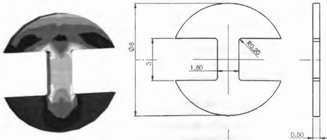

FIG. 2 Model of testing grips for M-TT.

FIG. 3 Testing setup with mechanical extensometer.

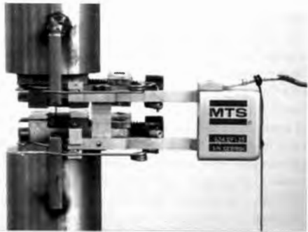

FIG. 4 Comparison of tensile curves obtained for standard-size specimens and M-TT specimens with a mechanical extensometer for strain measurement.

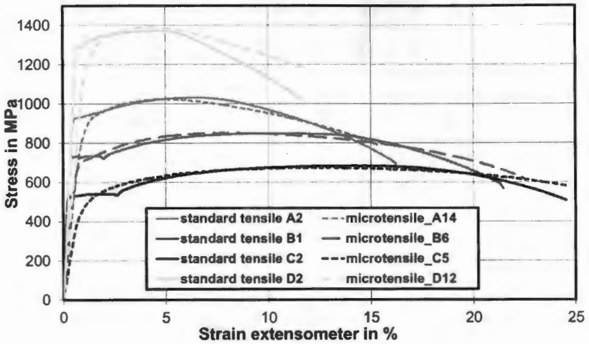

As  the  target  was  to  obtain,  if possible,  curves  and  results  very  similar  to  those for standard-size specimens, further effort was applied to improve the strain measure­ ment. Because of the M-TT specimen size, it was clear that a mechanical extensome­ ter  could  hardly be  used,  and  therefore  optical  systems  were  going  to  be  employed. As  a  first  candidate,  a  videoextensometer  was  used.  The  testing  setup  is  shown  in Fig.  5. The applied extensometer allowed  simultaneous measurement of longitudinal and transversal strain  that could be  used,  for  example,  for  Poisson  ratio calculation, even  with  this  kind of specimen.  The  results  obtained for  a low-carbon  steel  (LCS) with this kind of  testing setup are depicted in Fig. 6. They are displayed there together with  curves  for  standard-size  tensile  specimens  with  the  strain  measured  by  a  me­ chanical extensometer. Almost identical curves can be observed for M-TT specimens and standard specimens up to the ultimate tensile strength (UTS). After the UTS, the curves' deviation from each other can be observed; this is due to the various positions of  the extensometer with regard to the necking area. However, the initial gauge length marking is  rather inconvenient because  of the small specimen size, and  a more  so­ phisticated method for the strain measurement is going to be applied.

In  the  last  stage  of development  of the  testing  procedure  for  strain  measure­ ment for M-TTs, the digital  image correlation (DIC)  system ARAMIS  was  used. In order for strain measurement with  DIC to be performed, a random speckle pattern has  to  be applied on the specimen surface. An example of the DIC strain  measure­ ment during the tensile test can be found in Fig. 7.

FIG. 5 Testing setup with print screen of videoextensometer measurement.

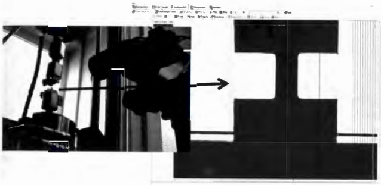

We carried out tests on several materials with a wide range of tensile properties. Namely,  Al-alloy,  Ni-alloy,  Titanium  Gr.  5,  and  several  steels  were  compared  in tests  on standard-size specimens and with  the use of the M-TT. Standard-size sam­ ples  were  round with diameters ranging from  5 to  10 mm, and in  one case (steel)  a segment  of pipe  was  tested.  The  resulting  curves  from  these  tests  are  graphically FIG. 7

FIG. 6 Comparison of tensile curves obtained on standard-size specimens and M-TT specimens with videoextensometer.

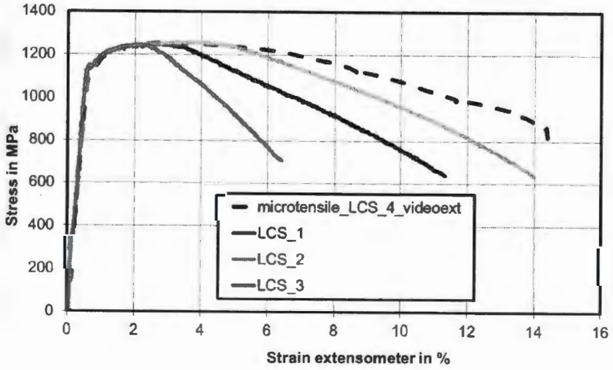

DIC strain measurement during different stages of tensile tests for M-TT specimens.

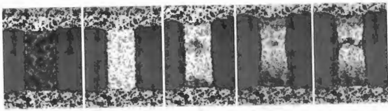

summarized in  Fig.  8.  There was  excellent  agreement  for  all  materials  investigated between  standard-size  specimens  and  M-TT  specimens  for  the  whole  range  of strength levels from about 250 MPa up to 1250 MPa.

On the basis of the positive results attained with  the use of DIC for  the strain mea­ surement, this system was used for further strain measurement in the course of M-TTs.

## Determination of Cross-section Reduction and Elongation

In addition to the strength properties, properties describing material plasticity such as  cross-section reduction  (CSR)  and elongation (A) were evaluated. Because of the

FIG. a Comparison of records obtained with DIC for M-TT measurement of various metallic materials.

50

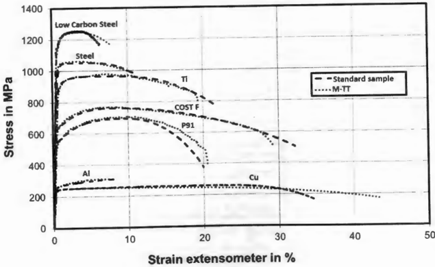

small size of M-TT specimens, the standard kind of measurement is  rather compli­ cated; therefore,  alternative  methods  were  tried  for  the  CSR  determination.  Three methods were investigated:  minimal neck dimensions (CSRM), direct measurement of fracture area via optical microscope (CSR 0 ) ,  and measurement with circle fitting (CSRsM)·

In  the case of CSRM, the minimal specimen dimensions according to  Figs. 9(a) and 9(b) were determined. The area in this case was  calculated via the simple multi­ plication of minimal  measured dimensions. In  the second case, CSR 0 is  the cross­ section  area  measured  with  the  use  of an  optical  microscope  by  means  of digital image  processing  of the  fracture  area,  as  depicted  in  Fig.  9(c).  The  last  applied method was CSRsM  in which a circle is  fitted  on the basis of minimal and maximal neck thickness and minimal neck width [Fig. 9(d)]. On the basis of these parameters, the  necking area was subsequently calculated.

These three approaches were applied to a set of specimens, and the results were compared  with  the  values  determined  for  the  CSR  of standard-size  specimens. A summarization is shown in Table 1. The best agreement was found for  the simplified measurement CSRM  when minimal neck dimensions were simply multiplied.

FIG. 9 Cross-section reduction determination for M-TT specimens.

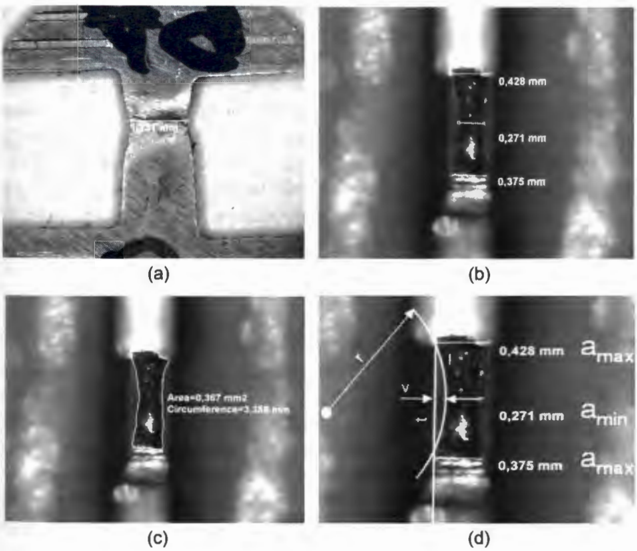

Comparison of cross-section reduction measurement with M-TT and standard-size

TABLE 1 specimens.

| CSRs, %   |   CSRM, % | CSR 0 , %   |   CSRsM, % | (CSRM - CSRs) 2   | (CSR 0 - CSRs) 2   |   (CSRsM - CSR 5 ) 2 |
|-----------|-----------|-------------|------------|-------------------|--------------------|----------------------|
| 53.4      |      53.2 | 49.9        |       46.2 | 0.04              | 12.25              |                51.84 |
| 57.1      |      59.3 | 54.2        |       51.7 | 4.84              | 8.41               |                29.16 |
| 56.8      |        58 | 51 .7       |       49.6 | 1.45              | 26.1               |                51.84 |
| 62.6      |      60.8 | 54.1        |       53.6 | 3.25              | 72.25              |                81.00 |
| 63.5      |      66.5 | 60.9        |       56.6 | 9.00              | 6.77               |                47.61 |
| 59.1      |      63.2 | 62.4        |       56.4 | 16.81             | 10.89              |                 7.30 |
| 62.1      |      61.3 | 61.1        |       57.8 | 0.65              | 1 .00              |                18.49 |
| 64.1      |      64.5 | 64.3        |       60.4 | 0.1 7             | 0.05               |                13.69 |
| 63.2      |      66.9 | 66.1        |       60.3 | 13.69             | 8.41               |                 8.42 |
| 45.7      |      45.1 | 49.4        |       46.4 | 0.37              | 13.69              |                 0.49 |
| 44.7      |      45.1 | 40.8        |       40.3 | 0.1 6             | 15.21              |                19.37 |
| 46.5      |      46.5 | 43.6        |       41.1 | 0                 | 8.41               |                29.16 |
| Sum       |           |             |            | 50.38             | 183.33             |               358.34 |

Elongation  is  the  last  typical  value  evaluated  from  tensile  tests.  Because  of the small  specimen  dimensions,  it  is  very  sensitive  topic  with  M-TT. Considering  the uniform  part of a  gauge  length  2.6 mm  the  obtained  elongation  would  not  be  the standard A5 ,  but A 2 \_ 65 .  This would give a hint that elongations measured via M-TTs should be  significantly greater.  This kind of measurement requires  marking of the gauge  length  on  the  sample.  Because  of  the  small  specimen  dimensions,  this  is rather difficult,  as  the  marking  accuracy  and  marking linewidth  in  relation  to  the gauge length lead  to sizeable uncertainty. Instead of this, we  decided to consider as a gauge length for  the elongation measurement the whole narrow part of the speci­ men  including  the  radius  between  the  gauge  section  and  specimen  shoulders (Fig. 10). The initial gauge length was  uniform, thanks to the milling cutter used for specimen machining in a single pass. This dimension is  also rather easy to  measure prior  to  and  after  the  test.  This  approach  was  applied  to  a  set  of specimens. The results are summarized in Table 2. Good agreement across the measured data popu­ lation  can  be  observed.  The  differences  in  elongation  values  between  specimen dimensions are within the standard data scatter attained for  this value, and thus the proposed  simple  method  of  elongation  calculation  from the  distance  between shoulder edges seems to be applicable.

Determination  of the  uniform  elongation  Ag with  the  use  of strain  measure­ ment by a standard extensometer and DIC for M-TT specimens exhibited some dif­ ferences.  However,  the  differences  seemed  to  be  on  the  edge  of the  measurement accuracy. The only significant difference was attained for copper, for which very flat curves  were  obtained and thus  even  little  differences  in  peak stress  determination could  lead  to  large  differences  in  the  evaluated  Ag.  In  the  tensile  test  records  in Fig. 8, almost identical curves are found for copper.

FIG. 10

Elongation determination for M-TT.

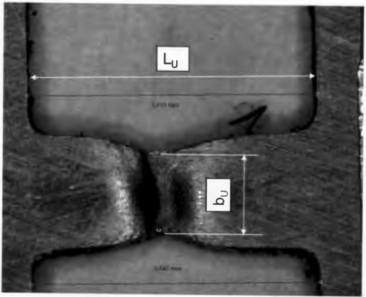

## Weld Investigation

The  investigated  material  was  an  experimental  dissimilar  weld  consisting  of two chromium-molybdenum heat-resistant steels  and weld  metal.  This  type  of weld  is widely used in  the oil  and gas  industries and in  fossil  fuel  and nuclear power plants. A weld macro is depicted in Fig. 1 1.

Sample extraction out of the weld was  performed in  the direction  transverse to the  weld  axis.  A segment  was  extracted  and  grooved  with  a milling  cutter so  that the specimen gauge section was created in a single pass. This semi-product was sub­ sequently sliced  on  an  accurate  metallographic  saw  with  a  step  of 1 mm.  Samples were ground to  their final  thickness with a grinding machine. The specimen orien­ tation  was  in  the  thickness  direction.  One specimen  per  location  and  loading  rate was tested.

The  investigation  was  performed across  all  weld  zones:  basic  material  1 (BM1),  heat-affected zone  1 (HAZ  1), weld  metal  (WM), heat-affected zone 2 (HAZ 2), and basic material 2 (BM-2). Prior to tests, gauge length dimensions were measured and  recorded.  All  tests  were  performed  under  quasi-static  loading  conditions  in agreement with standard requirements. The results are summarized in Fig. 12. Hard­ ness values  also are shown for comparison, as  this is  a traditional measure used for property characterization across a weld.  There is  good  agreement in  trends among all  evaluated  quantities.  The  M-TT  proved  sensitive  to local  property changes  and provided  significantly  more  information  about  material  behavior  such  as  elonga­ tion, CSR, and strain hardening than hardness tests or SPTs.

vi C Q) E · c; Q) 0. V, II-± "O C &lt;U 1:' &lt;U "O C 19 V, .2 ~ :i V, ~ t,; 2 .!!! · ;;; C 2 0 C .Q "' .!::! ro E E :J Vl N w -' co ~

|                  |                                                     | ,-.... N N ~ U)(.C),o::f"MU)   | N                       | OCOO"I t.ri                     | r-ri             | ~                   |                          | ~                        | ~               | 00~'"'2°L.f"I~ ~       | :=                       | r-- ~ r--                  | Vl ci r--       |
|------------------|-----------------------------------------------------|--------------------------------|-------------------------|---------------------------------|------------------|---------------------|--------------------------|--------------------------|-----------------|------------------------|--------------------------|----------------------------|-----------------|
| "ii'- ~ <(       | "' ": "" N                                          | 0 -<i                          | r-- ~ "' Vl             |                                 | CJ> LO           | 0 o:i               | C> r--                   | "" cri                   | Vl cri          | "' r--                 | <D LO                    | "" ;Q                      | ..,. -<i        |
| "' Q. ::E: e Q:  | C> "1 co Vl Vl Vl ~ ~                               | "' [ii ;2                      | a> \0 ;2                | ~ <D CJ>                        | N al CJ>         | "" "' <D r--        | N cri <D r--             | N '° CJ> <D              | ..,. ci ,::::   | "" cri 0 ""            | C> ;;;                   | 0 ci <D N                  | Vl -<i Vl N     |
| ~ ::E: J         | ..,. C> ,,; "" ~ 2                                  | ; <D CJ>                       | ci CJ> CJ>              | U"! "" oi                       | "" N CJ> co      | "' N <D             | "1 N CJ> Vl              | r-- ci ..,. Vl           | CJ> ci N Vl     | ..,. -<i <D N          | -: ..,. <D N             | "' ..,. "" N               | r-- LO "" N     |
| "' Q. Cl "'      | ..,. ~ cri "" 0 0 N N                               | ~ 0 N                          | ": "" r:;               | <D ~                            | N ~              | "" o:i r:;          | r-- o:i N N              | <D cri 0 N               | r-- '° ;;:      | o:i <D                 | r-- ci <D                | r-- g                      | ": r-- CJ>      |
| E E 0 .Q         | Vl ":                                               | [ii ~                          | r-- ~                   |                                 | "" ..,.          |                     | Vl ~                     |                          | CJ> ":          | <D CJ> -<i             | r-- U"!                  |                            | co ~            |
| E E 0 ..         | 0 Vl ci                                             | 0 0 "'                         | r-- <D ci               |                                 | Vl Vl ci         |                     | co Vl ci                 |                          | Vl Vl ci        | Vl ..,. "'             | r-- ..,. ci              |                            | <D Vl ci        |
| E E J            | ..,. co -<i                                         | 0 0 ci ""                      | CJ> CJ> ,-..:           |                                 |                  | co co cri           |                          | 5 LO                     |                 |                        |                          | N 0 -<i                    |                 |
| C: ., E · o ~ V, | 1:' "' I- -0 I- C ± "' V, I V, I u V, ....J u ....J | 1:' "' -0 C "' V, I w Q) V,    | I- >-;- L I w V, Q) V,  | "O ro I- -0 I- C ± "' I ;:: ;:: | LJ.. I- V, 0 I u | 1:' "' -0 C "' Vll  | I- I- ± I LJ.. I- V, 0 u | 1:' "' "O C "' Vll oi a. | I- I- ± I oi a. | 1:' "' -0 C "' Vll <i' | I- I- ± <i' I            | 1:' "' -0 C "' t,; I ::, u | I- I- ± I ::, u |
| ;;; · .: ~ ::E:  | 2 C C 0 QI .0 E ro ·~ u C. J: X LJ.J .2             | ~ Vl u ;:', w 2 V> V, u ....J  | ~ 2 C QI E Cl QI .!'.!, | Vl l5 E ::, · 1: 2 ;::          |                  | .n z > 0 L u ..,. x | 6 z                      | oi a.                    |                 | E ::, C E ::, <i'      | ?; <{ z LJ.J >, ..Q -;;; | <D ~ I- Vl 0 0 0 <D u      | * &~ CJ> CJ>    |

FIG. 11 Macro of the investigated heterogeneous weld.

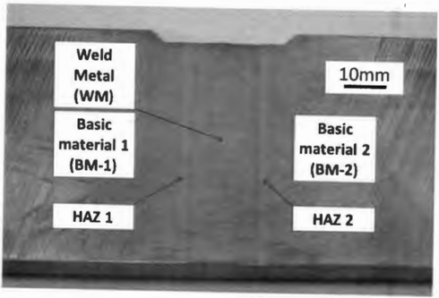

## Strain  Rate Sensitivity Measurement

Another application  that  is  going  to  demonstrate  the capabilities  of the  developed testing  procedure  is  testing  to  assess  the  strain  rate  sensitivity of materials. As  an experimental  material,  the  same  kind  of weld  was used  with  similar sampling and sample  preparation procedures. Specimen  sampling  is shown  in Fig  . 13. We extracted four blocks in order to  provide samples for different strain rates from  the same locations with  regard  to  the  weld.  In  this  case  nine  different  locations  across the weld  were  investigated. One specimen per location and loading rate was  tested. The sampling orientation was in the plate length direction in this case.

Tests  were  carried  out  at  room  temperature  at  four  different  loading  velocities, resulting  in  the  following  initial  strain  rates:  0.003,  0.3,  3,  and  33 s1 . Testing  strain rates  are  designated  in  graphs as  1 to  4,  where  1 means  the slowest and 4  the  fastest. The testing setup can be seen in Fig. 14. Examples of  the resulting curves are depicted in Fig. 1 5. As  could be expected, we  found an  increase in strength properties from  the base metal  toward  the  weld.  Because  of the  high  gradient  of the  property changes  in  the transition  from  the base metal across  the heat-affected zone to  the weld and multi-pass welding technology, some property scatter can be expected. Because of these facts, sampiing  is  crucial,  as  a  small  deviation  in  specimen  positioning  can  reveal  a  different microstructure. Nevertheless, the obtained results yielded reasonable trends.

Strain  rate sensitivity evaluation  is  shown in  Fig. 16. Parallel  increasing trends were found  for  both yield  stress and tensile strength.  For both sampling locations, there was slight deviation from  common trends in  the values  for a strain rate of  3 s1 .  This might have  been  due  to  small  deviation  from  the  expected  sampling location.  Nevertheless, very good results were attained in this case with  the use of  M-ITs. Considering the fact that there was just one sample per location and condition, it is  clear that the developed testing procedure provides reliable results.

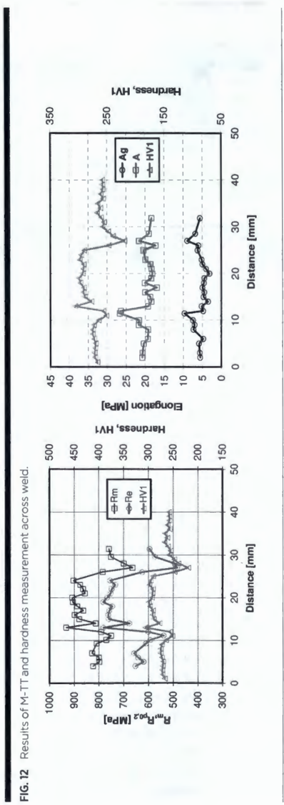

FIG. 13 Sampling scheme for strain rate sensitivity tests. Gray lines depict the weld, and black lines represent sampling locations.

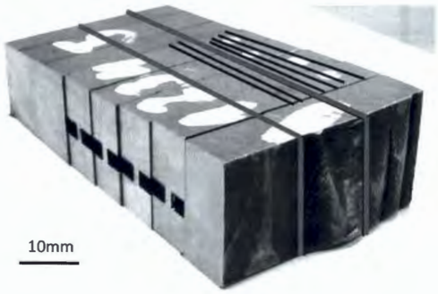

## Discussion

Complete development of the  M-TT technique  is summarized  in  this paper,  from the specimen  geometry  proposal  to  the  testing  fixture design and  strain  measure­ ment  possibilities  through  the  CSR  and  elongation  determination.  The  proposed procedure allows determination of all standard parameters on small-size samples.

FIG.14 Testing setup for dynamic M-TT with DIC strain measurement.

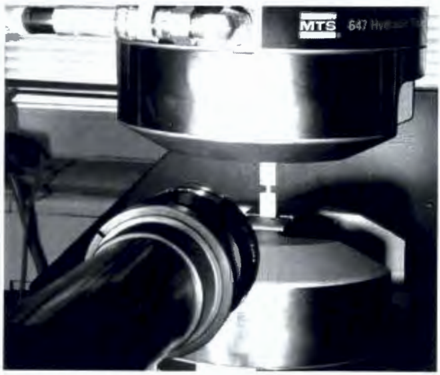

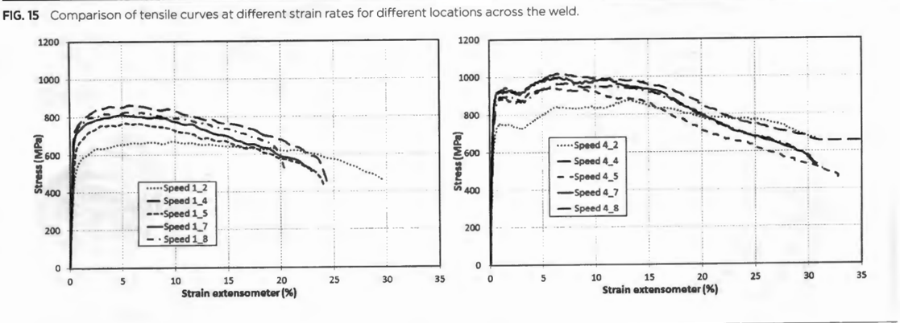

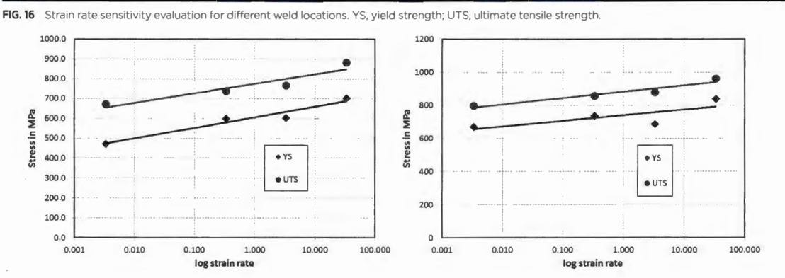

The first  issue  concerning testing was  the strain measurement. At the  first  stage, a  mechanical extensometer for  more accurate crosshead displacement measurement was  employed. The results confirmed the applicability of the proposed measurement technique  with  the  use  of the  M-TT.  In  the  second  step,  a  videoextensometer  was used. The  results  were  already  providing very  good agreement with standard tensile curves.  However,  because  of the  small  size  of the  sample,  markings  of the  gauge length  were  rather  inconveniently  big  relative  to  the  specimen  size.  In  the  end, shoulder edges  were  used  as  a gauge  length  mark.  When  this  kind  of measurement was  used, deformation of the transition region between the gauge length and should­ ers  was  included  in  the  strain  measurement,  which  can  result  in  some  inaccurate results. Therefore, a DIC system was used in the final stage of the strain measurement procedure  search.  In  the  case  of DIC,  local  strains  can  be  evaluated  including  true stress-true  strain  measurements.  DIC  systems  allow  the  user  to  define  the  gauge length; in  our case  the  selected value was  within  the specimen gauge  length.  M-TTs with  the  use  of DIC  for  the  strain  measurement were  executed  for  a wide  range  of materials:  copper alloy,  aluminum  alloy,  titanium  Gr. 5,  and  several  different  steels. The results obtained for standard-size samples and M-TT samples exhibited excellent agreement for both considered strength parameters, yield stress and tensile strength.

The next stage for  the M-TT development was procedures for measurement for elongation and CR determination.  Determination of these values  was  not possible with  a standard  micrometer or warier caliper;  instead  optical  measurement with  a microscope  had  to  be  carried  out.  In  the  case  of the  CSR,  three  methods  of area evaluation  were  investigated.  The  first  one  was  simple  measurement  of the  neck minimum dimensions. The second one was  measurement of the  real  cross-section area via digital  image processing. The last one was  fitting  a circle into  the  neck sil­ houette on the basis of the minimal width measurement and minimal and maximal thickness.  These  three  values  of the  CSR  were  subsequently compared with  values obtained for  standard round specimens.  Based on this  comparison, the best agree­ ment was obtained with the simple method using just minimal neck dimensions.

Concerning  the  elongation,  the  main  problem  is  the  accuracy  of any  kind  of gauge length marking taking into account the 2.6-mm-long gauge length. Mechani­ cal marking or paint marking was disregarded because of problems with application and subsequent gauge length  measurement. The parallel distance between shoulder edges was  used for  the elongation evaluation. Elongation values determined via  this kind of measurement exhibited fair agreement with standard sample results.

The developed testing procedure was subsequently applied to  the evaluation of local properties across the weld and the determination of dynamic tensile behavior. Both of these  examples  show the  potential of the  developed  method.  The method developed here allows  reliable  tensile  property determination  with  the  use  of sam­ ples  using  the  same  material  volume  as used  for  SPT  samples.  However,  the reported  values  obtained  in  M-TTs  are  significantly higher,  as  no  correlations  are applied and complete stress-strain curves are available from  these  measurements as in  the  case  of standard  tests.  The M-TT  method allows  the determination  of local properties  and  property evolution  over some  component  region  and a determina­ tion of anisotropy, and the results shown here also point out the applicability of the method for dynamic material property determination.

However, when the method proposed here is  to be applied, attention should be paid  to  the  size  effect  when  testing  coarse-grained  materials. In  order for  realistic results  to  be  obtained,  the  specimen  must contain  several  hundreds  of grains  over its  cross-section,  as  was  found,  for  example,  in  Refs  6 and  7.  Significantly smaller specimens than discussed in  this work also can be  used for  tensile testing in appro­ priate applications, as  mentioned in,  for example, Refs 8-10.

## Conclusions

The  development  of a  micro-tensile  test  (M-TT)  is  shown  here.  A  small  tensile specimen size is  proposed here on the basis of the small punch test (SPT)  specimen dimensions.  The  testing  procedure  for  M-TTs  is  demonstrated  here.  The  strain measurement is  recommended by a digital  image correlation (DIC)  system, and an approach for  the elongation and the cross-section reduction (CSR)  is also proposed. The proposed procedure allows the determination of  all typical tensile test measures for  standard-size samples with  the use  of micro-samples.  Tests were carried out on several materials with a wide range of tensile properties, namely, Al-alloy, Ni-alloy, Titanium Gr.  5,  and several  steels.  We  found  excellent agreement  for  all  materials investigated  between  standard-size  specimens  and  M-TT specimens  for  the  whole range of  strength levels  from about 250 MPa up to  1250 MPa.

The M-TT performance is demonstrated on the evaluation  of local  properties across dissimilar welds. Trends of all  evaluated parameters followed  trends of hard­ ness  measurement  but  provided  much  more  complex  information  about  material behavior  than  hardness  tests.  The  M-TT  was  also  utilized  for  material  property evaluation under dynamic loading conditions. Realistic strain  rate hardening curves were  attained.  This  creates  the  potential  for  dynamic  property measurements with the  use  of "slower testing systems," as  a strain  rate of about 100 s1 can be reached with  M-TT samples on a testing system  with  a velocity of about 300 mm/s. This  is significantly  different  from  standard-size  samples,  for  which  a  loading  velocity  of about  5 mis would  be  required.  Next  to  the  use  of less  expensive  testing  systems, slower loading velocities  also  diminish  the  problem of oscillations  in  the  course of the dynamic tests.

A  new  testing  procedure  for  small-size  tensile  samples  was  proposed.  The method allows direct determination of standard tensile test values without any kind of correlation.  It  allows  the  determination  of local  properties  such  as  anisotropy and strain rate sensitivity. There is  a wide  range of potential applications for  the M­ TT method, from  evaluation of residual service life  to local  property determination as  input data for  FEM simulations. Verification of the influence of grain size on the results  has  to  be  performed, and validity limits  have  to  be established. Thus further work on this method is expected in the near future.

## ACKNOWLEDGMENTS

This  work  was  done  within  the  work  on  the  project  "Creation  of an  International Team of Scientists and Participation in Scientific Networks in the Sphere of Nanotech­ nology  and  Unconventional  Forming  Material"  (CZ.l.07/2.3.00/20.0038),  sponsored by the European Social Fund and the national budget of the Czech Republic.

## References

- [1] Konopik,  P . and  Dzugan,  J., "Determination  of Tensile  Properties  of Low  Carbon  Steel and Alloyed Steel  34CrNiMo6 by Small Punch Test and Micro-Tensile Test," 2nd Interna­ tional  Conference SSTT,  Ostrava,  Czech  Republic,  Oct  2-4,  Material  and  Metallurgical Reseach, Ltd.,  Ostrava, Czech Republic, 2012,  pp. 319-328.
- [2] Konopik, P . and Dzugan, J., "Determination of Fracture Toughness and Tensile Properties of  Structural  Steels  by  Small  Punch  Test  and  Micro-Tensile  Test," Proceedings  of the 22nd International Conference on Metallurgy and Materials, Brno,  Czech  Republic,  May lS-17, Tanger Ltd., Slezska Ostrava, Czech Republic, 2013.
- [3] Konopik, P .,  Dzugan, J., and  Prochazka, R.,  "Evaluation of Local Mechanical Properties of Steel  Weld  by  Miniature Testing  Technique," MS&amp;T '13: Materials Science &amp; Technology 2013 Conference &amp; Exhibition, Montreal, QC,  Canada,  Oct. 27-31,  The  Minerals,  Metals &amp; Materials Society (TMS), Warrendale, PA, 2013.
4. [  4] Prochazka,  R.,  2013,  "Determination of Mechanical  Properties of Structural  Materials by Using Miniature Specimen Test Techniques," M.Sc. thesis, West Bohemian University, Pil­ sen, Czech Republic.
5. [SJ Konopik,  P.,  2013,  "Mechanical  Properties  Results  Compatibility  for  Structural  Steels," Ph.D. thesis, West Bohemian University, Pilsen, Czech Republic.
- [6] Mark  Henning,  M. and  Vehoff, H.,  "Statistical  Size  Effects Based  on  Grain  Size  and  Tex­ ture in Thin Sheets," Mater. Sci. Eng.  A, Vol.  452-453, 2007, pp. 602-613.
- [7] Poling,  W.  A., 2012,  "Grain  Size  Effects  in  Micro-Tensile  Testing  of Austenitic  Stainless Steel," M.Sc. thesis, Colorado School of Mines, Golden, CO.
- [8] Zhang,  D. and  Chu,  J., "Mechanical  Characterization  of  Post-buckled  Micro-bridge Beams by Micro-tensile testing," Microsyst.  Technol., Vol. 16, No. 3,  2010, pp. 375-380.
- [9] Auhorn, M.,  Kasanicka,  B.,  Beck, T., Schulze, V., and  Lohe,  D.,  "Mechanical  Strength and Microstructure of Stabilor-G and  Zr02 Microspecimens," Microsyst.  Technol., Vol.  12, No. 7, 2006, pp. 713-716.
- [10] llzhofer, A.,  Schneider,  H., and  Tsakmakis,  C.,  "Tensile Testing Device for Microstructured Specimens," Microsyst. Technol., Vol. 4, No. 1 , 1997, pp. 46-50.

STP 1576, 2015 / available online at www.astm.org I doi: 10. 7520/ STP157620740073

Maxim N. Gussev, 1 Jeremy T.  Busby, 1 Kevin G. Field, 1 Mikhail A.  Sokolov, 1 and Sean E. Gray 2

## Role of Scale Factor During Tensile Testing of Small Specimens

## Reference

Gussev, Maxim  N.,  Busby, Jeremy  T.,  Field, Kevin  G., Sokolov,  Mikhail  A., and  Gray, Sean  E., "Role  of  Scale  Factor  During  Tensile  Testing  of  Small  Specimens," Small  Specimen  Test Techniques:  6th  Volume, STP  1576,  Mikhail  A.  Sokolov  and  Enrico  Lucan,  Eds.,  pp.  31-49, doi:10.1520/ STP157620140013, ASTM International, West Conshohocken, PA 2015. 3

## ABSTRACT

The  influence  of  scale  factor  (tensile  specimen  geometry  and  dimensions)  on mechanical test results  was  investigated for different widely used types of small specimens (SS-1, SS-2,  SS-3, and SS-J3) and a set of materials. It was found that the  effect of scale  factor on  the accurate  determination of yield  stress,  ultimate tensile stress, and uniform elongation values was weak; however, clear systematic  differences  were  observed  and  should  be  accounted  for  during interpretation of  results. In contrast, total elongation  values were  strongly sensitive to variations in  specimen geometry. Modern experimental methods like digital  image  correlation  allow  the  impact of scale  factor  to  be  reduced. Using these  techniques,  it  was  shown  that  true  stress-true  strain  curves  describing strain-hardening  behavior  were  very  close  for  different  specimen  types.  The limits of miniaturization are  discussed, and  an  ultra-miniature specimen concept was  suggested  and  evaluated.  This  type  of  specimen,  as  expected,  may  be suitable for scanning  electron  microscopy and transmission  electron  microscopy in situ testing.

Manuscript received February 7. 2014; accepted for publication May 13, 2014; published online August 29, 2014.

'Oak Ridge National Laboratory, Oak Ridge, TN, 39831, United States of America.

2 The Univ. of Michigan, Ann Arbor, Ml, 481 09, United States of America.

3 ASTM Sixth International Symposium on Small Speomen Test Techniques on January 29-31, 2014 in Houston, TX.