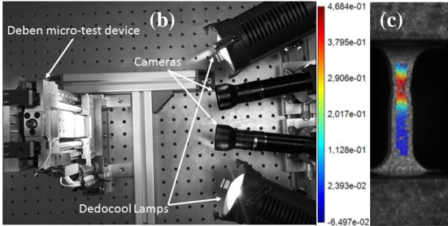
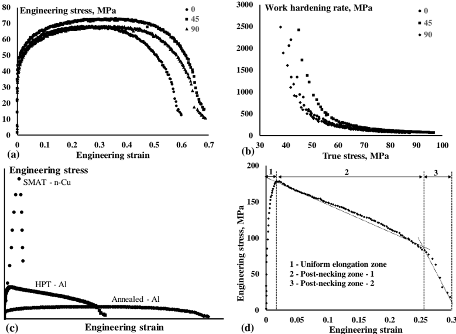
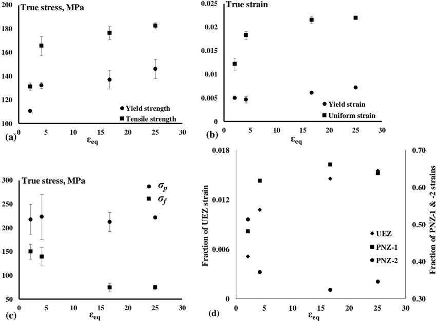
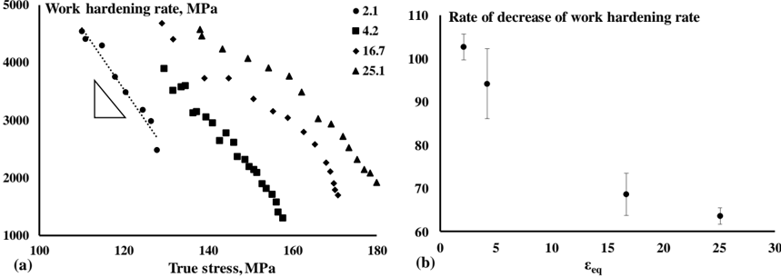

## PAPER · OPEN ACCESS

## Miniature tensile testing of SPD processed fine-grained aluminum

To cite this article: Harishchandra A Lanjewar et al 2019 J. Phys.: Conf. Ser. 1270 012022

View the article online for updates and enhancements.

## Miniature tensile testing of SPD processed fine-grained aluminum

## Harishchandra A Lanjewar 1,* , Soroosh Naghdy 1,2 , Leo A I Kestens 1,3 and Patricia Verleysen 1

1 Department of Electrical Energy, Metals, Mechanical Construction and Systems (EEMMeCS), Ghent University, Ghent, Belgium

2 Process models, ArcelorMittal, Ghent, Belgium

3 Department of Materials Science and Engineering, Delft University of Technology, Delft, The Netherlands

*E-mail: harishchandra.lanjewar@ugent.be

Abstract .  Manufacturing  of  ultrafine-grained  (UFG)  or  nanocrystalline  (NC)  metals  via  a single step top-down approach imposing severe plastic deformation (SPD) is one of the most promising ways to achieve superior properties such as high strength and superplastic forming capability. Nonetheless, the lack of relevant data on their post-SPD performance in different test  environments  makes  it  difficult  to  fully  understand  their  mechanical  behavior.  While characterizing  the  tensile  behavior,  almost  all  of  the  previous  reports  are  limited  to  the discussion  on  the  plastic  performance  of  the  material  in  terms  of  elongation  to  failure  and corresponding strength, with only a few studies discussing the effect of grain fragmentation on work  hardening  response  of  the  material.  In  the  present  work,  a  comprehensive  analysis  is presented  in  terms  of  the  uniform  and  post-necking  mechanical  behavior  of  the  ultrafinegrained  material.  Commercially  pure  aluminum  is  subjected  to  high  pressure  torsion  (HPT) deformation with strains ranging from very low levels (γ ≈ 2.1) to values well in the saturation regime (γ ≈ 25.1). When tested in uniaxial tension, the strength increases monotonously. The uniform  elongation  improves  with  the  imposed  HPT  strain,  though  remains  lower  than  the value of the initial material. Based on the slopes of the stress-strain curve, three distinct zones are identified, i.e. uniform deformation, post-necking-1, and post-necking-2. With accumulating  SPD  deformation,  the  material  shows  enhanced  pre-necking  strength  and ductility; while post-necking material fails early and at lower strength levels. The post-necking response is observed to be highly microstructure dependent: a lower grain size augments the resistance for micro-crack propagation and thus the ductility, however, once initiated, a crack propagates much faster in fine-grained than in coarse-grained HPT processed material.

## 1.  Introduction

Fabrication  of  ultrafine-grained  (UFG)  or  nanocrystalline  (NC)  metals  via  single  step  top-down approaches imposing severe plastic deformation (SPD) is one of the most promising ways to achieve superior properties  such  as  high  strength  and  superplastic  forming  capability  [1].  Over  the  last two decades,  many  studies  have  been  conducted  on  a  variety  of  metals.  Three  methods,  namely  equal channel angular pressing (ECAP) [2], accumulative roll bonding (ARB) [3] and high pressure torsion (HPT)  [4]  have  emerged  as  the  most  potent  tools  to  generate  refined  structures.  ECAP  and  ARB

IOP Conf. Series: Journal of Physics: Conf. Series 1270 (2019) 012022 doi:10.1088/1742-6596/1270/1/012022

requires  multiple  passes  to  impose  large  plastic  strains  on  the  material,  contrary  to  HPT  where  a significant amount of strain can be imposed on a disk-shaped sample in one single operation. Thus produced  nanostructured  (NS)/ultrafine-grained  (UFG)  metals,  quite  independent  of  the  processing route, when  tested in tension after pre-straining in simple shear mode,  show  extraordinary enhancements in strength but suffer from poor ductility [5]. However, with continued shear straining the uniform deformation improves to some extent and has been associated with the smaller size of the nucleating flaws during plastic instability [6]. In the case of ECAP Cu, increased rate sensitivity owing to  refined  grain  size  has  been  considered  another  contributing  factor  to  improved  ductility  [7]. Methods to improve upon the combination of strength-ductility property have been proposed by either engineering a multi-component  structure or post-SPD  treatments [8]. In post-SPD  annealing treatments,  work  hardening  capacity  of  the  material  was  seen  to  improve  in  conjunction  with  the reduction  in  overall  dislocation  density  [9].  During  such  annealing  treatments,  non-equilibrium boundaries  which  are  known  to  be  present  in  large  proportions  in  SPD  material,  convert  into boundaries  of  equilibrium  nature,  i.e.  with  lowered  geometrically  necessary  dislocation  density  and thereby enhanced ability to store the deformation [10].

In present work, the mechanical behavior of UFG metal is studied using uniaxial tensile testing of miniature dog-bone shaped specimen extracted from HPT deformed commercially pure aluminum (CP Al). The HPT deformation includes very small strains as well as strains in the saturation regime so that a  continuous  progression  in  the  grain  structure  is  obtained  and  later  linked  to  their  plastic  flow properties  in  terms  of  elongation,  strength  and  work  hardening  behavior.  Based  on  the  uniform deformation and post-necking mechanical behavior, preliminary conclusions can be drawn about the potential failure conditions specific to the UFG metals.

## 2.  Material and methods

The  cast  block  material  of  CP  Al  (Al  -  99.6  wt%)  was  cold  rolled  to  a  thickness  of  1.3  mm  and annealed at 773 K for 30 s, producing an average grain size of 85 μ m. HPT was performed, using 15 mm disks punched out of the annealed sheet, at a nominal pressure of 2.5 GPa and different rotations of ¼, ½, 2 and 3, at a rotational speed of 1 rpm. The equivalent strain applied during HPT is calculated using relation [11]:

$$\varepsilon _ { e q } = \frac { r \varphi } { 3 ^ { 1 / 2 } h } \quad ( 1 ) \\ \intertext { v e r } \varepsilon _ { e q } = \frac { r \varphi } { 3 ^ { 1 / 2 } h } \quad ( 1 ) \\ \intertext { w h e r } \intertext { s u n d } \varepsilon _ { e q } ( t _ { e } - t _ { s } ) \sin ^ { 2 } v _ { e q } - 1 v _ { s } - 1 v _ { e } - 1 v _ { s } \sin ^ { 2 } v _ { e } + 1 v _ { s } - 1 v _ { e } - 1 v _ { s } \sin ^ { 2 } v _ { e } + A _ { s }$$

where r is the sample radius, ϕ is the rotation applied in rad and h is the sample initial thickness. As shown in figure 1 (a), two dog-bone shaped miniature tensile samples were extracted from each HPT processed disk using electrical discharge machining (EDM). The simple shear deformation geometry in terms of directions - radial ( r ), shear ( ɵ ) and shear plane normal ( z ) is also indicated.

(a)

R7.50

z

3

3

Figure  1. (a)  Tensile  sample  extraction  scheme  with  simple  shear  geometry,  (b)  tensile  test  and camera  setup  during  an  experiment  and  (c)  full-field  strain  map  using  3-dimensional  digital  image correlation (3D DIC).

ɵ

r

4

1 0.05

2.5

10

The HPT 𝜀𝑒𝑞 in  the center of the tensile samples was 2.1, 4.2, 16.7, and 25.1. In addition, annealed material was also tested along different orientations with respect to the rolling direction, i.e. 0 ° , 45 °, and 90 ° . A dual-screw Deben ®  micro-test device with 1 kN load cell was used and tests were performed at a strain rate of 0.0056 s -1 .  For  full-field  strain  mapping, 3D DIC a non-contact optical strain measurement technique was used. Here the tensile samples were spray painted with the speckle pattern (black dots over white background). Two high-resolution cameras captured the images of the deforming specimen during tension tests (figure 1 (b) and (c)). MacthID Grabber ®  was used to acquire the force and camera signals, while subsequent image correlations and calculations were performed using MatchID Stereo ® , both are the modules of the commercial DIC software package MatchID ® .

The microstructural characterization was carried out using electron backscatter diffraction (EBSD) in  a  scanning  electron  microscope  (SEM)  with  a  field  emission  gun  (FEG).  The  observations  were performed  on  the r -ɵ plane.  During  the  analysis  to  determine  the  average  grain  size  ( G S),  using OIM TM   software,  1 ° and  15 ° were  chosen  as  the  minimum  boundary  misorientation  and  high  angle boundary misorientation, respectively.

## 3.  Experimental results and discussion

The microstructure  experiences  refinement in GS with  the  accumulating  HPT  strain  and  reduces  to average  values  of  48,  18,  1.22,  and  1.42  μm  at 𝜀𝑒𝑞 of  2.8,  4.2,  16.7,  and  27.9,  respectively.  The engineering strain is obtained by calculating the extension between two horizontal lines marking the gage length of the specimen. The engineering stress-strain curves for annealed material along different orientations  are  shown  in  figure  2  (a).  Generally,  to  describe  the  stress-strain  behavior  in  metals Hollomon's power law can be used and in that case, the work hardening rate is given by:

Figure 2. Engineering stress-strain curves (a) and work hardening rates along different orientations (b) for annealed material. (c) Engineering stress-strain curves for nano-Cu ( n -Cu) from ref [12], annealed and HPT processed Al from present work and (d) partitioned engineering stress-strain curve for HPT Al.

IOP Conf. Series: Journal of Physics: Conf. Series 1270 (2019) 012022 doi:10.1088/1742-6596/1270/1/012022

$$\frac { d \sigma } { d \varepsilon } = n \frac { \sigma } { \varepsilon } \\ \dot { \omega } _ { \mu } \omega _ { \nu } = \hat { \omega } _ { \mu } + \hat { \omega } _ { \nu } + \hat { \omega } _ { \mu } + \hat { \omega } _ { \nu } + \hat { \omega } _ { \mu } + \hat { \omega } _ { \nu } + \hat { \omega } _ { \mu } + \hat { \omega } _ { \nu } + \hat { \omega } _ { \mu }$$

where n is the strain hardening exponent, σ is the true stress and ε is the true strain. In the annealed material a slight anisotropy can be observed in both (figure 2 (b)), stress-strain and work hardening response. The material shows stage III and IV of work hardening. In stage III a rapid decline in work hardening is manifested due to the balance between dislocation multiplication and local dislocation annihilation process [13]. On the other hand, in stage IV where the work hardening rate is constant, the microstructure breaks into localized bands leading to deformation concentration in such bands.

Various studies conducted to evaluate the tensile properties of NC/UFG metals have reported two types of mechanical behavior with regard to the post-necking elongation, as shown by n -Cu from ref [12]  and  HPT-Al  from  present  work,  in  figure  2  (c)  [8,  12].  Though  both  show  lower  uniform elongation  after  reaching  maximum  load, n -Cu  fails  soon  while  HPT  Al  shows  long  tail-like  postnecking elongation. As shown in figure 2 (d), the engineering stress-strain curve for HPT Al can be partitioned  into  three  distinct  zones:  (i)  uniform  deformation  zone  (UEZ),  (ii)  post-necking  zone-1 (PNZ-1),  and  (iii)  post-necking  zone-2  (PNZ-2).  The  PNZ-1  demarcates  the  diffuse  necking deformation, whereas PNZ-2 covers the localized elongation in a very narrow band preceding failure.

The true stress-strain  values for  both  the  homogeneous and post-necking tensile deformation for HPT Al are shown in figure 3. As can be seen, the stress-strain values corresponding to the yielding and maximum load conditions show continuous improvement with 𝜀𝑒𝑞 . The 0.2% offset yield strength which is ~42 MPa in annealed condition reaches a value of 146 MPa at 𝜀𝑒𝑞 of 25.1. Contrary to the conventional forming processes, here in HPT, uniform deformation increase with accumulating shear strain in the material. Unlike pre-necking stress-strain values, the true stress values corresponding to the end of PNZ-1( σ p ) and PNZ-2( σ f ), either stay constant or decrease, respectively. To further compare the pre- and post-necking tensile behavior, the average true strain values are utilized to determine the strain fractions from each deformation zone as shown in figure 3 (d). The true strain corresponding to the end of PNZ-1 is obtained from the volume constancy using the width strain value from a local strain  field  correlation  near  the  fracture;  while  that  for  PNZ-2  is  obtained  from  topographic measurements  using  SEM.  From  figure  3  (d),  it  can  be  observed  that  both  UEZ  and  PNZ-1  strain fractions increase, while the strain fractions corresponding to PNZ-2 decrease with 𝜀𝑒𝑞 . Thus it can be concluded that with 𝜀𝑒𝑞 and refining GS , the pre-necking plastic performance improves, while postnecking plasticity deteriorates on account of the lower local ductility values.

Figure 3. True yield and tensile stress (a) and strain (b) values; true stress values corresponding to the end of PNZ-1 ( σ p ) and -2 ( σ f ) and (d) true strain fractions from each of the deformation zone.

Chan  reported  that  in  the  case  of  fine-grained  material,  the  stress  required  for  micro-crack nucleation is lower than that required for propagation and therefore additional plastic work is required for crack propagation [14]. In present work, much better ductility observed in PNZ-1 indicates its role in  providing  the  necessary  plastic  deformation  and  thereby  strain  hardening  to  locally  produce  the stress concentrations  favorable  for  micro-crack  propagation.  This  plastic  work  increases  with decreasing grain size indicating an important role played by the refining GS in delaying the fracture. However,  once  initiated  the  finer-grained  material  fractures  more  swiftly  than  their  coarse-grained counterparts.

The work hardening rates for HPT processed material are calculated  using  equation  (2)  and are plotted vs. true stress in figure 4 (a), while the linear slopes of the work hardening rates at different 𝜀𝑒𝑞 are shown in figure 4 (b). It can be seen that unlike annealed material which exhibits both stage III and IV work hardening, HPT processed material shows only stage III hardening. The work hardening in  severely  deformed  structures  becomes  difficult  due  to  the  presence  of  a  large  fraction  of  nonequilibrium boundaries which are known to possess enhanced diffusion properties [15]. In addition, dissociation  of  trapped  dislocations  at  non-equilibrium  boundaries  is  considered  as  one  of  the prevalent recovery mechanism in SPD processed materials [16-17]. However, from figure 4 (d) it can be  seen  that  the  work  hardening  ability  is  improving  with 𝜀𝑒𝑞 ,  which  seems  to  be  the  source  of enhancing uniform deformation in figure 3 (b).

Figure 4. (a) Work hardening rates calculated for HPT processed material plotted vs. true stress and (b) the slope of stage III work hardening vs. 𝜀𝑒𝑞 .

## 4.  Conclusions

From the above experimental results and discussion following conclusions can be drawn:

- 1)  The  rolled  and  recrystallized  material  shows  a  slight  anisotropy  in  its  stress-strain  and  work hardening response. The annealed material exhibits stage III and IV hardening, while HPT processed material owing to efficient recovery mechanisms possess only stage III hardening.
- 2) With 𝜀𝑒𝑞 , the pre-necking plastic properties show improvement, while the post-necking plastic performance deteriorates owing to reduced local ductility.

IOP Conf. Series: Journal of Physics: Conf. Series 1270 (2019) 012022 doi:10.1088/1742-6596/1270/1/012022

- 3)  Refining GS causes  the  plastic  work  required  for  micro-crack  propagation  to  increase  and thereby delays the fracture. However, once initiated the finer-grained material fractures rapidly.
- 4) The work hardening ability of SPD processed material improves with the accumulating shear deformation.

## Acknowledgements

The authors would like to acknowledge the Interuniversity Attraction Poles Program (IUAP) of the Federal Science Policy of Belgium and the partners of IUAP-VII-project P7/21 'Multiscale mechanics of  interface  dominated  materials'.  The  funding  sources  did  not  play  any  role  in  design,  collection, analysis and interpretation of the data, or in the writing of the report.

## References

- [1] Zhilyaev A P and Langdon T G 2008 Prog. Mater. Sci. 53 893-979
- [2] Valiev R Z and Langdon T G 2006 Progr. Mater. Sci. 51 881-981
- [3] Pirgazi H and Akbarzadeh A 2008 Int. J. Mod. Phys. B 22 2840-47
- [4] Naghdy S, Kestens L, Hertelé S and Verleysen P 2016 Mater. Charact. 120 285-94
- [5] Dalla Torre F H, Lapovok R, Sandlin J, Thomson P F, Davies C H J and Pereloma E V 2004 Acta Mater. 52 4819-32
- [6] Wang Y M, Ma E and Chen M W 2001 Appl. Phys. Lett. 80 2395-97
- [7] Valiev R Z 2003 Adv. Eng. Mater. 5 296-300
- [8] Ma E 2006 J. Miner. Met. Mater. Soc. 58 49-53
- [9] Stolyarov V V, Zhu Y T, Lowe T C and Valiev R Z 2001 Mater. Sci. Eng. A 303 82-9
- [10] Krasilnikov N, Lojkowski W, Pakiela Z and Valiev R 2005 Mater. Sci. Eng. A 397 330-7
- [11] Shrivastava S C, Jonas J J and Canova G 1982 J. Mech. Phys. Solids 30 75-90
- [12] Wang Y M, Wang K, Pan D, Lu K, Hemker K J and Ma E 2003 Scr. Mater. 48 1581-6
- [13] Verlinden  B,  Driver  J,  Samajdar  I  and  Doherty  R  D  2007 Thermo-mechanical processing of metallic materials (Oxford, UK: Elsevier Pergamon Materials Series)
- [14] Chan K S 1990 Scr. Metall. Mater. 24 1725-30
- [15] Valiev R Z, Kozlov E V, Ivanov Y F, Lian J, Nazarov A A and Baudelet B 1994 Acta Metall. Mater. 42 2467-75
- [16] Ko Y G, Shin D H, Park K -T and Lee C S 2006 Scr. Mater. 54 1785-9
- [17] Tucker G J and McDowell D L 2011 Int. J. Plast. 27 841-57