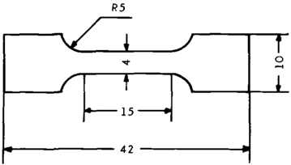
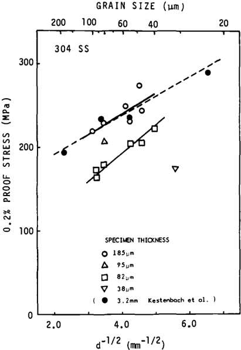
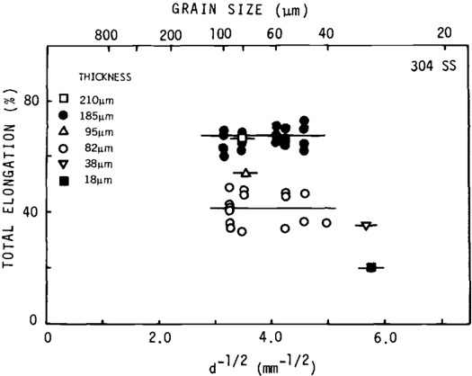
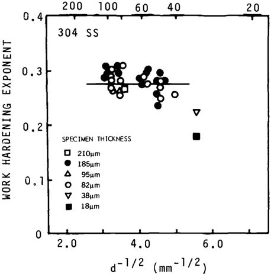
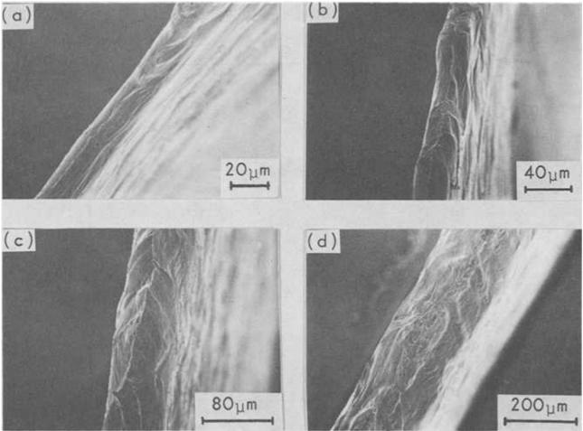
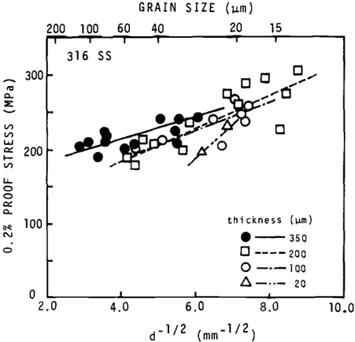
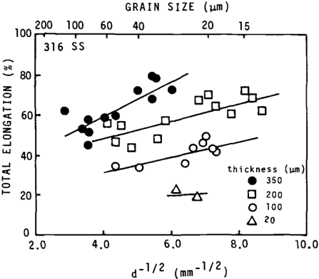
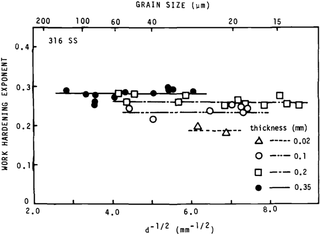
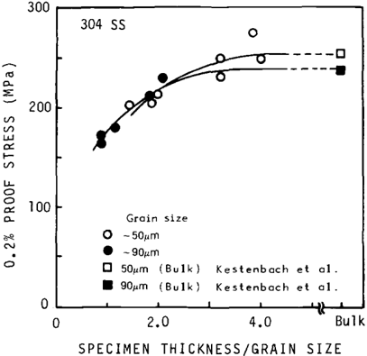
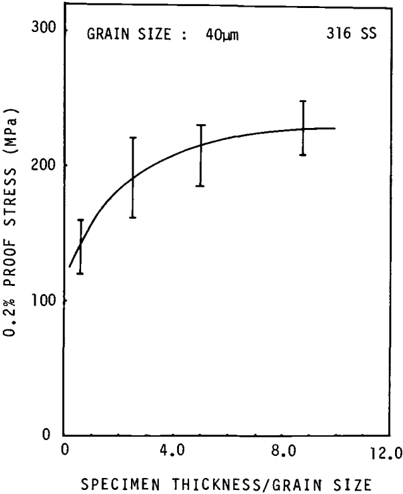

## ILL - DOCUMENT DELIVERY

## Copyright Warning

The copyright law of the United States (Title 17, United States Code) governs the making  of  photocopies  or  other  reproductions  of  copyrighted  material.  Under certain  conditions  specified  in  the  law,  libraries  and  archives  are  authorized  to furnish a photocopy or other reproduction. One of these specified conditions is that the photocopy or reproduction is not to be 'used for any purpose other than private study,  scholarship  or  research.'  If  a  user  makes  a  request  for,  or  later  uses,  a photocopy or reproduction for purposes in excess of 'fair use,' that user may be liable  for  copyright  infringement.  This  institution  reserves  the  right  to  refuse  to accept a copying order if, in its judgement, fulfillment of the order would involve violation of copyright law.

## I n t e r l i b r a r y   L o a n

915-747-5678

[l i b r a r y i l l @ u t e p . e d u](mailto:libraryill@utep.edu)

## Effects of Specimen Thickness and Grain Size on tiie  Meciianical Properties of Types 304 and 316 Austenitic  Stainless Steel

REFERENCE: Igata,  N.,  Miyahara,  K.,  Uda,  T.,  and  Asada,  S., "Effects of  Specimen Thickness and Grain Size on the Mechanical Properties of Types 304 and 316 Austenitic Stainless  Steel," The  Use  of  Small-Scale Specimens  for Testing  Irradiated Material. ASTMSTP888, W. R. Corwin and G. E. Lucas, Eds., American Society for Testing and Materials,  Philadelphia,  1986, pp.  161-170.

ABSTRACT: The mechanical properties of thin foil specimens of Types 304 and 316 aus­ tenitic stainless steels (thickness:  18 to 350 /xm) have been investigated  at room  tempera­ ture.  The  0.2%  proof  stress,  ultimate  tensile  strength,  work  hardening  exponent,  and total elongation generally decrease with decreasing specimen thickness at a constant grain size. The effect  of grain  size on the 0.2%  proof  stress of the 316 stainless steel is smaller than that of the 304 stainless steel. The fracture  mode of the specimens is ductile  fracture and  does not  depend  on the specimen  thickness.

KEY WORDS: Type 304 austenitic stainless steel. Type 316 austenitic stainless steel, thin foil  specimen,  mechanical  properties, 0.2%  proof  strength,  total elongation, work  hard­ ening exponent,  grain  size effect,  specimen  thickness effect,  Hall-Petch  relation

Recently,  many  investigations  of  mechanical  properties  of very small  size specimens [7-5], including the investigation of the relation between the prop­ erties  of  small  size  specimens  and  those  of  bulk  specimens,  have  been  per­ formed  from  the  viewpoint  of  the  development  of  fusion  reactor  materials. Especially in the case of irradiation  at RTNS-II,  HFIR, or light ion accelera­ tors,  very  sm.all  size  specimens  need  to  be  studied.  Thus  it  is important  to investigate the effects of specimen size and thickness on the mechanical prop­ erties.

In  the  present  work,  tensile  strength  properties  of  thin  foil  specimens of Types 304 and 316 stainless steels have been studied,  and the effects  of grain size and  specimen  thickness  on the tensile  strength  properties  have been  in­ vestigated.

'Department  of Materials  Science, University of Tokyo, Hongo,  Bunkyo-ku,  Tokyo,  Japan.

## Experimental  Procedures

The materials used in this work are commercial types 304 and 316 austenitic stainless steel foils (thickness:  18 to 350 /xm) supplied by Nippon  Kinzoku Company Ltd. Tension specimens were cut from  as-received foils by machin­ ing and  were not  deburred  by chemical- or electro-polishing.  Solution  treat­ ments were done at various temperatures from  1320 to 1575 K for 8 to 80 min in  an  argon  (purity:  99.99%)  atmosphere  of  about  8  X  lO-' Pa  in  order  to change  the  average  grain  size.  There  were  no  other  microstructural differ­ ences,  such  as  dislocation  density  or  the  precipitation  of  carbides,  between the specimens besides the differences  in grain size. The size and  shape of the tension test specimens are shown in Fig. 1. Chemical compositions of materi­ als were analyzed  after  the  solution  treatments.  Table  1 shows the results of the  chemical  analysis.  Mean  grain  sizes  were  measured  by the  usual  linear intercept method on the cross sections through the foil thickness. Grain struc­ ture was equiaxed. Tension tests were done at room temperature (strain rate: 4.5  X  10"'' s~')  using an Instron-type testing machine.  Special grip was not used to test the foil specimens. Total elongation was obtained by the measure- ment  of  the  change  of  the  distance between  two gage  marks  after  fracture. The gage marks were indicated by a thin felt pen. Fracture surfaces were ob­ served by a scanning electron  microscope.

FIG.  1Shape  and size of specimens (mm).

TABLE  1 Chemical  composition  (wt%)  of  materials.

| Material   | Thickness     |    C |   Si |   Mn |     P |     S |   Cu |    Ni |    Or |   Mo |      N |
|------------|---------------|------|------|------|-------|-------|------|-------|-------|------|--------|
| 304 SS     | 18 fim        | 0.05 | 0.51 | 1.09 | 0.030 | 0.002 | 0.06 |  8.91 | 18.33 | 0.06 | 0.1200 |
| 304 SS     | 38 fim        | 0.08 | 0.60 | 1.35 | 0.029 | 0.008 | 0.05 |  8.99 | 18.33 | 0.05 | 0.0370 |
| 304 SS     | 70 ^m         | 0.07 | 0.65 | 1.68 | 0.032 | 0.001 | 0.29 |  8.91 | 18.31 | 0.24 | 0.0097 |
| 304 SS     | 100 ftm       | 0.06 | 0.46 | 1.01 | 0.030 | 0.004 | 0.06 |  8.54 | 18.48 | 0.07 | 0.0547 |
| 304 SS     | 210 ;um       | 0.06 | 0.74 | 1.67 | 0.031 | 0.002 | 0.07 |  8.77 | 18.27 | 0.06 | 0.0648 |
| 316 SS     | 20 to 200 ixm | 0.05 | 0.60 | 1.06 | 0.031 | 0.005 | 0.28 | 10.41 | 16.86 | 2.23 | 0.0658 |
| 316 SS     | 350 (im       | 0.04 | 0.58 | 0.99 | 0.030 | 0.004 | 0.26 | 10.83 | 17.40 | 2.20 | 0.0220 |

## Experimental Results

SUS  304 Austenitic Stainless  Steels

Figure 2 shows the grain  size dependencies of 0.2%  proof  strength  at each specimen thickness. The data of Kestenbach  and Meyers [6] are  also shown in Fig. 2. Their tension test  specimens have a gage width of 4 mm,  length of 30 mm,  and thickness of 3.2 mm. The chemical compositions of their  mate­ rial  are  almost  the  same  as  those  used  in  the  present  work,  but  the  carbon content of their material (0.10 wt%) is a little larger than that of the  present work  (0.05 to  0.08  wt%).  According  to  Reed  and  Simon  [7],  however,  the contribution of carbon and nitrogen on the yield strength of 304 stainless steel are  185 MPa/at%  and 131 MPa/at%,  respectively.  Accordingly, the contri­ bution  of  carbon  in  Kestenbach  and Meyers'  material  on the 0.2% proof strength is in the same range as the contribution of carbon and nitrogen of the present work [80 ±  15 MPa (except the data for the 18 ftm thick specimen)]. Therefore  the data  of Kestenbach  and Meyers are considered  to be the ap­ proximate  strength  of bulk  304 austenitic  stainless  steel.  Figure 2 indicates that the deviation of the strength of the thinner specimen from the Hall-Fetch relation of bulk  material becomes  larger.

FIG. l-Grain size  dependence  of the  0.2%  proof  strength  of the 304 stainless  steel.

Figure 3 shows the relation  between grain  size and total  elongation of the specimen  at each  thickness.  Total  elongation  does not depend on the grain size but decreases with decreasing the specimen thickness. Figure 4 shows the relation between the work hardening exponent and the grain size of the speci­ men  at each  thickness.  The work  hardening  exponent  is obtained  from the true  stress true  strain  data  at nominal  strain  values of 0.2,  1.0, 2.0, 5.0,  10, 15, 20, 25, and so forth  up to ultimate  strain (%),  using the method of least squares. The basic equation is a = kt", where a is true stress, e is true  strain, k is constant,  and n is work  hardening  exponent.  Figure  4 indicates  that, except  for the very  thin  specimens,  the work  hardening  exponent  does not depend on the grain  size or specimen  thickness.

Figure  5 shows the fracture  surfaces  of 304  stainless  steel  foil  specimens observed by a scanning electron microscope. Fracture mode of all  specimens is ductile  fracture.

FIG.  3Relations  between total elongation and grain size  of  the  304 stainless steel.

## GRAIN SIZE (pm)

FIG. 4Relations  between  work hardening  exponent  and grain size of the 304 stainless  steel.

## SUS  316 Austenitic Stainless  Steel

Figure  6 shows  the  grain  size  dependencies  of  the  0.2%  proof  stress  for each  specimen  thickness.  Though  the  scattering  of  data  points  is large  and lines are not drawn by the method of least squares, it is recongnized that  the strength  of thinner  specimens generally becomes smaller  at a constant  aver­ age grain  size.

Figure  7 indicates  the  relation  between  grain  size and  total  elongation  of the specimens at each thickness. While the total elongation of the 304 stain­ less steels is not affected  by the grain size, that of the Type 316 stainless steel is influenced  by the grain  size, and  its grain  size dependency becomes  small with decreasing the specimen thickness. The total elongation of the 316 stain­ less steel decreases with decreasing the specimen thickness at a certain  grain size. This latter  behavior  is similar to that  of the 304 stainless  steel.

Figure 8 shows the effects of grain size and specimen thickness on the work hardening exponent. The work hardening exponents do not depend on grain size. The effects  of  specimen  thickness on the work  hardening  exponent  are generally  small  for  specimens  with  thicknesses  larger  than  about  100 /nm. This behavior  is similar to that  exhibited by the 304 steels as well.

FIG.  5Fracture  surfaces  of  the  304  stainless  steel foil  specimens  observed  by  a  scanning electron  microscope, (a) 18 jxm thick, (b) 35 nm  thick, (c) 70 p.m thick, (d) 210 iim thick.

FIG. 6Grain  size  dependence  of the  0.2%  proof  strength  of the 316 stainless  steel.

FIG.  7Relations  between  total  elongation  and grain size of the 316 stainless  steel.

FIG. 8Relations  between work hardening  exponent  and grain size of the 316 stainless  steel.

## Discussion

Miyazaki et al  [/]  have analyzed  the effects  of  specimen  thickness (t) and grain  size (d) on  the  flow  stress of thin  specimens.  They report  that the  flow stress  decreases  with  decreasing  specimen  thickness  when  the  value  of t/d becomes smaller than  a critical value. Figures 9 and  10 show the 0.2%  proof stress of the foil  specimens of the 304 and 316 stainless steels as functions  of t/d, respectively. The critical values of t/d of the 304 and 316 stainless steels are considered to be about 4 and 6, respectively.  Miyazaki et al [/]  and  Auer and  Sagues  [2]  have  also  reported  fairly  small  critical  values  of t/d (i.e., about 5 for  aluminum  and about 2 for Type 316 stainless steel, respectively).

On the other hand, the total elongation of bulk materials of the 304 [ 8] and 316 [ 9] stainless steels are reported to be more than  70 and 60%, respectively; therefore  the specimen thickness  must be larger than  about 200 fim in  order to get the total elongation of the thin specimen equal to that of the bulk mate­ rials,  according  to the  results  shown  in  Figs. 3 and  7.  In the  case  of the  316 stainless steel, however,  even if the specimen thickness  is larger than  200 /xm (or 350 /im), the total elongation  of the specimens with grain  size larger  than about 30 fim (or 60 ^m) is smaller than that of bulk material, as shown in Fig. 7.  Therefore  the  concept  of the  critical  value of t/d is considered  to be  also important  for  the  elongation.

The  effects  of  grain  size  and  specimen  thickness  on  the  work  hardening exponent  are  small  except  for  the  very thin  specimens  (20 to  40 ^m  thick). This is because the main factors that determine the work hardening exponent

FIG.  9Relations  between  the  0.2%  proof  strength and  the  value  of  specimen thickness (t)/grain size (d) at each grain  size  of  the 304 stainless  steel.

12.0

FIG.  10Relation  between  the  0.2%  proof  strength  and  the  value of specimen  thickness (t)/ grain  size (d) at a certain grain  size  (40 jim)  of  the 316 stainless  steel.

are  supposed  to be  the  elementary  processes  of  dislocation  motion,  such  as glide,  and  interactions between  dislocations or between  dislocations  and  ob­ stacles in the interior of grains. Accordingly,  it is considered to be reasonable that  the effects  of grain  size and  specimen  thickness on the work  hardening exponents are small. For the very thin  specimen (18 /um thick), however,  the work  hardening  exponent  is  small.  This  is believed  to  be  due  to  a  surface effect  such as an image force.  For instance, Miyazaki et al [/]  have observed that  the  dislocation  density  near  surface  of aluminum  crystal is reduced.

## Conchisions

1.  The 0.2%  proof  stresses of the 304 and 316 stainless  steels show grain size  dependence  and  specimen  thickness  dependence.  The  0.2% proof strength  of the  thin  specimens  deviates towards  low strength  from  the  HallPetch relation of the bulk material. However, when the value of t/d is larger than  the  critical  value,  the  0.2%  proof  stress  of the  thin  specimen  becomes equal to that  of the bulk  material.  In the present work, the critical values of t/d of the 304 and 316 stainless steels are about  4 and  6,  respectively.

2.  The  total  elongation  of  the  304  stainless  steel  has  no grain  size  depen­ dence, but that of the 316 stainless steel slightly depends on grain size at each specimen thickness. The total elongation of the 304 and 316 steels is strongly affected  by the  specimen  thickness  at  a constant grain  size. It  is a  necessary condition  that  the  specimen thickness be larger than  about  200 ^m  at  least, for the total elongation of the thin specimen to be equal to that of bulk  mate­ rial.
3.  The effects  of grain  size and  specimen  thickness on the work  hardening exponent are small. But, in the case of very thin specimens, the work  harden­ ing exponent  becomes small. This is considered  to be due to a surface  effect such  as the  reduction  of  dislocation  density by an  image  force.

## References

- [1] Miyazaki,  S.,  Shibata,  K.,  and  Fujita,  H., Acta  Metallurgica, Vol. 27,  1979, p. 855.
- [2]  Auer,  J.  and  Sagues,  A.  A.  in Proceedings. International  Conference  on  Radiation  Effects and Tritium Technology for Fusion  Reactors, J. S. Watson  and F. W. Wiffen,  Eds., Gatlinburg,  Tenn.,  1975, pp.  11-64.
3. \3] Panayotou,  N. F.,  Puigh,  R. J.,  and  Opperman,  E.  K., Journal  of Nuclear  Materials. Vol. 103 &amp;  104,  1981, p.  1523.
4. [4\ Jung,  P.,  Sagues,  A. A.,  Schroeder,  H.,  Auer,  H. J.,  and  Reiley,  T.  C , Journal  of  Nuclear Materials. Vol.  74,  1978, p. 348.
- [5]  Igata,  N.,  Miyahara,  K.,  Ohno,  K.,  and  Uda,  T.  in Proceedings. 3rd  Topical  Meeting on Fusion  Reactor  Materials,  Sept.  1983, Albuquerque,  N.M.,  forthcoming.
- [6]  Kestenbach,  H. J. and  Meyers, M. A., Metallurgical  Transactions. Vol. 7A,  1976, p. 1943.
- [7]  Reed,  R.  P.  and  Simon,  N.  ]., Advances  in  Cryogenic Engineering-Materials. Vol.  30, A.  F. Clark  and  R.  P.  Reed,  Eds.,  Plenum  Press, New York,  1984.
- [8]  High  Temperature  Strength  of Metals:  Vol.  2 -Stainless  Steels, Iron  and  Steel  Institute of Japan.  1975, p. 83.
- [9] NRIM  Creep Data Sheet. No.  15, National  Research  Institute  of  Metals,  Japan,  1974.