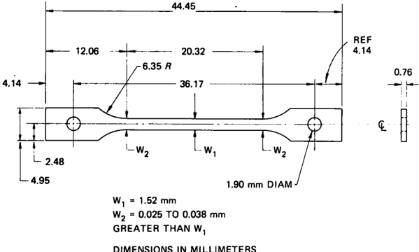
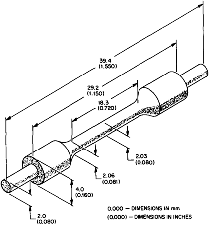
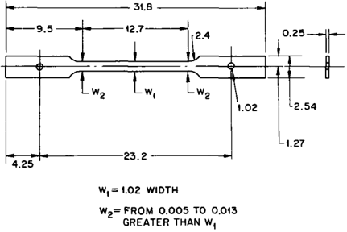
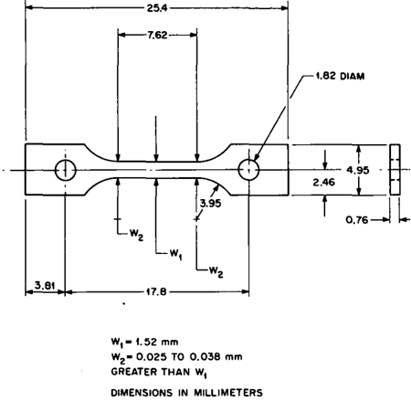
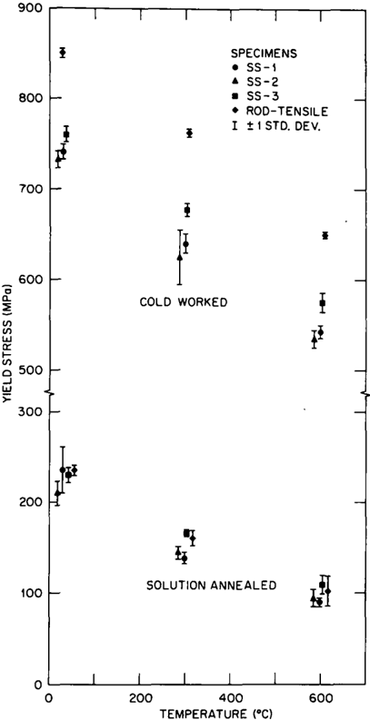
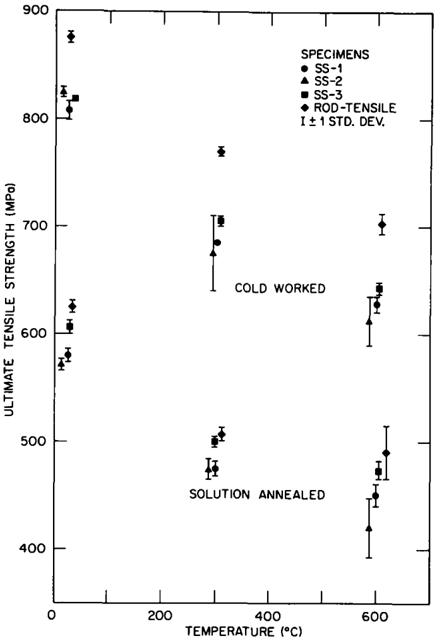
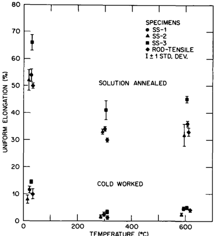
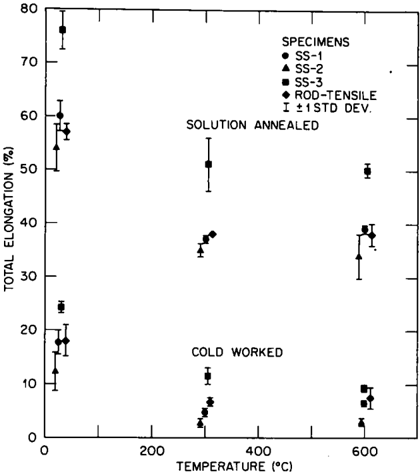
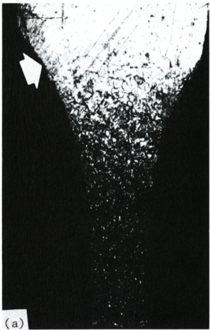
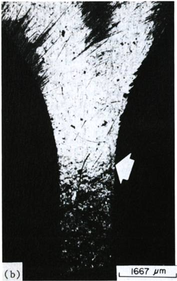

## MINIATURE TENSILE  TEST  SPECIMENS FOR  FUSION  REACTOR  IRRADIATION STUDIES *

## R.L.  KLUEH

Metals and Ceramics Division,  Oak Ridge National Laboratory, Oak Ridge,  TN 37831,  USA

Received 17 December 1984

Three  miniature  sheet-type  tensile  specimens  and  a  miniature  rod-tensile  specimen  are  being  used  in  irradiation-damage studies for  fusion  reactor  materials. Miniature  specimens  are  also  being  used  to  determine  design  properties  of  irradiated materials.  Consequently, a comparison of the tensile  properties determined with these different specimens was made by testing cold-worked  and  solution-annealed  Type  316  stainless  steel  sheet  and  rod  at  room  temperature,  300°C  and  600°C.  Good agreement was  observed when  the properties obtained  with  the different specimens were compared,  and  all of the specimens can be used  for irradiation-damage studies.  However, there were small differences in the properties obtained using the different specimens,  and  it was recommended that before any miniature specimens are used  to determine design-type properties,  further studies  be conducted.

## 1.  Introduction

Because  of  space  limitations  for  test  specimens  in most  nuclear  reactors  used  for  irradiating  materials  for mechanical  properties  testing,  specimen  miniaturization is  necessary:  Miniature  test  specimens  are  used  for  both alloy  development  studies  and  for  determining  design data  [1].

*  Research  sponsored  by  the  Office  of  Fusion  Energy,  US Department of Energy, under Contract No. DE-AC05840R21400  with  Martin  Marietta  Energy Systems,  Inc.

Many  of the tensile specimens irradiated in the United  States  Fusion  Reactor  Materials  program  have been  miniature  sheet  specimens  designated  SS-1;  this specimen  was  developed  in  the  Fast  Breeder  Reactor Program  for  irradiations  in  the  Experimental  Breeder

DIMENSIONS  IN  MILLIMETERS

Fig.  1.  The miniature SS-I sheet tensile  specimen.

0167-899x/85/$03.30 © Elsevier  Science  Publishers  B.V. ( N o r t h - H o l l a n d Physics  Publishing  Division)

Reactor-II (EBR-II) [2]. The SS.-1 has  an overall length of 44.5  mm and a reduced gage section 20.3 mm long by 1.52  mm wide by 0.76  mm  thick (fig.  1).  In addition, a rod-tensile  specimen  was  developed  for  elevated-temperature  irradiations in  the  High-Flux Isotope  Reactor (HFIR)  (fig.  2)  [3]. The  gage  section  is  18.3  mm  long and 2.03  mm in diameter. The spurs shown on  the end of  the  specimen (fig.  2)  have two purposes:  (1)  they are used  to  secure  the  specimens in  the  irradiation capsule and (2)  they  are  required to  ensure a  uniform temperature  distribution  along  the  gage  length  and  shoulders during irradiation.

To  further reduce  the  space occupied by an individual specimen and thus allow for the simultaneous irradiation  of  a  larger  number  of  specimens  or  to  use  for irradiation in an accelerator [4], an SS-2 sheet specimen was developed  (fig. 3). This specimen  is precision punched  from  0.25-ram-thick sheet  and  has  an  overall length of 31.8 mm with a gage section 12.7 mm long by 1.02 mm wide.  To date,  few data have been reported on this specimen.

The  Fast  Flux  Test  Facility  (FFTF)  has  recently come  into  use  for  materials  testing  for  fusion  reactor applications.  In  the  Materials  Open  Test  Assembly (MOTA)  in  use  in  FFTF  [5],  it  has  been  decided  to restrict the specimen length to 25.4 mm to maximize the

HFIR-CTR  TENSILE  SPECIMEN

Fig. 2. The miniature rod-tensile specimen.

DIMENSIONS  IN  MILLIMETERS

Fig. 3. The miniature SS-2 sheet tensile specimen.

utilization of available space. Therefore, a 25.4-mm-long variation of the  SS-1 sheet specimen was designed. This specimen, designated SS-3, is also machined from 0.76mm-thick sheet;  the  reduced  section length is 7.62  mm, and the width is 1.52 mm (fig. 4).

Still smaller rod  specimens have been developed  for irradiation  in the Rotating  Target  Neutron Source (RTNS-II)  and  for  future  use  in  the  Fusion  Materials Irradiation Test (FMIT) facility [6]. The gage sections of these  specimens were  chemically milled from 0.76-mmdiam wire.  The reduced section had  a  minimum diameter of 0.21  to 0.30 mm and a "plastic gage length" of 2.0

25.4

Fig. 4. The miniature SS-3  sheet tensile specimen.

to 4.0  mm  [6].  When  the  room-temperature  properties  of cold-worked  Type  316  stainless  steel  determined  using these  small  specimens  were  compared  to  average  properties from  the  literature, which  were  obtained using larger  specimens, reasonable agreement  was  obtained [6].  However,  no  comparison  tests  were  conducted in which  a  single  heat  of  material  was  tested  using  a  large specimen  and  the  miniature  specimen.

Although  the  various  miniature  specimens  discussed above  have  been developed and used over the past years,  to  date  no  comprehensive  experimental  comparison  using  the  different  specimens  on  a  single  heat  of material has been made. Such  a  comparison will  be discussed  here.  Tensile properties  have  been  determined using  the  four  miniature  specimens shown  in  figs.  1 to 4. Tests  were  made  on  a  single  heat  of  Type  316  stainless steel  in  two  different  conditions  at  three  test  temperatures.

## 2.  Experimental procedure

The objective of this study was to  compare the tensile  properties  obtained from  four  different tensile specimens  machined from  the  same  heat  of  material. The  four  specimen  types  tested  were  the  SS-1  (fig.  1), SS-2  (fig.  3),  SS-3  (fig.  4),  and  the  miniature  rod-tensile (fig.  2).

The  Type  316  stainless  steel  test  material  was  taken from  heat  X15893 (magnetic fusion  energy reference heat). Tests  were  made  on  the  steel  in  the  2070-coldworked  condition  and  the  solution-annealed  condition. The SS-1 and SS-3 specimens were machined from 0.76-mm-thick  sheet;  the  SS-2  specimens  were  punched from 0.25-mm-thick  sheet.  Prior  to  the  final  2070 reduction  by  rolling,  the  sheet  was  annealed  1  h  at  1050°C. Miniature rod-tensile  specimens  were  machined from 4.2-mm-diam rod, which was also annealed 1 h at 1050°C prior  to  the  final  reduction  in  area  by  swaging; the  rod  used  for these  tests  contained -  2370 cold work. The  solution-annealed  specimens  were  obtained  by  annealing  the  cold-worked  rod  or  sheet  specimens  1  h  at 1050°C.

The  grain  size  of  the  solution-annealed steels  was different  for  the different product  forms  from which  the specimens  were  obtained.  These  ASTM  grain  size numbers  (and average  grain  diameters)  were  estimated as follows:  grain  size No.  4  (90  ~m)  for  the 0.76-mm  sheet (SS-1  and  SS-3  specimens),  grain  size  No.  3  (125  /lm) for  the  0.25-mm  sheet  (SS-2  specimens),  and  grain  size No.  5  (65  /~m)  for  the  2.03-mm-diam  rod  (rod-tensile specimens).

All  four  types  of  specimens  were  tested  in  the  solution-annealed  and  cold-worked  condition.  Three of each type  of  specimen  in  each  condition  were  tested  at  room temperature,  300°C  and  600°C. Tensile  tests  were  conducted in a vacuum  chamber  on  a 120-kN-capacity Instron  closed-loop,  servo-hydraulic  materials  test  machine  using  a  crosshead  speed  of  0.0085  mm/s,  which resulted  in  different  nominal  strain  rates  for  the  different specimens  because  of  the  different  gage  lengths. (The  strain  rate  of  the  SS-3  was  about  2.5  times  that  for SS-1.)  However,  this  slight  difference  in  strain rate  at the  strain  rates  used  for  the  tests  was  not  expected  to have  a  significant  effect on  the  tensile  properties  [7].

## 3.  Results  and  discussion

The tensile results for the various specimens are given in tables  1 through  4.  In  figs. 5  through  8  the 0.270 yield  stress  (YS),  ultimate  tensile  strength  (UTS),  uniform  elongation,  and  total  elongation  ar  e  plotted  as  a function  of  temperature.  For  each  set  of  three  tests  (on a  given  type  of  specimen  at  a  given  temperature), the mean  value is plotted.  Bars  that  designate  plus  or  minus one  standard deviation  are  also  shown  for  each  mean value  of  the  three  tensile  tests  at  the  given  test  conditions.

Table 1 Tensile  properties  of  Type  316  strainless steel  with  SS-I  test specimens

| Test temperature   | Strength (MPa)    | Strength (MPa)    | Elongation (70)   | Elongation (70)   |
|--------------------|-------------------|-------------------|-------------------|-------------------|
| (°C)               | Yield             | Ultimate          | Uniform           | Total             |
| Solution annealed  | Solution annealed | Solution annealed |                   |                   |
| 23                 | 230               | 590               | 56                | 62                |
| 23                 | 264               | 590               | 53                | 58                |
| 23                 | 215               | 578               | 52                | 57                |
| 300                | 134               | 479               | 34                | 38                |
| 300                | 146               | 479               | 33                | 37                |
| 300                | 134               | 467               | 34                | 37                |
| 600                | 88                | 441               | 36                | 39                |
| 600                | 88                | 448               | 35                | 38                |
| 600                | 96                | 460               | 37                | 39                |
| 20%-cold-worked    | 20%-cold-worked   | 20%-cold-worked   | 20%-cold-worked   | 20%-cold-worked   |
| 23                 | 735               | 803               | 10.l              | 16                |
| 23                 | 748               | 817               | 12.0              | 17                |
| 23                 | 733               | 802               | 12.4              | 20                |
| 300                | 646               | 684               | 1.6               | 4.0               |
| 300                | 646               | 684               | 2.9               | 5.3               |
| 300                | 627               | 684               | 2.4               | 4.8               |
| 600                | 536               | 619               | 4.6               | 6.5               |
| 600                | 539               | 627               | 4.8               | 6.9               |
| 600                | 551               | 634               | 4.0               | 6.0               |

Table 2 Tensile  properties  of  Type  316  strainless steel  with  SS-2  test specimens

| Test temperature   | Strength (MPa)    | Strength (MPa)    | Elongation (%)    | Elongation (%)    |
|--------------------|-------------------|-------------------|-------------------|-------------------|
| (°C)               | Yield             | Ultimate          | Uniform           | Total             |
| Solution annealed  | Solution annealed | Solution annealed | Solution annealed | Solution annealed |
| 23                 | 207               | 577               | 55                | 57                |
| 23                 | 198               | 569               | 48                | 49                |
| 23                 | 224               | 569               | 54                | 56                |
| 300                | 138               | 465               | 33                | 34                |
| 300                | 141               | 477               | 34                | 36                |
| 300                | 152               | 481               | 32                | 34                |
| 600                | 95                | 440               | 35                | 37                |
| 600~!~             | 103               | 431               | 27                | 29                |
| 600                | 86                | 388               | 33                | 35                |
| 20 %-cold-worked   | 20 %-cold-worked  | 20 %-cold-worked  | 20 %-cold-worked  | 20 %-cold-worked  |
| 23                 | 733               | 819               | 9.8               | 16.0              |
| 23                 | 741               | 827               | 6.8               | 10.0              |
| 23                 | 724               | 827               | 7.8               | 10.6              |
| 300                | 655               | 707               | 1.0               | 2.0               |
| 300                | 595               | 681               | 1.9               | 3.2               |
| 300                | 621               | 638               | 1.6               | 2.8               |
| 600                | 534               | 595               | 1.6               | 2.4               |
| 600                | 543               | 638               | 2.8               | 2.9               |
| 600                | 526               | 603               | 2.5               | 3.3               |

Specimen size or type gives rise to several differences,  and the  differences  appear  to  depend  on  the property  being  measured. One  variant  that is  not directly  attributable  to  the  specimen  type  is  the  relatively higher YS  and UTS  of  the cold-worked rod-tensile specimens.  One  reason for this  difference  is  that the reduction  of  area  for  the  rod  was -23%,  compared  to -20% for the sheet material. However,  part of this large  difference  in  the  strength  of  the  cold-worked  rod and  sheet  may  arise  because  the  reductions  by  rolling and  swaging  are  not  directly  equivalent,  although  such equivalence  is  generally  assumed.

In addition to the increased strength of the rod specimens  in  the  cold-worked  condition,  the  UTS of  the rod specimens was also somewhat greater after the solution  anneal.  The  SS-3  specimens  generally  had  the highest  YS  and  UTS  of  the  sheet  specimens  in  both  the solution-annealed  and  cold-worked condition. There was relatively  little  difference  between  the  strengths  of  the SS-1  and  SS-2  specimens.

Table 3 Tensile  properties  of  Type  316  stainless steel  with  SS-3  test specimens

| Test temperature   | Strength (MPa)   | Strength (MPa)   | Elongation (%)   | Elongation (%)   |
|--------------------|------------------|------------------|------------------|------------------|
| (°C)               | Yield            | Ultimate         | Uniform          | Total            |
| Solution annea~d   | Solution annea~d | Solution annea~d | Solution annea~d | Solution annea~d |
| 23                 | 230              | 605              | 63               | 74               |
| 23                 | 237              | 613              | 67               | 74               |
| 23                 | 222              | 602              | 68               | 80               |
| 300                | 168              | 505              | 37               | 45               |
| 300                | 165              | 498              | 41               | 53               |
| 300                | 167              | 495              | 44               | 54               |
| 600                | 103              | 464              | 44               | 49               |
| 600                | 122              | 476              | 44               | 49               |
| 600                | 103              | 476              | 46               | 51               |
| 20 %-t~ld-worked   | 20 %-t~ld-worked | 20 %-t~ld-worked | 20 %-t~ld-worked | 20 %-t~ld-worked |
| 23                 | 766              | 816              | 14.0             | 24.3             |
| 23                 | 755              | 816              | 14.6             | 23.3             |
| 23                 | 761              | 818              | 14.6             | 25.0             |
| 300                | 682              | 712              | 4.0              | 13.0             |
| 300                | 680              | 706              | 3.3              | 11.7             |
| 300                | 669              | 696              | 3.0              | 10.0             |
| 600                | 563              | 639              | 5.0              | 9.7              |
| 600                | 579              | 640              | 4.7              | 9.0              |
| 600                | 585              | 650              | 4.7              | 9.3              |

Empirical  equations  have  been  developed  to  predict the  YS  and  UTS  of  solution-annealed  austenitic  stainless  steels,  and  both  YS  and  UTS  were  found  to  depend on  chemical  composition  [8].  The  YS  also  depended  on the  grain  size  through  the  Hall-Petch  relationship  with strength  proportional to d -1/2, where d is  the  grain diameter.  No  grain  size  effect  was  noted  for  the  UTS; instead,  it varied with t -1/2, where  t  is  the  twin  spacing [8].  Since  we  tested  only  a  single  composition,  the  only effect of microstructure on the different specimens should  involve grain  size and  twin  spacing.

As  stated  above,  there  is  little  difference  in  the  YS values  of  the  solution-annealed  specimens.  However,  if the  grain  size  determines  the  difference  in  yield  stress, the  SS-1  and  SS-3  specimens  should  have  similar values, and  the  rod-tensile  specimens  should  have  the  highest value.  No  such  systematic  difference  is  observed.  The UTS  values  for  the  solution-annealed  rod-tensile  specimens  are  always  the largest.  However,  the values for  the SS-3  specimens  are  always  greater than those  of  the SS-1  specimens,  even  through  they  have  the  same  twin spacing.  Althoug h grain size or twin spacing  should have no effect on the strength of the cold-worked material,  the  results  indicate  that  both  the  YS  and  UTS for  the  SS-3  specimens  are,  with  one  exception,  greater

Table 4 Tensile properties of  Type 316  stainless steel  with rod-tensile specimens

| Test temperature   | Strength (MPa)    | Strength (MPa)    | Elongation (55)   | Elongation (55)   |
|--------------------|-------------------|-------------------|-------------------|-------------------|
| (°C)               | Yield             | Ultimate          | Uniform           | Total             |
| Solution annealed  | Solution annealed | Solution annealed | Solution annealed | Solution annealed |
| 23                 | 239               | 632               | 49                | 56                |
| 23                 | 230               | 621               | 51                | 59                |
| 23                 | 236               | 623               | 50                | 57                |
| 300                | 165               | 509               | 31                | 38                |
| 300                | 167               | 512               | 30                | 38                |
| 300                | 150               | 501               | 30                | 38                |
| 600                | 111               | 504               | 33                | 40                |
| 600                | 113               | 506               | 34                | 38                |
| 600                | 84                | 464               | 31                | 36                |
| 2055-coM-worked    | 2055-coM-worked   | 2055-coM-worked   | 2055-coM-worked   | 2055-coM-worked   |
| 23                 | 850               | 882               | 11.6              | 20.4              |
| 23                 | 849               | 873               | 9.8               | 18.7              |
| 23                 | 855               | 873               | 8.0               | 14.8              |
| 300                | 767               | 774               | 1.7               | 7.4               |
| 300                | 762               | 766               | 1.0               | 6.5               |
| 300                | 760               | 771               | 1.3               | 6.4               |
| 600                | 650               | 712               | 4.6               | 9.5               |
| 600                | 647               | 701               | 4.0               | 6.0               |
| 600                | 652               | 695               | 3.8               | 7.4               |

## than  for  the  SS-1  and  SS-2  specimens.

No  explanation  is available  for  what  appears to  be  a systematically larger strength obtained using  the  SS-3 specimen than obtained with the SS-1 specimen for similar  test  conditions. For  all  the  test  conditions  used, the  greatest  difference  between  the  mean  values  for  SS-1 and  SS-3  specimens  was -17%  for  the  YS  ~it  300  and 600°C for  the  solution-annealed material.  Differences  of ~&lt; 5% were obtained  for the YS values of the cold-worked sheet  and  the  UTS  values  for  the  solution-annealed and the  cold-worked  sheet.  These  differences  are  not  unreasonable, considering the variation often observed in tensile  data.

Ductility  is described  by  Dieter  [9]  as  "a  qualitative, subjective  property of  a  material". Measurements often show  considerable  variation even  for  one  type  of  specimen,  including  large  specimens.  Surprisingly little  difference  is noted  for  the  uniform  and  total  elongation  of the  four  types  of  specimens  for  the  cold-worked condition,  although the  total  elongations  for  the  SS-3  specimens  were  slightly  greater than total  elongation  values obtained from  the  other  specimens  (figs.  7  and  8).  For the  solution-annealed material, the  uniform and total elongation  values  of  the  SS-3  specimens  were  consider- ably higher than for the SS-1, SS-2, and rod-tensile specimens,  which  had  similar  values.  Although  the  total elongation  will  depend on  the  specimen  geometry, the uniform elongation should  not [9].  Thus, the  observation of the greater uniform elongation of the SS-3 specimens  in  the  solution-annealed condition  was unexpected.  (The  SS-3 specimens  also  have  the  highest unif o r m elongation  in  the  cold-worked condition, but the difference  with  the  other  specimens  was  much  less t h a n for  the  solution-annealed condition.)

Fig.  5.  The  0.255 yield stress for annealed and cold-worked Type  316  stainless steel  as  a  function of  temperature for four miniature tensile  specimens. The  mean  value  of  three tests for each  specimen is  shown; the  error bars indicate +  1 standard deviation.

Fig.  6.  The  ultimate  tensile  strength for  annealed  and  coldworked  Type  316  strainless  steel  as  a  function  of  temperature for  four  miniature  tensile specimens.  The  mean  value of  three tests  for each  type of specimen is shown; the error bars indicate + 1 standard  deviation.

When  the  tested  SS-3  specimens  were  examined,  it was found that  deformation in  the  solution-annealed specimens was not confined to the reduced section. Instead, deformation occurred up into the shoulder section  (fig.  9a).  This  is  in  contrast  to  what  occured  for the  cold-worked  SS-3  specimen  where  essentially  all  the deformation  was  confined  to  the  reduced  section  (fig. 9b).  In  effect,  therefore,  the  solution-annealed  specimen has  a  larger  gage  length  than  that  used  to  calculate  the uniform and total elongation for  SS-3  specimens. A similar observation  applies  for  the  SS-1  specimen.  However,  because  the  length  of  the  reduced  section  of  the SS-3  (7.6-mm  gage  length) is  about 38%  of  the  SS-1 (20.3-mm gage length), the uniform elongation determined for the SS-3 is  considerably affected. (The SS-2  specimens  also  showed  a  small  amount  of  deformation  in the shoulder.)

TFMPFRATURE  PC}

Fig.  7. The uniform elongation for annealed and  cold-worked Type  316  stainless  steel  as  a  function of  temperature  for  four miniature  tensile specimens.  The  mean  value of  three  tests  for each  type  of  specimen  is  shown;  the  error  bars  indicate  +1 standard  deviation.

The  reason  for  the  observed  behavior  involves  the deformation  behavior of the soft annealed  material  relative  to  the  stronger  cold-worked  material.  The  solutionannealed  material  in  the  reduced  section  work  hardens until the  strength of  this  portion  of  the  specimen  exceeds  the  yield  stress in the  section  of  the  specimen where  the  reduced  section  goes  into  the  shoulder  section,  despite  the  larger  cross-section  area  of  the  latter portion  of  the  specimen.  A  similar effect does  not  occur in  the  cold-worked  specimens  because  the  stainless  steel under  these cnditions  does  not  have  the work-hardening capability  that  it  does  in  the  solution-annealed  condition. It should be noted, however, that even  in the cold-worked condition the SS-3 specimens have a slightly larger  uniform  elongation  than  the  SS-1  specimens  (fig. 7).

Total  elongation, e  t , can  be  written  as  [9]:

$$e _ { 1 } = ( L _ { 1 } - L _ { o } ) / L _ { o } = e _ { u } + \alpha / L _ { o } ,$$

where  L o  and  L t  are  original  and  final  lengths,  respectively,  e, i  s  the  uniform  elongation,  and  a is  the  local necking  extension.  For  a  fixed  cross-sectional  area  such as  for  the  SS-1  and  SS-3  specimens,  the  equation  indicates  that the  shorter the  gage  length,  the  greater  the total  elongation  [9].  On  the  other  hand,  because  of  the similar  cross-sectional areas, Barba's  law  implies  that the  total  elongations  for  the  SS-1  and  SS-3  specimens should  be  the  same  if  measured  over  the  same  center gage  length  [9]  (the  largest  gage  length  possible  would be  7.2  mm,  the  length  of  the  SS-3  reduced section). Unfortunately, the measurement of gage marks on irradiated specimens presents considerable difficulty, even  if  the  fractured  specimens  could  be  properly  fitted together,  a  process  that  is  extremely  difficult  with  these small  cross  sections.

Another  method  to  compare  ductilities  would  be  the use  of reduction  of area  values.  However,  for such  small specimens  this  also  presents considerable  difficulty  even  when  unirradiated  *.  Reduction  of  area  measurements were  made for the SS-1 and SS-3  specimens tested in this study. Reasonable agreement was obtained, indicating that deformation in the two  specimens is similar.

These  results  indicate  that the  comparison  of  total elongations  determined  on  the  different  types  of  specimens  will  prove  difficult,  although  similar  values  were determined on the SS-1,  SS-2,  and rod-tensile specimens.  The elongations  of the  three  sheet-type  specimens will  be  overestimated  because  of  deformation  beyond the  reduced  section,  which  has  been  assumed  to  be  the gage  length. The  amount of  excess  deformation will depend  on  the  flow characteristics  of  the  material  being tested, and the error introduced into the calculated elongation values will increase as the length of the reduced  section  is  decreased.

The  reproducibility  of  the  strength  and  ductility  values  for  a  given  type  of  miniature  specimen  is  indicated by  the  standard  deviation  as  shown  in  figs.  5  to  8.  No particular specimen always has the largest standard deviation  for  a  given  set  of  test  conditions.  To  further evaluate  the  reproducibility,  a  pooled  standard deviation  was  calculated  for  the  solution-annealed  and  coldworked  material  separately  and  then  combined  for  all specimens  of  a  given  type,  regardless  of  the  material's condition.

The pooled standard deviation was calculated as follows [10]:

$$S _ { \mathfrak { p } } = \sqrt { \sum _ { i = 1 } ^ { n } \left ( n _ { i } - 1 \right ) S _ { i } ^ { 2 } / \sum _ { i = 1 } ^ { n } \left ( n _ { i } - 1 \right ) } & & \quad \ \ \ \ \ \ \ \ \ \ \ \ \ \ \ \ \ \ \ \ \ \ \ \ \ \ \ \ \ \ \ \ \ \ \ \ \ \ \ \ \ \ \ \ \ \ \ \ \ \ \ \ \ \ \ \ \ \ \ \ \ \ \ \ \ \ \ \ \ \ \ \ \ \ \ \ \ \ \ \ \ \ \ \ \ \ \ \ \ \ \ \ \ \ \ \ \ \ \ \ \ \ \ \ \ \ \ \ \ \ \ \ \ \ \ \ \ \ \ \ \ \ \ \ \ \ \ \ \ \ \ \ \ \ \ \ \ \ \ \ \ \ \ \ \ \ \ \ \ \ \ \ \ \ \ \ \ \ \ \ \ \ \ \ \ \ \ \ \ \ \ \ \ \ \ \ \ \ \ \ \ \ \ \ \ \ \ \ \ \ \ \ \ \ \ \ \ \ \ \ \ \ \ \ \ \ \ \ \ \ \ \ \ \ \ \ \ \ \ \ \ \ \ \ \ \ \ \ \ \ \ \ \ \ \ \ \ \ \ \ \ \ \ \ \ \ \ \ \ \ \ \ \ \ \ \ \ \ \ \ \ \ \ \ \ \ \ \ \ \ \ \ \ \ \ \ \ \ \ \ \ \ \ \ \ \ \ \ \ \ \ \ \ \ \ \ \ \ \ \ \ \ \ \ \ \ \ \ \ \ \ \ \ \ \ \ \ \ \ \ \ \ \ \ \ \ \ \ \ \ \ \ \ \ \ \ \ \ \ \ \ \ \ \ \ \ \ \ \ \ \ \ \ \ \ \ \ \ \ \ \ \ \ \ \ \ \ \ \ \ \ \ \ \ \ \ \ \ \ \ \ \ \ \ \ \ \ \ \ \ \ \ \ \ \ \ \ \ \ \ \ \ \ \ \ \ \ \ \ \ \ \ \ \ \ \ \ \ \ \ \ \ \ \ \ \ \ \ \ \ \ \ \ \ \ \ \ \ \ \ \ \ \ \ \ \ \ \ \ \ \ \ \ \ \ \ \ \ \ \ \ \ \ \ \ \ \ \ \ \ \ \ \ \ \ \ \ \ \ \ \ \ \ \ \ \ \ \ \ \ \ \ \ \ \ \ \ \ \ \ \ \ \ \ \ \ \ \ \ \ \ \ \ \ \ \ \ \ \ \ \ \ \ \ \ \ \ \ \ \ \ \ \ \ \ \ \ \ \ \ \ \ \ \ \ \ \ \ \ \ \ \ \ \ \ \ \ \ \ \ \ \ \ \ \ \ \ \ \ \ \ \ \ \ \ \ \ \ \ \ \ \ \ \ \ \ \ \ \ \ \ \ \ \ \ \ \ \ \ \ \ \ \ \ \ \ \ \ \ \ \ \ \ \ \ \ \ \ \ \ \ \ \ \ \ \ \ \ \ \ \ \ \ \ \ \ \ \ \ \ \ \ \ \ \ \ \ \ \ \ \ \ \ \ \ \ \ \ \ \ \ \ \ \ \ \ \ \ \ \ \ \ \ \ \ \ \ \ \ \ \ \ \ \ \ \ \ \ \ \ \ \ \ \ \ \ \ \ \ \ \ \ \ \ \ \ \ \ \ \ \ \ \ \ \ \ \ \ \ \ \ \ \ \ \ \ \ \ \ \ \ \ \ \ \ \ \ \ \ \ \ \ \ \ \ \ \ \ \ \ \ \ \ \ \ \ \ \ \ \ \ \ \ \ \ \ \ \ \ \ \ \ \ \ \ \ \ \ \ \ \ \ \ \ \ \ \ \ \ \ \ \ \ \ \ \ \ \ \ \ \ \ \ \ \ \ \ \ \ \ \ \ \ \ \ \ \ \ \ \ \ \ \ \ \ \ \ \ \ \ \ \ \ \ \ \ \ \ \ \ \ \ \ \ \ \ \ \ \ \ \ \ \ \ \ \ \ \ \ \ \ \ \ \ \ \ \ \ \ \ \ \ \ \ \ \ \ \ \ \ \ \ \ \ \ \ \ \ \ \ \ \ \ \ \ \ \ \ \ \ \ \ \ \ \ \ \ \ \ \ \ \ \ \ \ \ \ \ \ \ \ \ \ \ \ \ \ \ \ \ \ \ \ \ \ \ \ \ \ \ \ \ \ \ \ \ \ \ \ \ \ \ \ \ \ \ \ \ \ \ \ \ \ \ \ \ \ \ \ \ \ \ \ \ \ \ \ \ \ \ \ \ \ \ \ \ \ \ \ \ \ \ \ \ \ \ \ \ \ \ \ \ \ \ \ \ \ \ \ \ \ \ \ \ \ \ \ \ \ \ \ \ \ \ \ \ \ \ \ \ \ \ \ \ \ \ \ \ \ \ \ \ \ \ \ \ \ \ \ \ \ \ \ \ \ \ \ \ \ \ \ \ \ \ \ \ \ \ \ \ \ \ \ \ \ \ \ \ \ \ \ \ \ \ \ \ \ \ \ \ \ \ \ \ \ \ \ \ \ \ \ \ \ \ \ \ \ \ \ \ \ \ \ \ \ \ \ \ \ \ \ \ \ \ \ \ \ \ \ \ \ \ \ \ \ \ \ \ \ \ \ \ \ \ \ \ \ \ \ \ \ \ \ \ \ \ \ \ \ \ \ \ \ \ \ \ \ \ \ \ \ \ \ \ \ \ \ \ \ \ \ \ \ \ \ \ \ \ \ \ \ \ \ \ \ \ \ \ \ \ \ \ \ \ \ \ \ \ \ \ \ \ \ \ \ \ \ \ \ \ \ \ \ \ \ \ \ \ \ \ \ \ \ \ \ \ \ \ \ \ \ \ \ \ \ \ \ \ \ \ \ \ \ \ \ \ \ \ \ \ \ \ \ \ \ \ \ \ \ \ \ \ \ \ \ \ \ \ \ \ \ \ \ \ \ \ \ \ \ \ \ \ \ \ \ \ \ \ \ \ \ \ \ \ \ \ \ \ \ \ \ \ \ \ \ \ \ \ \ \ \ \ \ \ \ \ \ \ \ \ \ \ \ \ \ \ \ \ \ \ \ \ \ \ \ \ \ \ \ \ \ \ \ \ \ \ \ \ \ \ \ \ \ \ \ \ \ \ \ \ \ \ \ \ \ \ \ \ \ \ \ \ \ \ \ \ \ \ \ \ \ \ \ \ \ \ \ \ \ \ \ \ \ \ \ \ \ \ \ \ \ \ \ \ \ \ \ \ \ \ \ \ \ \ \ \ \ \ \ \ \ \ \ \ \ \ \ \ \ \ \ \ \ \ \ \ \ \ \ \ \ \ \ \ \ \ \ \ \ \ \ \ \ \ \ \ \ \ \ \ \ \ \ \ \ \ \ \ \ \ \ \ \ \ \ \ \ \ \ \ \ \ \ \ \ \ \ \ \ \ \ \ \ \ \ \ \ \ \ \ \ \ \ \ \ \ \ \ \ \ \ \ \ \ \ \ \ \ \ \ \ \ \ \ \ \ \ \ \ \ \ \ \ \ \ \ \ \ \ \ \ \ \ \ \ \ \ \ \ \ \ \ \ \ \ \ \ \ \ \ \ \ \ \ \ \ \ \ \ \ \ \ \ \ \ \ \ \ \ \ \ \ \ \ \ \ \ \ \ \ \ \ \ \ \ \ \ \ \ \ \ \ \ \ \ \ \ \ \ \ \ \ \ \ \ \ \ \ \ \ \ \ \ \ \ \ \ \ \ \ \ \ \ \ \ \ \ \ \ \ \ \ \ \ \ \ \ \ \ \ \ \ \ \ \ \ \ \ \ \ \ \ \ \ \ \ \ \ \ \ \ \ \ \ \ \ \ \ \ \ \ \ \ \ \ \ \ \ \ \ \ \ \ \ \ \ \ \ \ \ \ \ \ \ \ \ \ \ \ \ \ \ \ \ \ \ \ \ \ \ \ \ \ \ \ \ \ \ \ \ \ \ \ \ \ \ \ \ \ \ \ \ \ \ \ \ \ \ \ \ \ \ \ \ \ \ \ \ \ \ \ \ \ \ \ \ \ \ \ \ \ \ \ \ \ \ \ \ \ \ \ \ \ \ \ \ \ \ \ \ \ \ \ \ \ \ \ \ \ \ \ \ \ \ \ \ \ \ \ \ \ \ \ \ \ \ \ \ \ \ \ \ \ \ \ \ \ \ \ \ \ \ \ \ \ \ \ \ \ \ \ \ \ \ \ \ \ \ \ \ \ \ \ \ \ \ \ \ \ \ \ \ \ \ \ \ \ \ \ \ \ \ \ \ \ \ \ \ \ \ \ \ \ \ \ \ \ \ \ \ \ \ \ \ \ \ \ \ \ \ \ \ \ \ \ \ \ \ \ \ \ \ \ \ \ \ \ \ \ \ \ \ \ \ \ \ \ \ \ \ \ \ \ \ \ \ \ \ \ \$$

*  Accurate  cross-sectional  areas  are  difficult  to  obtain for noncircular  cross  sections, even  for  large  specimens, and according  to  ASTM  Spec. E-139, "reduction  of  area is reported only for specimens of circular cross section".

Fig.  8. The total elongation for annealed  and cold-worked type 316  stainless  steel  as a  function of temperature  for four miniature  tensile  specimens.  The  mean  value of three  tests  for each type of specimen is shown; the error bars indicate  + 1 standard deviation.

where  n, is  the  number  of  specimens  with  a  standard deviation,  S~.  For  the  present  calculation,  n i =  3  and  Si is  the  value  shown in figs. 5 to 8; n  =  3  (three test temperatures)  for  the  cold-worked  or  solution-annealed material  when  treated  separately  and n  =  6  when  they are  combined.  According  to Choi  [10],  "This  quantity  is a sort of average  standard deviation" of all the S  i values.  The  calculation  of  Sp  assumes  that  the  standard deviation  for  a  given  type  of  specimen  does  not  depend on  temperature.  It  also  assumes  that  errors  introduced by  temperature  variations  during  test,  by  test  machine, etc.,  are  the  same  for  each  type  of  specimen.  Under these  assumptions,  the  difference in  Sp  values is indicative of  the  precision  obtained  for  a  given specimen.  The Sp  was  calculated  separately  for  the  solution-annealed and  cold-worked  conditions  because  of the considerable difference  in  the  magnitude  of  the  properties  for  these different  conditions.

Table  5  gives  the  calculated  values  of  Sp  for YS  and UTS;  table  6  gives  Sp  for  the  uniform  and  total  elongations. If the solution-annealed and cold-worked material  is considered  separately,  it  is seen  that  the  SS-2 specimens generally  had the largest Sp for all four properties. However,  they  were  not  always  the  largest, and  in  some  cases  where  this  value  was  the  largest,  it did  not  differ  substantially from  the  Sp  for  the  other specimens.  For  the  combined data,  the  Sp  for  the  SS-2 specimens was largest for all four parameters. Considering  the  size  of  the  SS-2  specimen  (0.25-ram-thick)  and the  fact  that  the  specimens  were  punched  from  sheet material,  we  would  have  expected  the  properties  determined  from  these  specimens  to  be  the  least  reproducible.  However,  the  small  and  generally comparable variation for  all  the  specimen types  is encouraging, Because  the specimens were obtained from thin sheets or  small-diameter rods,  using the same procedures used to fabricate  specimens  for  irradiation  experiments,  it was not possible to compare properties determined using larger,  more  standard, test  specimens  (e.g,  6.35-mm diam. rod specimens that are typically used). No quantitative  comparisons  are  possible  with literature data,  because  Type  316  stainless steel  shows  considerable heat-to-heat variation in properties  [11]. When  the solution-annealed  strength  properties  were  compared with  average values determined from a  large number of heats  of  annealed  material  [11], there  was  good  agreement.  However, because of the possibility of large heatto-heat  variations,  the  variability caused  by  specimen size  cannot be  assessed.

Rickerby  et  al.  [12] are  using  thin  sheet  specimens for tensile studies after light-ion irradiation in a charged-particle  accelerator.  They  attempted  to  compare  results  obtained  from  0.2-ram-thick  sheet  specimens  with  those  obtained  from  cylindrical  specimens with a 4-mm-diam  gage section.  (The  0.2-ram-thick specimen  had  a  ll-mm-long reduced  section  that  was 2-ram wide,  which made it similar to  the 0.25-ram-thick SS-2 specimen. Note  that  the 4-ram diameter of the rod specimen is  twice  the  diameter of  the  rod-tensile specimens tested  in  the present studies.)

For tensile tests  between 24  and  850°C on  sohitionannealed Type 316  stainless steel,  Rickerby et al.  found no  significant effect  of  specimen  thickness  on  YS  and UTS  when  the  specimen  thickness  exceeded  about  2.5 times  the  grain diameter  [12]. The  uniform elongation determined  by  the  two  specimens  was  also  in  good agreement.  However,  the  total  elongation  for  the  0.2ram-thick specimen was essentially equal to  the uniform elongation and  significantly less  than  determined with the 4-mm-diam cylindrical specimen. Over the tempera- ture  range  tested,  the  total  elongation of  the  0.2-ramthick specimen ranged from 56 to 9070 of that measured with  the larger specimens [12].

Fig,  9.  Micrographs of  (a)  solution-annealed  and  (b)  coldworked SS-3  tensile specimens  tested at roomtemperature. Note that  the extent of deformation (arrows) is beyond the reduced section in the solution-annealed specimen, but not in the coldworked specimen.

Table 5 Pooled standard deviation for strength parameters

| Steel type                | Pooled standard deviation (MPa)   | Pooled standard deviation (MPa)   | Pooled standard deviation (MPa)   | Pooled standard deviation (MPa)   | Pooled standard deviation (MPa)   | Pooled standard deviation (MPa)   | Pooled standard deviation (MPa)   | Pooled standard deviation (MPa)   |
|---------------------------|-----------------------------------|-----------------------------------|-----------------------------------|-----------------------------------|-----------------------------------|-----------------------------------|-----------------------------------|-----------------------------------|
|                           | Yield stress                      | Yield stress                      | Yield stress                      | Yield stress                      | Ultimate tensile strength         | Ultimate tensile strength         | Ultimate tensile strength         |                                   |
|                           | SS-1                              | SS-2                              | SS-3                              | Rod tensile                       | SS-1                              | SS-2                              | SS-3 Rod                          | tensile                           |
| Solution - annealed steel | 15.3                              | 10.0                              | 7.9                               | 11.0                              | 8.1                               | 17.1                              | 6.1                               | 14.7                              |
| CoM- worked steel         | 9.1                               | 18.8                              | 8.8                               | 3.4                               | 6.5                               | 24.4                              | 7.1                               | 6.4                               |
| Combined                  | 12.6                              | 15.1                              | 8.4                               | 8.1                               | 7.4                               | 21.0                              | 5.9                               | 11.3                              |

When  the  present  results  are  compared  with the results  of  Rickerby  et  al.  [12], the  YS,  UTS,  and  uniform  elongation  that  they  obtained  agreed  quite  well with  those  obtained  in  the  present  experiment,  even though  different  heats  of  steel  were  used.  The  major difference was in the total elongation values: No significant  effect  of  specimen  thickness  on  total  elongation was observed in the present experiment, despite the fact that  the  SS-2  specimen is  quite  similar to  the  0.2-mmthick  specimen used  by  Rickerby.  Although Rickerby et al.  [12]  attributed  their  observations  to  specimen thickness,  the  excellent  agreement  between  the  SS-2 specimens and  the  other  specimens used in this experiment would seem to  indicate that  some  other  explanation is required.

The  results of  the  present  tests  are  encouraging, but there  are  some  areas  of  concern.  One  such  concern  is the  apparently  higher  strength  values  determined  with SS-3 specimens  compared  with  the SS-I"  specimens, especially the  YS  for  the  cold-worked  material and  the UTS  for  the  cold-worked  and  the  annealed  material. Also  of  concern  are  the  differences  noted  for  uniform elongation values,  which  are  apparently caused  by  de- formation  outside  the  gage  length,  which  then  means the  gage  length over which  the  elongation values are  to be determined is undefined. Differences in total elongation  for  the  different  specimen  types  were  ecpected. However, part of that  difference involves the undefined gage  length,  which  thus  introduces further  uncertainty. These  results  indicate  that  caution  must  be  exercised when properties are compared.

Table 6 Pooled standard deviation for ductility parameters

| Steel type                | Pooled standard deviation (t~)   | Pooled standard deviation (t~)   | Pooled standard deviation (t~)   | Pooled standard deviation (t~)   | Pooled standard deviation (t~)   | Pooled standard deviation (t~)   | Pooled standard deviation (t~)   | Pooled standard deviation (t~)   |
|---------------------------|----------------------------------|----------------------------------|----------------------------------|----------------------------------|----------------------------------|----------------------------------|----------------------------------|----------------------------------|
|                           | Uniform elongation"              | Uniform elongation"              | Uniform elongation"              | Uniform elongation"              | Total elongation                 | Total elongation                 |                                  |                                  |
|                           | SS-I                             | SS-2                             | SS-3                             | Rod tensile                      | SS-I                             | SS-2                             | SS-3                             | Rod tensile                      |
| Solution - annealed steel | 1.39                             | 3.28                             | 2.64                             | 1.10                             | 1.63                             | 3.58                             | 3.54                             | 1.44                             |
| CoM- worked steel         | 0.83                             | 0.96                             | 0.39                             | 1.09                             | 1.31                             | 1.96                             | 1.04                             | 2.0                              |
| Combined                  | 1.14                             | 2.42                             | 1.89                             | 1.09                             | 1.48                             | 2.89                             | 2.61                             | 1.74                             |

For studies to determine irradiation effects  on tensile behavior  (e.g.,  to  compare  the  effect  of  irradiation  on different  alloys),  which  is  presently  the  basic  use  of these specimens, any of the specimen types is adequate. However, the SS-1 and rod-tensile specimens are preferable, primarily because of their longer gage  lengths and larger  cross  sections.  Before  any  attempts  are  made  to use  these  specimens  to  determine  design  data,  studies should  be conducted to  resolve  the  discrepancies, especially those between the SS-3 and SS-1 specimens. Studies  might  be  made  on  specimens  with  grids  etched  on the surfaces. Such tests would help determine the nature of  the  deformation along the  specimen  as  well  as  help delineate the  gage  length.  For  completeness,  such  tests should  be  made  with  materials  of  different  strength, work-hardening characteristics, and ductility, thus making it possible to study the variation of gage length more closely.

## 4.  Summary  and  conclusions

Tensile  tests  were  made  to  compare  the  properties obtained  with  four different  miniature  tensile specimens that  have  been  developed  for  testing  irradiated  materials. Comparisons were  made by testing solution-annealed  and  20%-cold-worked  type  316  stainless  steel  at room temperature, 300°C  and 600°C.  The types of specimens  tested  were:  two  sheet  specimens  machined from  0.76-mm-thick  sheet  (SS-1  and  SS-3  specimens),  a sheet  specimen  punched  from 0.25-mm-thick  sheet (SS-2 specimen),  and  a  2.03-mm-diam  rod-tensile  specimen.

The  tensile  properties  determined  with  the  different specimens  were  in  good  agrement  when  differences  in grain  size,  cold  work,  and  gage  length  were  taken  into account.  Variation  in YS and  UTS for a  given specimen, as  measured by  standard deviation, was  usually  well below  10%.  The  largest  standard deviations  were  observed  for  the  SS-2  specimen,  with  little  difference  for the  other  three  types  of  specimens.  Good  reproducibility  of  uniform  and  total  elongation  was  also  obtained, with  the  variability  of  the  SS-2  specimen  only  slightly greater  than  for  other  specimens.

All of the specimens appear to be adequate for studies  of  the  effects  of  irradiation  on  tensile  behavior. However, some differences were observed  in  the properties  obtained  with  the  different  specimens,  and  it  was concluded  that  before any  miniature  specimens  are  used to  determine  design-type  data,  these  differences  should be  further  investigated.

## Acknowledgments

Special thanks  are due  to  several people:  N.H.  Rouse conducted  the  tensile  tests;  M.L.  Grossbeck  and  P.F. Tortorelli  reviewed  the  manuscript; and  Frances  Scarboro  prepared  the  manuscript.

## References

- [1]  Papers on  various  types  of  miniature  specimen  testing were  presented  at  a  symposium  in  Albuquerque,  New
2. Mexico,  September  1983; see:  Use  of  nonstandard  subsized  specimens  for  irradiated  testing,  ASTM  STP  888, eds.  G.  Lucas  and  W.R.  Corwin  (American  Society  for Testing and  Materials, Philadelphia, 1985) to appear.
- [2]  R.  Bajaj  et  al.,  Tensile  properties  of  neutron-irradiated Nimonic  PE  16,  in:  Effects  of  Radiation  on  Materials Tenth Conference, ASTM STP 725, eds.  D. Kramer,  H.R. Brager,  and  J.S.  Perrin (American Society for Testing and Materials, Philadelphia, 1981) pp.  326-351.
- [3]  E.E.  Bloom  and  F.W.  Wiffen,  The  effects  of  large  concentrations  of  helium  on the  mechanical  properties  of neutron-irradiated  stainless  steel, J. Nucl. Mater. 58 (1975) 171-184.
- [4]  M.P.  Tanaka,  E.E.  Bloom and J.A. Horak, Tensile properties  and  microstructure  of  helium  injected  and reactor irradiated V-20  Ti,  J.  Nucl.  Mater. 103  &amp;  104  (1981) 895-900.
- [5]  R.E.  Bauer and  R.W.  Truitt,  Materials,  Open Test Assembly (MOTA) irradiation in FFTF, in:  Effects  of Radiation on  Materials:  Twelfth  Conference,  ASTM  STP  870, eds. F.A. Garner and J.S.  Perrin (American Society for Testing Materials, Philadelphia, 1985) to appear.
- [6]  N.F.  Panayotou,  R.J.  Puigh,  and  E.K.  Opperman,  Miniature specimen tensile data  for high energy neutron  source experiments, J. Nucl. Mater.  103 &amp; 104 (1981)  1523-1526.
- [7]  V.K. Sikka, R.W. Swindeman and C.R. Brinkman,  Elevated temperature  tensile ductility minima in  types 304 and  316 stainless steel, in: Fracture 1977,  Vol. 2, ed. D.M.R. Taplin (Pergamon  Press,  NewYork,  1978) pp.  561-567.
- [8]  F.B. Pickering, Physical Metallurgy  and the  Design  of Steels  (Applied Science,  London,  1978) pp.  230--35.
- [9]  G.E.  Dieter,  Mechanical  Metallurgy  (McGraw  Hill,  New York,  1976) pp.  346-348.
- [10]  S.C. Choi, Introductory Applied Statistics in Science (Prentice-Hall,  Englewood  Cliffs, New  Jersey,  1978)  p. 133.
- [11]  V.K.  Sikka  et al.,  Heat-to-heat variations in creep properties  of type 304 and  316 stainless  steels,  J.  Pressure  Vessel Technol. 97 (1975)  243-251.
- [12]  D.G.  Rickerby  et  al.,  Comparison  of  mechanical  properties  in  thin  specimens of stainless  steel  with  bulk  material behaviour,  in:  Use  of  Nonstandard  Subsized  Specimens for Irradiated Testing, ASTM STP 888, eds.  G.  Lucas and W.R. Corwin (American Society for Testing and Materials, Philadelphia, 1985) to appear.