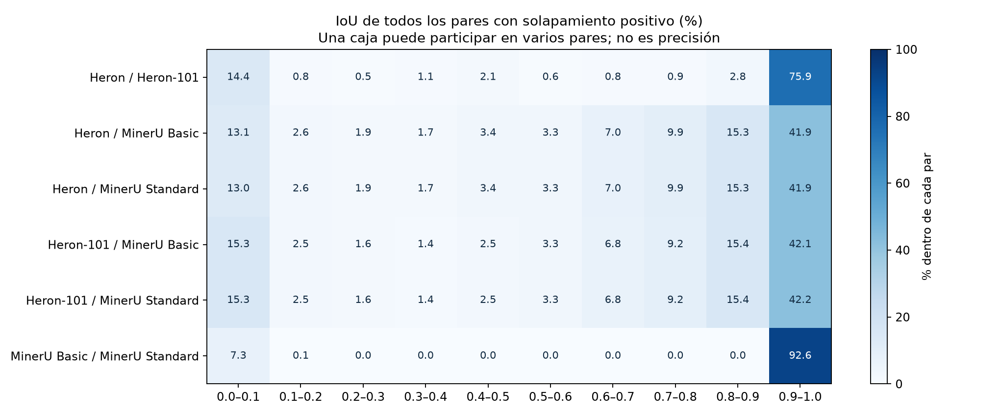
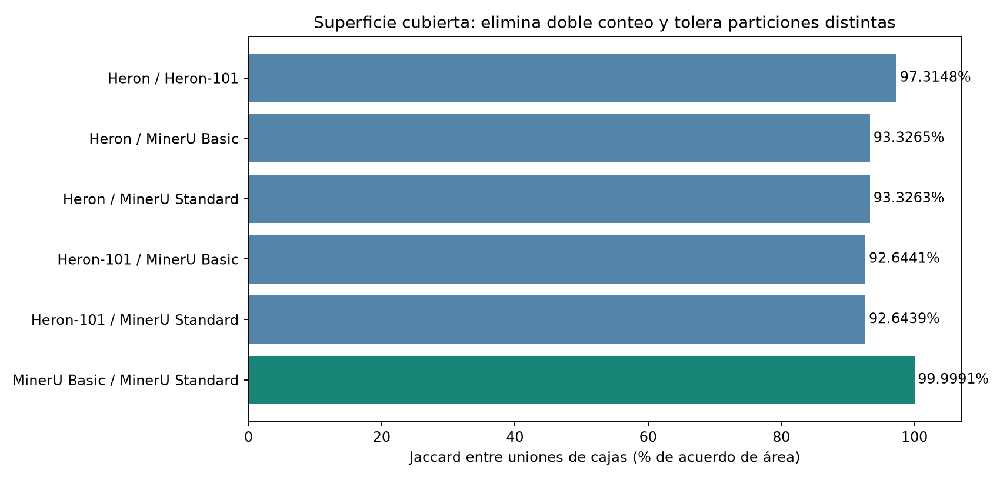
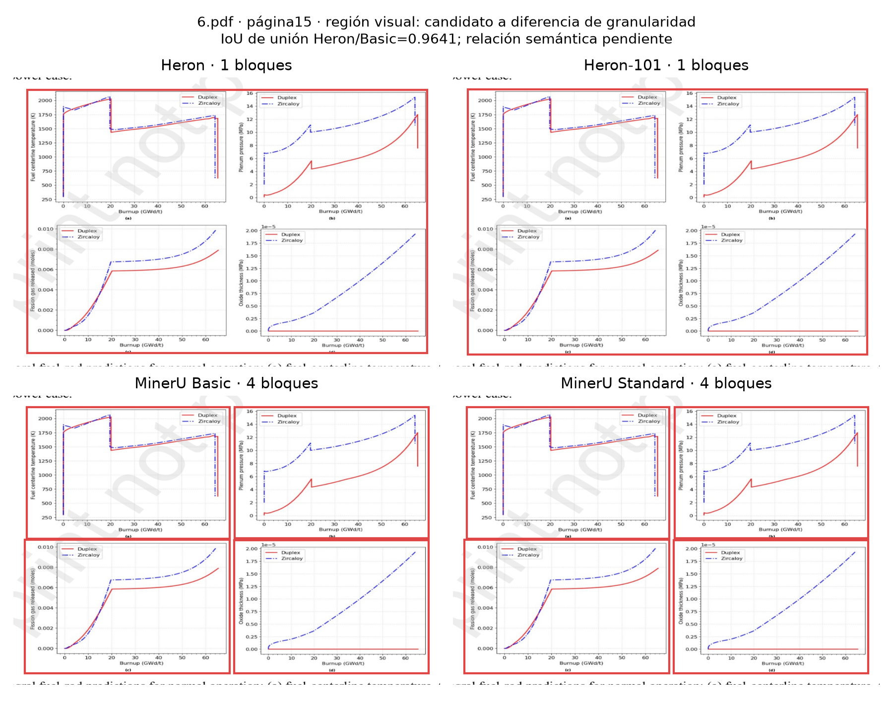

# In-depth technical analysis of boxes, categories, and granularity

Data, tables and original assets: [data directory](../raw_results/analytics/deep-20261101-v2). Artifact filenames in the report refer to that directory.

Current delivery: deep-20261101-v2. 15 papers,397 pages,1.588 tool/page outputs. No parsers, OCR, Colab, models, or PDF renders were run.35.240 native records and19.597 valid boxes were analyzed. The study reuses existing predictions, backgrounds, and metrics; it keeps six selected human examples separate from predictions.

## 1. Useful conclusion for this experiment

MinerU Basic and Standard are nearly identical in geometry: area Jaccard99,999102%; at block level99,999296%. Their4.168 blocks per tool enter spatial correspondences with IoU>=.9 and have the same native labels. There is no evidence of an overall Standard improvement in the boxes or categories measured here.

Heron/Heron-101 also closely resemble one another:97,315% surface agreement. Against MinerU, surface agreement is92,644–93,327%, although median IoU between individual boxes is around.859–.862. This distinguishes boundary/partition discrepancies from large surface differences. It is not true PDF coverage: a union may include blank space, mix blocks, or share omissions.

There are specific candidates for equivalent granularity. Comparing only blocks:7 between Heron/101;29 between Heron/Basic;29 between Heron/Standard;29 between101/Basic;29 between101/Standard;0 between Basic/Standard. The sets overlap: these are not123 independent cases. Not all1:n are acceptable, and even a high IoU does not demonstrate semantic membership or caption preservation.

Categories were analyzed after grouping by coordinates. The result identifies recurring disagreements and declared capabilities, but cannot rank overall semantic accuracy without a reference. Your definition of accuracy prioritizes coverage and boundaries over identical segmentation; a combined figure or several consecutive paragraphs are not automatically penalized.

## 2. Method and Data Mining foundation

Bibliographic query through official CLI/Bases/Fileclass/gateway:8efd92ca022a433096fe643338bce152, review accepted. Continuity and inventory:6ffb384b75694bc9aaea699d8349142c, review accepted. Original chapters without a document class were preserved as bibliography, without reclassifying them.

- Chapter2, Data: normalized attributes, missing values, proximities, and discretization. Boxes use relative page coordinates; a missing child box is not filled in with the parent's.
- Chapter3, Exploring Data: histograms, quantiles, and OLAP by tool/paper/page/category/level. Micro by area, mean by page, and macro by paper are distinguished.
- Chapter4, Classification: a table between tools expresses agreement. An accuracy confusion matrix needs verified actual classes. Parser voting is not used as a reference.
- Chapter6, Association Analysis: support/confidence/lift describe output co-occurrence, with denominators and per-paper breakdowns to avoid misleading aggregate conclusions. They are not probabilities of correctness.
- Chapter8, Cluster Analysis: complete-link agglomerative clustering to avoid chaining regions through a bridge, with internal evaluation separate from external evaluation. It is restricted to one box per tool per cluster; that limit does not remove duplicates, it leaves them explicit.
- Chapter9: limitations of clustering algorithms and proximities. K-means on centers is not used: boxes with the same center may have very different extents, and partitioning requires incorporating area.

IoU/containment rules, bands, and thresholds are experimental adaptations, not values prescribed by the book. Method frozen before computation in [PROTOCOL](context/docs/methodology/geometry-protocol.md). Independent review detected and corrections were made to: three omitted empty pages, complete-link merge priority, shared geometry hash, and timing of the human snapshot. V1 is preserved as diagnostic; it is not the current delivery.

## 3. Six comparisons: histograms and correspondences

| Pair | Positive pairs | Median IoU | Reciprocal matches | Reciprocal median | Total area IoU |
| --- | --- | --- | --- | --- | --- |
| Heron / Heron-101 | 5824 | 0.9753 | 4455 | 0.9832 | 97.315 % |
| Heron / MinerU Basic | 5934 | 0.8589 | 3886 | 0.8969 | 93.327 % |
| Heron / MinerU Standard | 5933 | 0.8590 | 3886 | 0.8969 | 93.326 % |
| Heron-101 / MinerU Basic | 5890 | 0.8618 | 3831 | 0.8965 | 92.644 % |
| Heron-101 / MinerU Standard | 5888 | 0.8619 | 3831 | 0.8965 | 92.644 % |
| MinerU Basic / MinerU Standard | 6309 | 1.0000 | 4091 | 1.0000 | 99.999 % |

All positive pairs include small intersections between neighbors and coincident parent/body boxes. They are not one-to-one matches; a box may participate several times. Reciprocal matches choose the highest IoU in both directions and exclude ties. This is a selected population, also not a true reference. Unmatched boxes are not turned into IoU0 pairs.

| IoU | heron/heron101 | heron/basic | heron/standard | heron101/basic | heron101/standard | basic/standard |
| --- | --- | --- | --- | --- | --- | --- |
| [0.0,0.1) | 14.44 % | 13.06 % | 13.05 % | 15.28 % | 15.25 % | 7.32 % |
| [0.1,0.2) | 0.82 % | 2.58 % | 2.58 % | 2.46 % | 2.46 % | 0.13 % |
| [0.2,0.3) | 0.48 % | 1.85 % | 1.85 % | 1.65 % | 1.65 % | 0.00 % |
| [0.3,0.4) | 1.08 % | 1.67 % | 1.67 % | 1.43 % | 1.43 % | 0.00 % |
| [0.4,0.5) | 2.09 % | 3.42 % | 3.42 % | 2.46 % | 2.46 % | 0.00 % |
| [0.5,0.6) | 0.64 % | 3.25 % | 3.25 % | 3.26 % | 3.26 % | 0.00 % |
| [0.6,0.7) | 0.82 % | 7.04 % | 7.05 % | 6.76 % | 6.76 % | 0.00 % |
| [0.7,0.8) | 0.89 % | 9.93 % | 9.91 % | 9.15 % | 9.15 % | 0.00 % |
| [0.8,0.9) | 2.78 % | 15.28 % | 15.30 % | 15.42 % | 15.42 % | 0.00 % |
| [0.9,1.0] | 75.94 % | 41.91 % | 41.92 % | 42.14 % | 42.15 % | 92.55 % |

Intervals closed on the left and open on the right; the last includes1. Denominators by column:5.824,5.934,5.933,5.890,5.888,6.309. All35.778 pairs are preserved in full. Basic/Standard:5.827 pairs with IoU exactly1,5.839 in[.9,1];470 pairs below.2. These are not470 errors: they contain secondary intersections of different records.

## 4. Covered surface without depending on the number of boxes

A sweep through allx/y boundaries produces disjoint geometric cells. Each cell preserves which tools and category sets cover it; areas are not counted twice. Area IoU is intersection of unions / union of unions. No enclosing rectangle is used, nor is blank content inferred.

Relative comparison does not identify who is right: area exclusive to a tool may be recovered content, padding, or mixing. There are3 pages without boxes from any tool; they have Jaccard N/A, not1 or0. They are included in397 pages and in association support. Mean Jaccard by page excludes those three N/A values and states this in its implicit denominator; it does not turn them into approval.

| Pair | Mean across papers | Minimum paper | Maximum paper |
| --- | --- | --- | --- |
| Heron / Heron-101 | 97.794 % | 92.892 % | 99.201 % |
| Heron / MinerU Basic | 93.427 % | 91.825 % | 95.497 % |
| Heron / MinerU Standard | 93.427 % | 91.825 % | 95.508 % |
| Heron-101 / MinerU Basic | 93.139 % | 87.071 % | 95.854 % |
| Heron-101 / MinerU Standard | 93.140 % | 87.071 % | 95.865 % |
| MinerU Basic / MinerU Standard | 99.998 % | 99.989 % | 100.000 % |

Pages with lowest Heron/Basic Jaccard for targeted inspection:

| Paper/page | Area IoU | Heron only (% page) | Basic only (% page) |
| --- | --- | --- | --- |
| 17.pdf / 58 | 0.0119 | 0.000 % | 42.646 % |
| 17.pdf / 3 | 0.3430 | 1.105 % | 0.115 % |
| 17.pdf / 2 | 0.3451 | 7.564 % | 1.116 % |
| 17.pdf / 5 | 0.4585 | 7.334 % | 0.735 % |
| 14.pdf / 2 | 0.4801 | 0.000 % | 18.109 % |
| 8.pdf / 1 | 0.5821 | 0.000 % | 10.001 % |
| 15.pdf / 7 | 0.6206 | 0.361 % | 0.507 % |
| 14.pdf / 3 | 0.6867 | 1.813 % | 0.836 % |
| 8.pdf / 4 | 0.6874 | 0.005 % | 0.123 % |
| 7.pdf / 6 | 0.6953 | 15.959 % | 1.794 % |

This is neither a random sample nor an error ranking. The “only” figures are divided by total page area. `comparison_by_paper.csv` and `page_metrics.csv` preserve all cases.

## 5. Geometric duplication, levels, and granularity

| Tool | Records with a box | Unique geometries | Coincident groups |
| --- | --- | --- | --- |
| Heron | 4889 | 4806 | 83 |
| Heron-101 | 4777 | 4717 | 60 |
| MinerU Basic | 4966 | 4529 | 437 |
| MinerU Standard | 4965 | 4528 | 437 |

MinerU's437 groups break down into213 chart/chart_body,162 image/image_body, and62 table/table_body. They are a coincident parent/body representation; not437 erroneously duplicated figures. Heron has83 coincident groups;35 are section_header/text,16 footnote/list_item, and12 page_footer/picture. Heron-101 has60, including19 section_header/text. Different labels on the same box must be preserved as alternatives/output ambiguity, without silently choosing one.

MinerU has4.168 block-level boxes in each version; Basic adds798 child boxes and Standard797. Heron has4.889 block and Heron-1014.777. Overall area counts per box mixed levels and categories. MinerU's overall median box is2,40% of the page versus Heron's1,28–1,31%, but that alone does not establish who groups more of the same content.

Bipartite components are built with IoU>=.5 or containment>=.9. A1:n/n:1 group is a granularity candidate when union IoU>=.9, each small box has less than.98 of the large box's area, and the small boxes have redundancy<=1%. This rejects large gaps, complete duplications, andn:m components. Small boxes may be panels or other kinds of parts: that meaning is not assigned automatically.

### Block-level comparison

| Pair | 1:n | n:1 | Compatible granularity | 1:1 with different area | n:m | No strong link |
| --- | --- | --- | --- | --- | --- | --- |
| Heron / Heron-101 | 66 | 95 | 7 | 213 | 109 | 107 |
| Heron / MinerU Basic | 41 | 182 | 29 | 1649 | 37 | 343 |
| Heron / MinerU Standard | 41 | 182 | 29 | 1649 | 37 | 343 |
| Heron-101 / MinerU Basic | 41 | 139 | 29 | 1628 | 28 | 416 |
| Heron-101 / MinerU Standard | 41 | 139 | 29 | 1628 | 28 | 416 |
| MinerU Basic / MinerU Standard | 0 | 0 | 0 | 0 | 3 | 0 |

“No strong link” means no correspondence under this rule, not a confirmed omission. “1:1 with different area” does not distinguish padding, clipping, and different content: these are boundaries to review. Then:m cases are preserved; they are not flattened to force an answer.

In Heron/Basic,26 of29 candidates are one Heron box versus several Basic boxes;3 are the reverse. The26 include24 visual/visual and2 visual/header; they are not all called semantic equivalents. Of the3 reverse cases, one includes caption/table versus table and another index/header versus index. Surface equivalence can coexist with a category or relationship difference. For visual/visual cases, granularity is a plausible and useful geometric explanation according to your priorities.

| Paper/page | Pair | Boxes A:B | Union IoU | Categories A/B |
| --- | --- | --- | --- | --- |
| 5.pdf / 1 | Heron / MinerU Basic | 1:2 | 0.9366 | ['visual'] / ['running_header'] |
| 9.pdf / 6 | Heron / MinerU Basic | 1:2 | 0.9183 | ['visual'] / ['visual'] |
| 9.pdf / 6 | Heron / MinerU Basic | 1:2 | 0.9469 | ['visual'] / ['visual'] |
| 15.pdf / 9 | Heron / MinerU Basic | 4:1 | 0.9071 | ['document_index', 'running_header'] / ['index'] |
| 15.pdf / 45 | Heron / MinerU Basic | 1:2 | 0.9181 | ['visual'] / ['visual'] |
| 6.pdf / 14 | Heron / MinerU Basic | 1:4 | 0.9645 | ['visual'] / ['visual'] |
| 6.pdf / 15 | Heron / MinerU Basic | 1:4 | 0.9641 | ['visual'] / ['visual'] |
| 6.pdf / 15 | Heron / MinerU Basic | 1:4 | 0.9672 | ['visual'] / ['visual'] |
| 6.pdf / 16 | Heron / MinerU Basic | 1:4 | 0.9716 | ['visual'] / ['visual'] |
| 6.pdf / 16 | Heron / MinerU Basic | 1:4 | 0.9699 | ['visual'] / ['visual'] |
| 6.pdf / 17 | Heron / MinerU Basic | 1:4 | 0.9703 | ['visual'] / ['visual'] |
| 6.pdf / 18 | Heron / MinerU Basic | 1:6 | 0.9005 | ['visual'] / ['visual'] |

Reproducible example:6.pdf,page15. Heron has one visual box versus4 Basic visual blocks; the union has IoU close to.96. Existing PNG backgrounds were reused without rendering the PDF again. Confirmation that the parts belong to the same set and that the shared caption is associated is still missing.

### Sensitivity: do not turn thresholds into truth

All9 combinations of containment .85/.9/.95 and union .85/.9/.95 were tested across all localized levels:

| Pair | Minimum candidates | Maximum candidates |
| --- | --- | --- |
| Heron / Heron-101 | 2 | 9 |
| Heron / MinerU Basic | 0 | 6 |
| Heron / MinerU Standard | 0 | 6 |
| Heron-101 / MinerU Basic | 0 | 9 |
| Heron-101 / MinerU Standard | 0 | 9 |
| MinerU Basic / MinerU Standard | 0 | 0 |

This population includes parents/bodies. It therefore must not be compared as though it were the block table: in Heron/Basic the baseline value is3 with all levels and29 with block. The difference shows the effect of hierarchical representation. `granularity_sensitivity.csv` contains all numerators by page and threshold; the threshold maximizing agreement was not chosen. A case is not declared stable merely because it exists in one combination.

## 6. Categories after spatial grouping

Clustering considers only coordinates through IoU and complete-link; each internal pair must reach.9, and there cannot be two boxes from the same tool in one cluster. Labels are read afterward. This is repeated at.8/.9/.95 in `cluster_sensitivity.csv`. Pages are not mixed to claim they contain the same object: cross-page patterns are repeated signatures, not content identity.

Across all levels there are8.175 clusters,7.219 with multiple tools and820 with more than one descriptive category. Those820 are not errors; they include different schemas and levels. Atblock level there are6.453 multi-tool clusters. Conservative assessment uses the partial map already defined in the plan, with `unmapped` outside the evaluable denominator.

| Pair | Equivalent clusters | Comparable categories | Agree | Conditional agreement |
| --- | --- | --- | --- | --- |
| Heron / Heron-101 | 4271 | 3631 | 3594 | 98.981 % |
| Heron / MinerU Basic | 2093 | 1502 | 1384 | 92.144 % |
| Heron / MinerU Standard | 2093 | 1502 | 1384 | 92.144 % |
| Heron-101 / MinerU Basic | 2047 | 1469 | 1365 | 92.920 % |
| Heron-101 / MinerU Standard | 2047 | 1469 | 1365 | 92.920 % |
| MinerU Basic / MinerU Standard | 4168 | 2742 | 2742 | 100.000 % |

These percentages are agreement conditional on equivalent boxes,block level, and mapped categories. They do not measure all detections, heading recall, or accuracy. The first descriptive category layer across all levels must not be used as a winner: it includes child bodies without schema equivalence. The block table is the controlled comparison.

MinerU Basic and Standard agree on all4.168 native labels in their equivalent block clusters, although only2.742 enter the conservative analytical map. The other1.426 are not discarded from the result: they are preserved as unmapped schema. They are not1.426 errors.

### Which disagreements dominate

| Heron | MinerU Basic | Equivalent cases | Comparison |
| --- | --- | --- | --- |
| text | text | 1070 | mapped |
| list_item | ref_text | 536 | partial schema/unmapped |
| picture | chart | 118 | mapped |
| list_item | text | 117 | mapped |
| picture | image | 103 | mapped |
| table | table | 57 | mapped |
| formula | equation | 19 | mapped |
| page_header | header | 15 | partial schema/unmapped |
| document_index | index | 14 | partial schema/unmapped |
| section_header | paragraph_title | 11 | mapped |
| picture | header | 7 | partial schema/unmapped |
| key_value_region | text | 6 | partial schema/unmapped |

The536 Heron/Basic list_item/ref_text cases describe two ways to label nearly identical regions. Bibliographic reference and list item may be compatible properties, so that difference does not demonstrate tool failure. picture/chart and image express different schema resolution: chart is more specific, but not necessarily correct. formula/equation is vocabulary translation, not failure.

| Tool | Declared headings | Captions with dedicated box | Declared chart | Declared ref_text |
| --- | --- | --- | --- | --- |
| Heron | 563 | 271 | 0 | 0 |
| Heron-101 | 543 | 274 | 0 | 0 |
| MinerU Basic | 505 | 338 | 213 | 688 |
| MinerU Standard | 505 | 337 | 213 | 688 |

These counts are declared availability, not true frequency in the PDF. In particular, a dedicated MinerU caption may be a localized child; do not attribute children without boxes to caption or treat all spans as omitted elements.

### Disagreements that do merit your priority attention

- 28 equivalent block clusters show heading versus text, on22 pages from8 papers. They are high-interest candidates because of your asymmetric cost; we do not yet know which side represents the actual heading.
- 3 show caption versus text, on3 pages/3 papers.
- 1 shows visual versus text.
- 31 cross-edges in20 text boxes almost completely contain a heading/visual/table from another tool and are more than1,5 times larger. They are absorption/mixing candidates; not31 confirmed mixtures. Another tool's labels are not an independent reference.

Complete examples are preserved in heading_vs_text_examples.jsonl, caption_vs_text_examples.jsonl, visual_vs_text_examples.jsonl, and structural_boundary_candidates.csv. Coordinate clustering detects discrepancies; deciding accuracy requires evidence of function, separating heading→text errors from body→heading errors. No heading classifier based on size is invented.

## 7. Patterns across pages and papers

236 recurring signatures were detected (at least2 pages). Each signature includes labels by tool, vertical band, and width; it preserves cases/pages/papers, concentration in the dominant paper, and examples with IDs. Bands .2/.8 and widths .35/.7 are exploratory descriptors, not column or section boundaries.

| Declared labels | Zone/width | Cases | Pages | Papers |
| --- | --- | --- | --- | --- |
| basic:ref_text; heron:list_item; heron101:list_item; standard:ref_text | middle/medium | 254 | 25 | 11 |
| basic:ref_text; heron:list_item; heron101:list_item; standard:ref_text | bottom/medium | 33 | 11 | 8 |
| basic:ref_text; heron:list_item; heron101:list_item; standard:ref_text | top/medium | 45 | 13 | 7 |
| basic:header; heron:picture; heron101:picture; standard:header | top/narrow | 7 | 7 | 7 |
| basic:ref_text; heron:list_item; heron101:list_item; standard:ref_text | middle/wide | 145 | 20 | 6 |
| basic:text; heron:list_item; heron101:list_item; standard:text | middle/medium | 21 | 15 | 5 |
| basic:ref_text; heron:list_item; heron101:list_item; standard:ref_text | bottom/wide | 21 | 12 | 5 |
| basic:index; heron:document_index; heron101:document_index; standard:index | middle/wide | 10 | 10 | 4 |
| basic:ref_text; heron:list_item; heron101:list_item; standard:ref_text | top/wide | 16 | 9 | 4 |
| heron:text; heron101:section_header | middle/narrow | 8 | 7 | 4 |
| basic:text; heron:list_item; heron101:list_item; standard:text | bottom/medium | 5 | 4 | 4 |
| basic:table_body; heron101:table; standard:table_body | middle/wide | 4 | 4 | 4 |

The reference/list pattern of medium width and middle zone appears254 times on25 pages/11 papers. It does not depend exclusively on one paper. Thepicture/header pattern in a narrow upper region appears on7 pages/7 papers; it is especially relevant to your logo example. It is not automatically validated that all seven are logos, nor are their labels corrected.

`pattern_macro_and_loo.csv` calculates support by paper including zeros, macro mean, and descriptive range when excluding each paper. This checks how much the count depends on the observed collection; it is neither an external test nor a generalization confidence interval. Exact signatures include the tools present; if a box is missing, the signature may change, so patterns are not disjoint by actual function.

Page rules are in page_association_rules.csv: antecedent=declared presence of a category; consequent=disagreement, granularity, or area difference>0,5% of the page. Support/confidence/lift and per-paper breakdowns are published. Minimum thresholds of10 antecedent pages and5 joint pages only reduce accidental rarities. These are exploratory, without multiple-comparison correction or independent confirmation: do not select rules by lift and present them as document laws. High confidence may reflect a very frequent category or a schema; macro and micro are not interchangeable.

## 8. Your human examples: specific evidence and limits

| Page | Selection | Tool | Intersecting labels | ROI area with boxes | Human note |
| --- | --- | --- | --- | --- | --- |
| 1.pdf / 1 | negative | Heron | footnote, page_footer | 12.686 % | leaves text unsegmented |
| 1.pdf / 1 | preferred | MinerU Basic | footer | 92.504 % | leaves text unsegmented |
| 1.pdf / 1 | negative | Heron | footnote, page_footer | 20.196 % | leaves text unsegmented |
| 1.pdf / 1 | preferred | MinerU Basic | footer | 79.521 % | leaves text unsegmented |
| 1.pdf / 1 | negative | MinerU Basic | header | 25.098 % | that is not text, it counts more as an image since it is more like a logo |
| 1.pdf / 1 | preferred | Heron | picture | 24.126 % | that is not text, it counts more as an image since it is more like a logo |
| 1.pdf / 1 | negative | MinerU Basic | text | 24.408 % | it is an author, not a section |
| 1.pdf / 1 | preferred | Heron | section_header, text | 18.380 % | it is an author, not a section |
| 1.pdf / 1 | negative | Heron | text | 41.892 % | it is a number, not text |
| 1.pdf / 1 | preferred | MinerU Basic | page_number | 25.696 % | it is a number, not text |
| 12.pdf / 4 | negative | Heron | caption, table | 77.644 % | (no note) |
| 12.pdf / 4 | preferred | MinerU Basic | table, table_body, table_caption | 66.704 % | (no note) |

The two coverage preferences on1.pdf,page1 agree with a surface difference in those regions: Heron covers approximately12,7% and20,2% of your ROIs; Basic92,5% and79,5% of its preferred ROIs. ROIs on both sides have different boundaries, include blank space, and are not true boxes. Those percentages contextualize preference, not quantify text recall. The human note does express content you are missing; it is preserved as selected local evidence.

The logo example links Basic'sheader with Heron'spicture and matches a recurring signature in7 papers. The number links Heron's text with Basic'spage_number: a local category preference, without extrapolating it to all numbers.

There is a discrepancy that should not be hidden: in the example “it is an author, not a section,” you selected Basic as nonpreferred, but its region intersects text; the Heron alternative intersects coincident text and section_header. The note and preference direction do not unambiguously determine which output you wanted to penalize. It remains pending, without reversing your record or using it as a training label.

On12.pdf,page4 a Basic segmentation is preferred over Heron. The ROI includes a table andcaption; Heron's box surface may even be larger without being your preferred option. This confirms that amount of area does not replace structural suitability. Six targeted examples, five on one page, do not allow training or evaluating generalization of a preference model; nor are they six exact reference boxes.

## 9. Assessment matrix according to P01–P12

| Dimension | Available automatic evidence | What is missing to decide according to your priorities |
| --- | --- | --- |
| Coverage, especially heading/caption/body | Union agreement, exclusive areas, selected human ROIs | Independent content inventory; omissions common to all are invisible here |
| Paragraphs, columns, sections |1:n/n:1, different boundaries and absorption candidates | Confirm whether it crosses columns/headings or only combines valid paragraphs |
| Combined figure/panels | Granularity candidates and preserved native relationships | Validate membership and shared caption; a large box may still be useful |
| Relationship consistency | MinerU reports251 visual parents with caption child in each version; Heron reports no edges in this projection | Correctness and applicability of those links; without inventing panels from geometry |
| Lists | Declared Heron items and MinerU references/text; recurring patterns | Check actual lists and grouping; isolated list_item is not a complete structure |
| Labels | Equivalent groups, vocabulary, conditional agreement, and human examples | Actual function of the region; heading→text priority separate from body→heading |
| Clipping | Different boundaries and exclusive areas | Evidence of clipped visible letters/words; no OCR was run, nor is automatic clipping claimed |
| Cost/failures | Preserved receipts and memory/time by scope | Comparable timing measurements and repetitions; do not add detector times to SDK parsing |

There is no aggregate score or semantic winner. Consistency is described by capability and context; a systematically incorrect output can also be consistent. Localized captions and relationships do not guarantee that the shared link is correct, andimage_body nodes are not interpreted as panels.

## 10. Cost and technical decision these data allow

Basic/Standard offer practically identical block results in this collection. Previous receipts record Basic301,352s of SDK parse excluding export, peak RAM5.853MiB and GPU2.862MiB; Standard321,891s, RAM9.707MiB and GPU12.473MiB. These are one pass and stage samples, not statistical repetition or memory attributable exclusively to the model. Within that scope, no geometry/category gain is observed to explain Standard's higher cost. This supports using Basic as an operational candidate for this collection, preserving Standard as a comparison and without claiming universal equivalence.

Heron12,598s and Heron-10116,685s correspond only to the sum of detector inference; do not compare them directly with MinerU parsing. Corrected attempts completed15 papers per tool without failures; the11 previous failures of each MinerU with another version remain separate history. Nothing was rerun for this delivery.

The useful decision is to take advantage of coverage/structure that proves consistent and uniformly reconstruct capabilities that do not. This analysis does not yet implement that reconstruction or establish an ensemble. Your acceptance of variable granularity allows reducing review: focus on exclusive regions, discrepant headings/captions, complex groups, and shared-relationship cases; do not review every small box difference.

## 11. Artifacts, reproducibility, and stopping point

- Histograms and correspondences: iou_histograms.csv, pair_summary.csv, matched_boxes.csv.
- Relative coverage: atomic_area_signatures.jsonl, page_metrics.csv, comparison_by_paper.csv.
- Granularity: granularity_groups.jsonl (all levels), block_granularity_groups.jsonl, strict_granularity_examples.jsonl, granularity_sensitivity.csv.
- Categories: spatial_clusters.jsonl, block_spatial_clusters.jsonl, label_contingency.csv, block_label_contingency.csv, unlocalized_categories.csv, coincident_boxes.jsonl.
- Patterns: recurring_patterns.jsonl, pattern_macro_and_loo.csv, page_association_rules.csv; these JSONL files contain IDs and base0 pages.
- Feedback: human_feedback_snapshot.json, human_feedback_context.jsonl. Human originals were not modified.
- Subsequent review: review_examples.jsonl plus priority disagreement files; does not require reviewing all blocks one by one.
- Verification: verification.json, supplement_verification.json, report_verification.json, and final_checks.json.2.452 original files were checked before/after, along with identity of inputs used and partitions. Independent review does not equal semantic review of the397 PDFs.

Stopping condition for this delivery: all six comparisons and strata are calculated, patterns have denominators and examples, originals are preserved, and semantic accuracy is not presented without a reference. True coverage, overall category accuracy, and which differences are exclusively granularity in the semantic sense remain explicitly undetermined. Specific geometric candidates and the work needed to confirm them are identified.

## 12. Additional check of the shared caption: one specific case

Inspection of the existing background of6.pdf,page15 shows Figure8 (four strain/stress panels) above and Figure9 (temperature/pressure/gas/oxide) below. In the Basic JSON, Figure8's caption is a child of `/pages/14/blocks/4`, whose box is the first chart in Figure9's lower group. The four upper charts are blocks0–3. Therefore, in this case the output preserves the caption and images, but the declared membership does not represent Figure8's group. This is an agent visual observation checked against original text/structure; not accumulated human review or a global rule.

This demonstrates why figure area agreement and the count of parents with captions are insufficient for your definition of accuracy. No association based on proximity is created, nor is the original changed. `caption_parent_diagnostics.json` preserves text, coordinates, pointers, and hash to review this case. `caption_parent_geometry.csv` describes all localized caption–parent relationships (above/below/overlapping), without declaring those above incorrect: table captions or particular layouts may be valid.
