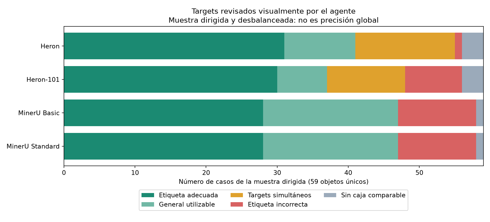
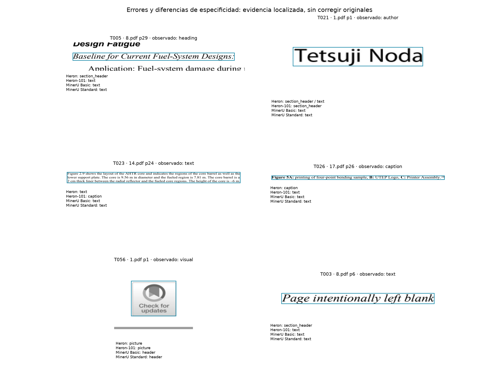

# Block targets: accuracy, specificity, and inconsistencies

Data, tables and original assets: [data directory](../raw_results/analytics/targets-20261101-v1). Artifact filenames in the report refer to that directory.

## Main result

There is no single winner by labels. In this collection, Basic and Standard produce practically the same block labels; Standard shows no target improvement that would justify preferring it on that dimension. MinerU offers less ambiguous output and explicitly recognizes references and numbers, but loses heading signals and uses header for editorial images. Heron preserves more heading and image signals in the reviewed sample, but provides text/section_header alternatives over the same region; that ambiguity prevents treating them as clean decisions. Heron-101 shows no consistent improvement over Heron in the observed cases.

The already agreed method was applied: spatially corresponding blocks, an agreement table preserving native labels, explicit visual reference for reviewed cases, and higher ordinal priority for heading→text than text→heading. Blocks help compare the same content; they are not themselves the true class.

## 1. Scope and evidence

- Complete census of35.240 records from15 papers/397 pages and all native targets, separated by level and bbox presence.
- Block-level correspondences from the previous in-depth analysis, internal IoU>=.9 and one box per tool in a cluster; granularity relationships and child captions are kept separate.
-65 ROIs visually inspected on already existing PNG files, with labels hidden in reference sheets.4 repetitions of the same object (T031/T016,T062/T056,T063/T021,T064/T022) and2 additional cases without an unequivocal single class (T024,T065) were excluded:59 eligible unique objects remain,236 tool/case assessments.
- The sample targets discrepancies plus controls, is not random:19 headings,10 visuals,6 authors/affiliations,5 captions,4 texts,4 references,3 tables,3 equations,2 notes,1 list,1 number, and1 date. Twelve of the19 headings come from8.pdf. Cases are unique by object, not statistically independent.
- The observed class was assigned by the agent from the visual background, not by tool majority or text extracted from a parser. Selection does depend on predictions, and the agent knows the project's hypotheses: it is not a fully blind trial. It is not called human validation.

Methodological source: Data Mining chapter4 (confusion matrix with a reference) and chapter5§5.7 (imbalanced classes, precision/recall, and asymmetric cost). CLI/Bases/Fileclass query/review: faae4823e31543b5aa5d75bb594b34f4, status reviewed. The book supports the method; it does not establish geometric thresholds or user weights. No numerical weights, scores, or reference classes based on size heuristics were invented.

## 2. Vocabulary and states: what counts as an error

| State | Interpretation |
| --- | --- |
| adequate | The label corresponds to the visually observed family; subtype is checked separately |
| coarse_usable | General but usable: text for author, list_item for reference, header for editorial logo; does not necessarily identify the specific target of interest to you |
| contradictory | Multiple families on the same object that are not resolved into a single function; the favorable one is not silently chosen, nor are all declared false |
| wrong | Dedicated correspondence with an incompatible label and unequivocal visual reference |
| no_own_correspondence | No box reaches the dedicated correspondence criteria; this is separated from tagging error and is not turned into an overall semantic omission |
| excluded_reference | Ambiguous crop, a set of several classes, or repetition of the same object |

Affiliations can simultaneously be list items and notes; footnote/list_item is not penalized as a contradiction in that subtype. Bibliographic reference and list item are also compatible properties. picture/image/chart are first compared as a visual family, but original vocabulary and specificity are preserved. section_header/paragraph_title belong to headings; document_title versus section_heading is recorded separately.

Dedicated correspondence uses IoU>=.5, or box containment inROI>=.9 withROI coverage>=.5. A large group coveringROI>=.9 but not comparable is distinguished as group_coverage; its bbox is not copied to a child, nor is a specific label imputed to each part. Intersections and alternatives are preserved by case to review boundary sensitivity.

## 3. Target census and count bias

| Localized target | Heron | Heron-101 | Basic | Standard |
| --- | --- | --- | --- | --- |
| heading | 563 | 543 | 505 | 505 |
| text | 1815 | 1816 | 1730 | 1730 |
| caption | 271 | 274 | 338 | 337 |
| visual | 357 | 348 | 375 | 375 |
| table | 59 | 60 | 62 | 62 |
| equation | 71 | 71 | 70 | 70 |

These are declared localized records, not the actual number of PDF elements. Heron has563 heading records but557 unique geometries; Heron-101543 and541; each MinerU505. Theheading targets appear on262,255, and259 pages respectively. It is not inferred that Heron recovers58 additional correct headings: it may contain false headings and duplications.

MinerU's text records include many children without bbox: Basic8.496 texts,1.730 localized, and6.766 without a box; Standard8.440,1.730, and6.710. Mixing them with Heron's blocks distorts distributions and micro accuracy. Children without boxes are not counted as omitted content or as millions of classification cases.

References: each MinerU declares688 ref_text on41 pages from15 papers; Heron mainly uses list_item. The latter is not declared worse for not using the same name. `target_census.csv` also preserves targets outside the main families andchild/inline categories without analytical equivalence.

### Alternatives on exactly the same box

- Heron:35 heading/text geometries and3 caption/text.
- Heron-101:19 heading/text and3 caption/text.
- MinerU:0 of these exact combinations at localized target level.

Do not confuse these with MinerU's437 parent/body groups from the previous analysis:chart/chart_body orimage/image_body are not semantic target contradictions. A valid multilabel output may exist, but for a task needing a single function it requires an explicit subsequent policy. The output is not modified here.

## 4. Reviewed sample results: no overall ranking

| Tool | Cases | Appropriate | Generally useful | Multitarget | Incorrect | No dedicated correspondence |
| --- | --- | --- | --- | --- | --- | --- |
| Heron | 59 | 31 | 10 | 14 | 1 | 3 |
| Heron-101 | 59 | 30 | 7 | 11 | 8 | 3 |
| MinerU Basic | 59 | 28 | 19 | 0 | 11 | 1 |
| MinerU Standard | 59 | 28 | 19 | 0 | 11 | 1 |

Columns separate specificity from error. Do not add generally useful to error, or count ambiguous cases as successes because one of their labels matches. Nor classify no correspondence as a false label. Differences reflect the chosen sample; do not publish “X% tool accuracy” across397 pages from this table.

Breakdown by reference: each cell expresses **appropriate / generally useful / multitarget / incorrect / no dedicated correspondence**.

| Reference | N | Heron | Heron-101 | Basic | Standard |
| --- | --- | --- | --- | --- | --- |
| heading | 19 | 10 / 0 / 9 / 0 / 0 | 8 / 0 / 9 / 2 / 0 | 9 / 0 / 0 / 10 / 0 | 9 / 0 / 0 / 10 / 0 |
| text | 4 | 1 / 0 / 2 / 1 / 0 | 2 / 0 / 1 / 1 / 0 | 3 / 0 / 0 / 0 / 1 | 3 / 0 / 0 / 0 / 1 |
| caption | 5 | 4 / 0 / 1 / 0 / 0 | 4 / 0 / 0 / 1 / 0 | 4 / 0 / 0 / 1 / 0 | 4 / 0 / 0 / 1 / 0 |
| visual | 10 | 9 / 0 / 0 / 0 / 1 | 9 / 0 / 0 / 0 / 1 | 1 / 9 / 0 / 0 / 0 | 1 / 9 / 0 / 0 / 0 |
| author | 6 | 0 / 5 / 1 / 0 / 0 | 0 / 3 / 1 / 2 / 0 | 0 / 6 / 0 / 0 / 0 | 0 / 6 / 0 / 0 / 0 |
| reference | 4 | 0 / 4 / 0 / 0 / 0 | 0 / 4 / 0 / 0 / 0 | 4 / 0 / 0 / 0 / 0 | 4 / 0 / 0 / 0 / 0 |
| list | 1 | 1 / 0 / 0 / 0 / 0 | 1 / 0 / 0 / 0 / 0 | 0 / 1 / 0 / 0 / 0 | 0 / 1 / 0 / 0 / 0 |
| table | 3 | 3 / 0 / 0 / 0 / 0 | 3 / 0 / 0 / 0 / 0 | 3 / 0 / 0 / 0 / 0 | 3 / 0 / 0 / 0 / 0 |
| equation | 3 | 3 / 0 / 0 / 0 / 0 | 3 / 0 / 0 / 0 / 0 | 3 / 0 / 0 / 0 / 0 | 3 / 0 / 0 / 0 / 0 |
| number | 1 | 0 / 1 / 0 / 0 / 0 | 0 / 0 / 0 / 1 / 0 | 1 / 0 / 0 / 0 / 0 | 1 / 0 / 0 / 0 / 0 |
| metadata | 1 | 0 / 0 / 1 / 0 / 0 | 0 / 0 / 0 / 1 / 0 | 0 / 1 / 0 / 0 / 0 | 0 / 1 / 0 / 0 / 0 |
| note | 2 | 0 / 0 / 0 / 0 / 2 | 0 / 0 / 0 / 0 / 2 | 0 / 2 / 0 / 0 / 0 | 0 / 2 / 0 / 0 / 0 |

## 5. Headings: the dimension with the highest cost for you

| Tool | Observed headings | Appropriate heading only | Heading + another class | Text only | Nonheadings with heading signal |
| --- | --- | --- | --- | --- | --- |
| Heron | 19 | 10 | 9 | 0 | 5 |
| Heron-101 | 19 | 8 | 9 | 2 | 5 |
| MinerU Basic | 19 | 9 | 0 | 10 | 0 |
| MinerU Standard | 19 | 9 | 0 | 10 | 0 |

In these19 headings, Heron preserves a heading signal in all, but9 are simultaneously text/section_header. That does not mean19 clean correct decisions. Heron-101 offers8 clean,9 ambiguous, and2 text only. MinerU offers9 clean and10 as text. The five nonheadings with a heading signal from each Heron include authors, notices, or metadata; some are multilabel and others single errors.

The practical consequence depends on your priority: a heading localized as text requires rediscovering its function; Heron at least offers a heading signal in many of those cases, although resolving conflicting candidates also has a cost. There is no complete dominance: greater signal availability and lower ambiguity are different dimensions.

### Repeated pattern: same template, different results

In8.pdf,11 internal labels Baseline for Current Fuel-System Designs/New Baseline for Licensing were inspected, separate from Application/Assessment and body text (T004–T014):

| Tool | Single heading | Heading + text | Text only |
| --- | --- | --- | --- |
| Heron | 5 | 6 | 0 |
| Heron-101 | 3 | 6 | 2 |
| MinerU Basic | 4 | 0 | 7 |
| MinerU Standard | 4 | 0 | 7 |

Basic/Standard alternate between paragraph_title(4) andtext(7) for the same template function. This is documented inconsistency, not just a naming difference between engines. Heron alternates single and double output; Heron-101 even loses the signal in2. The pattern is not extrapolated to all headings: text, layout, and paper are preserved in each ROI.

Other examples:12.pdf,page4,T020 and4.pdf,page2,T027 are actual numbered subheadings preserved as text by both MinerU variants.12.pdf,page1,T019 is a document title: Basic/Standard declare it doc_title; Heron provides section_header (correct family, coarser hierarchy subtype); Heron-101 adds text.

### The native score does not automatically resolve inconsistency

Scores were recovered from original Heron JSON files by bbox/label equality, without creating MinerU scores or comparing them between engines. If, hypothetically, the highest-score label among dedicated correspondences were taken:

| Tool | Reviewed headings with score | Highest score preserves heading | Highest score chooses text |
| --- | --- | --- | --- |
| Heron | 19 | 13 | 6 |
| Heron-101 | 19 | 10 | 9 |

The heading signal available in19 Heron cases would be reduced to13 using highest score, because6 favor text. This is a diagnostic, not a newly implemented policy or a calibrated correctness score. `native_score_alternatives.jsonl` preserves all alternatives.

Rates in `heading_sample_rates.csv` are operational measures of clean signal and bounds with conflicts within this targeted sample; they are not population estimates. Bounds are not statistical confidence intervals. The conventional strict matrix is limited to one predicted family; multilabels, group coverage, and lack of correspondence are presented outside it. Overall accuracy dominated by text is not used.

## 6. Text, authors, dates, and false headings

- 1.pdf,page1,T021: Tetsuji Noda is an author. Basic/Standard use text (generally useful). Heron provides text+section_header; Heron-101 section_header. Here the name is not a section heading.
- 2.pdf,page1,T028: author list with superscripts; Heron-101 section_header is incompatible with the observed function.
- 8.pdf,pages4 and6,T002/T003: Page intentionally left blank is a notice, not a section. Heron returns heading as an alternative in one and as the sole category in another; MinerU preserves text.
- 8.pdf,page1,T033: SEPTEMBER2024 is an editorial date. text is generally usable; section_header does not describe the actual function. Not all large typography is a heading.
- Affiliations T034/T050: text/list_item/footnote may describe different aspects. Do not turn them into false errors due to schema differences.

Human feedback about the author said “not a section,” but the saved direction opposed Basic(text) to Heron(text+section_header). Visual observation clarifies the content's function without reversing or correcting original feedback. T063 was the same object asT021 and was excluded from the denominator.

## 7. Captions: correct class, markers, and relationship are three questions

In five reviewed captions (five papers), Heron offers4 with unequivocal caption family and1 caption/text; Heron-101 and each MinerU offer4 with unequivocal caption family and1 incorrect text. Case17.pdf,page26,T026 is Figure5A:...B:...C:...: a multipanel caption preserved as text by101 and both MinerU variants. This is a shared error: agreement does not imply truth.

There is also a subtype error: T018,15.pdf,page30, is Figure6's caption about elastic properties. Basic andStandard label it table_caption. The caption family is appropriate but the table subtype does not correspond to the observed figure. It is recorded as figure_as_table_caption inagent_subtype_assessments.csv; it is not counted twice as a family failure. Heron uses generic caption. Therefore,4/5 with correct family does not mean4/5 correct specific labels.

The opposite case is in14.pdf,page24,T023: Figure2.9 shows the layout... is a body paragraph, not the caption. Heron-101 labels it caption. Therefore, searching only for a Figure/Table prefix would not suffice to reconstruct accurate tagging; function and context must be considered, not just the initial word.

### The apparent338 versus337 caption advantage is a marker

Already preserved texts of each MinerU caption were inspected, without OCR:

| Native text pattern | Basic | Standard |
| --- | --- | --- |
| Isolated marker(a)/(b)/letter |53|52|
| Figure/Fig prefix |207|207|
| Table prefix |46|46|
| Other caption texts |32|32|

The338/337 records are not338/337 complete captions. The specific difference is in6.pdf,page12: Basic includes `(b)` as image_caption; Standard does not. Both preserve the complete Figure4 caption and Figure5's. There is no evidence that Standard loses a complete shared caption there. Patterns are lexical descriptors, not an infallible text classification.

In addition, previous analysis documented6.pdf,page15: Figure8's caption is declared a child of a Figure9 chart. The caption label can be correct and the parent–caption relationship incorrect. This membership failure remains separate from tagging and is not fixed by changing the block class.

## 8. Image, logo, and header: content specificity versus position

Of10 visuals reviewed in8 papers, the Heron variants identify9 with picture and lack a dedicated correspondence for1 decorative illustration. Basic/Standard recognize that illustration as visual, but use header for9 logos/editorial covers. These are useful boxes, and header describes a positional function; **it does not provide the specific image identification you prefer**.

Examples: Elsevier logos in5.pdf/7.pdf,page1; CrossMark in1.pdf,page1; journal covers in5/7/12/2.pdf,page1 and11.pdf,page2. This pattern is repeated, not an isolated case of the logo you pointed out. It is incorrect to add the9 as omitted images or declare allheader “wrong”: the deficit is content-target specificity.

For scientific charts, picture versus chart/image is a shared visual family and vocabulary of different resolution. chart is more specific but is not automatically considered more accurate without observing whether the region is actually a chart. This visual sample concentrates on logos and covers; it is not used to claim accuracy for all scientific figures.

The17 in1.pdf is a chapter number. Basic/Standard label it page_number: useful numeric family, imprecise subtype. Heron uses text and101picture. Do not claim that Basic correctly identified a page number: the observed reference is chapter_marker and is recorded as `chapter_as_page_number`.

## 9. References, lists, tables, and equations

Four reviewed bibliographic entries/fragments (three papers): MinerU uses ref_text, Heron list_item. Both can be useful, but ref_text better identifies the bibliographic function. The full pattern has536 nearly equivalent list_item/ref_text correspondences between Heron andBasic in the collection; these are not536 Heron errors.

The only reviewed nonbibliographic bullet,T051(8.pdf,page18), is list_item inHeron andtext inMinerU. List signal available inHeron and usable general text inMinerU; one observation does not establish consistent lists throughout the document. List grouping and continuity were not assessed as part of the target.

Three reviewed tables and three equations were appropriately recognized by all four tools. Controls include cases where tools already agreed, so they establish neither universal accuracy nor a population tie. formula/equation are normalized as the equation family; table_body shares geometry with its parent and is not counted as a second correctly identified table.

## 10. Complete patterns across tools and papers

| Pair | Labels A/B | Cases | Pages | Papers |
| --- | --- | --- | --- | --- |
| Heron/MinerU Basic | list_item / ref_text | 536 | 40 | 15 |
| Heron/MinerU Basic | picture / chart | 118 | 75 | 14 |
| Heron/MinerU Basic | picture / image | 103 | 63 | 14 |
| Heron/MinerU Basic | list_item / text | 117 | 29 | 9 |
| Heron/MinerU Basic | picture / header | 7 | 7 | 7 |
| Heron/Heron-101 | text / section_header | 12 | 11 | 6 |
| Heron/MinerU Basic | formula / equation | 19 | 11 | 5 |
| Heron/MinerU Basic | document_index / index | 14 | 14 | 5 |
| Heron/Heron-101 | key_value_region / text | 5 | 5 | 5 |
| Heron/MinerU Basic | section_header / doc_title | 5 | 5 | 5 |
| Heron/Heron-101 | section_header / text | 14 | 13 | 4 |
| Heron/MinerU Basic | picture / footer | 4 | 4 | 4 |
| Heron/Heron-101 | list_item / footnote | 14 | 3 | 3 |
| Heron/Heron-101 | text / key_value_region | 6 | 6 | 3 |
| Heron/MinerU Basic | key_value_region / text | 6 | 4 | 3 |
| Heron/MinerU Basic | footnote / page_footnote | 3 | 3 | 3 |

These frequencies are based on nearly equivalent block clusters and preserve label text, pages, papers, concentration, and macro support. They indicate family equality/inequality, not accuracy: different classes may be compatible. Neither four votes nor two engine families constitute the reference; Basic/Standard and Heron/101 are dependent and share errors.

`target_pair_conditionals.csv` expresses, for example, which labelB accompaniesheading fromA over available correspondences. The denominator is the target declared byA that does have a correspondence: it is not the set of actual headings or recall. A→B andB→A asymmetry is preserved.

A pattern repeated across pages shows consistent output behavior, not correctness by itself. TheBaseline template documents functional inconsistency because the ROIs were reviewed; thereference/list pattern only shows schema alternatives until actual function is checked. No classifier was trained or threshold tuned to one paper's results.

## 11. Which tool contributes more for your priorities

| Target/capability | Observed evidence | Bounded assessment |
| --- | --- | --- |
| Headings localized as headings | Heron preserves more signals in the sample; MinerU loses10/19 as text | Heron provides useful candidates, but9 are ambiguous. Do not use it as final tagging or extrapolate10/19 to the entire collection |
| Text without false headings | MinerU keeps authors/notices as text and returns no heading alternatives in those cases | Cleaner in these cases; may be too general for actual headings |
| Caption |4/5 clean per tool, with shared failure or alternative | No established winner; separate panel marker, complete caption, and shared relationship |
| Editorial image/logo | Heron picture in9 cases where MinerU uses header | Heron provides the specific content target you prefer; does not imply better overall segmentation |
| Bibliographic reference | MinerU ref_text in all4 cases; Heron list_item | Greater MinerU bibliographic specificity; list_item is not necessarily false |
| List | One bullet list_item versus text | Signal favoringHeron, sample insufficient for overall consistency |
| Table/equation | All appropriate in3+3 controls | No advantage detected in chosen controls; not a complete evaluation |
| Standard versusBasic | Same labels in4.168 equivalent blocks; isolated caption difference(b) | No demonstrated Standard advantage in this collection's block targets |

A winning label by voting is not recommended, nor is an ensemble implemented. According to your preference for uniform reconstruction, **headings** and the **content class of logos/header** are tasks requiring a uniform policy if MinerU is adopted as the base. Heron can provide candidate evidence, but choosing it automatically here would reintroduce the inconsistency you want to avoid. This is diagnostic, not validation of a complementary technique.

## 12. Evidence by case

| Case | Location | Observed | Heron | Heron-101 | Basic | Standard |
| --- | --- | --- | --- | --- | --- | --- |
| T001 | 8.pdf p3 | text | section_header,text → contradictory | section_header,text → contradictory |  → no_own_correspondence |  → no_own_correspondence |
| T002 | 8.pdf p4 | text | section_header,text → contradictory | text → adequate | text → adequate | text → adequate |
| T003 | 8.pdf p6 | text | section_header → wrong | text → adequate | text → adequate | text → adequate |
| T004 | 8.pdf p28 | heading | section_header → adequate | section_header → adequate | text → wrong | text → wrong |
| T005 | 8.pdf p29 | heading | section_header → adequate | text → wrong | text → wrong | text → wrong |
| T006 | 8.pdf p30 | heading | section_header,text → contradictory | section_header → adequate | paragraph_title → adequate | paragraph_title → adequate |
| T007 | 8.pdf p35 | heading | section_header,text → contradictory | section_header,text → contradictory | text → wrong | text → wrong |
| T008 | 8.pdf p36 | heading | section_header,text → contradictory | section_header → adequate | paragraph_title → adequate | paragraph_title → adequate |
| T009 | 8.pdf p37 | heading | section_header → adequate | section_header,text → contradictory | paragraph_title → adequate | paragraph_title → adequate |
| T010 | 8.pdf p37 | heading | section_header,text → contradictory | section_header,text → contradictory | text → wrong | text → wrong |
| T011 | 8.pdf p39 | heading | section_header,text → contradictory | section_header,text → contradictory | text → wrong | text → wrong |
| T012 | 8.pdf p44 | heading | section_header,text → contradictory | text → wrong | text → wrong | text → wrong |
| T013 | 8.pdf p45 | heading | section_header → adequate | section_header,text → contradictory | text → wrong | text → wrong |
| T014 | 8.pdf p49 | heading | section_header → adequate | section_header,text → contradictory | paragraph_title → adequate | paragraph_title → adequate |
| T015 | 7.pdf p1 | heading | section_header,text → contradictory | section_header → adequate | paragraph_title → adequate | paragraph_title → adequate |
| T016 | 7.pdf p1 | heading | section_header,text → contradictory | section_header → adequate | paragraph_title → adequate | paragraph_title → adequate |
| T017 | 15.pdf p1 | heading | section_header,text → contradictory | section_header → adequate | text → wrong | text → wrong |
| T018 | 15.pdf p30 | caption | caption,text → contradictory | caption → adequate | table_caption → adequate | table_caption → adequate |
| T019 | 12.pdf p1 | heading | section_header → adequate | section_header,text → contradictory | doc_title → adequate | doc_title → adequate |
| T020 | 12.pdf p4 | heading | section_header → adequate | section_header,text → contradictory | text → wrong | text → wrong |
| T021 | 1.pdf p1 | author | section_header,text → contradictory | section_header → wrong | text → coarse_usable | text → coarse_usable |
| T022 | 1.pdf p1 | number | text → coarse_usable | picture → wrong | page_number → adequate | page_number → adequate |
| T023 | 14.pdf p24 | text | text → adequate | caption → wrong | text → adequate | text → adequate |
| T025 | 17.pdf p2 | author | text → coarse_usable | section_header,text → contradictory | text → coarse_usable | text → coarse_usable |
| T026 | 17.pdf p26 | caption | caption → adequate | text → wrong | text → wrong | text → wrong |
| T027 | 4.pdf p2 | heading | section_header → adequate | section_header,text → contradictory | text → wrong | text → wrong |
| T028 | 2.pdf p1 | author | text → coarse_usable | section_header → wrong | text → coarse_usable | text → coarse_usable |
| T029 | 5.pdf p1 | heading | section_header → adequate | section_header → adequate | paragraph_title → adequate | paragraph_title → adequate |
| T030 | 8.pdf p1 | heading | section_header,title → adequate | section_header,title → adequate | doc_title → adequate | doc_title → adequate |
| T032 | 5.pdf p1 | author | text → coarse_usable | text → coarse_usable | text → coarse_usable | text → coarse_usable |
| T033 | 8.pdf p1 | metadata | section_header,text → contradictory | section_header → wrong | text → coarse_usable | text → coarse_usable |
| T034 | 7.pdf p1 | author | footnote,list_item → coarse_usable | footnote → coarse_usable | text → coarse_usable | text → coarse_usable |
| T035 | 5.pdf p3 | caption | caption → adequate | caption → adequate | chart_caption → adequate | chart_caption → adequate |
| T036 | 8.pdf p13 | caption | caption → adequate | caption → adequate | table_caption → adequate | table_caption → adequate |
| T037 | 7.pdf p3 | caption | caption → adequate | caption → adequate | table_caption → adequate | table_caption → adequate |
| T038 | 5.pdf p1 | visual | picture → adequate | picture → adequate | header → coarse_usable | header → coarse_usable |
| T039 | 8.pdf p1 | visual |  → no_own_correspondence |  → no_own_correspondence | image → adequate | image → adequate |
| T040 | 7.pdf p1 | visual | picture → adequate | picture → adequate | header → coarse_usable | header → coarse_usable |
| T041 | 5.pdf p3 | table | table → adequate | table → adequate | table → adequate | table → adequate |
| T042 | 8.pdf p13 | table | table → adequate | table → adequate | table → adequate | table → adequate |
| T043 | 7.pdf p3 | table | table → adequate | table → adequate | table → adequate | table → adequate |
| T044 | 5.pdf p4 | equation | formula → adequate | formula → adequate | equation → adequate | equation → adequate |
| T045 | 7.pdf p10 | equation | formula → adequate | formula → adequate | equation → adequate | equation → adequate |
| T046 | 9.pdf p4 | equation | formula → adequate | formula → adequate | equation → adequate | equation → adequate |
| T047 | 5.pdf p8 | reference | list_item → coarse_usable | list_item → coarse_usable | ref_text → adequate | ref_text → adequate |
| T048 | 8.pdf p26 | reference | list_item → coarse_usable | text → coarse_usable | ref_text → adequate | ref_text → adequate |
| T049 | 7.pdf p13 | reference | list_item → coarse_usable | list_item → coarse_usable | ref_text → adequate | ref_text → adequate |
| T050 | 5.pdf p1 | author | list_item → coarse_usable | footnote,list_item → coarse_usable | text → coarse_usable | text → coarse_usable |
| T051 | 8.pdf p18 | list | list_item → adequate | list_item → adequate | text → coarse_usable | text → coarse_usable |
| T052 | 7.pdf p14 | reference | list_item,text → coarse_usable | list_item → coarse_usable | ref_text → adequate | ref_text → adequate |
| T053 | 5.pdf p1 | visual | picture → adequate | picture → adequate | header → coarse_usable | header → coarse_usable |
| T054 | 7.pdf p1 | visual | picture → adequate | picture → adequate | header → coarse_usable | header → coarse_usable |
| T055 | 12.pdf p1 | visual | picture → adequate | picture → adequate | header → coarse_usable | header → coarse_usable |
| T056 | 1.pdf p1 | visual | picture → adequate | picture → adequate | header → coarse_usable | header → coarse_usable |
| T057 | 11.pdf p2 | visual | picture → adequate | picture → adequate | header → coarse_usable | header → coarse_usable |
| T058 | 4.pdf p1 | visual | picture → adequate | picture → adequate | header → coarse_usable | header → coarse_usable |
| T059 | 2.pdf p1 | visual | picture → adequate | picture → adequate | header → coarse_usable | header → coarse_usable |
| T060 | 1.pdf p1 | note |  → no_own_correspondence |  → no_own_correspondence | footer → coarse_usable | footer → coarse_usable |
| T061 | 1.pdf p1 | note |  → no_own_correspondence |  → no_own_correspondence | footer → coarse_usable | footer → coarse_usable |

Each case hasROI, paper/page, visual sheet, observed class/subtype, confidence, and note in `agent_reference_cases.jsonl`; each assessment saves all dedicated boxes and other intersections in `agent_assessments.jsonl`. Equivalent regions can be reviewed jointly without requesting piece-by-piece labeling from the user.

## 13. Verification, provenance, and limits

- Census: target_census.csv,target_profiles.csv,target_correspondences.csv,target_patterns.csv.
- Ambiguities: same_box_target_conflicts.jsonl andstrict_same_box_target_alternatives.csv; do not confuse parent/body groups with class conflict.
- Agent reference:65 ROIs,59 scored objects,4 duplicates excluded,2 references without a single class;236 eligible assessments. T062 is a partial ROI of the logo;T065 mixes table/caption.
- Assessment: agent_target_summary.csv,agent_tool_summary.csv,agent_confusion_counts.csv,heading_asymmetric_costs.csv,heading_sample_rates.csv, andagent_subtype_assessments.csv. Targeted rates and explicit abstentions, without overall accuracy.
- Original scores and text: native_score_alternatives.jsonl,native_caption_text.csv. No OCR or imputed scores; original JSON files preserved.
- Intermediate diagnostic audit results were preserved before correcting theARTICLE INFO duplicate and affiliation compatibility. They are in diagnostic-audit-v1; they are not the current delivery. The family map did not change; code snapshots fix preparation and audit versions.
- Independent review: corrected theT016/T031 duplicate and false affiliation conflict. Does not constitute human semantic approval. Tests8/8; final checks and hashes in final_checks.json.
- Originals, previous results, feedback, and viewer were not modified. No parsers, OCR, models, Colab, or PDF renders were run. Sheets are presentation crops of existing PNG files.

The finding is a matrix of strengths and problems by target, not a universal winner. Claiming precision/recall for the entire collection requires a representative reference and an inventory of actual elements, including those no tool detects. Agent review makes examples verifiable and distinguishes error from mere discrepancy; it does not replace human review or eliminate selection bias.
