

# Reading-order library comparison: utility, behavior and cost

**Date:** November 2, 2026.  
**Scope:** Hantian/LayoutReader, Docling ReadingOrderPredictor, XY-Cut++, Recursive XY-Cut, PP-DocLayoutV2 ReadingOrder and docTR ReadingOrderPredictor.  
**Population:** 15 papers, 397 pages and the same eligible MinerU boxes.  
**Status:** comparative technical evaluation using existing results and agent visual inspection; final selection and human review remain pending. The user-endorsed provisional choice when computational cost is ignored is recorded in §12.

## 1. Scope and comparative conclusion

**docTR and Docling are the leading practical candidates for continuing this baseline; the evidence does not establish that they are universally the most accurate.** docTR combines a low median time, stability in the available control and usable reading sequences in several examples, without requiring Docling's specific CID contract. However, it places a continuation of Results before its heading in C03. Docling preserves that section boundary in C03 and uses less observed RAM, but requires corrected source numbering and exhibits a jump to references that docTR avoids in C04. Choosing between them requires considering these tradeoffs alongside their high agreement.

**XY-Cut remains a simple, inexpensive geometric baseline, with a visible limitation in two-column references.** XY-Cut++ also has a low cost, but the executed variant is not equivalent to the algorithm in the paper and exhibits an image–heading reversal in C07. PP-DocLayoutV2 is a neural alternative that is stable in almost all pilot permutations, with a higher cost than the geometric methods and no sufficiently established utility advantage in this sample to justify that cost. Hantian is not a suitable default under the current contract: sensitivity to input order and visible disorganization accompany the highest observed cost.

These conclusions combine actual adapter capabilities, integrity, examples, stability and resource use. No weights, composite score, probability of correctness or majority-vote winner are assigned. A library may agree with others while sharing a problem; it may also produce a different but acceptable sequence.

**Contents**

- [2. Evidence populations, priorities and method](#2-evidence-populations-priorities-and-method)
- [3. What was executed for each library](#3-what-was-executed-for-each-library)
- [4. Coverage and integrity](#4-coverage-and-integrity)
- [5. Behavior by document function](#5-behavior-by-document-function)
- [6. Library comparisons and variation across documents](#6-library-comparisons-and-variation-across-documents)
- [7. Stability under input changes](#7-stability-under-input-changes)
- [8. Time, memory and measurement scope](#8-time-memory-and-measurement-scope)
- [9. Complete comparative cases](#9-complete-comparative-cases)
- [10. Library assessment and remaining work](#10-library-assessment-and-remaining-work)
- [11. Limitations, verification and sources](#11-limitations-verification-and-sources)
- [12. Provisional choice prioritizing quality and ignoring cost](#12-provisional-choice-prioritizing-quality-and-ignoring-cost)

## 2. Evidence populations, priorities and method

The objective is to choose a reading-order method for a second baseline based on MinerU segmentation. Priorities are a usable body-text sequence, column separation, headings before the relevant content, preservation of units and identity, reasonable handling of figures/tables and integration cost. Precedence, immediate succession, thematic membership and continuity across pages are assessed as distinct dimensions. A single valid figure position is not required when a document allows alternatives.

| Evidence population | Size and purpose | Supported claims |
|---|---|---|
| Technical collection | 6 × 397 = 2,382 saved outputs | Coverage, integrity and behavior of the executed versions/configurations. |
| Order comparison | 15 pairs × 397 pages = 5,955 cases; 5,880 with metrics | Differences between libraries, not accuracy. |
| Stability control | `12.pdf`, 13 pages and two permutations: 26 comparisons per candidate | Observed sensitivity in that document; Docling uses the corrected CID validation. |
| Agent inspection | 7 purposefully selected pages, 138 eligible units and 42 sequences | Local findings and strengths/limitations by function; not collection-wide semantic quality rates. |
| Saved cost measurements | 394 adapter times per candidate; memory coverage varies | Observed time and sampled memory, within the scope specified in §8. |

The visual sample includes a first page, interleaved figures, tables, closing text/references, two-column references, dense text and a single-column page. It was selected to contrast functions and retain controls, rather than randomly. The agent knows the library identities and project hypotheses: inspection is unblinded and does not constitute human validation. Observations were not entered as votes in the review system.

Existing predictions, boxes, text and backgrounds are reused. No models, OCR, Colab jobs or PDF renders were executed for this report. The presentation follows the [integrated bounding-box report](../../bounding_boxes/reports/final-integrated-report.md): priorities → evidence by function → cost → bounded decision → cases and provenance. Its IoU criteria and class assessments are not transferred to reading order.

The Data Mining foundation consists of data quality, proximity measures, descriptive statistics and comparison by attributes. Chapters 2 and 3 were consulted using CLI/Bases/Fileclass and gateway review, as recorded in the [documentary packet](../../../history/obsidian-gateway/e644b0c965024d1f8c897ea731f2528d/packet.json). They are bibliographic support, not proof that a sequence is correct. Earlier exploratory clustering and associations do not support the library choice in this report; their code and outputs were removed during the authorized cleanup because they had no current consumers.

## 3. What was executed for each library

This is not a comparison of six complete PDF extraction pipelines. Their ordering modules/adaptations are isolated over the same MinerU units. Input representation and remapping are part of the observed result.

| Library / executed version | Mechanism and information used in this integration | Output, requirements and relevant limitation |
|---|---|---|
| **Hantian/LayoutReader**; checkpoint `629be376…`, helper `3b46ee82…` | LayoutLMv3 with position classification. Receives boxes rounded to 0–1000; this adapter does not consume text, labels or a page image. | Per-element ranks converted to IDs. CUDA worker; length checked against embeddings, with a maximum of 510 units. Sequential input position affects the result. This is not the original Microsoft LayoutReader. |
| **Docling** `docling-slim 2.145.0`, `docling-core 2.105.0` | Spatial rules; boxes in points, dimensions, categories and available text through `PageElement`. | Reorders elements while preserving IDs. CID = MinerU root-block ordinal, without renumbering after filtering. Only `predict_reading_order` was executed, without merges or automatic caption associations. Source consecutiveness is an assumption, not semantic ground truth. |
| **XY-Cut++**, `home-still` implementation, commit `81d93f82…` | Rust implementation using boxes in points and categories reduced to text/title/visual. | Index permutation through an in-memory worker. This third-party variant has documented differences from the paper; results do not establish fidelity to published XY-Cut++. |
| **Recursive XY-Cut**, `Sanster/xy-cut`, commit `3639c53b…` | Recursive geometric cuts. Uses only boxes rounded to integer coordinates 0–1000, without text or categories. | Index permutation; no neural weights required. Geometry and whitespace determine partitions. Does not inherently model document function or thematic continuity. |
| **PP-DocLayoutV2 ReadingOrder**, checkpoint `880e8971…`, Transformers `5.22.1` | Isolated neural module for pairwise relationships, using boxes and remapped categories. Does not receive images or text in this integration. | Logits/ranks decoded using the official Transformers helper. CUDA worker and explicit category remapping. The complete PP-DocLayoutV2 detector is not evaluated. |
| **docTR** `python-doctr 1.1.0` | Spatial rules using boxes, categories, available text, dimensions and language. Explicit `ltr` direction for English. | Index permutation. Evaluates `ReadingOrderPredictor` without running docTR OCR. Results should not be extended to other languages or a different direction policy. |

Complete code/checkpoint revisions are recorded in [sources.json](../test/test_config/sources.json); pinned packages are in the [validated lock](../raw_results/tests_results/20261102T052716Z-config-7e26b3/requirements.lock). Adaptation sources: [engines.py](../code/reading_order/adapters/engines.py) and the [CID contract](../code/reading_order/adapters/docling_contract.py). Capabilities are not inferred from library branding or benchmark results based on different segmentation.

## 4. Coverage and integrity

| Library | PASS pages | Nonempty orders | Valid empty orders | FAIL / unsupported / not run | Missing, extra or duplicate IDs |
|---|---:|---:|---:|---:|---:|
| Hantian | 397 | 394 | 3 | 0 / 0 / 0 | 0 |
| Docling | 397 | 394 | 3 | 0 / 0 / 0 | 0 |
| XY-Cut++* | 397 | 394 | 3 | 0 / 0 / 0 | 0 |
| XY-Cut | 397 | 394 | 3 | 0 / 0 / 0 | 0 |
| PP-DocLayoutV2 | 397 | 394 | 3 | 0 / 0 / 0 | 0 |
| docTR | 397 | 394 | 3 | 0 / 0 / 0 | 0 |

Preservation was checked against the eligible inventory, rather than only between two outputs. Input identity and the SHA256 hashes of the 30 original MinerU JSON files were verified. The 15 PDFs had been verified in memory during collection execution; they were not downloaded or read again for this comparison.

Empty orders correspond to `14.pdf:4`, `15.pdf:2` and `15.pdf:4`. `8.pdf:4` and `15.pdf:9` each have one unit. These five pages provide no evaluable pairs or successors and are not converted into perfect agreements. Equal technical coverage ceases to differentiate these six runs; it also does not rule out semantic omissions shared with MinerU.

## 5. Behavior by document function

### 5.1. Titles, metadata and body separation

On the first page in C01, five candidates place the title among the first three elements, while Hantian places it at rank 8 after elements located lower on the page. Unit `ed6d350dccccdf7fc6a8043d` is identical for all candidates. This is visible disorganization of the first-page sequence, rather than content loss.

Docling and docTR tend to place headers at the beginning and footers/numbers at the end. XY-Cut/XY-Cut++/PP-DocLayoutV2 also show general separation, with different placements of page numbering. Reading a header before or after the body is not automatically penalized: an auxiliary-content policy is distinguished from an interruption of the main sequence.

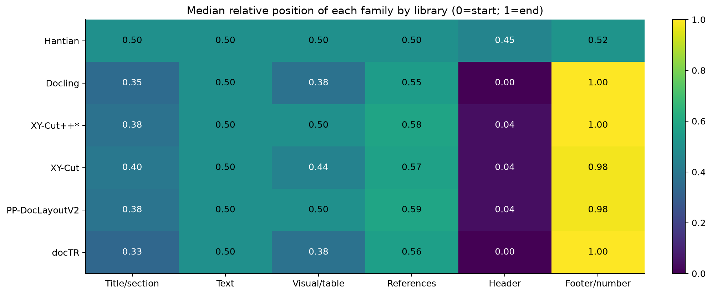

**Figure 1.** Median relative position of each family, `rank/(n−1)`, on pages with at least two units. This is a unit-level distribution, rather than an average with equal paper weights. Common denominators per library: 505 titles/sections, 1,729 text units, 437 visuals/tables, 688 references, 225 headers and 494 footers/numbers. Index and equation units are outside these six families. Categories come from MinerU, not new labels assigned by the ordering libraries.

The median header position is 0.45 for Hantian, 0 for Docling/docTR and approximately 0.04 for the other three. Footers/numbers are around 0.52 for Hantian and 0.98–1 for the others. This contrast describes an observed policy; a middle position near 0.5 does not by itself demonstrate randomness or error.

### 5.2. Body text, columns and section boundaries

In C06, a page of dense body/list text, Docling, docTR, XY-Cut++, XY-Cut and PP-DocLayoutV2 maintain the top-to-bottom sequence of the 25 text units and page number. Hantian interleaves vertically distant elements. This is a useful control: divergence is not confined to complex visual layouts.

C03 shows a more specific docTR problem. The `Results` heading, ID `2995faf2b8fbeb287d3d3c33`, appears at rank 7 in Docling, 8 in XY-Cut/XY-Cut++/PP-DocLayoutV2 and 9 in docTR. The line beneath it begins “Results from the measurements of specimen envelope” and continues in the upper-right block with “dimensions are plotted in Fig. 1”. That block belongs to Results, rather than the preceding thermometry section. docTR moves this continuation to rank 6, before its heading and the beginning on the left; Docling places it after the heading. The agent identifies a section-boundary/continuity break in docTR, limited to this case. A contrast review corrected the initial interpretation of that continuity; this is not converted into an accuracy rate or a universal rule between columns.

### 5.3. Interleaved figures and tables

C02 contains interleaved figures and lower charts. Hantian moves the two lower charts to ranks 2 and 3; the other methods integrate them after more of the upper content. Several figure–text relationships are possible: an association is not declared correct solely because of proximity or the number of crossing arrows.

In C03 all candidates preserve both tables. Docling/docTR place them at ranks 2 and 3; XY-Cut/XY-Cut++/PP-DocLayoutV2 at 3 and 4, preceded by a header and number; Hantian at 5 and 6. The initial difference of one position does not imply a table error: part of it comes from metadata handling. The relevant distinction is whether the body-text sequence remains usable afterward.

In C07 five candidates agree. XY-Cut++ reverses image `0b2462c7a6f1f9d62620902b` and subsequent heading `9cec84dc0b21ea4e651ceca2`. The heading precedes a figure located higher on the page. This is a localized issue in the tested variant, without extrapolation to the original paper.

### 5.4. References and internal sequence

C04 reveals a Docling limitation hidden by its high aggregate agreement with docTR: it orders the references block first and then returns to paragraphs/statements above it. Reference heading `65f44a0a813a6b4b112e7982` is at rank 3 in Docling and 10 in docTR; upper text `de6d8180cd3c5ad3bb47cbd1` is at ranks 10 and 3, respectively. The agent considers docTR's sequence more useful for preserving the physical order of closing text and references on this page. XY-Cut/XY-Cut++/PP-DocLayoutV2 show the same downward sequence as docTR here; Hantian mixes parts of both blocks.

In C05, with 51 references and two metadata units, Docling, docTR, XY-Cut++ and PP-DocLayoutV2 maintain a recognizable column sequence; Hantian produces extensive interleaving and XY-Cut changes the internal sequence of the left column. The first left-column reference, `d65477dca9d5563024a4a3c6`, appears at rank 25 with XY-Cut, compared with 2 in Docling/docTR, 3 in PP-DocLayoutV2 and 4 in XY-Cut++. Preserving it alone does not guarantee a useful sequence. PP-DocLayoutV2's good behavior in this example does not establish a global advantage over rule-based methods.

### 5.5. Capabilities not established by this comparison

There are no independent captions among the eligible units compared: some visible captions remain inside the original hierarchical representation. These orders therefore cannot support choosing a library based on caption–figure accuracy. Thematic hierarchy, paragraph merging, auxiliary routes and semantic continuity across pages are also not established. The six candidates produce page sequences in this experiment; concatenating them does not implement those capabilities.

## 6. Library comparisons and variation across documents

Two complementary measures use the same IDs: precedence disagreement D = inverted pairs/evaluable pairs; successor Jaccard J = intersection/union of directed immediate-successor edges. Low D and high J indicate similarity between outputs, rather than correctness. The main table weights each document equally after averaging its pages; exact matches are page counts with a denominator of 392.

| Pair | Macro D | Macro J | Pages with identical order |
|---|---:|---:|---:|
| Hantian / Docling | 0.442139 | 0.140559 | 45/392 |
| Hantian / XY-Cut++* | 0.440526 | 0.136439 | 47/392 |
| Hantian / XY-Cut | 0.421976 | 0.148433 | 57/392 |
| Hantian / PP-DocLayoutV2 | 0.420164 | 0.152483 | 56/392 |
| Hantian / docTR | 0.440751 | 0.136745 | 44/392 |
| Docling / XY-Cut++* | 0.160221 | 0.601516 | 190/392 |
| Docling / XY-Cut | 0.123363 | 0.639611 | 201/392 |
| Docling / PP-DocLayoutV2 | 0.101359 | 0.785141 | 222/392 |
| Docling / docTR | 0.015555 | 0.889031 | 347/392 |
| XY-Cut++* / XY-Cut | 0.081585 | 0.599259 | 218/392 |
| XY-Cut++* / PP-DocLayoutV2 | 0.077119 | 0.694782 | 243/392 |
| XY-Cut++* / docTR | 0.160119 | 0.579846 | 184/392 |
| XY-Cut / PP-DocLayoutV2 | 0.031202 | 0.762037 | 294/392 |
| XY-Cut / docTR | 0.125227 | 0.610257 | 199/392 |
| PP-DocLayoutV2 / docTR | 0.098361 | 0.769443 | 221/392 |

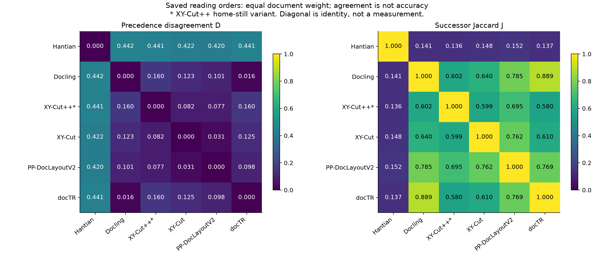

**Figure 2.** Symmetric matrices with equal paper weights. The diagonal is identity, rather than a measurement. Docling–docTR is the closest pair, but C04 shows that meaningful differences for use remain. Hantian's divergence is interpreted alongside the examples and its stability, rather than as a voting result.

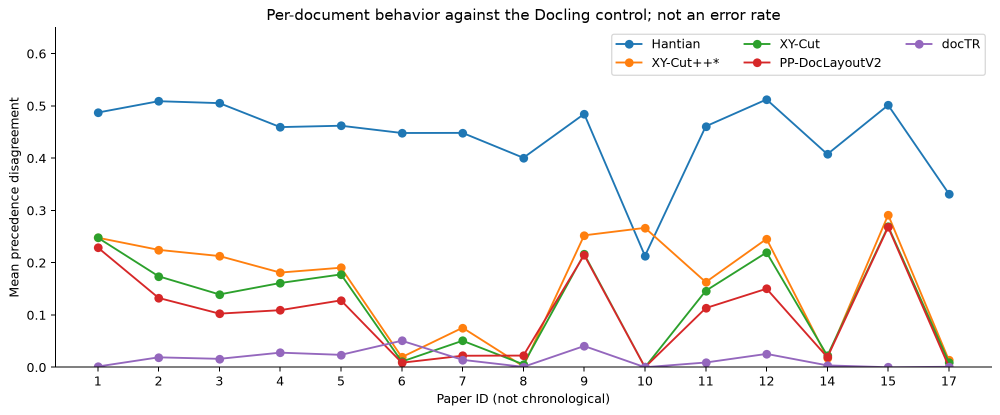

**Figure 3.** Mean disagreement per paper against Docling as a comparison control, without treating it as ground truth. IDs are not a time axis. Variation confirms that the decision should not depend on one paper or the average of all its boxes. All 15 pairs, document means, micro summaries and denominators remain in the [complete numerical results](../raw_results/analytics_results/collection-all-pairs-20261102/analysis.json).

## 7. Stability under input changes

| Library | Changed orders / 26 | Bounded interpretation |
|---|---:|---|
| Hantian | 26/26 | Strong dependence on input presentation in `12.pdf`. With identical input, 13/13 controls retained the order; sensitivity should not be confused with temporal randomness. |
| Docling, corrected CID | 0/26 | Preserving the source ordinal removes the changes observed with presentation-dependent CIDs in this control. Does not prove universal invariance or turn the MinerU ordinal into semantic ground truth. |
| XY-Cut++* | 0/26 | No observed changes under the two permutations; fidelity to the paper is a separate issue. |
| XY-Cut | 0/26 | No observed changes in this control. |
| PP-DocLayoutV2 | 1/26 | One observed change; saved analysis locates it in native scores, rather than rank→ID conversion. |
| docTR | 0/26 | No observed changes under the English/ltr configuration used. |

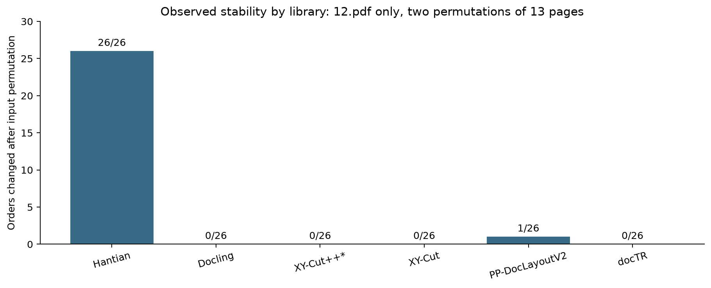

**Figure 4.** `12.pdf` only: two permutations of 13 pages, rather than 26 independent documents. Docling uses the [corrected targeted validation](../raw_results/analytics_results/docling-hantian-validation-20261102/analysis.json), rather than the old 4/26 result. The other candidates use the [preserved stability audit](../raw_results/analytics_results/stability-12-completed-20261102/stability.json). Engines were not rerun.

CID dependence is an integration cost for Docling: replacing it with the position in a filtered list changes the algorithm's assumption. For Hantian, the [saved investigation](../raw_results/analytics_results/sensitivity-attribution-20261102/attribution.json) and targeted validation separate neural output from the decoding helper. Choosing Hantian would first require justifying that sensitivity under our box contract, rather than relying on the LayoutReader name or a benchmark with different granularity.

## 8. Time, memory and measurement scope

| Library | Median time (ms/page) | IQR (ms) | Recorded maximum (s) | Median RAM / sampled maximum (MiB) | Median GPU attributed to PID (MiB) |
|---|---:|---:|---:|---:|---:|
| Hantian | 25.730 | 25.167–26.377 | 11.884 | 1,516.5 / 1,518.7 | 1,216.0 |
| Docling | 3.952 | 2.762–6.344 | 2.057 | 132.4 / 132.7 | N/A |
| XY-Cut++* | 1.657 | 1.583–1.738 | 0.002 | 47.7 / 48.1 | N/A |
| XY-Cut | 1.751 | 1.193–2.309 | 0.036 | 69.3 / 69.3 | N/A |
| PP-DocLayoutV2 | 10.181 | 9.881–10.977 | 11.755 | 1,517.8 / 1,517.8 | 618.0 |
| docTR | 1.308 | 1.125–1.608 | 9.060 | 751.2 / 751.2 | N/A |

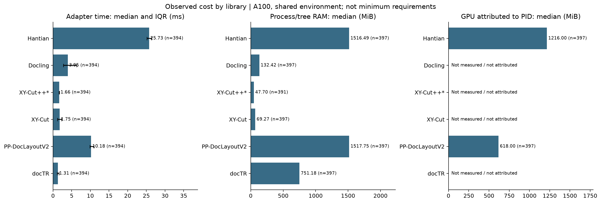

**Figure 5.** Adapter time, process/tree RAM and GPU memory attributed by PID. Time bars show the median and IQR, rather than repeated runs of one case. Missing GPU measurements are N/A, rather than zero. There are 394 times per candidate, 397 RAM samples except for XY-Cut++ (391), and 397 GPU values for each of the two CUDA modules.

The `adapter_total_s` measurement spans the adapter call, including imports/lazy loading when they occur. Separate `load_s`, `inference_s` and `decode_s` phases were not measured. Maximum values therefore are not interpreted as steady-state latency, the median is not called pure inference time, and these times are not added to simulate a complete PDF pipeline. Reused predictions retain their original measurements, and execution includes preparation/continuations; this is not a repeated performance trial.

RAM sampling sums the process and its children, can count shared pages twice and can miss peaks between one-second samples. The XY-Cut++ worker can terminate before a sample; its 47.7 MiB does not establish the Rust process's full memory footprint. GPU measurements cover owned PIDs, rather than the entire device. A100 results do not establish minimum VRAM or feasibility on 6 GB.

**Observed tradeoffs:** docTR has the lowest median time but higher process RAM than Docling; Docling is attractive when that footprint matters. The XY methods are inexpensive, with the functional limitations in §5. The two neural modules require more resources in this integration. No agreed budget supports converting these differences into a global quality/cost score.

## 9. Complete comparative cases

The seven figures contain the six outputs on the same original background and boxes; numbering is the saved sequence. Panels always follow this order: Hantian, Docling, XY-Cut++*, XY-Cut, PP-DocLayoutV2 and docTR. IDs, boxes, labels, complete orders, references and background hashes are in [evidence.json](../raw_results/analytics_results/library-comparison-20261102/evidence.json). Agent inspection is unblinded, purposeful and not extrapolated to the entire collection.

| Case | Paper / physical page | Units | Main comparative finding |
|---|---|---:|---|
| C01 | 1 / 1 | 11 | Hantian delays the title to rank 8; the other five place it at 2–3. |
| C02 | 2 / 3 | 9 | Interleaved figures: Hantian advances the two lower charts. Other placements require a figure/body policy, rather than a proximity penalty. |
| C03 | 5 / 3 | 15 | All preserve the tables; docTR advances a right-column Results continuation before its heading and beginning on the left. Docling preserves that precedence here. |
| C04 | 9 / 11 | 16 | Docling advances references and returns to closing text above; docTR and the XY/PP methods maintain a more direct physical sequence here. |
| C05 | 2 / 11 | 53 | Docling/docTR/XY-Cut++/PP-DocLayoutV2 preserve a recognizable column sequence; XY-Cut shows left-column reversals and Hantian extensive interleaving. |
| C06 | 8 / 19 | 26 | Dense text/list control: five downward sequences compared with Hantian's interleaving. |
| C07 | 17 / 22 | 8 | Five agree; XY-Cut++ swaps an image and subsequent heading. There is no independent caption among these eight IDs. |

### C01. First page and metadata

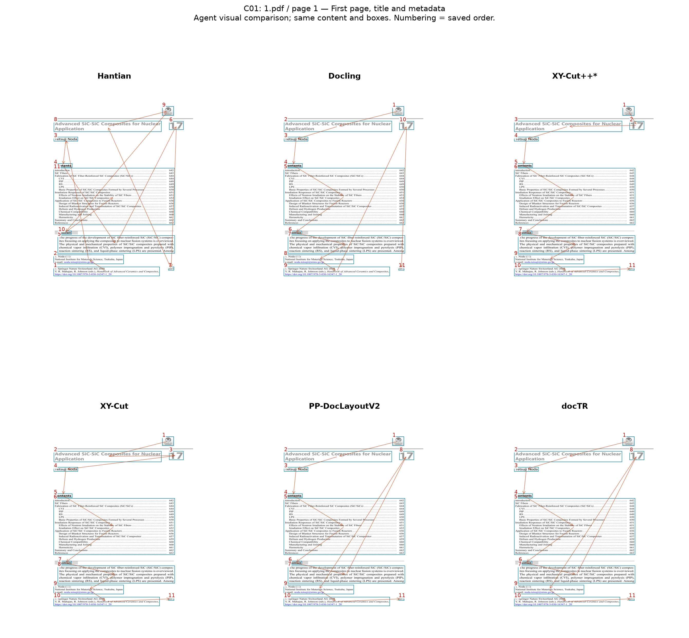

### C02. Columns and interleaved figures

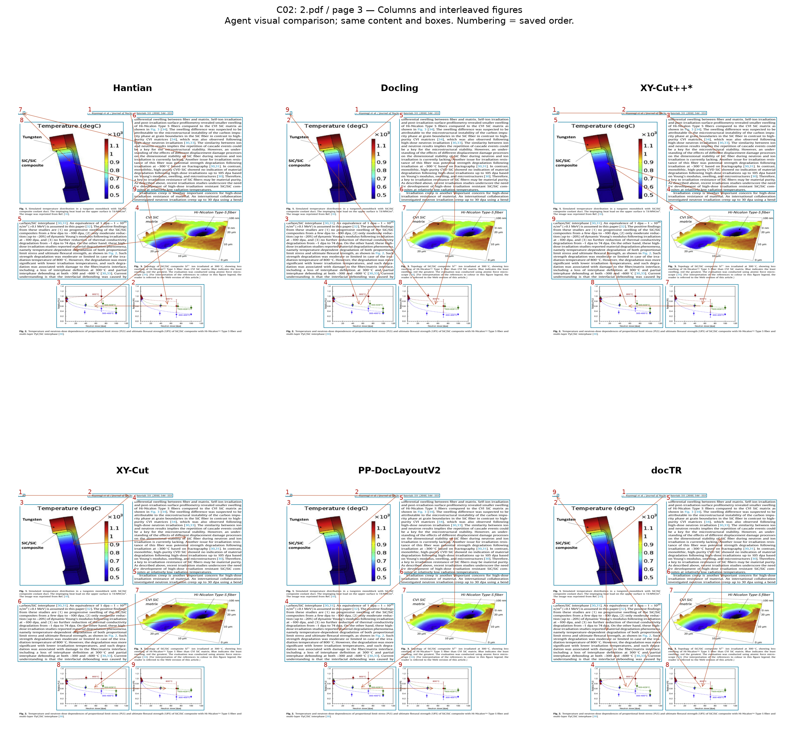

### C03. Tables and section continuity

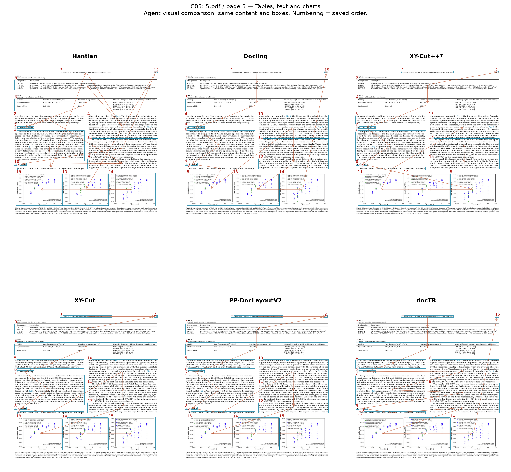

### C04. Closing text and references

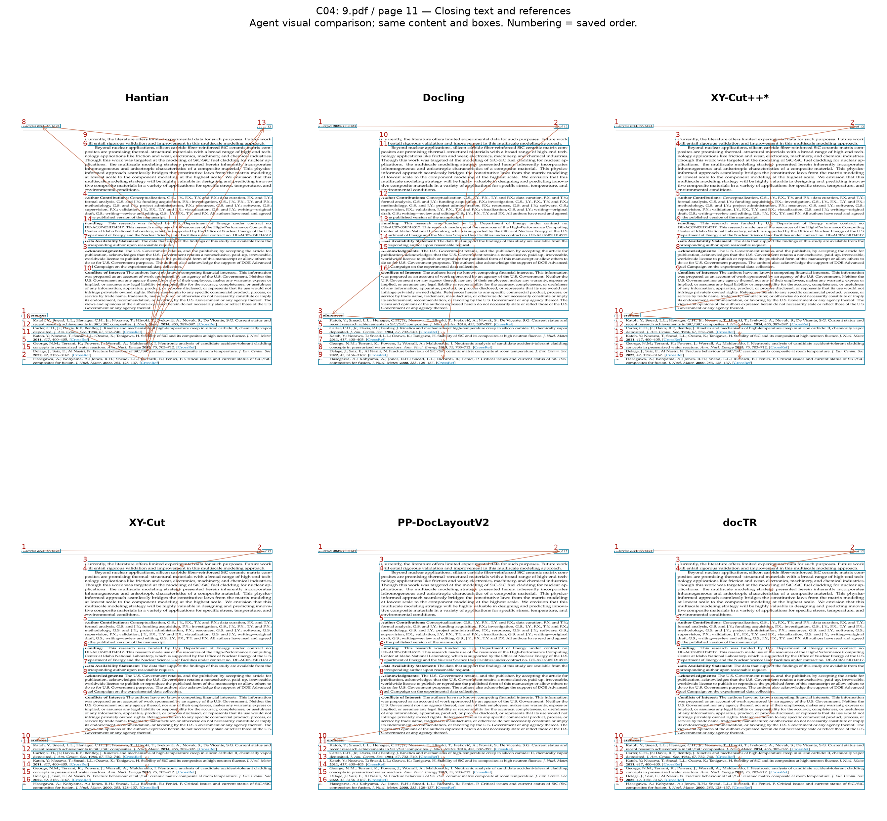

### C05. Two-column references

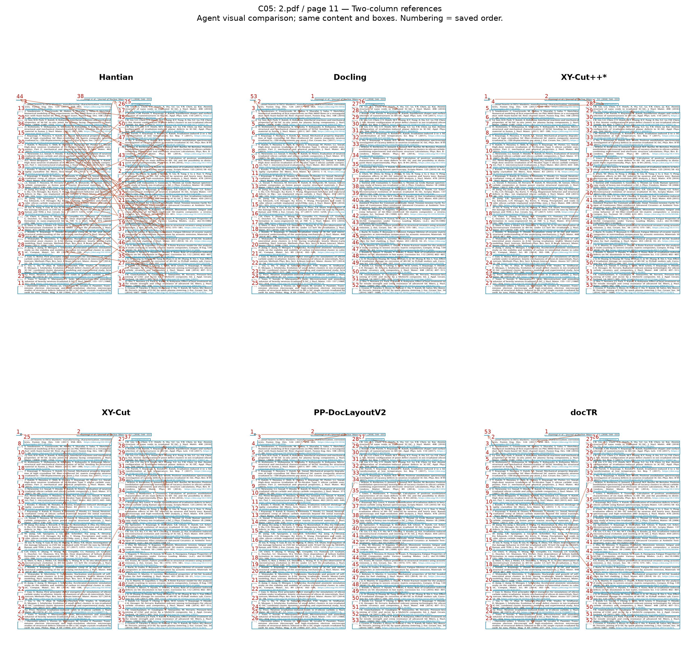

### C06. Dense body text

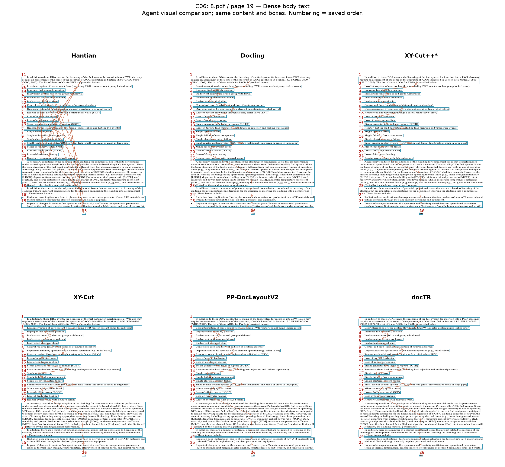

### C07. Single column, image and heading

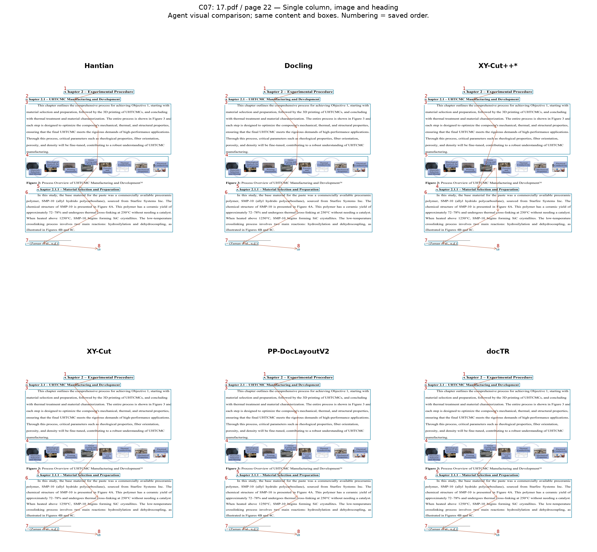

## 10. Library assessment and remaining work

| Library | Strength established in this comparison | Remaining issue or cost | Provisional role |
|---|---|---|---|
| **docTR** | Useful text/reference sequences in several cases, stable control and low median time. Avoids Docling's jump in C04. | Advances a Results continuation before its heading in C03; higher process RAM than Docling; fixed direction/language. Captions and cross-page continuity are not established. | Leading review candidate alongside Docling; not a global semantic winner. |
| **Docling** | Category-aware rules, good text/reference sequences in several cases, Results boundary preserved in C03 and lower RAM than docTR. | Mandatory source CID contract; group jump in C04; integration must preserve that identity correctly. | Control and leading alternative, especially when process footprint matters. |
| **XY-Cut** | Geometric baseline without weights, inexpensive and stable in the pilot. | Does not use document function and can change a column's reference sequence despite preserving all boxes (C05). | Simplicity/cost baseline; do not assume it suffices for scientific layouts across the collection. |
| **XY-Cut++*** | Low time and good column sequence in C05. | Variant is not faithful to the paper; image–heading reversal in C07; reduced categories and a dedicated worker. | Experimental candidate, conditional on explicitly identifying the variant. Do not present it as validation of the paper. |
| **PP-DocLayoutV2** | Recognizable reference sequence in C05 and Results heading before its continuation in C03; only one change in the stability control. | GPU/weights and category remapping; higher cost; no sufficient global functional advantage established to prefer it over rules when cost is included. | Neural alternative for future contrasts if review establishes an improvement that justifies the cost. The later choice ignoring cost is recorded in §12. |
| **Hantian** | Technically completes the collection and preserves all units. | 26/26 changes after input permutation, title/metadata dispersion and visible interleaving; highest median time and observed GPU usage. | Do not use as the default under the current contract. Its suitability for this granularity/presentation must first be resolved. |

The operational recommendation is to **focus the next review on docTR and Docling, retaining XY-Cut as a simple baseline**. Correction cost per output has not been measured; no candidate has been shown to handle titles, captions, membership and document continuity uniformly. No ensemble was implemented and no selection was made by consensus. Final selection and human review remain pending; the later provisional choice under a quality-only criterion is recorded in §12.

## 11. Limitations, verification and sources

1. **There is no independent semantic reference for the 397 pages.** Agent judgments cover seven cases and are not population-level accuracy percentages.
2. **Segmentation is fixed.** Detection/OCR and actual PDF omissions are not compared. Child captions and original relationships are not turned into new units to favor a method.
3. **The visual sample is purposeful and unblinded.** Its 42 sequences share seven pages; they are not 42 independent samples. Examples adverse to the recommended candidates are retained.
4. **Stability and cost use different populations.** Stability was tested on `12.pdf`; collection measurements are not controlled repetitions or hardware minima.
5. **Version and adaptation matter.** Old/corrected Docling CIDs, third-party XY-Cut++ and isolated docTR/PP-DocLayoutV2 modules are not interchangeable with other products or configurations.
6. **Some capabilities remain unestablished.** Captions, thematic routes, cross-page continuity and downstream utility remain pending; a valid linear order does not guarantee them.

The base analysis checked 5,880 evaluable comparisons through an independent calculation and confirmed equality with the 1,985 historical comparisons against Docling. The [existing 149-test suite](../raw_results/tests_results/exploratory-20261102/suite.xml) corresponds to the previous analytical code; it is not presented as 149 new tests of this text or validation of visual judgments. The original report delivery separately checked report numbers, figure provenance, case orders/IDs and source preservation. Figures were inspected and a contrast review corrected the C03 interpretation. The [original delivery receipt](../raw_results/analytics_results/library-comparison-20261102/verification.json) records those checks and hashes for that earlier revision.

| Evidence | Verifiable source |
|---|---|
| Primary results and A100 environment | [Collection manifest](../raw_results/code_results/collection-20261102-delivery/canonical/manifest.json) and [summary](../raw_results/code_results/collection-20261102-delivery/summary.json). |
| Numerical comparison of all 15 pairs | [JSON](../raw_results/analytics_results/collection-all-pairs-20261102/analysis.json), [pair-level CSV](../raw_results/analytics_results/collection-all-pairs-20261102/pair_summaries.csv) and [page-level CSV](../raw_results/analytics_results/collection-all-pairs-20261102/comparisons.csv). |
| Independent mathematical check | [Verification receipt](../raw_results/tests_results/all-pairs-20261102/independent-check.json). |
| Historical stability and corrected contract | [Stability audit](../raw_results/analytics_results/stability-12-completed-20261102/stability.json) and [targeted validation](../raw_results/analytics_results/docling-hantian-validation-20261102/analysis.json). |
| Exact library adaptation | [engines.py](../code/reading_order/adapters/engines.py), [sources.json](../test/test_config/sources.json), [lock](../raw_results/tests_results/20261102T052716Z-config-7e26b3/requirements.lock). |
| Reproducing this report's figures | [library_comparison_report.py](../analytics/library_comparison_report.py). Reads saved evidence; does not import or execute engines. |
| Figure data, sample and hashes | [evidence.json](../raw_results/analytics_results/library-comparison-20261102/evidence.json) and [positions by family](../raw_results/analytics_results/library-comparison-20261102/category_positions.csv). |
| Charts and cases in this delivery | [assets](assets/) folder: five statistical figures in PNG/SVG and seven visual comparisons in PNG. |

The previous report was removed from this path and fully replaced by the present library comparison. It is retained only as a recovery backup outside the active delivery, with its [prior hash](../../../history/reading-order-report-restart-20261102/manifest.json). Original model results and retained historical analyses were not deleted or recomputed with models; the superseded exploratory analysis was subsequently removed during the authorized cleanup described in §2.

The English translation regenerates the 12 figures from saved evidence and translates display labels and case descriptions in the derived evidence/CSV. Numerical results, IDs, boxes, source references and the seven-case sample remain unchanged. The [translation verification](../raw_results/tests_results/english-translation-20261102/verification.json) records hashes, numerical equivalence, source preservation, link checks and software tests for the English revision. The original delivery receipt remains unchanged and identifies its original revision. Legacy heading anchors are retained for existing links. A subsequent [portability verification](../raw_results/tests_results/portability-20261102/verification.json) records this revision: figure, background and source paths in the derived evidence are relative to the repository root, and historical checkout paths are resolved without rewriting frozen manifests. Primary predictions, numerical results and figure files are unchanged. External source data and repository-level audit links retain the dependencies described in the [operating guide](implementation_plan.md#repository-layout-and-portable-references).

## 12. Provisional choice prioritizing quality and ignoring cost

**PP-DocLayoutV2 is the provisionally selected candidate when observed reading-order quality is prioritized exclusively, without considering computational cost.** The user endorsed this choice on November 2, 2026. Under this criterion, this conclusion takes precedence over the operational docTR/Docling recommendation in §§1 and 10, which also considered cost and integration simplicity.

In the inspected cases, PP-DocLayoutV2 preserves the Results heading before its continuation in C03, avoids Docling's premature jump to references in C04 and maintains a recognizable column sequence in C05. It also avoids XY-Cut++'s image–heading reversal in C07 and Hantian's extensive interleaving. This functional balance motivates the preference; it is not selected for proximity to consensus.

The main reservation is **one order change in the 26 stability comparisons on `12.pdf`**. Visual assessment covered seven purposefully selected pages: it does not demonstrate that PP-DocLayoutV2 is the most accurate on all 397 pages or establish universal superiority. Human review and independent semantic validation remain pending.

This conclusion records a decision subsequent to the original calculations and checks in §11; the report hash in that original receipt identifies the revision before this addendum. No new models were executed and their results were not modified.
